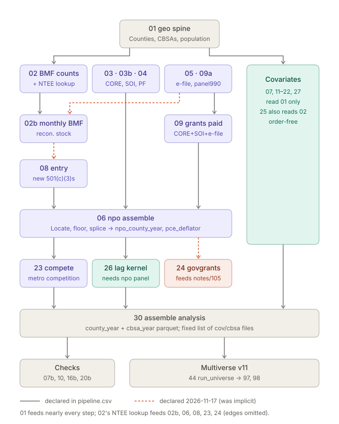

```{r setup}
library( data.table )
library( knitr )
p   <- fread( "../pipeline.csv", colClasses = "character", na.strings = character( 0 ) )
dic <- fread( "variable_dictionary.csv" )
split_paths <- function( x ) { x <- trimws( strsplit( x, ";", fixed = TRUE )[[ 1 ]] ); x[ nzchar( x ) ] }
## sources: the inputs/ index (one row per folder) + the archive status in
## docs/data_inventory.csv + the raw entries of pipeline.csv
idx <- grep( "^\\| \\[", readLines( "../inputs/README.md" ), value = TRUE )
idx <- rbindlist( lapply( strsplit( idx, "\\|" ), function( z ) {
  z <- trimws( z[ -1 ] )
  data.table( folder = sub( "^\\[([^]]+)\\].*", "\\1", z[ 1 ] ), source = z[ 2 ], obtained = gsub( "\\*", "", z[ 3 ] ),
              redistribute = gsub( "\\*", "", z[ 4 ] ) ) } ) )
inv <- merge( idx, fread( "data_inventory.csv" ), by = "folder", all = TRUE, sort = FALSE )
stopifnot( !anyNA( inv$status ), !anyNA( inv$source ) )
rw <- p[ , .( e = split_paths( raw ) ), by = id ][ , .( folder = sub( "=.*", "", e ), path = sub( "^[^=]*=", "", e ), id ) ]
rw <- rw[ , .( steps = paste( unique( id ), collapse = ", " ), files = paste( sprintf( "`%s`", unique( path ) ), collapse = "<br>" ) ), by = folder ]
inv <- merge( inv, rw, by = "folder", all.x = TRUE, sort = FALSE )
inv[ folder == "nccs-bmf-unified", `:=`( steps = "05 (writes), 02b", files = "`raw/panel990/bmf/bmf_unified_geocoded.parquet`" ) ]
```

This page documents how the county × year and CBSA × year panels are built: the
order of the steps and what each one reads, where the scripts and data live, every
data file with its archive status, and the variables in the final tables. It is
generated from `pipeline.csv`, the source index in [`inputs/README.md`](../inputs/README.md),
`docs/data_inventory.csv` (archive status) and `docs/variable_dictionary.csv`.
Each source's publisher, URL, licence and citation are in `inputs/<folder>/SOURCE.md`;
versions and coverage are in [`DATA-MANIFEST.md`](../DATA-MANIFEST.md).

To rebuild: `Rscript run.R [database|checks|multiverse|all]` from the project
folder. `run.R` runs the steps of `pipeline.csv` in order, skips steps whose
outputs are newer than their inputs, stops before starting if a declared input is
missing, and writes `MANIFEST.csv` (path, size, sha256) for every output. Paths
below are relative to the build folder (`MV_BUILD`, set in `~/.Renviron`).

# Build flow

{width=100%}

The flow has five layers:

1. **Geography (01).** County-equivalent spine (2023 delineation, Connecticut planning regions), CBSA crosswalk and annual population. Almost every later step reads it.
2. **Nonprofit sources (02–09).** BMF registrations (02, 02b, 08) and the financial returns (CORE 03, SOI 03b/04, e-file 05, grants 09a/09). **Step 02 also writes the NTEE lookup** (`ein_ntee_best.csv.gz`). The invalid-code rule lives once, in `resolve_ntee()` in `R/lib/00_setup.R`, and 02b, 06, 08, 23 and 24 apply it with that lookup.
3. **Nonprofit panel (06)** and the steps that need it: 23 (market competition), 26 (population lag kernels), 24 (government grants, used only by `notes/105`).
4. **Covariates (07, 11–22, 25, 27).** Each reads only the geography (25 also reads 02), so their order does not matter.
5. **Analysis panels (30)**, then the checks (07b, 10, 16b, 20b) and the multiverse run (44 → 97, 98).

## Steps in run order

```{r steps}
s <- p[ , .( Step = id, Stage = stage, Script = sprintf( "`%s`", sub( "^R/", "", script ) ),
             Reads = vapply( inputs, function( x ) length( split_paths( x ) ), 1L ),
             Raw = vapply( raw, function( x ) paste( unique( sub( "=.*", "", split_paths( x ) ) ), collapse = ", " ), "" ),
             Writes = vapply( outputs, function( x ) length( split_paths( x ) ), 1L ),
             Notes = notes ) ]
kable( s, col.names = c( "Step", "Stage", "Script", "Build inputs", "Raw sources", "Outputs", "What it does" ) )
```

## Order sensitivity

- **Every file passed from one step to another is declared in `pipeline.csv`.** `run.R` refuses to run if a step reads a file that a later step writes, and rebuilds every step downstream of a changed input. Files that used to pass between steps without being declared are now declared: the unified BMF (05 → 02b), the ruling cohorts (02b → 08), the NTEE lookup (02 → 02b, 06, 08, 23, 24), and step 24 itself.
- **30 reads a fixed list of CBSA-level files** (`cbsa_bls`, `cbsa_compete`, `cbsa_rcms`). Before 2026-11-17 it merged whatever `data/cov/cbsa/cbsa_*.csv` files were on disk, so a stale or extra file could change `cbsa_year`.
- **Raw files are declared, but downloads are not refreshed.** Every raw source a step reads is in the `raw` column, and a raw file newer than a step's outputs makes that step rerun. But steps 03, 05, 06, 09, 09a, 10, 17, 22 and 27 skip a download when the cached file exists, so a rebuild reproduces the cached version of a source, not the current one online. Delete the cache to refresh it; Section 3.1 says which sources change over time.

# Project folder structure

```
multiverse/                      scripts and documents (Dropbox, under git)
├── run.R                        single entry point; runs pipeline.csv in order
├── pipeline.csv                 step table: id, stage, script, args, env, inputs, raw, outputs
├── inputs/                      one folder per source: SOURCE.md (URL, licence, citation)
├── renv.lock                    pinned package versions
├── DATA-MANIFEST.md             sources, versions, frames and breaks
├── REPRODUCIBILITY-PLAN.md      plan and status of the reproducibility work
├── docs/                        this page, its diagram, inventory and dictionary
├── env/                         reproducibility checks, package list, pipeline_graph.md
├── R/
│   ├── lib/                     sourced helpers: 00_setup (paths, constants, NTEE rule),
│   │                            config (env vars), geo_helpers, 13_16_cov_helpers,
│   │                            40_multiverse (engine), 41_composites, md2qmd
│   ├── build/
│   │   ├── A_geo/               01
│   │   ├── B_npo/               02, 02b, 03, 03b, 04, 05, 08, 09a, 09, 24
│   │   ├── C_npo_panel/         06, 23
│   │   ├── D_cov/               07, 11–22, 25, 26, 27
│   │   ├── E_assemble/          30
│   │   └── F_checks/            07b, 10, 10b, 10c, 16b, 20b
│   ├── multiverse/              42–46, 51–57, 82, 85, 92, 93, 97, 98
│   ├── notes/                   analysis scripts behind notes/*.md
│   └── paper/                   94, 95, 96, 99, 102: figures and tables for paper/
├── notes/                       results notes (.md / .qmd)
└── paper/                       Quarto chapters and figures

MV_BUILD/                        build folder (outside Dropbox; D:/MULTIVERSE on the build machine)
├── raw/                         download caches and manual downloads (Section 3.1)
├── data/
│   ├── geo/, pop/               spine, crosswalks, population
│   ├── npo/                     org-year extracts, BMF tables, NTEE lookup, nonprofit panels
│   ├── cov/  (cov/cbsa/)        one covariate file per source (CBSA-level sources)
│   ├── compete/, govgrants/, need_socap/   side outputs of 23, 24, 27
│   ├── analysis/                the two final panels (Section 4)
│   ├── diagnostics/             checks, coverage tables, backfill counts
│   └── spec/run_<name>/         multiverse runs (specs.parquet, coefs.parquet)
├── logs/                        one log per step, run_timing.csv
└── MANIFEST.csv                 every declared output with sha256

00 - DATA/ (Dropbox data hub)    read-only inputs: BMF snapshots, BMF long panel, SOI, population
s3://lecy/nonprofit-density/inputs/   frozen copies of inputs (sha256 manifests)
s3://lecy/multiverse/            private mirror of the build folder (backup, not versioned)
```

# Data files

## Raw inputs and their archive status

Each source has one of four statuses:

- **Frozen.** A dated copy with checksums is in `s3://lecy/nonprofit-density/inputs/`. The build can be rerun on exactly these bytes.
- **Archive needed.** Manual or local-only files: not on the internet in this form, behind a login, or with no script that fetches them. Today the only copies are the data hub or build folder and the unversioned `s3://lecy/multiverse` mirror. These should be frozen next.
- **On demand (release).** A script downloads a dated or versioned release, then caches it under `raw/`. Reproducible as long as the release stays online.
- **On demand (moving).** A script downloads from an unversioned or "latest" URL, or a source that is revised in place. A fresh download can differ from the cached copy. Candidates to freeze.

Sources follow the 25 folders of [`inputs/`](../inputs/README.md). The files of each
are declared in the `raw` column of `pipeline.csv` (`Rscript run.R --raw` lists what
each entry resolves to on the current machine). Paths starting `$INPUTS/` are in the
data hub, `$BLS/` and `$DROPBOX/` in Dropbox; the rest are under `MV_BUILD`.

```{r inventory-summary}
lvl <- c( "frozen", "archive needed", "on demand (release)", "on demand (moving)" )
inv[ , status := factor( status, lvl ) ]
kable( inv[ , .( Sources = .N ), keyby = .( Status = status ) ] )
```

```{r inventory, results='asis'}
for ( s in lvl ) {
  x <- inv[ status == s ]
  cat( "\n\n**", tools::toTitleCase( s ), "**\n\n", sep = "" )
  print( kable( x[ , .( Folder = sprintf( "[%s](../inputs/%s/SOURCE.md)", folder, folder ), Source = source,
                        Steps = steps, Files = files, Obtained = obtained, Redistribute = redistribute, Why = why ) ] ) )
}
```

## Files the build writes

Every file below is regenerated by `run.R` from the raw inputs above and listed with
its sha256 in `MANIFEST.csv`. **Final** marks the analysis panels and multiverse
results; everything else is an intermediate file passed between steps (or a check).

```{r outputs, results='asis'}
o <- p[ , .( path = split_paths( outputs ) ), by = .( id, stage, script ) ]
cons <- p[ , .( path = split_paths( inputs ) ), by = .( reader = id ) ][ , .( read_by = paste( reader, collapse = ", " ) ), by = path ]
o <- merge( o, cons, by = "path", all.x = TRUE, sort = FALSE )
o[ , role := fcase( grepl( "^data/analysis/", path ), "final panel",
                    grepl( "^data/spec/", path ), "final (multiverse)",
                    grepl( "^raw/", path ), "cache passed between steps",
                    grepl( "^data/diagnostics/", path ) & is.na( read_by ), "diagnostic",
                    default = "intermediate" ) ]
kable( o[ , .( Step = id, File = sprintf( "`%s`", path ), Role = role, `Read by` = fifelse( is.na( read_by ), "", read_by ) ) ] )
```

# Final tables

**The analysis needs two final tables, one per geographic unit.** Both are written
by `30_assemble_analysis.R` with the same variable definitions:

```{r finals}
f <- data.table(
  Table = c( "`data/analysis/county_year.parquet`", "`data/analysis/cbsa_year.parquet`" ),
  Unit = c( "County-equivalent (2023 delineation, CT planning regions)", "CBSA (OMB 2023): 387 metropolitan + 538 micropolitan" ),
  Units = c( "3,144", "925" ), Years = c( "2000–2024", "2000–2024" ), Rows = c( "78,600", "23,125" ),
  Columns = c( 354, 422 ),
  `Used by` = c( "notes/58, paper/96 (county views)", "the multiverse (40 `load_panel()`) and nearly all notes and paper scripts" ) )
kable( f, col.names = c( "Table", "Unit", "Units", "Years", "Rows", "Columns", "Used by" ) )
```

How they relate:

- **One aggregation step, not several versions.** Every source is first placed on county-equivalents. The CBSA table sums counts and dollar totals over a CBSA's counties, then recomputes rates and shares from the summed numerators with the same formulas as the county table (`derive()` in 30). No other geographic unit (state, ZIP, tract) is built.
- **The metro/micro choice is a filter, not a table.** The multiverse's "units" decision keeps the 387 metros (`cbsa_type == "metro"`) or all 925 CBSAs from the same `cbsa_year`.
- **The CBSA table has 68 more columns** because some sources exist only at metro level: BLS nonprofit employment (`bls_*`, 07), market competition (`mkt_*`, 23), metro Gini (`gini_m`, 27), pre-1970 endowment (`hist_pre1970`, 25) and population-lag kernels (`lag_g5`, `lag_g10`, 26), plus `cbsa_title` and `n_counties`.
- **Periodic covariates come in four versions** (`v`, `v_obs`, `v_lin`, `v_locf`). The bare name is the default: linear interpolation between observed years, carried forward after the last release for RCMS, social capital, Census of Governments and BEA transfers. The dictionary lists these once, with a note.

Other built series that are **not** analysis tables:

- `data/npo/npo_county_year.csv` and `npo_cbsa_year.csv` (06) are the nonprofit-only versions that 30 merges with the covariates.
- `data/govgrants/govgrants_{county,cbsa}_year.csv` (24) are read only by `notes/105`. Government grants are mechanically tied to the outcomes, so they are not in the panels.
- The grassroots count `n_grass = n_bmf_c3pc − n_filer_c3` is built at analysis time in `94_variables_panel_model.R`, not stored.
- Multiverse results: `data/spec/run_principled_v11/specs.parquet` (one row per specification, 432,432) and `coefs.parquet` (estimates), read by 97 and 98.

# Variable dictionary

```{r dict-summary}
g <- dic[ , .( Variables = .N, `County table` = sum( table %in% c( "both", "county" ) ),
               `CBSA table` = sum( table %in% c( "both", "cbsa" ) ), `With gap-fill variants` = sum( gapfill ) ),
          keyby = .( Group = group ) ]
kable( g )
```

`Step` is the build script that creates the variable (30 = derived when the panels
are assembled). `Table` says which final table carries it. Dollar amounts from the
990s are in 2022 dollars (PCE deflator); covariate dollars are nominal unless the
description says otherwise. Generated by `docs/make_dictionary.R` from the panels
and the covariate codebooks; rerun it after a rebuild of 30.

```{r dict, results='asis'}
for ( gr in unique( dic$group ) ) {
  x <- dic[ group == gr ]
  cat( "\n\n## ", tools::toTitleCase( gr ), " (", nrow( x ), ")\n\n", sep = "" )
  print( kable( x[ , .( Variable = sprintf( "`%s`", variable ), Step = step, Table = table, Description = description ) ] ) )
}
```
