# Nonprofit density over time: stability, lags, and catch-up

387 metros, 2000–2024. Densities are year-specific SAMIs: the log deviation of a metro's nonprofit count or spending from what its population predicts. Three outcomes:

- **filers:** 501(c)(3) public charities filing a 990 or 990-EZ with revenue or expenses of at least $50k (2010 dollars). The series crosses the 2011 CORE → SOI splice, and TY2020 counts are about 9% low.
- **grassroots:** registered public charities that are not filers, i.e. the reconstructed BMF stock minus filers. This covers 990-N postcard filers, 990-EZ filers below the floor, registered churches and other non-filers, and dormant registrations. Grassroots are 72–80% of the registered stock in every year, and no metro count is negative. Churches that never register are outside every count here.
- **expenditures:** spending excluding hospitals and universities, which is noisy.

**Why filers vs grassroots rather than all registered organizations** (section 5):
- The pooled registered stock is mostly grassroots. Its SAMI correlates .97 with the grassroots SAMI, but only .82–.87 with filers. Filers and grassroots themselves correlate .65–.73.
- So pooled results sit between the two groups and close to grassroots, and they hide the cases where the groups behave differently.
- The registered stock stays in two places: as a robustness check (outputs in `catchup_grass/`), since unlike grassroots it has no splice, and as the denominator of the entry and filing-share mechanism in section 3.6.

Scripts:
- `R/notes/50_followups_jeremy.R` part 2 and `R/notes/52_endowment_change.R` (section 1; outputs `D:/MULTIVERSE/data/followup/p2_*`, `p8_*`, `p9_*`)
- `R/notes/72_catchup_lag.R` (sections 2–4; outputs `D:/MULTIVERSE/data/catchup/c1_*` … `c8_*`)
- `R/notes/73_pre2000_growth.R` (section 2.6, 1970–2000 population; outputs `c9_*`)
- `R/notes/75_capacity_grid.R` (section 6; outputs `c10_*`)
- `R/notes/76_bls_share_change.R` (sections 4.5–4.6; outputs `c11_*`)
- `R/notes/77_nonprofit_age.R` (section 4.7; outputs `c12_*`)
- `R/notes/78_nonprofit_lifespan.R` (section 4.8; outputs `c13_*`)
- `R/notes/79_kernel_lag.R` (section 2.8, kernel/distributed-lag models; outputs `c14_*`)
- Registered-stock robustness: `R/notes/72_catchup_lag.R grass` and `R/notes/73_pre2000_growth.R grass`, which run filers, grassroots and all registered (`D:/MULTIVERSE/data/catchup_grass/`)

Figures are copied to `notes/catchup-figures/`. Updated Nov 13, 2026.

## Summary

1. **Density is stable, especially for filers.**
   - Filer SAMIs correlate .97 ten years apart and .94 twenty years apart, more persistent than metro GDP. Rankings in 2000 and 2024 correlate .93.
   - Grassroots ranks move far more: .89 at ten years, .77 at twenty, and a .70 rank correlation between 2000 and 2024.
   - Large filer moves are rare: the top and bottom 10% moved about ±25% in 24 years.
2. **Growth produces a short lag, not a lasting deficit.**
   - Right after a growth surge, about half of the size-expected filers and three quarters of the size-expected grassroots organizations are missing.
   - Within a metro, the gap closes with a half-life of about 5 years for filers and 9 years for grassroots. Filers realize about 90% of size-expected growth by 10 years; grassroots realize about 70%.
   - Metros with stable population (within ±1% over three years) show no lag: filer and grassroots density stay within 1% of fully adjusted for 12 years (section 2.4).
   - As one regression specification (section 2.8): log N on log P plus a geometric kernel of past population changes beats any fixed lag by a wide margin. In levels the half-life is about 10 years for filers and 7.5 for grassroots, whose long-run within-metro elasticity is only .72. The 5- vs 10-year difference from the local projections comes down to metro trends, which 25 years of data cannot separate from a slow tail.
3. **The Sunbelt deficit is old and is mostly about filers.**
   - The fastest-growing fifth is about 25% below size-expected in filers but only 13–16% below in grassroots. The gap existed in 2000 and has not changed since.
   - It tracks 1970–2000 growth beyond region and census traits, with recent decades weighing more. Across metros it is a slow lag: fast growers that slowed after 2000 closed about a third of their filer gap in 24 years, and those still growing fast closed none.
   - It may also reflect traits that come with sustained in-migration. It does not survive controlling for nonprofit market share.
4. **Decline is asymmetric.**
   - Population loss: organizations stay at first, so density rises. Grassroots then shed the excess within about 5 years.
   - Relative income loss: filer density and spending fall at once and recover over about 10 years. Grassroots do not respond, and income gains do nothing for either group.
5. **Filers and grassroots catch up for different reasons (2011–2023).**
   - Filer gains follow the local economy: income growth, wage growth, education and turnout. They come from existing organizations crossing the filing floor, not from new registrations. Filer deficits do not converge across metros.
   - Grassroots gains follow legacy and demography. Old endowments and deficits converge, with a half-life of about 27 years. Grassroots density rises relative to filers where poverty rises and wages lag.
   - Poverty and inequality in 2000 predict smaller filer gains. No starting condition robustly speeds the recovery of fast growers.
6. **Market share.**
   - Nonprofit share of private employment accounts for about a third of the variation in filer density percentile, against an eighth for grassroots.
   - It is at most a soft ceiling on catch-up: low-share metros close grassroots deficits about half as fast, and filer catch-up shows no difference.
   - A higher nonprofit wage premium goes with fewer organizations but faster spending growth.
7. **Carrying capacity.**
   - On a growth × market-share grid, share sets the filer density level. The lowest-share fifth sits 24–35% below expected in every growth row, and growth history adds almost nothing once share is known.
   - Fast growers are concentrated in low-share cells, so the growth-history gap and the small nonprofit sector are largely the same fact.

---

## 1. SAMI levels are stable over time

### Persistence

Sources: `p2_persistence_summary.csv`, `p2_persistence_decay.csv`, `p2_persistence_lag1_by_year.csv`, `p9_sigma_convergence.csv`.

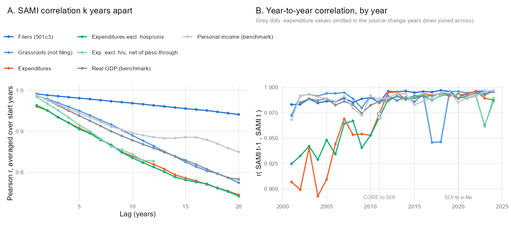

| | r, 1 yr | r, 5 yrs | r, 10 yrs | r, 20 yrs | rank r 2000 vs 2024 | same quintile 2000 and 2024 |
|---|---|---|---|---|---|---|
| filers | .991 | .981 | .969 | .941 | .93 | 63% |
| grassroots | .987 | .950 | .890 | .775 | .70 | 37% |
| expenditures excl. hosp./univ. | .963 | .905 | .835 | .742 | .72 | 46% |
| *real GDP SAMI (benchmark)* | .989 | .938 | .878 | .783 | .80 | 51% |
| *personal income SAMI (benchmark)* | .989 | .945 | .896 | .850 | .80 | 48% |

- **Filer density is more persistent than the size-adjusted economy itself.** The median metro moves 1.8 percentile points a year.
- **Grassroots density is about as persistent as GDP.** Ranks reshuffle substantially over 20 years: only 37% of metros are in the same grassroots quintile in 2000 and 2024.
- **Panel B.**
  - Expenditure values for 2011 and 2020 are left out. Those are the CORE → SOI and SOI → e-file source changes; the lines are joined across them, and grey dots mark the omitted years.
  - Grassroots dip in 2017–18, where the 2016–18 BMF snapshots omit newly ruled organizations and the reconstruction only partly fills them in.
  - Expenditures sit lower before 2011 (.89–.97) because CORE spending is noisier, and they dip again in 2023.
- **Spread over time:**
  - The SD of the filer SAMI was .40 in 2000, .38 in 2015 and .40 in 2024: no convergence.
  - Grassroots narrowed from .31 to .27 to .26.
  - Expenditures widened from .66 to .75.
- **Filer level convergence is glacial.** Regressing the 2000→2024 change on the 2000 level gives λ = −.064, a half-life of about 240 years. An IV estimate that uses the registered-stock start level as an independent measure gives −.060.

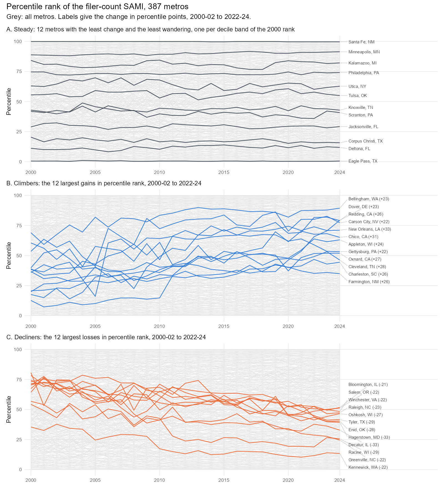

The paths are filer-SAMI percentile ranks, 2000–2024, selected by the change between the 2000–02 and 2022–24 averages (`p2_rank_paths_selected.csv`).
- **Steady:** the least change and the least wandering, one metro per band of the starting rank. Examples: Philadelphia, Minneapolis, Tulsa, Jacksonville.
- **Climbers** gained 22–33 points: New Orleans +33, Chico +31, Cleveland TN +28, Oxnard +27, Redding +26, Charleston +26.
- **Decliners** lost 21–33 points: Decatur IL −33, Hagerstown −33, Tyler −29, Racine −29, Enid −28, Raleigh −23.

Ranking by percentile change rather than SAMI change (the table below) shifts the lists. Metros near the top or bottom can change SAMI a lot with little rank movement.

### Who moved

Sources: `p8_top_movers.csv`, `p8_group_profiles.csv`, `p8_change_regression.csv`. All filer SAMI, 2000–02 to 2022–24.

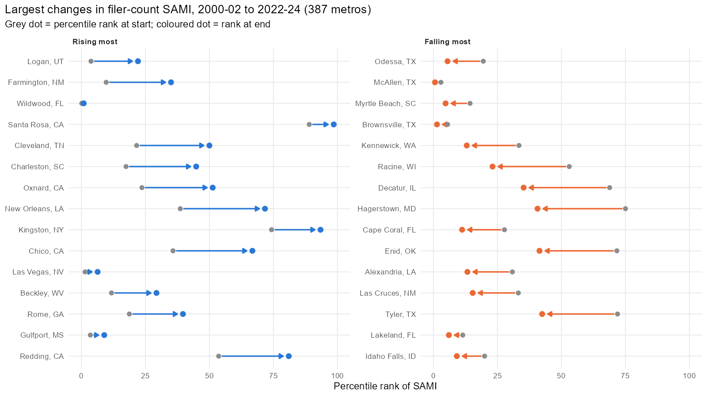

"% dev." is the deviation from the size-expected count; population growth is 2000–2024.

| rising most | % dev. 2000 → 2024 | pop. growth | falling most | % dev. 2000 → 2024 | pop. growth |
|---|---|---|---|---|---|
| Logan, UT | −54 → −24 | 55% | Odessa, TX | −26 → −50 | 41% |
| Farmington, NM | −41 → −9 | 6% | McAllen, TX | −57 → −70 | 59% |
| Santa Rosa, CA | +56 → +125 | 5% | Myrtle Beach, SC | −31 → −51 | 109% |
| Cleveland, TN | −25 → +4 | 27% | Brownsville, TX | −50 → −64 | 29% |
| Charleston, SC | −28 → −1 | 59% | Kennewick, WA | −12 → −35 | 66% |
| Oxnard, CA | −23 → +6 | 10% | Racine, WI | +6 → −22 | 5% |
| New Orleans, LA | −8 → +25 | −15% | Decatur, IL | +22 → −9 | −13% |
| Kingston, NY | +26 → +71 | 3% | Hagerstown, MD | +27 → −4 | 39% |
| Chico, CA | −11 → +19 | 2% | Cape Coral, FL | −20 → −38 | 94% |
| Las Vegas, NV | −61 → −49 | 71% | Enid, OK | +24 → −4 | 7% |

Profiles of the top and bottom 10% (39 metros each; the middle 80% in the last row):

| | Δ SAMI | start percentile | pop. growth | org growth | South | West | pre-1970 endowment SAMI |
|---|---|---|---|---|---|---|---|
| risers | +.22 | 26 | 16% | 121% | 33% | 44% | −.19 |
| fallers | −.22 | 48 | 28% | 46% | 49% | 18% | +.09 |
| *(middle)* | .00 | 52 | 18% | 74% | 40% | 20% | +.06 |

What separates them (`p8_change_regression.csv`, standardized):
- **Population growth alone does not predict the 24-year change** (β = −.05, R² = .002).
- **Conditional on the starting SAMI, growth matters.** Holding region and census traits fixed as well, the change falls with the starting SAMI (−.62 SD) and with population growth (−.44 SD). It rises with growth in % BA (+.32 SD). The West (+.87 SD) and South (+.32 SD) gain relative to the Northeast. R² = .34.
- **Risers start low and have thin historical endowments.** Fallers grew faster.

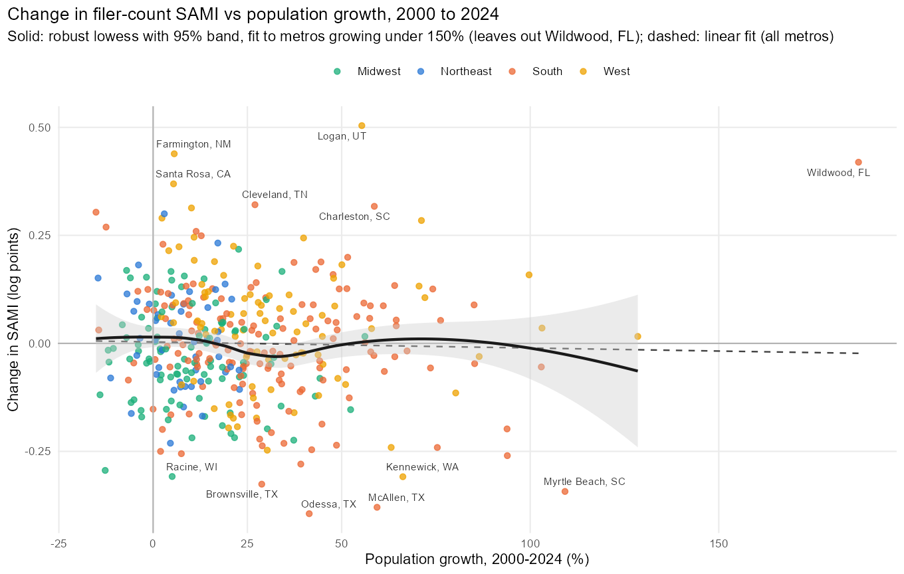

**The pooled curve is flat.** The robust lowess stays within ±.03 of zero from −15% to +100% growth. It is fit to metros growing under 150%, so Wildwood (+187%, The Villages) does not drag the right tail. Above about 100% growth the band widens, because only Myrtle Beach and a few others are out there.

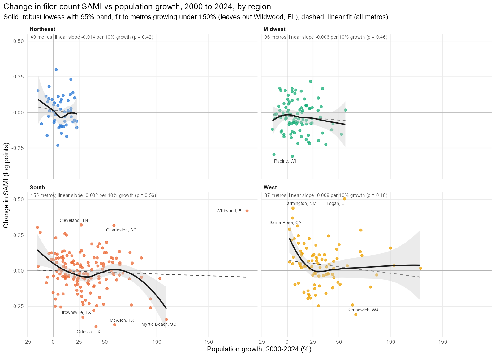

**No region has a meaningful linear slope** (`p8_change_vs_growth_by_region.csv`):

| region | metros | median growth | slope per 10% growth | p |
|---|---|---|---|---|
| Northeast | 49 | 7% | −.014 | .42 |
| Midwest | 96 | 8% | −.006 | .46 |
| South | 155 | 27% | −.002 | .56 |
| West | 87 | 28% | −.009 | .18 |

The lowess curves do differ in shape:
- **South:** gains among shrinking metros, a dip around 25–35% growth, and a fall beyond about 75%, driven by Myrtle Beach and the Florida retirement metros.
- **West:** gains concentrate among slow growers (Santa Rosa, Farmington), and the curve is flat beyond 25% growth.
- **Northeast and Midwest:** both are bunched at low growth and essentially flat.

These shapes rest on few metros at the extremes, and the bands overlap zero almost everywhere. Over 24 years, growth is matched almost one-for-one (section 2), so 2000–2024 growth alone does not predict filer density change in any region.

---

## 2. Lags after growth, and after decline

### 2.1 How much of the size-expected growth shows up, by horizon

Sources: `c1_horizon_elasticity.csv`, `fig_c1_horizon.png`. Each estimate regresses Δlog N over h years on Δlog P over the same h years, with start-year FE and metro-clustered SEs. It is expressed as a share of the cross-sectional scaling exponent b: .99 for both counts and 1.26 for expenditures.

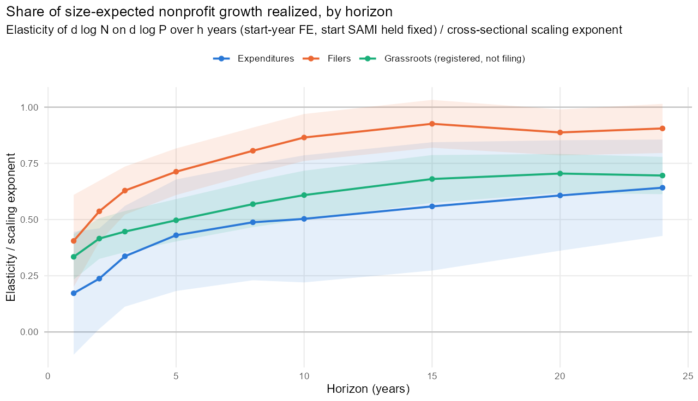

| horizon (years) | 1 | 3 | 5 | 10 | 15 | 24 |
|---|---|---|---|---|---|---|
| filers | .49 | .69 | .76 | .91 | .98 | .96 |
| grassroots | .41 | .53 | .58 | .69 | .76 | .78 |
| expenditures (÷ 1.26) | .45 | .54 | .61 | .68 | .72 | .76 |
| filers, start SAMI held fixed | .41 | .63 | .71 | .86 | .93 | .91 |

- **Filers** realize about half of the size-expected growth within a year, three quarters within five, and nearly all by 15 years.
- **Grassroots** respond more slowly and plateau below 80%.
- **Expenditures** have a raw elasticity of .96 at 24 years. Spending grows in proportion to population over time, not at the superlinear cross-sectional rate.

### 2.2 How long catch-up takes

Sources: `c2_local_projection.csv`, `c2_half_life.csv`.

> **How to read the catch-up charts (figures in 2.2, 2.4 and 2.5).**
> - **The episode.** Each chart follows a metro after an episode: a 10% population change (or a 10% relative income change) over three years. Every metro-year from 2006 on counts, weighted by how big its change was; there is no event cutoff. The exceptions are the stable groups in 2.4 and 2.5: the metro-years whose population, or relative income, changed by less than ±1%.
> - **The x-axis.** Years since the end of that three-year window. Year 0 is the window's last year.
> - **The y-axis is not the SAMI level.** It is how far the metro's density sits from where it would be without the episode, in percent. Density means the nonprofit count relative to what the metro's population predicts.
>   - Below 0: fewer organizations than the new population implies. Population grew and nonprofits haven't caught up yet.
>   - Above 0: more organizations than the population implies. People left and organizations didn't.
>   - **0 means fully adjusted:** the episode has no remaining effect, and density is back where the metro's own trend would put it.
> - **Why both lines move toward 0.** Growth starts below 0 and rises as organizations are added. Decline starts above 0 and falls as organizations close. Both are the sector catching up, in opposite directions.
> - **Fixed effects.** "Within metro" (metro + year FE) compares a metro with its own usual growth. "Across metros" compares metros with each other.
> - **Technically**, these are local projections of s[t+h] − s[t−3] on population growth from t−3 to t. They hold fixed prior growth (t−6 to t−3), later growth (t to t+h) and the starting SAMI. The coefficient b per log point is converted to the effect of a 10% change, 100 × (exp(b × log 1.1) − 1); declines use log 0.9.

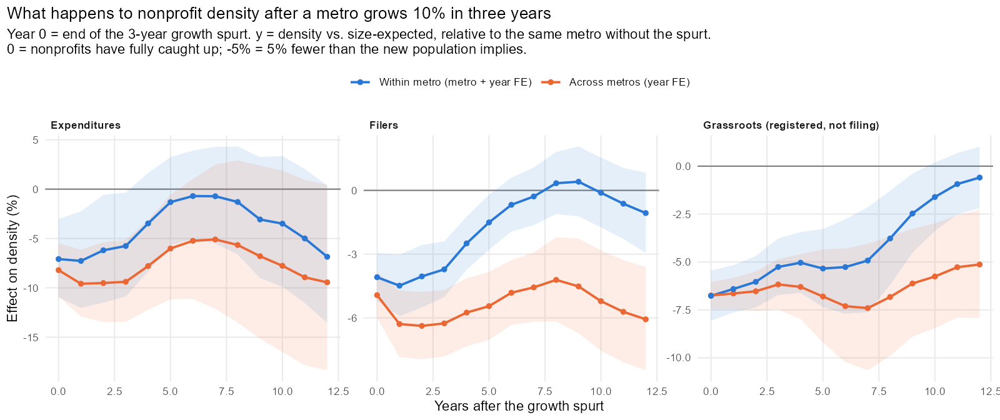

| effect on density of a 10% growth spurt | year 0 | 4 | 6 | 8 | 10 | 12 | half-life |
|---|---|---|---|---|---|---|---|
| filers, within metro | −4.1% | −2.5% | −0.7% | +0.4% | −0.1% | −1.0% | ~5 yrs |
| grassroots, within metro | −6.7% | −5.0% | −5.3% | −3.7% | −1.6% | −0.6% | ~9 yrs |
| filers, across metros | −4.9% | −5.7% | −4.8% | −4.2% | −5.2% | −6.1% | not reached |
| grassroots, across metros | −6.7% | −6.3% | −7.3% | −6.8% | −5.7% | −5.1% | not reached |

Example: a metro that grows 10% in three years ends the spurt with about 4% fewer filers than its new size implies, which is about 40% of the expected new filers. Within that metro, the shortfall is gone about 6 years later.

- **Within a metro, the gap closes.** A growth surge measured against the metro's own trend leaves a gap that closes in 5 years for filers and 9 for grassroots.
- **Across metros, it does not close.** Fast-growing metros remain low-density metros.
- **Robustness.**
  - Region × year and state × year FE give the same picture.
  - The splice-free registered stock gives the same 9-year half-life as grassroots.
- **Long horizons are thin.** h > 12 rests only on starts in 2006–09.
- **Expenditure responses are too noisy** for a reliable half-life.

### 2.3 The fast growers' level gap predates 2000

Sources: `c3_trajectories.csv`, `c3_fast_growers.csv`.

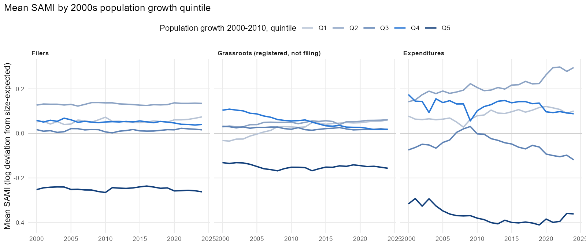

The same paths re-based so each quintile starts at 0 in 2000 (change since 2000, not level). All panels share one y-axis, so the size of the moves is comparable: filers are nearly flat, grassroots fan out by about ±9%, and expenditures swing by up to 15%.

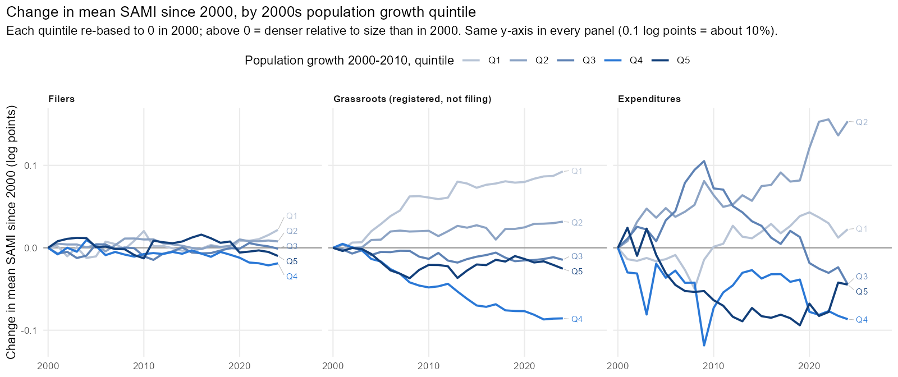

| change in mean SAMI since 2000 | Q1 (slowest) | Q2 | Q3 | Q4 | Q5 (fastest) |
|---|---|---|---|---|---|
| filers, 2010 | +.02 | +.01 | −.01 | −.01 | −.01 |
| filers, 2024 | +.02 | +.01 | .00 | −.02 | −.01 |
| grassroots, 2010 | +.06 | +.02 | −.01 | −.05 | −.02 |
| grassroots, 2024 | +.09 | +.03 | −.02 | −.09 | −.03 |
| expenditures, 2024 | +.02 | +.15 | −.05 | −.09 | −.05 |

- **Filers barely moved relative to 2000 in any quintile.** Every line stays within ±.02 log points (±2%) over 24 years. Faster-growing metros kept pace with their own growth without closing their inherited gap.
- **Grassroots show a growth gradient.** Slow growers gained (Q1 +9%, Q2 +3%), while faster growers lost (Q4 −9%, Q5 −3%). Most of the movement came in 2003–2012. Registrations piled up where population was flat and thinned out where it grew.
- **Expenditures are noisy**, with Q2 up about 15% and Q4–Q5 down 5–9%.

**Expenditures per resident** (`c3_exp_per_capita.csv`; real 2022 dollars, excluding hospitals and universities):

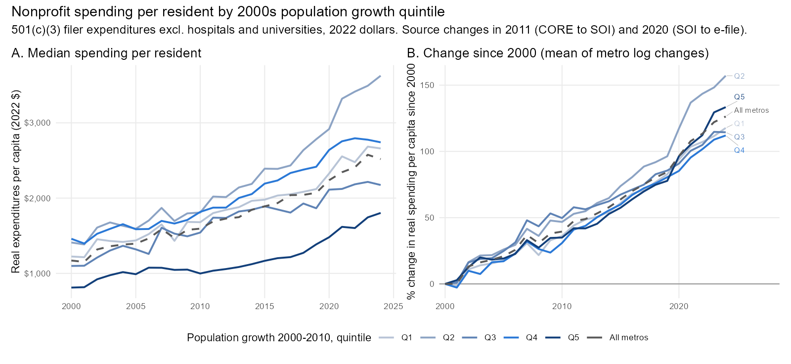

| | Q1 (slowest) | Q2 | Q3 | Q4 | Q5 (fastest) | all metros |
|---|---|---|---|---|---|---|
| median $ per resident, 2000 | 1,224 | 1,410 | 1,099 | 1,460 | 812 | 1,171 |
| median $ per resident, 2024 | 2,660 | 3,626 | 2,174 | 2,741 | 1,803 | 2,519 |
| % change since 2000 (mean of metro log changes) | +118% | +157% | +114% | +112% | +133% | +126% |

- **The fastest growers spend far less per resident.** The median Q5 metro spent $812 per resident in 2000 and $1,803 in 2024, about 30–45% below the other quintiles in both years.
- **Their spending kept pace.** Q5 per-capita spending grew 133%, slightly above the all-metro 126%, even though its population grew fastest. The dollar gap widened, but the percentage gap narrowed a little.
- **All quintiles roughly doubled real spending per resident.** The jumps around 2011 and 2020–21 partly reflect the source changes.
- **Per capita levels are not size-neutral.** Spending scales superlinearly across metros (b = 1.26), so level comparisons mix metro size with density. The change since 2000 (panel B) is the cleaner comparison, and it tells the same story as the SAMI change chart: no catch-up and no further falling behind.

Mean SAMI by quintile of 2000–2010 population growth:

| quintile | growth 2000s | growth 2010s | South or West | filers 2000 → 2010 → 2024 | grassroots 2000 → 2010 → 2024 |
|---|---|---|---|---|---|
| Q1 (slowest) | 0.5% | −0.7% | 27% | .05 → .07 → .07 | −.03 → .03 → .06 |
| Q3 | 9.7% | 7.2% | 66% | .02 → .01 → .02 | .03 → .02 → .02 |
| Q5 (fastest) | 23% | 20% | 96% | −.25 → −.27 → −.26 | −.13 → −.15 → −.16 |

- **The Q5 filer gap has neither widened nor narrowed in 24 years.** Q5 grew about 45% more than Q1 over the period, yet its density held. At the 24-year scale, new growth was matched almost one-for-one, but the inherited gap stayed.
- **The grassroots gap is half the size**, but it widened from −.10 to −.22 against Q1 because slow-growing metros gained grassroots density.
- **Recent growth explains little of the filer gap.** Using the horizon estimates, a metro growing 20 points faster per decade loses about 2–3% of filer density, against a Q5 gap of 25%.

Fast growers over 250k (% deviation from size-expected, 2000 → 2023):

| pattern | filers | grassroots |
|---|---|---|
| catching up | Charleston −28 → −1; Wilmington −13 → −1; Naples −18 → −6; Las Vegas −61 → −49; Dallas −22 → −15; Charlotte −12 → −7 | Las Vegas −41 → −24; Orlando −16 → +1; Charlotte −15 → +10; Port St. Lucie −21 → −8; Naples −32 → −19 |
| falling behind | Myrtle Beach −31 → −51; Cape Coral −20 → −38; Lakeland −36 → −50; McAllen −57 → −70 | Kennewick 0 → −24; Cape Coral −22 → −31; San Antonio −15 → −25; Austin +15 → +2 |
| sliding from above | Raleigh +25 → +3; Austin +19 → +13 | (Raleigh flat at +13) |

Myrtle Beach shows how the two groups can diverge. Its filer density fell from −31 to −51%, while its grassroots density rose from −34 to −24%.

### 2.4 Shrinking population: organizations stay, then grassroots adjust

Sources: `c5_horizon_by_sign.csv`, `c5_half_life_sign.csv`. These are the same models as 2.1 and 2.2 with separate slopes for population growth and decline. There are 1,372 metro-years with a 3-year decline, and 41 metros shrank over 2000–2024.

| share of size-expected change realized | 1 yr | 3 yrs | 5 yrs | 10 yrs | 15 yrs |
|---|---|---|---|---|---|
| filers, growth | .60 | .69 | .77 | .89 | .94 |
| filers, decline | −.15 | .27 | .33 | .57 | .68 |
| *p, difference* | <.001 | .005 | .015 | .31 | .50 |
| grassroots, growth | .39 | .47 | .51 | .61 | .69 |
| grassroots, decline | .16 | .28 | .38 | .64 | .61 |
| *p, difference* | .003 | .06 | .40 | .89 | .80 |

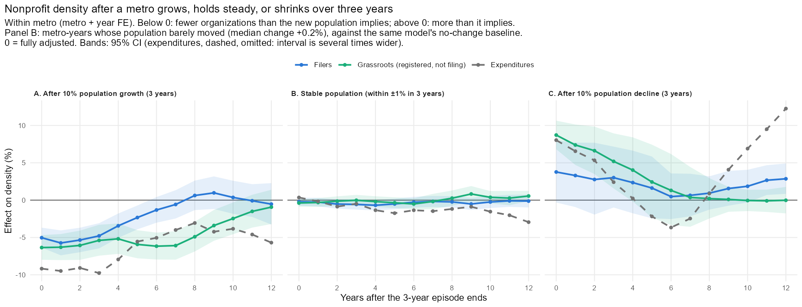

Panel A shows growth, panel B stable population, and panel C decline, with the outcomes as lines on a shared scale. The earlier layout, one panel per outcome and without the stable group, is `fig_c5_decline.png`.

**Panel B, the stable baseline** (`c5_stable_baseline.csv`; `R/notes/72_catchup_lag.R` part 5c):
- **Why it needs its own estimate.** In panels A and C, growth enters the model as a straight line, so a metro with 0% growth would sit at 0 by construction. Panel B adds a dummy for metro-years whose 3-year population change was within ±1%. That is 1,920 metro-years in 259 metros, with a median change of +0.2%. The dummy lets those metro-years depart from the model's no-change baseline, so a lag or excess in metros whose population did not move would show up.
- **What it uses.** The specification is otherwise identical: within metro, with the same controls.
- **Panels A and C barely change.** Adding the dummy moves the count paths by at most 0.6 points, so they keep the original model.
- **Result: stable metros have no lag.** Filers stay within 0.7% of 0 and grassroots within 0.6% at every horizon, and the 95% intervals include 0 throughout. The only exception is filers at year 4, whose interval reaches just to 0. The lags in A and the excess in C come from population change.

Reading panels A and C:
- **Within each direction, the groups differ in speed.**
  - After growth, filers close their shortfall by about year 8, while grassroots stay about 5–6% short until year 7 and close only by year 12.
  - After decline, grassroots start with the larger excess (about +9%) but shed it by year 7. Filers start lower (about +4%) and drift without clearly closing.
- **Between directions, grassroots are asymmetric.** Their excess after a decline disappears in about 7 years, roughly twice as fast as their shortfall after growth. Organizations leave faster than new ones arrive.
- **The expenditure line is too noisy to read**, especially after decline, which is why it has no confidence band.

| effect on density, within metro | year 0 | 2 | 4 | 6 | 8 | 10 | 12 |
|---|---|---|---|---|---|---|---|
| filers, after 10% growth | −5.0% | −5.3% | −3.4% | −1.3% | +0.6% | +0.4% | −0.5% |
| filers, stable (±1%) | −0.2% | −0.5% | −0.7% | −0.3% | −0.2% | −0.2% | −0.1% |
| filers, after 10% decline | +3.8% | +2.8% | +2.4% | +0.5% | +0.9% | +1.9% | +2.9% |
| grassroots, after 10% growth | −6.4% | −6.1% | −5.2% | −6.2% | −4.9% | −2.5% | −0.9% |
| grassroots, stable (±1%) | −0.4% | −0.1% | −0.2% | −0.5% | +0.3% | +0.4% | +0.6% |
| grassroots, after 10% decline | +8.7% | +6.6% | +4.0% | +1.3% | +0.2% | 0.0% | 0.0% |

Year 0 is the end of the 3-year episode. Below 0 means too few organizations for the new population size; above 0 means too many.

- **Across metros, shrinking places keep their organizations.** For filers, only about a third of the size-expected decline shows up in the first five years, against three quarters of expected growth, so density rises as population falls. By 10–15 years the slopes are no longer distinguishable, though the decline estimates rest on few metros.
- **Within metros, grassroots shed the excess quickly.** After a 10% decline, grassroots density is about 9% above size-expected. The excess halves in about 4 years and is gone by year 8. After 10% growth, the grassroots shortfall of about 6% takes about 10 years to close. Revocations and closures clear excess registrations faster than new organizations fill a deficit.
- **The filer decline response is small and noisy.** Density is about 4% above expected at year 0 (the interval includes 0), closing by about year 6.

### 2.5 Falling income: filer density falls at once and recovers slowly

The relative income change is the 3-year Δlog per capita income minus the year mean, split by sign. 52% of metro-years are relative losses.

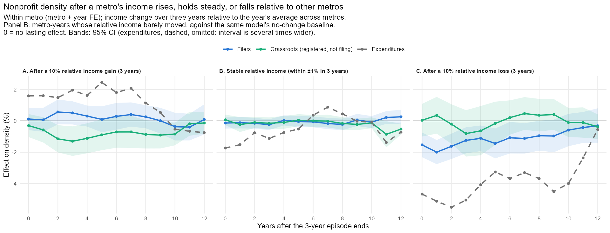

Panel A shows gains, panel B stable relative income, and panel C losses, with the outcomes as lines on a shared scale. The per-outcome layout, without the stable group, is `fig_c5_income.png`.
- **Panel B, the stable baseline.** It is built the same way as the stable-population panel in 2.4, using a dummy for metro-years whose relative 3-year income change was within ±1%. That is 1,852 metro-years in 375 metros, with a median change of −0.06% (`c5_stable_baseline.csv`).
  - **No lag.** Filers stay within 0.3% of 0 and grassroots within 0.5% at every horizon, and the intervals include 0 except for grassroots at year 12 (−0.5%).
  - **Panels A and C barely change.** Adding the dummy moves the filer paths by at most 0.2 points and the grassroots paths by at most 0.8, so they keep the original model.
- **After a loss,** filers sit about 1.5–2% below where they would be and recover only slowly; expenditures sit about 4–5% below.
- **Grassroots don't move after a loss.**
- **After a gain, grassroots dip about 1% in years 2–9**, consistent with some of them growing past the filing floor and becoming filers. The 95% interval only grazes zero, so treat this as suggestive.

| effect on density of a 10% relative income change, within metro | year 0 | 2 | 6 | 10 | 12 |
|---|---|---|---|---|---|
| filers, after a loss | −1.5% | −1.6% | −1.1% | −0.6% | −0.3% |
| filers, after a gain | +0.1% | +0.6% | +0.3% | −0.4% | +0.1% |
| filers, stable relative income (±1%) | −0.1% | −0.2% | −0.1% | −0.1% | +0.3% |
| grassroots, stable relative income (±1%) | +0.1% | −0.1% | 0.0% | −0.1% | −0.5% |
| expenditures, after a loss | −4.7% | −5.5% | −3.7% | −4.0% | −0.6% |
| expenditures, after a gain | +1.6% | +1.5% | +1.8% | −0.5% | −0.7% |
| grassroots, after a loss or gain | ~0 (within ±1%, n.s.) | | | | |

- **Income losses hit filers at once.** A 10% relative income loss lowers filer density by about 1.5–2% immediately, with a half-life of about 10 years. Spending falls by about 5% and stays down for about a decade.
- **Income gains do nothing within metros.**
- **Grassroots do not respond to income in either direction.** The filer response is organizations dropping below the filing floor, not dissolving. Those organizations simply move into the grassroots count, which is large enough that the shift barely registers.

### 2.6 Is the Sunbelt gap an old growth lag? Test with 1970–2000 population

Script `R/notes/73_pre2000_growth.R`; outputs `c9_*`, `fig_c9_*`.

**Data.**
- Census county counts for 1970, 1980 and 1990 come from three public Census Bureau tables (`e7079co.txt`, `e8089co.txt`, `99c8_00.txt`, in `D:/MULTIVERSE/raw/census-hist/`).
- They are mapped to 2023 counties: Dade → Miami-Dade, and the Virginia independent-city mergers.
- That gives 382 metros. The five Connecticut metros are dropped because 2023 planning regions do not nest in the old counties.
- Median metro growth was 45% over 1970–2000. The fastest fifth grew a median 141%.

**(a) The 2000 deficit tracks 1970–2000 growth, beyond region and census traits.**

| 2000–02 SAMI per log point of 1970–2000 growth | filers | grassroots | expenditures |
|---|---|---|---|
| growth alone | −.35 (R² .11) | −.15 (.03) | −.53 (.09) |
| + region, % BA, income, poverty, % 65+, % nonwhite (2000) | −.36 (R² .63) | −.29 (.44) | −.44 (.47) |

- **Controls don't absorb it.** Among metros in the same region with the same income, education, age and race profile, those that grew more since 1970 had lower density in 2000.
- **Growth history matters most for filers.** For grassroots it matters mainly after the controls.
- **Growth accounts for the whole fastest-fifth gap.** The cross-metro slope times the growth difference between the fastest and slowest fifths matches or exceeds the gap itself, which is −.28 for filers, −.11 for grassroots and −.46 for expenditures.

**(b) Recent decades weigh more than old ones, but filer gaps fade more slowly than the within-metro rate implies.**

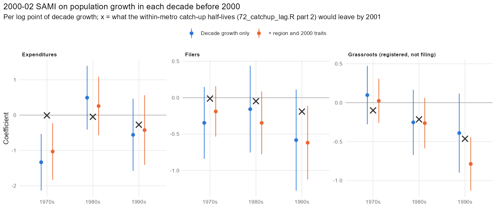

Coefficients include region and 2000 traits. "Expected" is what an immediate gap decaying at the within-metro half-life (section 2.2) would leave by 2001.

| 2000–02 SAMI per log point of decade growth | 1990s | 1980s | 1970s |
|---|---|---|---|
| filers, estimate | **−.62** (.26) | −.35 (.22) | −.19 (.18) |
| filers, expected at a 5-year half-life | −.19 | −.05 | −.01 |
| grassroots, estimate | **−.79** (.18) | −.26 (.17) | +.02 (.15) |
| grassroots, expected at a 9-year half-life | −.46 | −.21 | −.10 |
| expenditures, estimate | −.42 (.50) | +.26 (.42) | **−1.03** (.41) |

- **Both counts fade the way a lag should.** 1990s growth weighs most and 1970s growth least.
- **Grassroots are close to the lag model.** The within-metro rate predicts more than the whole grassroots gap.
- **Filer deficits are about three times larger than the within-metro rate predicts.** It accounts for only 26% of the fastest-fifth filer gap and 27% of the expenditure gap (`c9_gap_by_pre2000_growth.csv`).
- **Expenditures don't fit any lag pattern.** The 2000 spending data (CORE) are noisy.

**(c) Fast growers whose growth slowed after 2000 close part of the filer gap; those that kept growing do not.**

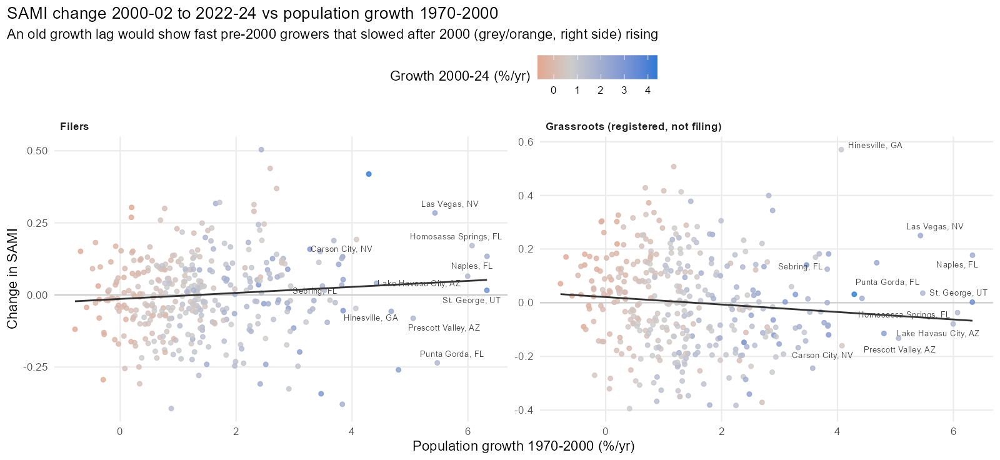

| top fifth by 1970–2000 growth | metros | growth 1970–2000 | growth 2000–24 | filer SAMI 2000 → 2024 | grassroots SAMI 2000 → 2024 |
|---|---|---|---|---|---|
| kept growing fast | 39 | 182% | 67% | −.24 → −.24 | −.15 → −.16 |
| slowed down | 38 | 133% | 26% | −.12 → −.08 | −.02 → −.05 |
| *all other metros* | 305 | 33% | 14% | .04 → .04 | .02 → .03 |

- **Holding post-2000 growth fixed, past growth predicts later filer gains.** Each extra 1%/yr of growth over 1970–2000 predicts a filer SAMI gain of +.033 over 2000–2024 (p = .001); the grassroots coefficient is +.021 (p = .12). With the 2000 SAMI and region controlled, these become +.016 (n.s.) and +.020 (p = .05).
- **Fast growers that slowed closed about a third of their filer gap in 24 years**, an implied half-life of about 35 years. Examples: Naples −18 → −6, Las Vegas −61 → −49, Homosassa Springs −48 → −38. Others did not: Punta Gorda −29 → −44, Lake Havasu City −60 → −57.
- **Grassroots show no comparable catch-up**, but slowed growers had almost no grassroots gap to close (−.02).
- **Metros that kept growing fast stayed flat.** New lag accumulates as old lag fades.

**Reading.**
- **The Sunbelt filer gap is substantially a growth-history gap, and controls don't absorb it.** It tracks 1970–2000 growth closely, recent decades count more than older ones, and partial catch-up follows slowdowns.
- **Across metros it is a slow lag.** Filer gaps close over decades (half-life around 35 years), not the 5 years seen within a metro.
- **Growth history may also proxy persistent traits.** A newcomer-heavy population with fewer local ties, or retiree composition, could act the same way. This test cannot separate a slow lag from such correlates.
- **The association survives region and census traits but not nonprofit market share** (section 6.2). Fast growers also have small nonprofit workforces.

### 2.7 Answer

- **The post-2000 lag is short.** Growth surges leave a deficit that closes in about 5 years (filers) to 9 years (grassroots).
- **Population decline is the mirror image.** Organizations persist at first, density rises, and grassroots catch down within about 5 years.
- **Income declines are different.** Filer density and spending drop immediately and recover over about a decade, and grassroots do not move.
- **The Sunbelt gap is mostly accumulated growth history, and mostly a filer gap.**
  - It closes slowly across metros, with a half-life of decades, and only once growth slows. Metros still growing fast hold their deficit indefinitely.
  - The within-metro catch-up rates account for about a quarter of the filer gap. The rest is either a much slower cross-metro lag or traits that come with sustained in-migration.

### 2.8 One specification for the lag: smoothed-population (kernel) models

Script `R/notes/79_kernel_lag.R`; outputs `c14_*`, `fig_c14_*`. Updated Nov 15, 2026.

**Why.** The local projections describe the response to a single episode. A regression of density on population needs one specification that works for any path, including growth followed by decline. Two simple candidates fail:
- `log N ~ log P[t−5]` imposes a fixed delay: no response for five years, then all of it at once.
- `log N ~ log P[t] + (log P[t] − log P[t−5])` uses one arbitrary growth window.

**The model.** Each year's population change opens a gap that closes at a constant rate. Replace current population with a geometrically weighted memory of past population changes:
- `G[t] = a·G[t−1] + Δlog P[t]`, so growth k years ago gets weight a^k, with a = 0.5^(1/half-life).
- Main specification: `log N ~ β·log P + γ·G | metro + year`.
  - β is the long-run within-metro elasticity.
  - −γ/β is the share of a population change not yet realized in the year it happens.
- A Pascal (second-order) term with weight (k+1)·a^k allows a deficit that widens for a few years before it closes.
- Growth followed by decline needs no special handling: each year's change opens its own gap, and all gaps close at the same rate.
- Sample: 382 metros (those with 1970–2000 census history), 2000–2024. Population before 2000 is interpolated log-linearly between censuses.
- The half-life is chosen by fit over a grid of 0.5–20 years. The 95% intervals come from 300 metro bootstrap draws, each of which re-chooses the half-life.

**How to read the table.** All rows are within metro (metro + year FE). Shares are fractions of the long-run within-metro response β, not of the cross-sectional b.
- **Missing at impact:** the share of a population change not realized in the same year.
- **Half-life:** years until the deficit falls to half of its peak.
- **Missing at 10 yrs:** the share still unrealized ten years later.

95% bootstrap intervals are in brackets (`c14_kernel_estimates.csv`).

| | half-life | β (long-run) | missing at impact | missing at 10 yrs |
|---|---|---|---|---|
| filers, geometric (B) | 10 [5.5–20] | .93 [.84–1.05] | .45 [.28–.66] | .23 [.12–.37] |
| filers, after gains (Cb) | 8.5 [4.5–20] | .95 | .43 [.24–.70] | .19 [.08–.33] |
| filers, after losses (Cb) | ≥20 (grid cap) [4.7–20] | | .89 [.48–1.57] | |
| grassroots, geometric (B) | 7.5 [4.5–14.5] | .72 [.62–.82] | .81 [.52–1.14] | .32 [.15–.58] |
| grassroots, Pascal (P) | peaks at year 4, halves by ~10 | .71 [.08–.80] | .06 [−.62–.70]; .79 at the peak | .37 |
| *filers, SAMI with b imposed (A)* | *15.5 [5.5–30]* | *(.99 imposed)* | *.41* | *.26* |
| *grassroots, SAMI with b imposed (A)* | *40 [25–60]* | *(.99 imposed)* | *.63* | *.53* |
| *filers, across metros (D1, year FE only)* | *30 [9.5–100]* | | *.45* | *.36* |
| *grassroots, across metros (D1)* | *14.5 [5–100]* | | *.39* | *.24* |

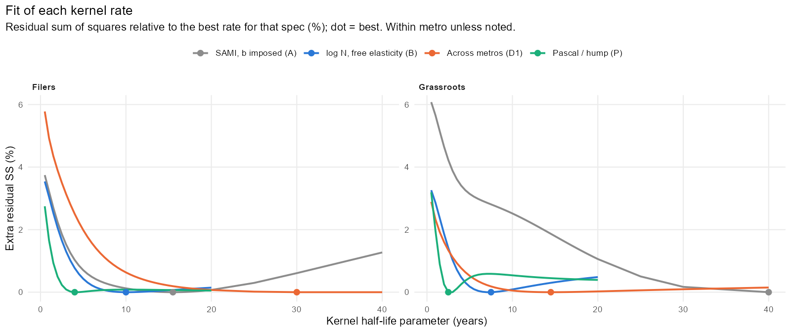

**1. A fixed lag is the wrong shape.** Fit of `log N` with metro + year FE, ΔBIC against the best model for each outcome (`c14_spec_comparison.csv`):

| specification | filers | grassroots |
|---|---|---|
| `log P[t]` | 396 | 369 |
| `log P[t−5]` | 526 | 260 |
| best single lag | `log P[t]`, 396 | `log P[t−10]`, 96 |
| `log P[t] + (log P[t] − log P[t−5])` | 226 | 228 |
| geometric kernel (B) | 43 | 52 |
| Pascal kernel (P) | 44 | 5 |
| gains vs losses kernels (Cb) | **0** | 48 |
| six free growth windows | 68 | **0** |

- **For filers, every pure lag fits worse than current population.**
- **For grassroots, older population fits better**, but the best single lag (t−10) is still well behind the kernels.
- **Adding one growth window captures less than half of the gain** that a kernel gives.

**2. Don't impose the cross-sectional slope within metros.**
- The long-run within-metro elasticity is .93 for filers and .72 for grassroots.
- Grassroots never fully catch up within a metro, matching the plateau in section 2.1.
- With b fixed at .99 (spec A), that permanent shortfall can only appear as very slow adjustment, which inflates the half-lives to 15.5 and 40 years.
- **Use `log N ~ log P + G`, or the SAMI with G and log P both on the right-hand side.** The SAMI alone, with b imposed, gets the half-lives wrong.

**3. Filers: a single geometric kernel is enough.**
- About 45% of a population change is missing in the first year, the gap halves in about 10 years, and a quarter is still open at 10 years.
- The Pascal (hump) term adds nothing.
- Separate gain and loss kernels fit best. Organizations barely leave after a population loss: about 90% of the implied decline is unrealized at first, and the loss half-life runs to the 20-year cap.

**4. Grassroots: the point estimate has a hump, but it is fragile.**
- The Pascal kernel puts the deficit's peak about 4 years after growth, at about 80% of the long-run response, halving by about year 10. It nearly matches the six free windows (ΔBIC 5).
- The bootstrap intervals for the hump terms are very wide, so treat the shape as suggestive.
- Annual population is smooth (intercensal), which makes the response within the first year or two poorly identified in any spec.

**5. The kernels and the local projections disagree after year 6, and the data can't decide between them.**

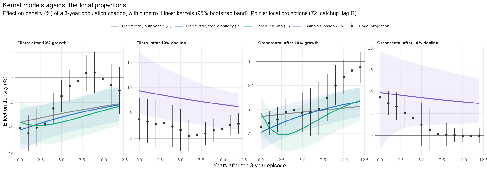

- **They agree for about 5 years after growth**, then the kernels keep a deficit: filers are about −2.5% at year 10, where the local projections show about 0.
- **The free windows** (`fig_c14_windows.png`) show the same long tail. Growth 10–20 years back still lowers filer density (−.17 and −.14 per log point).
- **The difference is metro trends.** The within-metro local projections put metro FE on a differenced SAMI, which is equivalent to metro-specific linear trends in levels.
  - Adding those trends to the kernel model (spec T, `c14_specT_profile.csv`) leaves β unidentified: filers .42, expenditures about 0. Within a metro, population follows a near-straight line, so trends absorb the identifying variation.
  - With trends, the free windows lose precision: their standard errors roughly double.
- **So a slow tail can't be separated from metro-specific drift with 25 years of data.** The two estimates bound the truth:
  - about 5 years (local projections, trends removed)
  - about 10 years (kernel, levels)
- **The same split appears after declines.** The local projections show grassroots shedding their excess within about 7 years, while the level kernel shows organizations persisting.

**6. Across metros the lag is slow.** Without metro FE (D1), the best filer half-life is about 30 years [9.5–100], close to the roughly 35-year cross-metro catch-up in section 2.6. For grassroots it is about 15 years.

**7. Expenditures are too noisy for any kernel.** The intervals span half-lives of 2.5–20 years.

**Implications for the SAMI regressions.**
- **Don't build the kernel into the SAMI.** Keep the SAMI as the year-specific cross-sectional residual. Enter G (with log P, so the within elasticity is free) as a regressor alongside the covariates. Partialling G out of the outcome alone would bias covariate coefficients wherever covariates correlate with growth history (Frisch–Waugh).
- **Treat the half-life as a multiverse branch rather than a single estimate**:
  - filers: 5 or 10 years
  - grassroots: geometric at 7.5 years, or Pascal
  - no kernel, as the contemporaneous baseline
- **Covariates get their own lags only where they have real year-to-year variation within metros** (income, wages, government earnings), estimated jointly with the population kernel.
  - A common rate across drivers is the natural partial-adjustment restriction, and it is testable. Filers' immediate response to income loss (section 2.5) suggests it fails.
  - Smooth or interpolated ACS measures can't identify a lag.

### 2.9 The lag branch in the multiverse (run v7)

Script `R/multiverse/82_lag_fork.R`; outputs `data/spec/run_principled_v7/lag_term.csv` and `lag_shift.csv`.

**Setup.**
- Add-on block `lag` in `40_multiverse.R`. Each alternative adds a kernel term to the full default model, under every non-covariate fork and in all three strata (the kernels vary over time, so within-metro specs run too):
  - `lag:g5`: half-life 5 years
  - `lag:g10`: half-life 10 years
- That is 36,168 specs; all of them fit.
- v7 = v6 + lag: 432,432 specs. No v6 spec_id changed.
- A third alternative, `lag:pascal` (geometric + Pascal terms at 2.5 years, 18,084 specs), was run and then dropped from the block (see below). Its fits remain in `run_principled_lag/` but are not in v7.
- The kernels cover all 925 CBSAs (`data/cov/cov_lag_kernel.csv`). The 7 Connecticut CBSAs use statewide 1970–2000 growth.

**The geometric kernels are among the most stable terms in the multiverse, except within metros.**

| median partial r (share p < .05) | cross-section | pooled | within |
|---|---|---|---|
| counts, `lag:g10` | −.30 to −.31 (98–99%) | −.12 (98–99%) | −.04 to −.05 (88–94%) |
| counts, `lag:g5` | −.29 to −.31 (99%) | −.11 (98–99%) | −.04 to −.05 (88–94%) |
| resources, `lag:g10` | −.22 to −.25 (99–100%) | −.10 (100%) | −.01 to −.02 (9–23%) |
| resources, `lag:g5` | −.19 to −.23 (94–100%) | −.08 to −.09 (97–100%) |−.01 to −.02 (7–33%) |

- **Sign stability is 100% in every cross-section and pooled cell.**
- **The two half-lives are nearly interchangeable.** The coefficients differ by about a factor of 2, which is just the difference in scale: a 10-year kernel sums about twice as much past growth. Partial r and significance are almost the same.
- **The Pascal pair didn't work as a multiverse branch, so it was dropped.** Its two terms are collinear and split the effect: each is significant in only 1–93% of specs, and the geometric term's sign is stable in only 51–96%.

**Adding the lag barely moves the other covariates within metros, and moves a few of them modestly in cross-sections.** Median change in partial r against the matched default spec:

| | cross-section | pooled | within |
|---|---|---|---|
| median \|Δr\| across covariate × stratum cells | .03 | .01 | .001 |
| largest median change | .10 | .035 | .014 |
| correlation of r across matched pairs | .90 | .93 | .97–.99 |

- **Within metros, nothing changes.** Covariate partial r moves by less than .015.
- **In cross-sections and pooled specs, three covariates shift**, the same way under every lag alternative (Pascal included):
  - **Poverty rate turns negative.** Count specs go from about 0 to −.08/−.12. The ~0 default was partly fast-growing low-poverty metros with growth-lagged sectors. Net of growth history, poverty goes with lower density. Its sign flips in 34–56% of pairs because it starts near zero.
  - **% BA gets stronger,** by +.05 to +.08. The growth deficit had been masking the education gradient: fast growers like Austin and Raleigh are well-educated.
  - **Foundation assets weaken,** by −.04 to −.05; |r| shrinks in about 90% of pairs. Part of the foundation-asset association was growth history, since fast growers have young, thin foundation sectors.
- **Turnout shrinks slightly** (−.02). Diversity and government barely move.

---

## 3. What predicts catch-up, 2011–2023

**Setup.** The outcome is the SAMI change from 2010–12 to 2022–24. Each factor is entered alone (`c4_predictors.csv`). The controls are population growth in the 2000s (gA) and the 2010s (gB) and the 2011 SAMI. Effects are reported as partial r.

**Decade view** (`c4_catchup_growth.csv`, per 10% growth):

| | filers | grassroots | expenditures |
|---|---|---|---|
| 2000s growth → SAMI change in the 2000s | −.012 | −.036 | −.067 |
| 2000s growth → SAMI change in the 2010s (rebound) | +.015 | +.031 | +.069 |
| same, holding the 2011 SAMI fixed | +.012 (n.s.) | −.005 (n.s.) | +.056 (n.s.) |
| 2010s growth → SAMI change in the 2010s | −.023 | −.050 | −.091 |
| 2011 SAMI (deficit convergence per decade) | −.010 (n.s.) | **−.233** | −.046 (n.s.) |

- **The 2000s growth deficit was recovered in the 2010s** for every outcome (recovery share 0.9–1.2).
- **For grassroots, recovery runs through convergence.** The deficit closes at −.23 per decade, a half-life of about 27 years, and growth-induced deficits close like any other.
- **Filers show no convergence at all.**

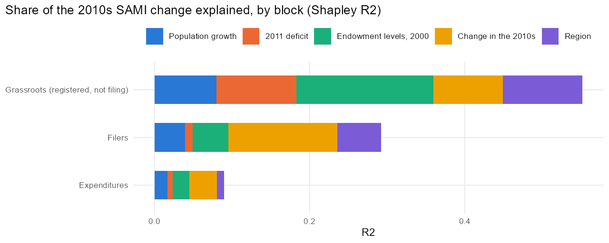

| Shapley R² | filers | grassroots | expenditures |
|---|---|---|---|
| change in the 2010s | **.14** | .09 | .04 |
| endowment levels, 2000 | .05 | **.18** | .02 |
| population growth | .04 | .08 | .02 |
| 2011 deficit | .01 | .10 | .01 |
| region | .06 | .10 | .01 |
| total R² | .29 | .55 | .09 |

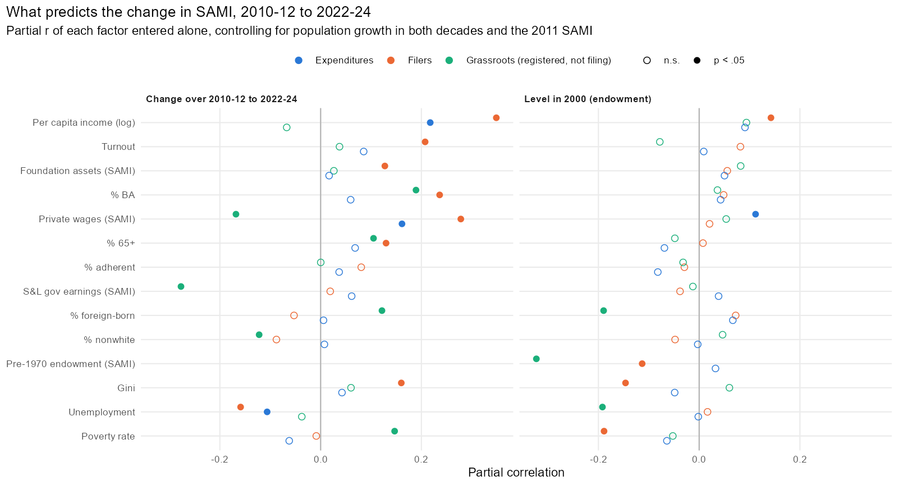

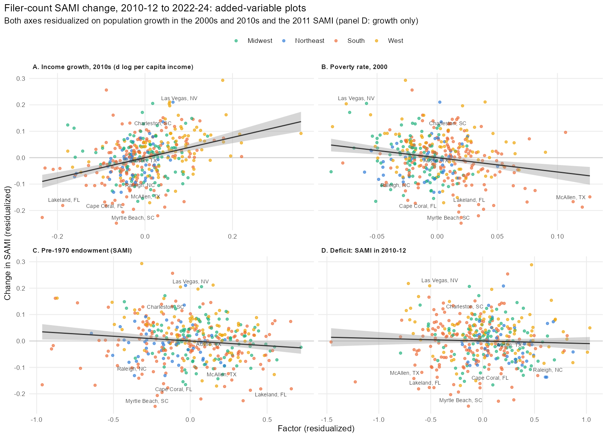

### 3.1 Change during the decade predicts filer gains; grassroots go the other way on the economy

| change, 2010–12 → 2022–24 | partial r: filers | grassroots | expenditures | r with 2000s growth | r with 2010s growth |
|---|---|---|---|---|---|
| Δ log per capita income | **.35** | −.07 | **.22** | .34 | .42 |
| Δ private-wage SAMI | **.28** | **−.17** | **.17** | .32 | .31 |
| Δ % BA | **.24** | **.19** | .06 | .24 | .36 |
| Δ turnout | **.21** | .04 | .09 | .19 | .06 |
| Δ % 65+ | **.13** | **.10** | .07 | −.08 | −.15 |
| Δ foundation-asset SAMI | **.12** | .03 | .01 | −.02 | −.08 |
| Δ unemployment | **−.16** | −.04 | **−.11** | −.11 | −.09 |
| Δ poverty rate | −.01 | **.15** | −.06 | −.45 | −.42 |
| Δ S&L government earnings SAMI | .02 | **−.28** | .06 | .00 | −.07 |

Bold is p < .05.
- **Filers follow the local economy.** Income and wage growth lift existing organizations past the $50k floor (section 3.6). Changes in the 2010s are the largest block for filers (Shapley .14 of .29); panel A of the added-variable plots shows the income slope.
- **Grassroots move the opposite way on the economy.**
  - Where wages and public-sector earnings grow, grassroots density falls relative to size. Some of those organizations graduate into filers.
  - Where poverty rises, grassroots density rises.
  - Education is the one change that lifts both.
- **These changes covary with population growth.** Fast-growing metros got richer, more educated and better paid (r .24–.42), which offsets part of the filer lag. That is why the unconditional 24-year filer change is unrelated to growth.
- **Read these as covariation, not causes.** Income and education change with the same in-migration that drives population growth.

### 3.2 Starting levels predict less for filers and more for grassroots

| level in 2000 | filers | grassroots | expenditures |
|---|---|---|---|
| poverty rate | **−.19** | −.05 | −.06 |
| Gini | **−.15** | .06 | −.05 |
| per capita income (log) | **.14** | .09 | .09 |
| foundation-asset SAMI | .03 | .06 | .05 |
| % BA | .05 | .04 | .04 |
| unemployment | .02 | **−.19** | .00 |
| % foreign-born | .07 | **−.19** | .07 |
| pre-1970 endowment SAMI | **−.11** | **−.32** | .03 |

- **For filers,** high poverty and inequality in 2000 predict smaller gains (panel B). The endowment block as a whole is small (Shapley .05).
- **For grassroots,** endowment is the largest block (Shapley .18). The historical stock, unemployment and immigrant share all predict smaller gains.

### 3.3 It is not "the rich get richer": old endowments converge

- **Pre-1970 endowment predicts smaller gains** (panel C). This is the SAMI of pre-1970 charities in the 2000 stock; partial r is −.11 for filers and −.32 for grassroots. It is a time-invariant level effect, not a lagged catch-up.
- **Grassroots deficits close.** The coefficient on the 2011 SAMI is −.23 per decade, a half-life of about 27 years.
- **Filer deficits do not** (panel D: −.01, flat).
- **The same reading holds over 2000–2024.** Risers in section 1 have thin historical endowments (s_hist −.19), and fallers have average ones.

### 3.4 No starting condition robustly speeds the recovery of fast growers

Source: `c7_recovery_by_tercile.csv`.

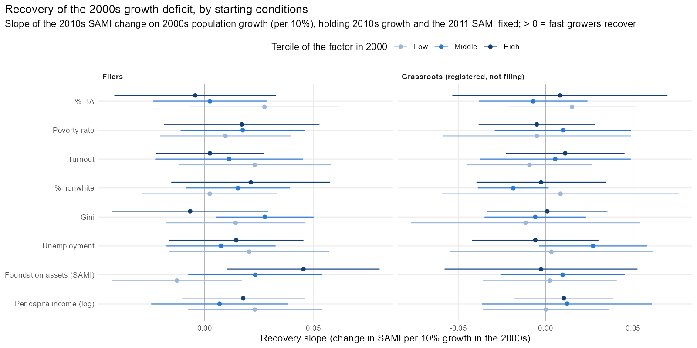

- **The test.** It asks whether fast growers of the 2000s recover faster under some 2000 conditions. It regresses the 2010s SAMI change on 2000s growth (holding 2010s growth and the 2011 SAMI fixed) within terciles of each 2000 condition.
- **Filers.** Recovery slopes are small (−.01 to +.04 per 10%), with overlapping intervals for every factor.
  - The linear interaction is significant only for 2011 Gini (p = .03) and the 2010s private-wage change (p = .048): two of 53 tests, fewer than chance alone would produce.
  - One suggestive pattern: recovery is faster where foundation assets were high in 2000 (+.044 vs −.003), but the linear interaction is not significant (p = .25).
- **Grassroots.**
  - Linear interaction models (p < .05) say recovery is faster where 2000 % BA, income, private wages and turnout were high, and slower where poverty, Gini, unemployment, % nonwhite or % foreign-born were high.
  - The tercile splits do not confirm it: every slope is near zero (−.02 to +.03), with overlapping intervals.
  - The linear interactions likely reflect the strong grassroots convergence term interacting with these traits, not faster recovery from growth.
- **Reading:** starting traits predict how much density changes (3.2), not how fast fast-growers recover.

### 3.5 New registrations do not explain catch-up; filing does

Source: `c6_mechanism.csv`. This is a distributed lag of each rate on 2-year population growth bins, 2011–2021.
- These measures are defined on the registered stock (filers + grassroots).
- The filing share is filers / (filers + grassroots).
- Exits are implied: stock[t−1] + entries − stock[t].

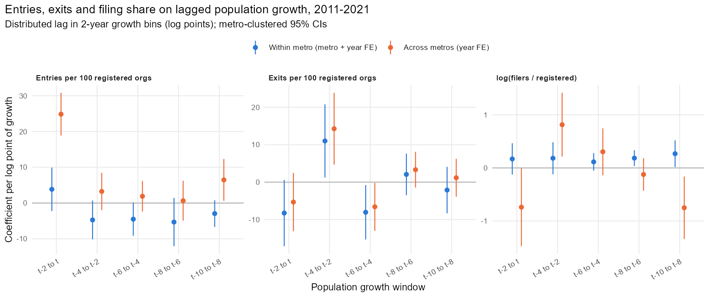

| per log point of growth, within metro (metro + year FE) | t−2 to t | t−4 to t−2 | t−6 to t−4 | t−8 to t−6 | t−10 to t−8 |
|---|---|---|---|---|---|
| new registrations per 100 registered (mean 4.9) | 3.8 | −4.7 | −4.5 | −5.3 | −2.9 |
| log filing share | .17 | .18 | .11 | **.19** | **.27** |

- **Entries track growth only across metros.** New registrations run at 4.9 per 100 organizations a year, and 10% two-year growth adds about 2.5. Within a metro, a growth surge does not raise entries; if anything, later entries are lower.
- **The filing share rises.** The share of registered organizations that file climbs steadily in the 6–10 years after growth, summing to about .9 per log point of sustained growth.
  - Filer catch-up comes from grassroots organizations growing past the $50k floor and appearing in the 990 data, not from new formation.
  - This is the link between the two groups: within metros, growth moves organizations from the grassroots count into the filer count.
- **Implied exits are too noisy to interpret.** The 2011 auto-revocations and source timing differences dominate them.

---

## 4. Nonprofit market share and the wage premium (BLS, 2013–2022)

The BLS QCEW nonprofit research data give 2013–2022 for 363 metros, after dropping 8 with changed delineations. The two measures:
- `bls_pct_npo`: the 501(c)(3) share of private employment. It includes hospitals and universities; the median is 10.3%.
- `bls_wage_ratio_adj`: the nonprofit / private average wage, adjusted for industry composition at fixed national weights. It is used for 341 metros where at least half the weight is reported; the median is 1.06.

Sources: `c8_levels.csv`, `c8_catchup.csv`, `c8_ceiling.csv`, `c8_metro.csv`.

### 4.1 Market share and the density level

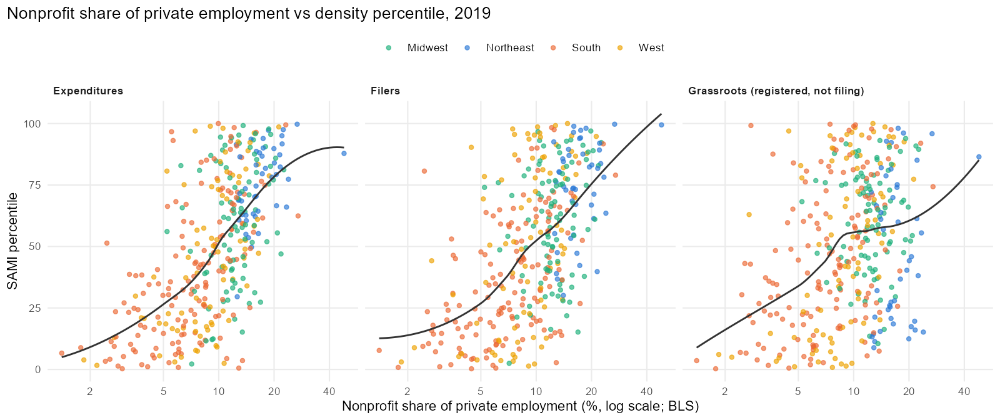

| pooled 2013–2022, year FE | filers | grassroots | expenditures |
|---|---|---|---|
| SAMI per log point of share | .40 | .18 | .78 |
| within R², share alone | .35 | .14 | .38 |
| percentile on share percentile: slope | .58 | .36 | .63 |
| percentile on share percentile: R² | .34 | .13 | .40 |
| + wage ratio (given share), per unit | −.42 | −.30 | −.28 (n.s.) |

- **Market share accounts for about a third of the variation in filer density percentile**, and an eighth for grassroots. Employment share measures the established sector that filers represent.
- **The relationship is not simple.** At 10% share, metros span the 5th to 95th filer density percentile.
- **The Sunbelt is low on both** (orange and yellow points sit lower left).
- **Health care adds nothing beyond overall share.**
  - The nonprofit share within health care and social assistance predicts filer density alone (1.17 per unit, within R² .26), but nothing once overall share is included (−.05, p = .85).
  - No industry-specific competition effect shows beyond the overall share.

### 4.2 Does a small market share cap catch-up?

Catch-up here is the SAMI change from 2013–15 to 2022–24, controlling for the 2013–15 SAMI and growth over 2003–13 and 2013–23. One grassroots outlier (Mankato, a group-exemption artifact) is dropped where noted.

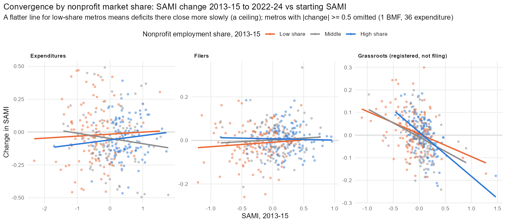

| by tercile of nonprofit employment share (median share) | low (5.2%) | middle (10.3%) | high (14.8%) |
|---|---|---|---|
| median filer SAMI, 2013–15 | −.22 | .04 | .21 |
| convergence slope, filers | +.02 (.02) | .00 (.03) | .00 (.02) |
| convergence slope, grassroots (without Mankato) | **−.09 (.02)** | −.15 (.04) | −.18 (.03) |
| mean filer change, metros below expected | −.018 (n = 90) | −.004 (n = 49) | −.004 (n = 24) |

- **Filers show no convergence anywhere**, and share neither raises nor lowers catch-up. Share and its interactions with the deficit and with prior growth are all n.s. (p > .5).
- **Grassroots show a soft ceiling.**
  - Deficits in low-share metros close about half as fast as in high-share metros (−.09 vs −.18 per decade).
  - The continuous share × deficit interaction is weaker (−.039, p = .10).
  - Higher share predicts slightly smaller grassroots gains overall (−.009 per SD, p = .04).
- **Below-expected filer density in low-share metros drifted down slightly** (−1.8% vs −0.4%).
- **Health care shows no ceiling either.** Where nonprofits hold a smaller share of health care, grassroots density grew slightly faster, not slower (−.010 per SD of nonprofit health share, p = .04). The "for-profits filled the niche" mechanism is not visible in health care.

### 4.3 The wage premium

- **Levels.** Holding market share fixed, a higher nonprofit/for-profit wage ratio goes with lower organization density for both groups: −.04 filer SAMI per 0.1 of the ratio (p = .001) and −.03 for grassroots (p = .03). The pattern fits fewer, larger, more professional organizations.
- **Catch-up.**
  - A higher premium predicts slower grassroots growth (−.016 per SD, p < .001) and faster spending growth (+.056 per SD, p = .002).
  - It does not predict filer change.
- **Reading.** Where nonprofits pay relatively well, the sector grows by getting bigger rather than more numerous.

### 4.4 Reading and caveats

- **Market share is a strong correlate of where filer density sits, not of how fast it moves.** At most it is a soft ceiling on grassroots convergence, not a cap on filer growth.
- **The Sunbelt's low filer density and low nonprofit share are the same fact seen two ways.** Neither predicts that the gap will close.
- **The measures overlap the outcome.** Employment share includes hospitals and universities, and it is partly the outcome itself, since nonprofit employment rises with the number of established organizations.
- **The BLS window (2013–2022) is short** and starts mid-way through the catch-up decade.

### 4.5 How much does market share change, and why?

Script `R/notes/76_bls_share_change.R`; outputs `c11_*`, `fig_c11_*`. The sample is a balanced panel of 327 metros with all ten years and no delineation change.

**Share is nearly fixed within metros.**
- Across metros, the share's SD is 5.3 percentage points. The typical metro's own year-to-year SD is 0.4 points, and its 2013–2022 range is 1.2 points.
- Shares in 2013 and 2022 correlate .95.
- From 2013–14 to 2021–22, the median metro moved +0.04 points; the middle half moved −0.6 to +0.8 points. 66 metros gained more than 1 point and 51 lost more than 1 point.

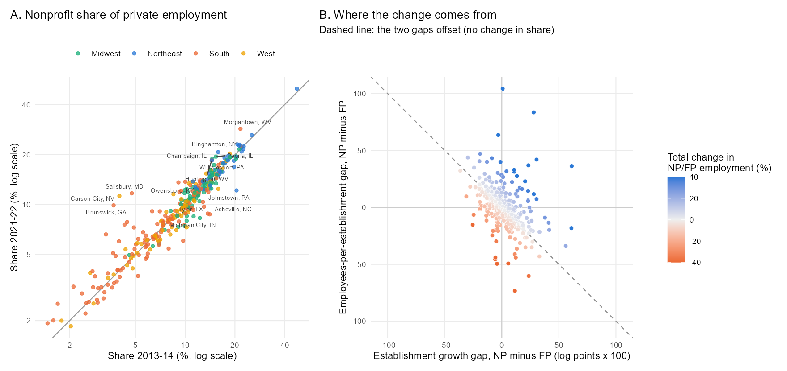

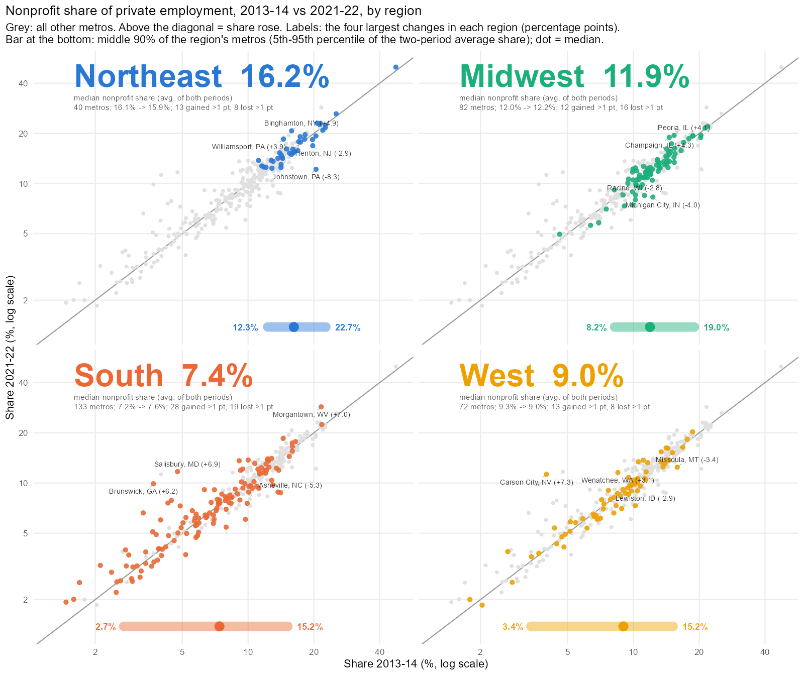

| region (`c11_by_region.csv`) | metros | median share (avg. of both periods) | middle 90% of metros | median share 2013–14 → 2021–22 | median change (pts) | gained > 1 pt | lost > 1 pt | variance share from establishment size |
|---|---|---|---|---|---|---|---|---|
| Northeast | 40 | 16.2% | 12.3–22.7% | 16.1% → 15.9% | +0.41 | 13 | 8 | 76% |
| Midwest | 82 | 11.9% | 8.2–19.0% | 12.0% → 12.2% | −0.07 | 12 | 16 | 66% |
| South | 133 | 7.4% | 2.7–15.2% | 7.2% → 7.6% | +0.07 | 28 | 19 | 69% |
| West | 72 | 9.0% | 3.4–15.2% | 9.3% → 9.0% | 0.00 | 13 | 8 | 78% |

The bars at the bottom of each panel show the middle 90% of metros. The Northeast and Midwest ranges are narrow and high. The South and West ranges are wide and reach far lower: the South's 5th percentile (2.7%) is below a fifth of the Northeast's (12.3%). Their top ends (15.2%) overlap the Northeast median.

- **The regions differ in level, not in change.** The Northeast's typical share is twice the South's, but every region's median moved less than half a point. No region is catching up or pulling away.
- **Within each region, large moves are idiosyncratic and mostly about establishment size.** Examples: Johnstown and Trenton in the Northeast; Michigan City and Racine versus Peoria and Champaign in the Midwest; Asheville versus Morgantown, Salisbury and Brunswick in the South; Missoula versus Carson City in the West.
- **The Midwest is the only region where more metros lost a point than gained one.**

**Decomposition.** The log ratio of nonprofit to for-profit employment splits exactly into two gaps between nonprofits (NP) and for-profits (FP):
- an establishment-count gap: NP establishment growth minus FP establishment growth
- an establishment-size gap: NP growth in employees per establishment minus FP growth

| share of the cross-metro variance in share change | 2013–14 → 2021–22 | year-to-year (net of year means) |
|---|---|---|
| establishment-count gap | 28% | 27% |
| establishment-size gap | **72%** | **73%** |

Splitting further:
- Nonprofit employees per establishment accounts for 68% of the variance.
- Nonprofit establishment growth accounts for 20%.
- For-profit establishment growth and size account for 8% and 5%.
- The two gaps are negatively correlated (−.33 across metros, −.46 year to year). Where nonprofits add establishments, their average establishment gets smaller.

**Shifts in share come mostly from changes in how many people nonprofit establishments employ, not from more or fewer nonprofits.**
- The biggest moves look like single large employers.
  - Johnstown PA fell 8.3 points and Asheville NC 5.3 points, both through a collapse in nonprofit establishment size (−73 and −50 log points). Both fit hospital systems converting to for-profit ownership (Conemaugh in 2014; Mission Health in 2019), though this is not verified in the data.
  - Brunswick GA (+6.2) and Carson City NV (+7.3) gained through jumps in nonprofit establishment size (+104 and +83).
- Establishment growth drives a few gains. Salisbury MD (+61 log points) and Williamsport PA (+38) grew mainly by adding nonprofit establishments.

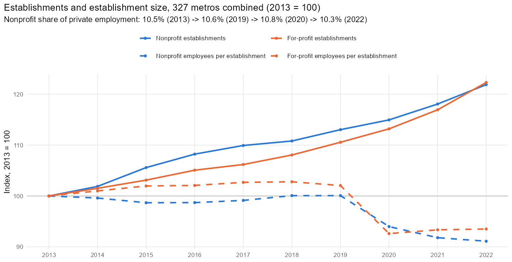

**Nationally, the two sectors moved in step** (all 327 metros summed):
- Nonprofit and for-profit establishments both grew about 22% from 2013 to 2022.
- Employees per establishment fell for both, mostly in 2020: nonprofit from 47.6 to 43.4, for-profit from 12.7 to 11.9.
- The nonprofit share went 10.5% (2013) → 10.6% (2019) → 10.8% (2020) → 10.3% (2022). The 2020 bump came from for-profit employment falling more in COVID, and it reversed by 2022.

**Share change is unrelated to change in organization density.** Over the same window, the change in nonprofit/for-profit employment correlates −.05 with the filer SAMI change and .11 with the grassroots SAMI change. Employment share tracks large employers, especially hospitals. Organization counts track the many small organizations. This is one more reason market share works as a level-setter (sections 4.1 and 6) but says little about catch-up.

### 4.6 Why is the Northeast's nonprofit sector about twice the South's and West's?

Source: `c11_region_profile.csv`, from `R/notes/76_bls_share_change.R` part 6. Each figure is the regional median of metro averages over 2013–2022; the endowment and growth rows come from sections 2.6 and 3.

| | Northeast | Midwest | South | West |
|---|---|---|---|---|
| nonprofit share of private employment | 16.1% | 12.0% | 7.5% | 9.2% |
| **nonprofit jobs per 1,000 residents** | **61** | **47** | **25** | **31** |
| for-profit jobs per 1,000 residents | 308 | 345 | 294 | 299 |
| nonprofit share within health care and social assistance | 58% | 54% | 34% | 40% |
| nonprofit share within private education | 85% | 73% | 66% | 55% |
| nonprofit share within social assistance | 53% | 50% | 40% | 35% |
| nonprofit share within arts and recreation | 17% | 18% | 15% | 15% |
| pre-1970 nonprofit stock, SAMI | +.13 | +.21 | −.17 | +.06 |
| foundation assets, SAMI (2000) | +.15 | +.51 | −.23 | −.33 |
| population growth 1970–2000 | 16% | 17% | 51% | 100% |
| religious adherents | 45% | 45% | 52% | 40% |
| Catholic share of adherents | 57% | 32% | 14% | 43% |
| S&L government share of employment | 10.0% | 10.0% | 10.4% | 11.3% |
| % BA / % 65+ | 31% / 17.7% | 28% / 16.3% | 25% / 15.9% | 29% / 15.9% |

**The gap is in the numerator.** For-profit employment per resident is similar everywhere (294–345 per 1,000). The South and West have well under half the Northeast's nonprofit jobs per resident. The question is why nonprofits supply fewer services there, not why for-profits are bigger.

Candidate explanations, roughly in order of weight:

1. **Ownership of hospitals and colleges** (the largest factor).
   - Health care is about half of nonprofit employment, and higher education is the next largest piece.
   - Within those industries, nonprofits hold 58% of health and social-assistance jobs in the Northeast against 34% in the South, and 85% of private education jobs against 55–66% in the South and West.
   - The same services exist, but in the South and West more of them are provided by for-profit chains or by government. The large for-profit hospital chains grew up in the South (HCA in Nashville, Tenet in Dallas), and the South and West rely more on public hospital districts and county hospitals. Some Northeast states, notably New York, long restricted for-profit hospital ownership.
   - Higher education follows the same pattern: dense old private colleges in the Northeast, public state systems in the South and West.
   - This fits section 4.5, where share shifts come mostly from employees per establishment and single large employers.
2. **Institutional age and religious sponsorship.**
   - Northeast hospitals, orphanages, settlement houses, immigrant-aid societies and colleges date from the 19th and early 20th centuries, many with Catholic or mainline Protestant sponsors.
   - The pre-1970 stock is above size-expected in the Northeast and Midwest (+.13, +.21) and below it in the South (−.17).
   - Catholic adherents are 57% of adherents in the Northeast against 14% in the South, and Catholic health systems, schools and charities are large nonprofit employers.
   - Adherence itself is higher in the South (52%). But Southern Protestant religious life runs largely through congregations rather than separately incorporated service agencies.
3. **Growth timing.**
   - South and West metros grew 50–100% over 1970–2000, against 16–17% in the Northeast and Midwest.
   - Nonprofit density lags growth, slowly across metros (section 2.6).
   - There is also an era effect: much of the Sunbelt's institutional build-out came after 1970, when for-profit hospital chains and public community colleges were the expanding models.
4. **Philanthropic capital.** Foundation assets relative to population are well above size-expected in the Midwest (+.51) and Northeast (+.15), and below it in the South and West (−.23, −.33). This reflects old industrial fortunes and community foundations that fund nonprofit providers.
5. **How government funds services** (not tested here).
   - Northeast states have long paid nonprofits to deliver publicly funded health and social services, through generous Medicaid and contracting.
   - Many Southern states spend less, did not expand Medicaid, or provide services directly.
   - The gap in nonprofit shares within social assistance (53% vs 35–40%) is consistent with this.
   - State and local government's share of employment is similar across regions (10–11%), so public provision is not an obvious substitute at the aggregate level.
6. **Demand factors** are modest. The Northeast is somewhat more educated (31% BA vs 25% in the South) and older (17.7% vs 15.9% aged 65+).

**Reading.**
- **The sector's size is driven by large institutions.** The Northeast's sector is about twice as large mainly because its hospitals and colleges are nonprofit. That reflects an older institutional history, Catholic and mainline sponsorship, philanthropic wealth and state policy. The South and West deliver the same services through for-profit chains and public institutions.
- **Organization counts show the same regional ordering**, but the size of the sector (employment, spending) is dominated by those few large institutions.
- **Next steps.** Testing items 1 and 5 directly would need hospital ownership data, such as the AHA survey or CMS Provider of Services files, and state Medicaid and contracting measures.

### 4.7 Nonprofit age: by state, against market share, and against size

Script `R/notes/77_nonprofit_age.R`; outputs `c12_*`, `fig_c12_*`.
- **Age** is 2022 minus the IRS ruling year, for the 1.36 million 501(c)(3) public charities in the 2022 BMF.
- **Filers** are the 312,500 matched by EIN to 2022 e-file returns at or above the $50k (2010 $) floor; the rest are grassroots.
- **Dollar-weighted age** weights each filer by its expenditures. It is the age of the average nonprofit dollar, the closest analogue to employment share.

Caveats:
- The ruling year marks IRS recognition, not founding.
- The ruling year resets when a revoked organization is reinstated (common after the 2011 auto-revocation), which understates age.
- Group-exemption subordinates carry the group's date. That makes all-registered ages older than filer ages in Mississippi, Tennessee, South Carolina and the Dakotas, and causes spikes at particular ages (around 55 and 79) in the size chart.

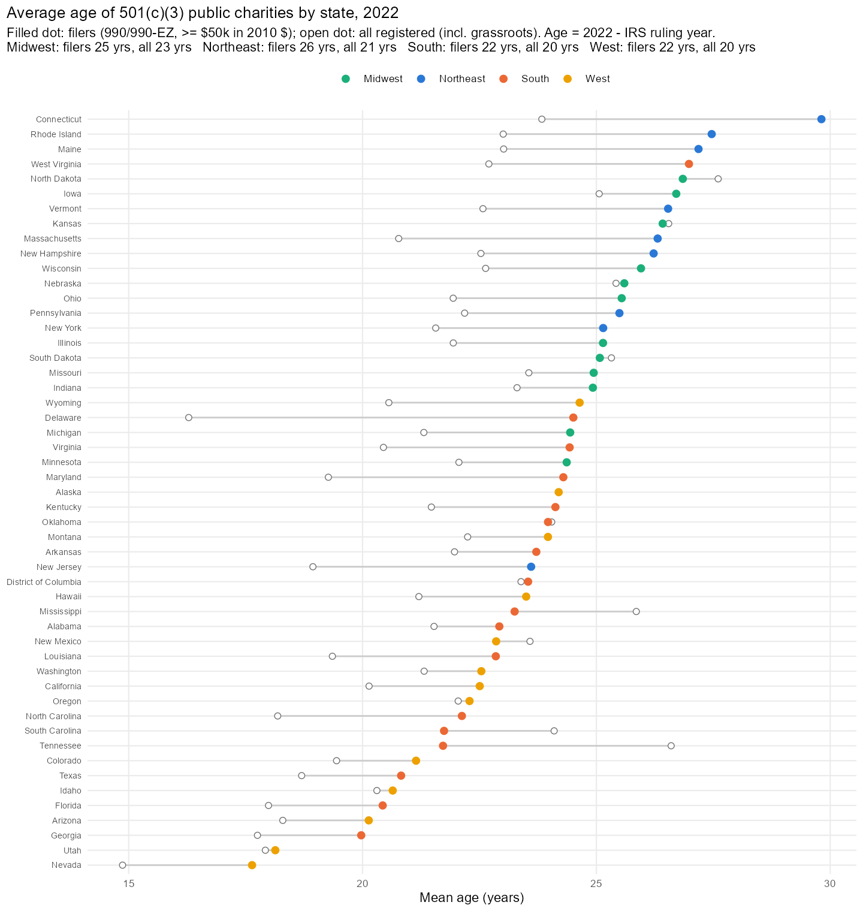

| `c12_age_by_region.csv` | Northeast | Midwest | South | West | all |
|---|---|---|---|---|---|
| mean age, filers | **25.7** | 25.3 | 22.2 | 22.1 | 23.6 |
| mean age, all registered | 21.5 | 22.8 | 20.0 | 20.2 | 20.9 |
| mean age, grassroots | 19.9 | 22.1 | 19.5 | 19.6 | 20.2 |
| median age, all registered | 14 | 15 | 12 | 12 | 13 |
| dollar-weighted age, filers | 45.1 | **46.4** | 41.0 | 42.7 | 43.7 |
| dollar-weighted age, excl. hospitals and universities | 37.9 | 36.0 | 33.6 | 35.2 | 35.6 |

- **Filers in the Northeast and Midwest are about 3.5 years older on average than in the South and West.**
  - The oldest filer sectors are Connecticut (30 years), Rhode Island, Maine, West Virginia, North Dakota, Iowa and Vermont.
  - The youngest are Nevada (18), Utah, Georgia, Arizona, Florida, Idaho, Texas and Colorado: the fast-growth Sunbelt and Mountain West.
- **The typical registered organization is young** (median 13 years) and close to the same age everywhere. The regional age gap is in established filers, not grassroots registrations.
- **The average dollar is much older than the average organization.** Dollar-weighted age (44 years) is about twice the filer mean (24), because large institutions are old (see below).

**Age and market share** (metros, BLS share 2013–2022; `c12_age_vs_share.csv`):

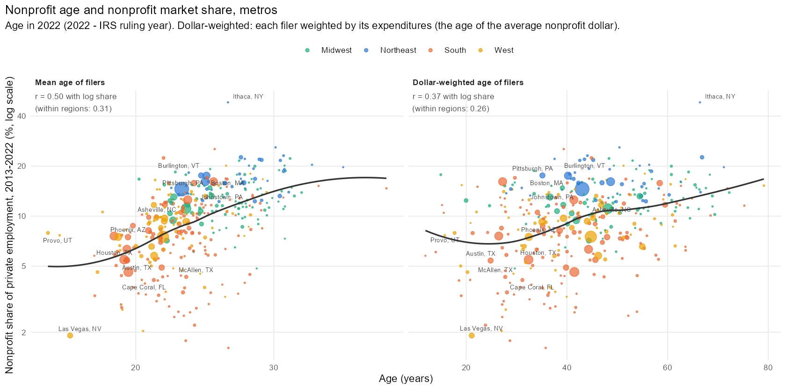

| correlation with log nonprofit share | all metros | within regions |
|---|---|---|
| mean age of filers | **.50** | .31 |
| dollar-weighted age of filers | .37 | .26 |
| dollar-weighted age, excl. hospitals and universities | .36 | .21 |
| median age, all registered | .21 | .12 |
| share of organizations ruled before 1970 | .01 | −.02 |

- **Metros with older filer sectors have larger nonprofit market shares,** including within regions.
  - Each extra year of dollar-weighted age goes with about a 1% larger share, holding region fixed (p < .001).
  - The youngest filer sectors are Provo (14 years), St. George (14) and Las Vegas (15; share 2%). The oldest are Wheeling, Elmira and Weirton (33–38). Ithaca has the highest share (48%).
- **The relationship flattens above an average filer age of about 28 years.** Beyond that, share levels off near 15–20%.
- **Region still matters at equal age.** The Northeast sits about 33% higher and the South about 37% lower than the Midwest at the same dollar-weighted age (log points). Age explains part of the regional gap, not all of it.

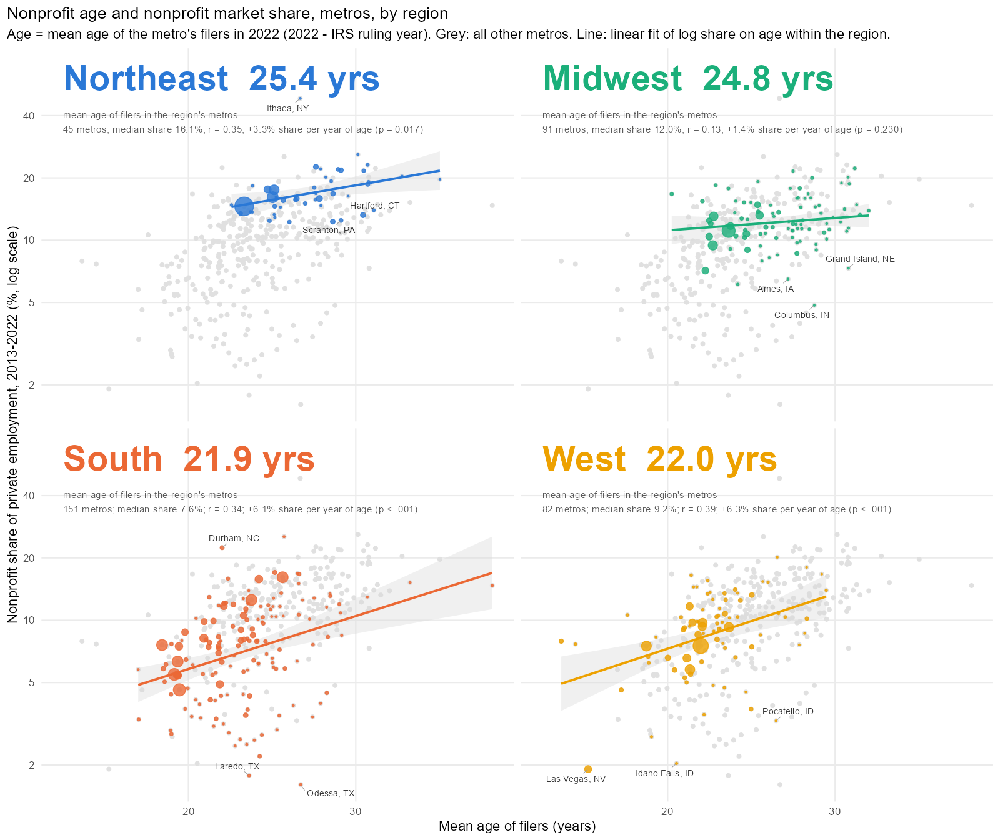

| by region (`c12_age_vs_share_by_region.csv`) | metros | mean filer age (all filers in the region's metros) | median share | r (age, log share) | share per extra year of age | p |
|---|---|---|---|---|---|---|
| Northeast | 45 | 25.4 | 16.1% | .35 | +3.3% | .017 |
| Midwest | 91 | 24.8 | 12.0% | .13 | +1.4% | .23 |
| South | 151 | 21.9 | 7.6% | .34 | **+6.1%** | < .001 |
| West | 82 | 22.0 | 9.2% | .39 | **+6.3%** | < .001 |

- **Within the South and West, age matters a lot.** Each extra year of average filer age goes with about 6% more nonprofit share. The South's regression line runs from about 5% share in metros with 17-year-old sectors to about 15% at 35 years.
- **In the older Northeast and Midwest, the slope is flat or modest** (+1–3% per year, not significant in the Midwest). This fits the leveling-off above about 28 years in the pooled chart: once a sector is old, more age adds little.
- **The age gap is what separates the Sunbelt from the older regions.** South and West filers are about 3–3.5 years younger on average (21.9–22.0 vs 24.8–25.4), and their metros sit in the steep part of the relationship.
- **Outliers below their region's line:**
  - Low share for their age: border and energy metros (Laredo, Odessa), Las Vegas, Idaho Falls and Pocatello in the West, and Columbus IN and Ames IA in the Midwest (both large corporate or university-dominated economies).
  - High share for their age: Durham NC (Duke) and Ithaca NY (Cornell), where a single large institution dominates.

### 4.8 How long do nonprofits last? Lifespan by region, filers vs non-filers

Script `R/notes/78_nonprofit_lifespan.R`; outputs `c13_*`, `fig_c13_*`.

**Definitions.** The sample is 1.49 million 501(c)(3) public charities with an IRS ruling year from 1990 to 2021.
- **Filers** (585,000) have filed any 990 or 990-EZ, of any size, in 2000–2024. Their lifespan runs from the ruling year to the last filing year.
- **Non-filers** (900,000) are registered but never filed. Their lifespan runs to the last year they appear in the BMF (2000–2022).
- **The ruling year** is the earliest one recorded for the EIN, or the first year it is seen if that is earlier, so reinstatements do not reset it.

**Method.**
- **Censoring.** Many organizations are still alive: 56% of filers still file in 2022 or later, and 61% of non-filers are still registered in 2021–22. The plain average of completed lifespans is therefore biased short.
- **Kaplan–Meier survival estimates:**
  - Right censoring for organizations still active.
  - Left truncation (delayed entry): the data start in 2000, so organizations ruled in the 1990s enter at their age in 2000. Those that closed before 2000 are unseen.
- **Summary measures, each with a 95% CI:**
  - The restricted mean lifespan (RMST): expected years active within the first 25 years after ruling.
  - The median lifespan.
  - Survival at 10 and 20 years.
- **For reference only,** the mean lifespan of organizations that ended, with t-based CIs.

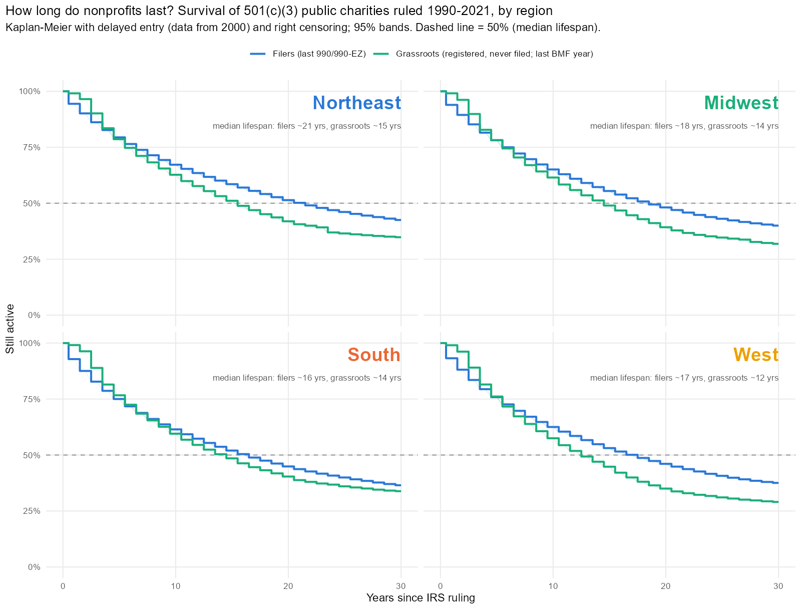

The survival chart has one panel per region, with filers (blue) and grassroots (green: registered, never filed) on the same axes.
- **In every region, the two curves cross at about 4–5 years.** Early on, filers end faster: many file a 990 for a year or two after ruling, then drop to postcard (990-N) status or stop, which counts as an end here. After about year 5, filers outlast grassroots, and the gap widens with age.
- **At 3 years, filers trail grassroots by 4–6 points; by 5 years the curves meet.**
- **By 20–30 years, filers lead by 8–11 points in the West, Northeast and Midwest, but only 3–5 points in the South.** Southern filers lose their long-run survival advantage over grassroots, which fits their higher hazard of ending (+21% vs the Northeast).

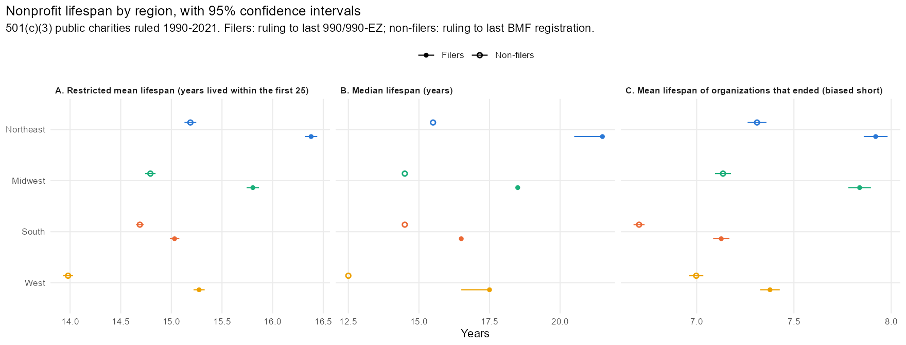

| `c13_lifespan_by_region.csv` | Northeast | Midwest | South | West | all |
|---|---|---|---|---|---|
| **filers:** restricted mean lifespan, first 25 yrs (95% CI) | **16.4** (16.3–16.4) | 15.8 (15.7–15.9) | 15.0 (15.0–15.1) | 15.3 (15.2–15.3) | 15.5 (15.5–15.5) |
| filers: median lifespan, years | ~21 | ~18 | ~16 | ~17 | ~17 |
| filers: still filing after 10 / 20 years | 67% / 51% | 65% / 48% | 62% / 45% | 63% / 46% | 64% / 47% |
| filers: mean lifespan of those that ended | 7.9 | 7.8 | 7.1 | 7.4 | 7.5 |
| **non-filers:** restricted mean lifespan, first 25 yrs (95% CI) | **15.2** (15.1–15.2) | 14.8 (14.7–14.8) | 14.7 (14.7–14.7) | 14.0 (13.9–14.0) | 14.6 (14.6–14.7) |
| non-filers: median lifespan, years | ~15 | ~14 | ~14 | ~12 | ~14 |
| non-filers: still registered after 10 / 20 years | 63% / 42% | 62% / 39% | 60% / 40% | 58% / 35% | 60% / 39% |
| non-filers: mean lifespan of those that ended | 7.3 | 7.1 | 6.7 | 7.0 | 7.0 |

Hazard of ending relative to the Northeast (`c13_hazard_ratios.csv`; Cox model with delayed entry):

| | Midwest | South | West |
|---|---|---|---|
| filers | 1.09 (1.07–1.10) | **1.21** (1.19–1.22) | 1.17 (1.15–1.18) |
| non-filers | 1.06 (1.05–1.07) | 1.07 (1.06–1.08) | **1.18** (1.17–1.19) |

**Reading.**
- **Nonprofits are long-lived but far from permanent.** About two-thirds of filers still file 10 years after ruling, and about half after 20. The typical (median) filer lasts about 17 years and the typical non-filer about 14.
- **Northeast filers last longest.** The median is about 21 years, against 16–18 elsewhere. Southern filers stop filing about 21% faster at any age, and Western filers 17% faster.
  - Over the first 25 years, a Northeast filer stays active about 1.4 years longer than a Southern one (16.4 vs 15.0).
  - This fits the older Northeast sectors in section 4.7: organizations that survive keep growing (age vs size), so higher survival compounds into larger, older sectors.
- **Among non-filers, the West stands out** with the shortest registrations (median about 12 years, hazard +18%). The other three regions are within about half a year of each other.
- **Filers outlast non-filers everywhere,** by about 1 year in restricted mean and 2–6 years in median.
  - The filer measure is "last 990 filed": an organization that drops below the filing threshold and becomes a postcard filer counts as ended here, though it may still exist.
  - So filer lifespans are, if anything, understated relative to non-filers.
- **The regional differences are precise but modest.** With hundreds of thousands of organizations, CIs are a tenth of a year wide. The differences are 1–2 years on a base of about 15. The CIs reflect sampling only, not measurement issues: ruling-date resets for reinstated organizations, group-exemption subordinates, and BMF snapshot gaps in 2016–18.
- **The completed-lifespan means (about 7 years) are far shorter than the survival-based estimates.** Organizations that end early are overrepresented among completed spells; the survival estimates correct for this.

**Age and size** (filers, 2022; `c12_age_vs_size.csv`):

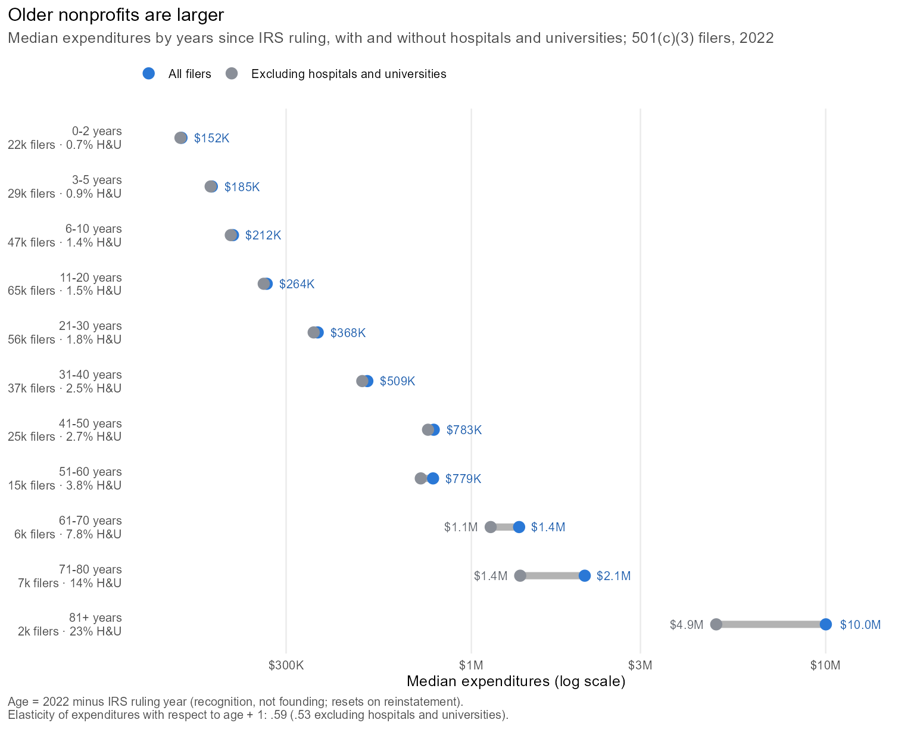

This is the same simplified chart as in the draft paper (`58_outline_analyses.R`, part O): median expenditures by age band, with and without hospitals and universities (`c12_age_vs_size_dumbbell.csv`). Excluding hospitals and universities barely changes the median through age 60. For the oldest organizations, the median falls from $10.0M to $4.9M.

| age (years) | 0–2 | 3–5 | 6–10 | 11–20 | 21–30 | 31–40 | 41–50 | 51–60 | 61–70 | 71–80 | 81+ |
|---|---|---|---|---|---|---|---|---|---|---|---|
| filers | 22k | 29k | 47k | 65k | 56k | 37k | 25k | 15k | 6k | 7k | 2k |
| median expenditures | $152k | $185k | $212k | $264k | $368k | $509k | $783k | $779k | $1.4M | $2.1M | $10.0M |
| % hospitals or universities | 0.7% | 0.9% | 1.4% | 1.5% | 1.8% | 2.5% | 2.7% | 3.8% | 7.8% | 13.7% | 23.3% |

- **Size rises steadily with age.** Median spending roughly doubles from a new filer ($152k) to a 30-year-old one ($368k), doubles again by about 45 years, and reaches $2–10M among organizations recognized before the 1950s.
- **The elasticity is .59** (log expenditures on log(age + 1)), and .53 excluding hospitals and universities. Doubling age goes with about 50% more spending. The Spearman correlation is .30.
- **The spread at every age is wide.** The interquartile range spans a factor of 4–5 at most ages and widens to 40 for the oldest organizations.
- **Hospitals and universities concentrate among the oldest:** a quarter of filers aged 81+.

**Reading.** Age links the regional pattern in section 4.6 to the size findings.
- Older nonprofit sectors hold more of the large, long-established institutions, especially hospitals and colleges, and organizations grow over decades.
- So the Northeast and Midwest, with older filer sectors, have more nonprofit employment per resident.
- The fast-growth Sunbelt and Mountain West have young sectors whose organizations have not yet had time to grow, or whose large institutions were founded as for-profit or public.
- This is consistent with the slow cross-metro lag in section 2.6. Catching up in employment share needs institutions to age and grow, not just more registrations.

---

## 5. Why filers vs grassroots, and what the pooled registered stock showed

**The pooled stock is mostly grassroots.**
- Grassroots are 72–80% of registered public charities.
- Correlations between the size-adjusted densities, 2000–2024:
  - registered with grassroots: .97
  - registered with filers: .82–.87
  - filers with grassroots: .65–.73
- Every registered-stock result therefore lands between the two groups, close to grassroots:

| | filers | grassroots | registered (pooled) |
|---|---|---|---|
| share of expected growth realized at 10 / 24 yrs | .91 / .96 | .69 / .78 | .75 / .83 |
| within-metro half-life | ~5 yrs | ~9 yrs | ~9 yrs |
| fastest fifth, SAMI 2024 | −.26 | −.16 | −.18 |
| deficit convergence per decade (2011 SAMI) | −.01 | −.23 | −.18 |
| Shapley R²: change / endowment (total) | .14 / .05 (.29) | .09 / .18 (.55) | .10 / .19 (.55) |
| BLS share, within R² | .35 | .14 | .23 |
| response to income loss | .15 | ~0 | ~0 |
| Δ income partial r | .35 | −.07 | .03 |

**Separating the groups adds clarity and loses no finding.** The pooled stock blended two groups that respond in opposite directions to the local economy. The income and wage effects were near zero in the pooled data, because filers rise and grassroots fall. The pooled stock also understated how strongly the fast-growth deficit, income sensitivity and market share belong to established filers.

**What the pooled stock still contributes:**
1. **A splice-free robustness check.**
   - Grassroots = registered − filers, so they inherit the 2011 and 2020 filer splices in reverse. Grassroots year-to-year changes are about 40% noisier in 2011.
   - Every grassroots conclusion here also holds for the registered stock, with similar magnitudes. Run `72_catchup_lag.R grass` and `73_pre2000_growth.R grass` to reproduce them.
2. **The mechanism.** Entries, exits and the filing share (section 3.5) are defined on the registered stock, because the movement of organizations between grassroots and filer status is the mechanism.
3. **An independent measure for the convergence IV** (section 1).

**Grassroots caveats:**
- **Dormant registrations** inflate the stock until the IRS revokes them; the 2011 auto-revocation is visible.
- **Group-exemption subordinates** registered at a headquarters address inflate Memphis and Mankato.
- **Churches** are counted only if they registered.
- **The 2016–18 BMF snapshot gap** shows as a dip in year-to-year grassroots correlations.

---

## 6. Carrying capacity: growth history × nonprofit market share

Script `R/notes/75_capacity_grid.R`; outputs `c10_*`, `fig_c10_*`.
- **Growth history** is population growth 1970–2000 in %/yr (section 2.6).
- **Market share** is the BLS 501(c)(3) share of private employment, averaged over 2013–2022.
- **Density** is the mean SAMI over 2013–2022, shown as % above or below the size-expected level.
- The sample is 358 metros. The two axes correlate −.41: fast growers have small nonprofit sectors.

### 6.1 The grid

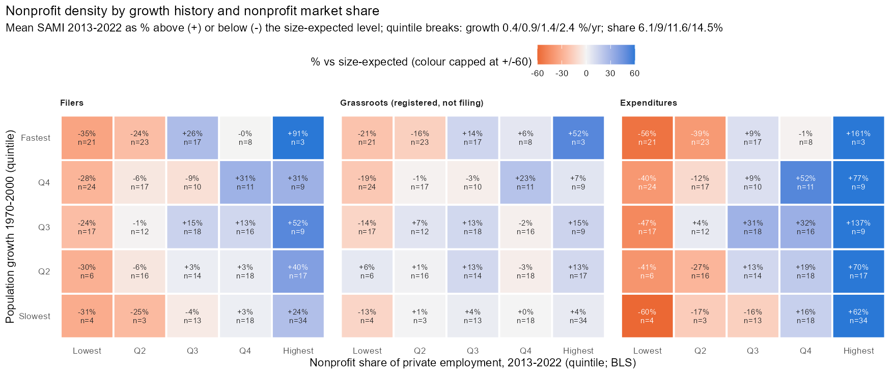

Filers, mean % vs size-expected (quintiles; breaks at 0.4 / 0.9 / 1.4 / 2.4 %/yr growth and 6.1 / 9.0 / 11.6 / 14.5% share):

| growth 1970–2000 ↓ / market share → | lowest | Q2 | Q3 | Q4 | highest |
|---|---|---|---|---|---|
| fastest | −35 (21) | −24 (23) | +26 (17) | 0 (8) | +91 (3) |
| Q4 | −28 (24) | −6 (17) | −9 (10) | +31 (11) | +31 (9) |
| Q3 | −24 (17) | −1 (12) | +15 (18) | +13 (16) | +52 (9) |
| Q2 | −30 (6) | −6 (16) | +3 (14) | +3 (18) | +40 (17) |
| slowest | −31 (4) | −25 (3) | −4 (13) | +3 (18) | +24 (34) |

Metros per cell are in parentheses.

- **Market share sets the level; growth history adds little once share is known.**
  - Every lowest-share cell is 24–35% below expected, whatever the growth history.
  - Every highest-share cell is 24–91% above.
  - Down a column, there is no consistent growth gradient.
- **The joint distribution is lopsided.**
  - 44 of the 72 fastest-growing metros sit in the two lowest-share quintiles; only 3 are in the highest.
  - 34 of the 72 slowest growers are in the highest-share quintile.
  - The off-diagonal cells are thin.
- **Grassroots show the same ordering, much weaker:** −21 to +52%.
- **Expenditures show it far stronger:** −60 to +161%.

### 6.2 How much each axis explains

Source: `c10_decomposition.csv`. Models are fit on standardized growth and log share.

| R² for mean SAMI 2013–2022 | filers | grassroots | expenditures |
|---|---|---|---|
| growth history alone | .08 | .05 | .10 |
| market share alone | .35 | .14 | .40 |
| both | .35 | .15 | .40 |
| both + interaction | .36 | .18 | .41 |
| region alone | .18 | .03 | .16 |
| Shapley: growth / share | .04 / .31 | .03 / .12 | .05 / .35 |

- **Growth history has no effect once share is held fixed.** Its coefficient is −.008 per SD (SE .021) for filers, against +.21 per SD for share.
- **The interaction is positive** (filers +.035, p = .02; grassroots +.048, p = .001). Fast growth goes with lower density only where the nonprofit share is low, and with slightly higher density where it is high.
- **This qualifies section 2.6.** The growth-history association there survives region and census traits, but not market share. Fast-growing metros have both few established organizations and a small nonprofit workforce. In a cross-section, the two measures can't be pulled apart, and employment share partly measures the same organizations.

### 6.3 Other views

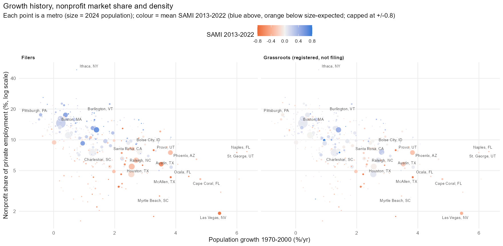

The scatter puts growth history on x and market share (log) on y, with color for density.
- **Density bands are close to horizontal.** Blue sits above about 10% share, orange below about 6%.
- **The fast-growth Sunbelt** (Las Vegas, Cape Coral, Myrtle Beach, McAllen, Phoenix, Austin, Raleigh) sits in the low-share, low-density corner.
- **Exceptions show the share effect.** Boise and Provo grew fast but have middle shares. Boise is near expected density; Provo is far below it (see 6.4).

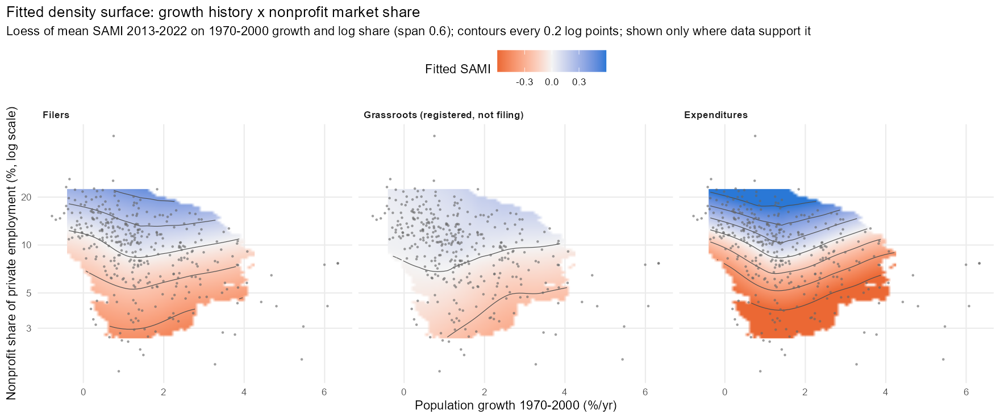

The fitted surface is a loess fit, shown only where data support it.
- **Contours run mostly flat across growth**, which is the share effect.
- **At low and middle shares, they tilt upward as growth rises.** A metro that grew 3–4%/yr needs about a 10% share to reach expected filer density; a metro that grew 1%/yr gets there at about 8%. This is the interaction in surface form.
- **The grassroots surface is much flatter.**

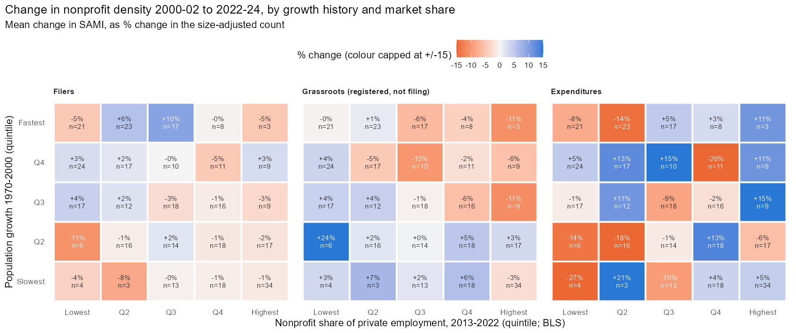

**The change grid (2000–02 to 2022–24) shows no systematic pattern for filers or expenditures.** Cells move ±10% with no gradient.
- Grassroots grew in low-share columns and shrank in high-share columns, which is convergence.
- In regression, market share predicts a small filer gain (+.022 per SD, p = .04), holding the 2000 SAMI fixed.
- Growth history predicts a grassroots loss (−.027 per SD, p = .002).

### 6.4 Above and below "capacity"

Source: `c10_capacity_fit.csv`. Expected SAMI is fitted from growth history, log share and their interaction.

| | furthest below expectation | furthest above |
|---|---|---|
| filers | Hinesville GA (−1.02), Killeen TX (−.99), Yuma AZ, Hanford CA, McAllen TX, Lake Havasu City AZ, Monroe MI, Provo UT, Brownsville TX, Merced CA | Midland TX (+.79), Santa Fe NM, Boulder CO, Napa CA, Cheyenne WY, Missoula MT, Charlottesville VA, Pittsfield MA, Fort Collins CO, Coeur d'Alene ID |
| grassroots | Provo UT (−.82), Yuma AZ, Hanford CA, McAllen TX, Ogden UT, Logan UT, Dalton GA, Laredo TX, Brownsville TX, Morristown TN | Missoula MT (+1.29), Augusta GA, Florence AL, Memphis TN, Jackson MS, Cheyenne WY, Coeur d'Alene ID, Boulder CO, Tallahassee FL, Santa Fe NM |

Patterns among the outliers:
- **Military towns** (Hinesville at Fort Stewart, Killeen at Fort Hood) fall far below their capacity for filers.
- **Utah metros** (Provo, Ogden, Logan) fall far below for grassroots, consistent with congregations that do not register separately.
- **Border metros** (McAllen, Brownsville, Laredo, Yuma) are below on both counts.
- **College and amenity towns** (Boulder, Santa Fe, Missoula, Charlottesville) are above.
- **Memphis's grassroots excess** is the known group-exemption artifact.

**Reading.**
- **Nonprofit market share works as a strong level-setter for filer density.** Growth history adds nothing once share is known, apart from a modest penalty in low-share metros.
- **Neither axis predicts much about change.**
- **The residuals point to institutional factors neither axis captures:** military bases, the LDS church structure, border economies and university towns.

---

## Caveats

- **Data.**
  - Filer counts cross the 2011 splice, and grassroots inherit it in reverse. The Q5 filer line jumps at 2011, so the splice may affect fast growers differently.
  - The registered stock is reconstructed from ruling years and last appearance, and the 2016–18 snapshots are incomplete.
  - Implied exits are noisy.
  - ACS measures are interpolated 2001–2009.
- **Kernel models** (section 2.8). Pre-2000 population is interpolated between censuses, and post-2000 annual estimates are smooth, so first-year responses are weakly identified. Free-elasticity kernels are capped at a 20-year half-life, because slower kernels are near-trends that are collinear with log P under metro FE. The tail beyond about 6 years is not separable from metro-specific trends.
- **Pre-2000 test limits** (section 2.6). It uses decennial counts only, drops Connecticut, and cannot separate a slow lag from traits that come with sustained in-migration. The 2000 SAMIs rest on CORE data.
- **Endogeneity.** Income, education and market-share changes respond to the same migration that drives population growth. Nothing here is causal.
