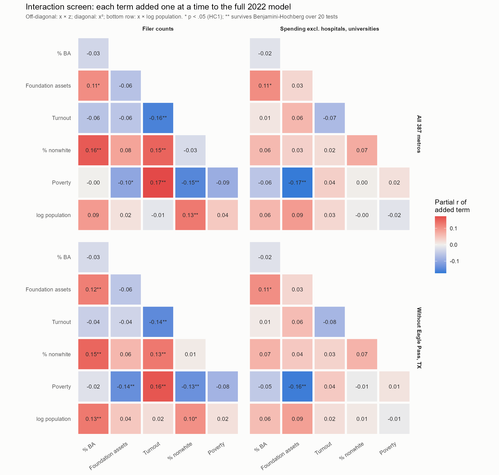

# Interaction screen: five benchmark covariates

- **Script:** `R/notes/80_interaction_screen.R`, run 2026-11-15.
- **Outputs:** `D:/MULTIVERSE/data/interactions/`: `p1_interaction_matrix.csv`, `p2_joint_cv.csv`, `p3_stability.csv`, `p3_stability_summary.csv`, `fig_interaction_matrix.png`.
- **Logs.** Extensive covariates are logged with the per-capita floor (`flog`, see below). The first run used `log(x + 1)`. `Rscript R/notes/80_interaction_screen.R slog` reproduces it in `interactions/slog/`.

## Status in the multiverse

- No spec in runs v1–v6 has an interaction term. `run_spec()` builds a purely additive formula.
- The plan lists "X × log P interactions (mechanism arm)" as fork C3 (Data Construction Plan §9.5), and the SAMI note (§ on mechanisms, rule 4) recommends it. It was never added to `BLOCKS`/`FORKS`.

## Design

- **Model.** Default 2022 metro model: log Y on % BA, foundation assets (log SAMI), turnout, % nonwhite, poverty, government earnings (log SAMI) and log P. By FWL this matches the SAMI model.
- **Outcomes.** Filer counts (`n_filer_c3`) and spending excluding hospitals and universities (`exp_c3_nohu`).
- **Scaling.** All predictors are z-scored in each estimation sample. An interaction coefficient is the change in x's effect (log points per SD) per SD of z. Main effects in an interaction model are effects at the mean.
- **One at a time.** Each term enters the full main-effects model alone: 10 pairs, 5 squares (x²) and 5 x × log P terms, so 20 tests per outcome. Each test reports HC1 p, Benjamini-Hochberg p over the 20, and p with x² and z² also in the model.
- **Joint test.** All 10 pairs together: a Wald test, adjusted R², and 10-fold CV RMSE (20 repeats).
- **Mini-multiverse.** Each term one at a time over:
  - identification: cs 2022, cs 2019, pooled 2015–22 with year FE
  - unit: metro, all CBSAs
  - estimator: OLS, state FE, division FE
  - outliers: none, winsorized 1%
  - outcomes: 3 count, 2 spending
  That is 108 specs per term for counts and 72 for spending, per sample.
- **Sample.** Every part is run on all metros and again without Eagle Pass, TX.

## Why `cor(x*z, y)` is not the cell to report

- A product of uncentered variables mostly carries the two main effects. For example, raw % BA × turnout correlates .63 with the filer SAMI, yet that interaction's partial r is −.06.
- Centering helps, but the centered product still correlates with the other covariates.
- The correct cell is the partial r (or t) of the centered product in the full model, `Y ~ x + z + x:z + others`. The matrix reports that. Both naive versions are kept in `p1` for comparison.

## Zero foundation assets (fixed)

- Eagle Pass, TX (cbsa 20580) reports zero foundation assets in every year. `slog()` (log(x + 1)) turned that into a log-asset SAMI of −16.6, about 11 SD below the metro mean.
- Across all CBSAs, 89 places have zeros or near-zero assets. The smallest positive value is $0.002 per person, against a $452 median.
- **What this did under `slog`:**
  - Every foundation-asset interaction looked strong: pf × poverty −.26, pf² +.15/+.23, pf × turnout +.19.
  - In the 2022 spending model, the foundation-asset main effect had t = 2.65.
- **Fix (2026-11-15).** `flog(x, pop)` in `40_multiverse.R` raises per-capita values below the 1st percentile of positive values in the estimation sample to that percentile, then logs.
  - Eagle Pass moves to z = −2.0.
  - The gov-earnings SAMI is unchanged (r = .998 with the old version).
  - The spending foundation-asset t is now 5.2.
  - With the floor, dropping Eagle Pass changes no interaction partial r by more than .035.
- **Impact on the multiverse** (run v5 vs v6, same specs, `81_compare_floor.R`).
  - Raw and per capita predictor forms are untouched.
  - Every non-foundation term correlates ≥ .995 across runs, with mean |Δ partial r| ≤ .009.
  - Foundation assets correlate .96–.98 across runs. Their median partial r rises from .163 to .186 in the log form and from .168 to .201 in the SAMI form.
  - Benchmark summary (part S definition): only spending foundation assets moves, median .11 → .13 and 65% → 66% significant. Every other cell moves ≤ .005 in median and ≤ 2 points in share.
- **Impact on single 2022 models** (the outline's cross-section parts, which call `slog`/`log1p` themselves).
  - Foundation assets' partial r rises .10–.12 in metro models (counts .31 → .41, spending .14 → .26) and .04–.09 in metro + micro and micro-only models.
  - Other covariates move ≤ .03.
  - County models barely change (≤ .03). There, 15% of counties have zero assets, so no single place carries the leverage.

## Results (2022 metros, with the floor)

| Term | Counts: partial r | Spending: partial r | Survives x², z²? |
|---|---|---|---|
| turnout × poverty | .17** | .04 | no for counts (p_sq = .36): stands in for turnout curvature |
| % BA × % nonwhite | .16** | .06 | yes |
| turnout² | −.16** | −.07 | — |
| turnout × % nonwhite | .15** | .02 | yes |
| % nonwhite × poverty | −.15** | .00 | yes |
| % nonwhite × log P | .13** | .00 | — |
| % BA × foundation assets | .11 | .11 | yes |
| foundation assets × poverty | −.10 | −.17** | yes |

`**` survives Benjamini-Hochberg over 20 tests. Main-effect partial r for comparison: % BA .27, foundation assets .16, turnout .18.

## Stability across forks (with the floor; share with median sign / share significant with that sign)

**Counts (108 specs per term)**

| Term | Median partial r | Same sign | Significant |
|---|---|---|---|
| turnout² | −.10 | 100% | 82% |
| turnout × % nonwhite | .09 | 100% | 84% |
| turnout × poverty | .10 | 100% | 81% |
| % BA × % nonwhite | .09 | 97% | 69% |
| % BA × foundation assets | .06 | 94% | 35% |
| foundation assets × poverty | −.04 | 81% | 32% |
| any x × log P | ≤ .05 | 54–78% | 11–34% |

**Spending (72 specs per term)**

| Term | Median partial r | Same sign | Significant |
|---|---|---|---|
| turnout² | −.11 | 100% | 78% |
| % BA² | −.09 | 100% | 61% |
| turnout × % nonwhite | .10 | 97% | 58% |
| turnout × poverty | .08 | 100% | 49% |
| % BA × foundation assets | .07 | 100% | 42% |
| foundation assets × log P | .07 | 89% | 39% |

## Do interactions change the main-effects results?

**Joint test, with the floor.**
- All 10 pairs are jointly significant for counts (p = .0008) and only marginally for spending (p = .04).
- Adjusted R² rises .003 for both outcomes.
- Out of sample, counts CV RMSE falls 0.9% and spending CV RMSE rises 0.5%. The interactions overfit spending.

**Main effects with all 10 pairs and all 5 squares added (counts).**
- % BA moves from .097 to .119 per SD.
- Foundation assets moves from .136 to .142.
- Turnout moves from .035 to .046.
- % nonwhite moves from −.106 to −.085.
- Poverty moves from −.034 to −.016.
- No sign changes. Spending is similar.

## Reading

- The additive multiverse is not misspecified in a way that threatens its main-effect conclusions.
- Interactions are real but second-order: partial r ≈ .10–.15 against .16–.27 for the leading main effects.
- Two stable patterns are worth a sentence or an add-on fork:
  - **Turnout is concave.** Its association weakens where turnout is already high. Turnout × poverty is this curvature, not a separate effect.
  - **Turnout and % BA matter more in more diverse metros.** Turnout × % nonwhite and % BA × % nonwhite are positive in 97–100% of count specs and survive the square controls.
- **Foundation-asset interactions were mostly the zero-asset artifact.**
- **The planned X × log P mechanism arm finds little.** No x × log P term is stable for counts, and foundation assets × log P is moderately stable for spending only.
