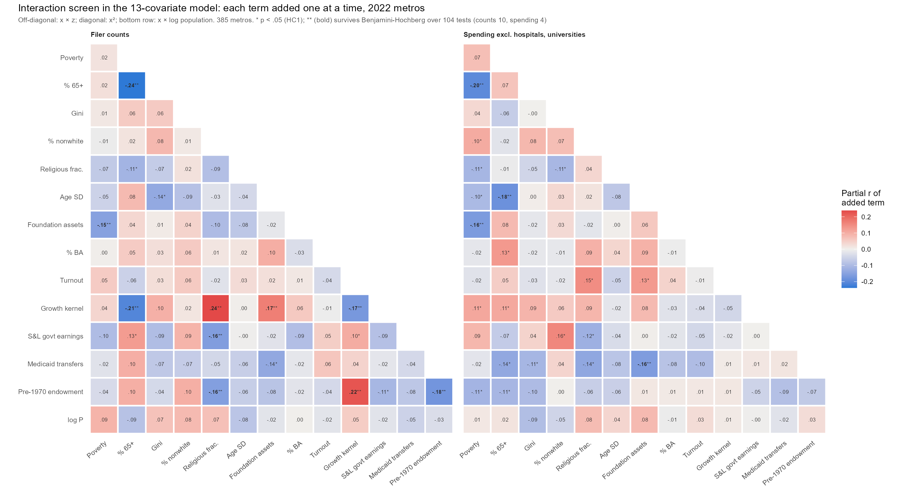

# Interaction screen v11: the 13-covariate default model

- **Script:** `R/99_interaction_screen_v11.R`, run 2026-11-17 (log `D:/MULTIVERSE/logs/99.log`).
- **Outputs:** `D:/MULTIVERSE/data/interactions/v11/`: `p1_main_effects.csv`, `p1_interaction_matrix.csv`, `p1b_absorption.csv`, `p1b_leverage.csv`, `p2_joint_cv.csv`, `p2_main_effects.csv`, `p3_stability.csv`, `p3_stability_summary.csv`, `fig_interaction_matrix.png` (copy of the figure above).
- **Predecessor:** `R/80_interaction_screen.R` and `notes/interaction-screen-results.md` (six-covariate default, five benchmark covariates, 20 terms).

## Design (what changed from script 80)

- **Model.** Log Y on the 13 default covariates (poverty, % 65+, metro Gini, % nonwhite, religious fractionalization = 1 − rel_hhi, age SD, foundation assets, % BA, turnout, growth kernel, S&L government earnings, Medicaid transfers, pre-1970 endowment) and log P. Totals are `flog(x, pop)` residualized on log P by year (SAMI form, the log-log model by FWL, as in script 80). Everything is z-scored in each estimation sample.
- **Sample.** 2022 metros with every covariate: 385 (Memphis and Mankato lack the endowment). Eagle Pass is no longer split out: the floor removed its leverage (script 80).
- **Terms.** 78 pairs, 13 squares, 13 x × log P = 104 per outcome, each added one at a time. BH within outcome over the 104, and over the old 20-term family for comparison.
- **Arm `old6`.** The old six-covariate model refit on the same 385 metros (current data) for its 20 terms. Script 80 vs `old6` is data drift; `old6` vs lean is the model change.
- **Mini-multiverse.** As in script 80: cs 2022 / cs 2019 / pooled 2015–22 × metro / all CBSAs × OLS / state FE / division FE × none / winsorized, with 3 count and 2 spending outcomes: 108 count and 72 spending specs per term, every one of the 104 terms (lean) and the 20 old terms (`old6`).
- **"Stable"** here means the same sign in ≥ 95% of specs and significant with that sign in ≥ 50%. The old four met this for counts (94–100% / 66–84%).

## Part 1: one at a time, 2022 metros

**Main effects (partial r, lean).** Counts: % BA .38, endowment .32, poverty −.29, Medicaid .24, S&L earnings .23, foundation assets .21, % nonwhite −.20 (turnout .01). Spending: % BA .27, Medicaid .18, endowment .16, age SD .13, foundation assets .11. The old card's comparison range (.16–.27) becomes roughly .20–.38 for counts and .11–.27 for spending.

**BH survivors (104 tests).**

| Counts (10) | partial r | Spending (4) | partial r |
|---|---|---|---|
| religious frac. × growth kernel | .24 | poverty × % 65+ | −.20 |
| % 65+² | −.24 | % 65+ × age SD | −.18 |
| growth kernel × endowment | .22 | poverty × foundation assets | −.16 |
| % 65+ × growth kernel | −.21 | foundation assets × Medicaid | −.16 |
| endowment² | −.18 | | |
| growth kernel² | −.17 | | |
| foundation assets × growth kernel | .17 | | |
| religious frac. × S&L earnings | −.16 | | |
| religious frac. × endowment | −.16 | | |
| poverty × foundation assets | −.15 | | |

- Counts survivors have partial r .15–.24; spending .16–.20. All but one counts survivor involve a covariate new to the default (growth kernel, % 65+, endowment, religious fractionalization). No x × log P term survives.
- **With x² and z² controls** most pairs hold (p_sq < .01), but growth kernel × endowment (p_sq .41), % 65+ × growth kernel (.15) and religious frac. × endowment (.06) are partly curvature.
- **Leverage** (`p1b_leverage.csv`; five metros have |z| > 4 on some covariate: Logan, McAllen, Provo, Punta Gorda, The Villages). Robust to dropping them AND to winsorizing: foundation assets × growth kernel, growth kernel × endowment, growth kernel², religious frac. × growth kernel, religious frac. × S&L earnings, poverty × foundation assets (both outcomes), foundation assets × Medicaid, poverty × % 65+. Fragile: % 65+² (winsorized p .22; The Villages has z = 8.4 on % 65+), endowment² (.35), religious frac. × endowment (.30), % 65+ × age SD (without extremes p .19).

**The old 20 terms now.**

| | old card (script 80) | old6, same 385 metros | lean |
|---|---|---|---|
| Counts, BH over 20 | 8 survive | 6 survive (turnout², turnout × poverty, turnout × % nonwhite, % BA × % nonwhite, poverty × % nonwhite, % nonwhite × log P) | **none** (smallest p_BH .07, poverty × foundation assets) |
| Spending, BH over 20 | 1 (foundation assets × poverty) | 1 (same) | 1 (same, p_BH .03) |

Over the 104-test family, poverty × foundation assets is the only old term that survives (both outcomes). The old count terms shrink to |r| ≤ .06: turnout² −.16 → −.04, turnout × poverty .17 → .05, turnout × % nonwhite .15 → .06, % BA × % nonwhite .16 → .06, poverty × % nonwhite −.15 → −.01.

**Which new covariate absorbs them?** (`p1b_absorption.csv`, old six + one new covariate.) None alone: each moves the old terms by .01–.07 (age SD and the growth kernel most, e.g. turnout² −.16 → −.09 / −.12). Only all seven together bring them to ≈ .05. The old interactions were standing in for several omitted main effects at once.

## Part 2: several terms at once (2022 metros)

| Model | terms | Wald p (counts / spending) | Δ adj R² | Δ CV RMSE |
|---|---|---|---|---|
| old 10 pairs | 10 | .002 / .016 | +.001 / +.005 | +1.2% / −0.4% |
| old 10 pairs + 5 squares | 15 | < .001 / .004 | +.002 / +.006 | +1.3% / +0.1% |
| own BH survivors (selected on full sample) | 10 / 4 | < .001 / < .001 | +.003 / +.006 | −5.0% / −3.2% |
| BH survivors, screen redone inside each training fold | 8.1 / 2.3 on average | — | — | **+2.7% / +0.9%** |
| union of survivors | 13 | < .001 / < .001 | +.003 / +.006 | −4.4% / −1.8% |
| all 13 x × log P | 13 | .16 / .30 | .000 / −.001 | +3.6% / +2.3% |
| all 78 pairs + 13 squares | 91 | < .001 / < .001 | +.008 / +.013 | +32% / +82% |

Main-effects model: adj R² .975 (counts), .891 (spending); CV RMSE .191 / .529.

- The survivor sets improve CV only when they are chosen on the same data. When the screen is honest (selected within each training fold) they predict worse than main effects. The old set and the x × log P set also predict worse for counts.
- **Main-effect signs** (`p2_main_effects.csv`). The old 10 pairs + 5 squares change no sign for counts; for spending only religious fractionalization flips, from −.004 (p .88) to +.03 (p .32). With the counts BH survivors, % 65+ flips from −.02 (p .46) to +.09 (p .01): with % 65+² in the model the linear term is the slope at the mean of a concave curve driven by retirement metros. Age SD loses significance (.071, p .004 → .004 with own survivors; −.003 with the union). Turnout, growth kernel (counts) and religious frac. (spending) flip, all within ± .05 and never significant. Spending: % 65+ and % nonwhite become significant negatives with survivors. No main effect that is significant in the main-effects model reverses sign significantly.

## Part 3: stability across forks (lean; share same sign / share significant with that sign)

**Counts (108 specs) — stable terms**

| Term | median r | same sign | signif. | 2022 BH survivor? |
|---|---|---|---|---|
| foundation assets × growth kernel | .16 | 100% | 93% | yes |
| religious frac. × growth kernel | .11 | 100% | 68% | yes |
| growth kernel × endowment | .11 | 100% | 79% | yes |
| % 65+ × growth kernel | −.11 | 100% | 68% | yes |
| % 65+ × religious frac. | −.11 | 100% | 77% | no |
| poverty × foundation assets | −.10 | 97% | 58% | yes |
| foundation assets × % BA | .10 | 100% | 52% | no |
| religious frac. × endowment | −.10 | 98% | 56% | yes |
| growth kernel × S&L earnings | .09 | 100% | 65% | no |
| religious frac. × S&L earnings | −.08 | 100% | 55% | yes |

Near misses: % 65+² −.10 (94% / 66%), foundation assets × Medicaid −.11 (92% / 61%). Growth kernel² (94% / 30%) and endowment² (89% / 14%) are not stable.

**Spending (72 specs) — stable terms**

| Term | median r | same sign | signif. | 2022 BH survivor? |
|---|---|---|---|---|
| % 65+ × Medicaid | −.11 | 100% | 82% | no |
| foundation assets × Medicaid | −.11 | 99% | 75% | yes |
| poverty × % 65+ | −.10 | 100% | 63% | yes |
| foundation assets × % BA | .10 | 100% | 67% | no |
| religious frac. × S&L earnings | −.10 | 100% | 72% | no |
| Gini × log P | −.09 | 100% | 65% | no |
| % nonwhite × S&L earnings | .09 | 100% | 57% | no |
| poverty × foundation assets | −.08 | 100% | 50% | yes |
| foundation assets × turnout | .07 | 100% | 53% | no |
| poverty × log P | .07 | 99% | 50% | no |

Near miss: % BA × log P −.11 (93% / 75%). % 65+ × age SD (92% / 53%) is not stable.

**The four previously stable terms**

| Term | Counts: old6 (same rows) | Counts: lean | Spending: old6 | Spending: lean |
|---|---|---|---|---|
| turnout² | 100% / 82% | 69% / 7% | 100% / 78% | 63% / 0% |
| turnout × poverty | 100% / 84% | 72% / 7% | 100% / 53% | 60% / 0% |
| turnout × % nonwhite | 100% / 84% | 76% / 10% | 96% / 64% | 51% / 0% |
| % BA × % nonwhite | 94% / 66% | 62% / 9% | 93% / 35% | 72% / 4% |

The `old6` arm reproduces script 80 on current data, so the collapse is the model change, not data drift. Two old terms gain in the lean model: foundation assets × % BA (counts 97% / 36% → 100% / 52%; spending 100% / 40% → 100% / 67%) and poverty × foundation assets (counts 82% / 32% → 97% / 58%).

**x × log P.** None is stable for counts: religious frac. × log P comes closest (87% / 59%), then % 65+ × log P (94% / 38%); the other 11 have 50–85% the same sign. For spending, Gini × log P (−.09; 100% / 65%) and poverty × log P (+.07; 99% / 50%) are stable, and % BA × log P (−.11; 93% / 75%) is close. Foundation assets × log P, the old card's one moderately stable size term, falls to 68% / 19%. None of the 13 survives BH in 2022, and jointly they are not significant (p .16 / .30) and raise CV error.

## Reading

- **The old interaction story does not survive the new model.** Turnout's concavity and the "turnout and % BA matter more in diverse metros" pattern were proxies for omitted main effects (several jointly: no single new covariate absorbs them).
- **A new set of second-order terms appears, mostly involving the new covariates.** The steadiest is foundation assets × growth kernel for counts (r .16, 93% of specs significant): foundation assets go further in growing metros. For spending, Medicaid interacts negatively with foundation assets and with % 65+: each matters less where the other is high. Poverty × foundation assets (negative) and foundation assets × % BA (positive) are the two benchmark-only terms that are stable in both outcomes.
- **They are still second-order.** Partial r .08–.16 across forks (.15–.24 in the 2022 screen) against .20–.38 for the leading count main effects. Adding them raises adjusted R² by ≤ .006. Chosen honestly, they worsen out-of-sample prediction (+2.7% counts, +0.9% spending), and no main effect that is significant without them changes sign.
- **Curvature is partly leverage.** % 65+² and endowment² vanish when covariates are winsorized; the % 65+ main-effect flip comes from that square.
- **The additive multiverse stands**; no x × log P arm is needed for counts. For spending, Gini × log P (negative) and poverty × log P (positive: the negative poverty association weakens in larger metros) could be mentioned as size dependence.
