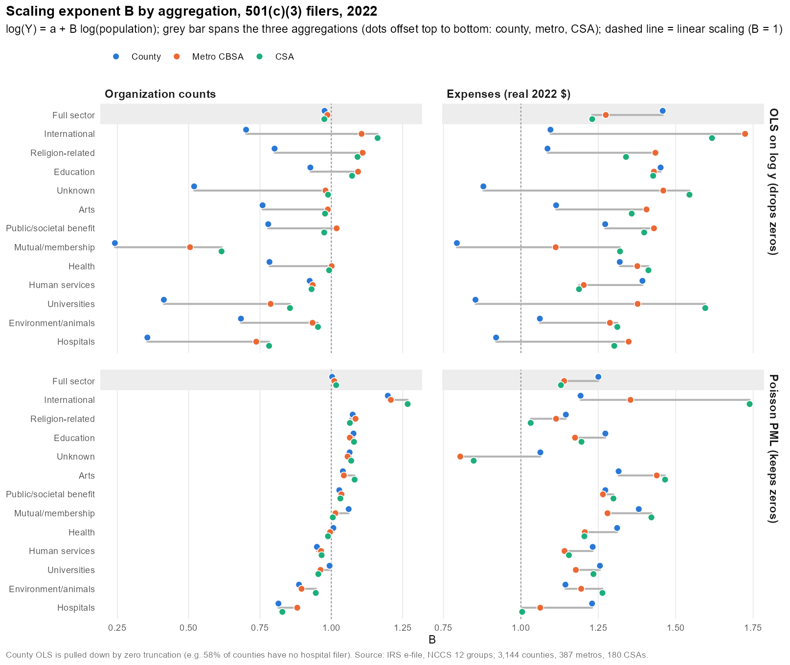

# Scaling exponent B by geographic aggregation

Script: `R/notes/74_scaling_aggregation.R` (run 2026-11-13). Output: `D:/MULTIVERSE/data/scaling_agg/`
(`scaling_B_by_unit.csv` has every unit × year × group × measure, with SEs, R² and zeros).

**Data.** 501(c)(3) e-filers above the $50k-real floor, 2021–2023 (966,535 org-years), NCCS 12
groups (e-file `ind`, filled from the BMF NTEE code), real 2022 $. Full sector = sum of the 12 groups.
Tables show 2022; B moves by at most 0.05 (counts) and 0.12 (expenses, OLS) between 2021 and 2023
within a unit type.

**Units.** Counties (3,144); metro CBSAs (387); all CBSAs, metro + micro (922); CSAs (180);
metro areas = CSA where the metro has one, else the metro CBSA. The OLS/Poisson range columns span
these five.

**Estimators.** OLS of log y on log P drops zeros. Poisson PML keeps them, and its B is the
elasticity of the mean. The two weight units differently: OLS gives the geometric-mean slope, and
Poisson is pulled toward large places.

## Results, 2022

(`R/notes/74b_plot_scaling_aggregation.R`)

| count | County OLS | Metro OLS | CSA OLS | OLS range | County Pois | Metro Pois | CSA Pois | Pois range |
|---|---|---|---|---|---|---|---|---|
| Full sector (all 501(c)(3)) | 0.98 | 0.99 | 0.98 | 0.01 | 1.00 | 1.01 | 1.02 | 0.02 |
| Arts | 0.76 | 0.99 | 0.98 | 0.23 | 1.04 | 1.04 | 1.08 | 0.06 |
| Education | 0.93 | 1.09 | 1.07 | 0.17 | 1.08 | 1.06 | 1.08 | 0.02 |
| Environment/animals | 0.68 | 0.93 | 0.95 | 0.27 | 0.89 | 0.90 | 0.95 | 0.06 |
| Health | 0.78 | 1.00 | 0.99 | 0.22 | 1.01 | 1.00 | 0.99 | 0.02 |
| Human services | 0.92 | 0.93 | 0.93 | 0.02 | 0.95 | 0.96 | 0.97 | 0.02 |
| Hospitals | 0.36 | 0.74 | 0.78 | 0.43 | 0.81 | 0.88 | 0.83 | 0.07 |
| International | 0.70 | 1.11 | 1.16 | 0.46 | 1.20 | 1.21 | 1.27 | 0.07 |
| Mutual/membership | 0.24 | 0.51 | 0.62 | 0.37 | 1.06 | 1.01 | 1.01 | 0.06 |
| Public/societal benefit | 0.78 | 1.02 | 0.98 | 0.24 | 1.03 | 1.04 | 1.03 | 0.02 |
| Religion-related | 0.80 | 1.11 | 1.09 | 0.31 | 1.07 | 1.08 | 1.07 | 0.03 |
| Universities | 0.41 | 0.79 | 0.86 | 0.44 | 0.99 | 0.96 | 0.95 | 0.04 |
| Unknown | 0.52 | 0.98 | 0.99 | 0.47 | 1.06 | 1.06 | 1.07 | 0.02 |

| expenses | County OLS | Metro OLS | CSA OLS | OLS range | County Pois | Metro Pois | CSA Pois | Pois range |
|---|---|---|---|---|---|---|---|---|
| Full sector (all 501(c)(3)) | 1.46 | 1.27 | 1.23 | 0.23 | 1.25 | 1.14 | 1.13 | 0.12 |
| Arts | 1.11 | 1.41 | 1.36 | 0.29 | 1.32 | 1.44 | 1.47 | 0.15 |
| Education | 1.45 | 1.43 | 1.43 | 0.16 | 1.27 | 1.17 | 1.20 | 0.10 |
| Environment/animals | 1.06 | 1.29 | 1.31 | 0.25 | 1.14 | 1.19 | 1.26 | 0.12 |
| Health | 1.32 | 1.38 | 1.41 | 0.22 | 1.31 | 1.21 | 1.21 | 0.11 |
| Human services | 1.39 | 1.20 | 1.19 | 0.21 | 1.23 | 1.14 | 1.16 | 0.10 |
| Hospitals | 0.92 | 1.35 | 1.30 | 0.43 | 1.23 | 1.06 | 1.00 | 0.23 |
| International | 1.10 | 1.72 | 1.62 | 0.63 | 1.19 | 1.35 | 1.74 | 0.55 |
| Mutual/membership | 0.79 | 1.11 | 1.32 | 0.53 | 1.38 | 1.28 | 1.42 | 0.14 |
| Public/societal benefit | 1.27 | 1.43 | 1.40 | 0.17 | 1.27 | 1.26 | 1.30 | 0.04 |
| Religion-related | 1.09 | 1.43 | 1.34 | 0.35 | 1.15 | 1.11 | 1.03 | 0.11 |
| Universities | 0.85 | 1.38 | 1.60 | 0.74 | 1.26 | 1.18 | 1.23 | 0.08 |
| Unknown | 0.88 | 1.46 | 1.54 | 0.67 | 1.06 | 0.80 | 0.85 | 0.34 |

Typical OLS SEs: about 0.01–0.02 for counts and 0.02–0.05 for expenses. Hospitals, universities,
international, mutual and unknown have SEs of 0.06–0.16.

## Reading

1. **Full-sector counts are scale-invariant.** B ≈ 1.00 at every aggregation and with both
   estimators (range 0.01–0.02). This is the cleanest result.
2. **Full-sector expenses are not.** B falls as units get larger: county 1.46 → metro 1.27 →
   CSA 1.23 (OLS), and 1.25 → 1.14 → 1.13 (Poisson). Big-budget organizations (hospitals,
   universities, large human-services agencies) sit in core counties. At the county level their
   budgets are credited to the core county's population alone; at the metro level the suburbs share
   the denominator.
3. **Most of the subsector OLS spread is zero truncation at the county level.** 58% of counties have
   no hospital filer and 90% have no mutual/membership filer. Dropping those zeros keeps only the
   small counties that happen to have one, which flattens the slope (hospitals: 0.36). Poisson keeps
   the zeros, and its count B varies by ≤ 0.07 across all five aggregations for every group. The
   same truncation affects metro + micro CBSAs, since micros often have none. Among metro CBSAs,
   CSAs and metro areas, the OLS count B agrees within about 0.1 for every group.
4. **Subsector expenses vary moderately.** Excluding the county column, the variation is about 0.1–0.2.
   The noisy groups are international (1.19–1.74 Poisson, few large organizations), hospitals and
   unknown. Under Poisson, arts, environment and international expenses rise with aggregation.
   Human services, health, education and hospitals fall, which is the same core-county
   concentration as point 2.

So B is a property of the aggregation for expenses, though not for counts. When comparing B to
scaling studies, metro CBSA and CSA/metro-area results are nearly interchangeable. County results
are not.

## Side question: counties with metro fixed effects

Sample: the 1,184 counties in 387 metros (238 multi-county metros; single-county metros are
absorbed by their FE). Model: log y ~ log P | CBSA, clustered by CBSA. 2022.

| | B metro-level | B pooled counties | **B within metro** | R² log P only | R² FE only | R² both | within-R² | resid var: pooled | resid var: FE | resid var: metro model | between-metro share of county SAMI var |
|---|---|---|---|---|---|---|---|---|---|---|---|
| Full sector, count | 0.99 | 1.09 | **1.12** (.02) | .89 | .40 | .94 | .90 | 0.30 | 0.18 | 0.15 | 47% |
| Full sector, expenses | 1.27 | 1.67 | **1.80** (.04) | .77 | .34 | .85 | .78 | 1.69 | 1.14 | 0.87 | 40% |
| Human services, count | 0.94 | 1.05 | 1.08 | .87 | .40 | .93 | .88 | 0.31 | 0.18 | 0.16 | 48% |
| Hospitals, expenses | 1.35 | 1.22 | 1.57 | .24 | .30 | .55 | .36 | 6.89 | 4.10 | 6.30 | 57% |

(All 12 groups × both measures × 3 years: `county_metro_fe.csv`.)

- **The premise doesn't hold.** County and metro B agree for full-sector counts only when *all*
  counties are pooled (0.98 vs 0.99). Within metros, B is clearly higher: 1.12 for counts and 1.80
  for expenses. The within-metro slope measures how nonprofits concentrate in the larger (core)
  counties of a metro, which differs from urban scaling across metros. A county model with metro FE
  therefore identifies a different B. Treat it as an intra-metro concentration elasticity, not a
  substitute for the metro estimate.
- **Variance left to explain.** In absolute terms the FE model leaves less: residual variance
  drops from 0.30 to 0.18 (counts) and from 1.69 to 1.14 (expenses), because the FE absorbs the
  metro-level SAMI. That component is 40–47% of the county SAMI variance for the full sector and
  up to about 60% for lumpy subsectors. The remaining variance is all within-metro, and it is
  still *larger* than the metro model's residual variance (0.18 vs 0.15; 1.14 vs 0.87). Any
  metro-level covariate is collinear with the FE and cannot explain it; only county-varying
  predictors can. A central-county indicator adds 0.15 log points to counts (SE .05) but
  leaves the within-R² unchanged (.897).
- In short, the county + metro-FE model leaves about 53–60% of the county SAMI variance. That
  remainder is a different quantity, the arrangement of organizations within a metro rather than a
  metro's nonprofit density relative to its size. If the substantive question is about metros, the
  metro model is the cleaner target. The FE design suits questions about where nonprofits locate
  inside a labor market.
