Seven regularities hold in metro-level 501(c)(3) density data before any covariate enters a model. Each is descriptive, and together they motivate the design decisions in the decision cards (D1–D12, in `04-design-decisions.qmd`). Data cover 387 US metros, 2000–2024, unless noted.

1. **Counts scale proportionally; spending scales faster and depends on the unit.**
    - Full-sector counts: β ≈ 1.00 at every aggregation (county, metro, metro + micro, CSA) and under OLS and Poisson (range 0.01–0.02).
    - Counts look sublinear (β ≈ 0.88) only after conditioning on covariates.
    - Spending: county 1.46 → metro 1.27 → CSA 1.23 (OLS). Big-budget organizations sit in core counties.
    - Subsectors differ: human services and environment are sublinear (0.90–0.96); education, religion-related and international are superlinear (1.07–1.21).
2. **Density is nearly frozen.**
    - Filer SAMIs correlate .94 twenty years apart; 97.5% of their variance is between metros.
    - No convergence: the cross-metro SD is .40 in both 2000 and 2024; λ = −.064 over 24 years (half-life about 240 years).
    - Filer density is more persistent than metro GDP.
3. **Density lags population, but differently within and across metros.**
    - Within a metro, half of size-expected organizations are missing right after growth. The gap closes with a half-life of about 5 years (filers) and 9 years (grassroots) in local projections, and about 10 and 7.5 years in kernel (distributed-lag) models in levels.
    - Across metros, the Sunbelt deficit (about −25% for the fastest-growing fifth) predates 2000, tracks 1970–2000 growth, and closes only once growth slows (half-life about 35 years). Stock-flow accounting shows it is a lag, not a trait: fast growers add at least as many entrants per resident as other metros, and growth alone produces the gap.
    - Decline is asymmetric: organizations stay at first, then grassroots shed the excess (half-life about 4 years). Relative income losses lower filer density immediately; gains do nothing.
4. **Filers and grassroots are two populations.**
    - Grassroots (registered non-filers) are 72–80% of the registered stock and also scale at about 1.0.
    - Filers follow the local economy (income, wages, market share) and do not converge across metros.
    - Grassroots follow endowment and demography and converge (half-life about 27 years).
    - Filer catch-up comes from existing organizations crossing the filing floor, not from new registrations.
5. **Nonprofit market share sets the level, not the pace.**
    - Share of private employment (BLS) explains about a third of the density percentile and absorbs the growth-history effect.
    - It is at most a soft ceiling on catch-up (grassroots only). Regions differ in its level, not its change.
    - It partly measures the outcome: it includes hospitals and universities and rises with density. The regional gap in share is mostly ownership: the Northeast has 61 nonprofit jobs per 1,000 residents, the South 25, with similar for-profit employment.
    - Older sectors hold larger shares. Northeast and Midwest filers are about 3.5 years older than those in the South and West, and Northeast filers last longest. Within the South and West, each extra year of average filer age goes with about 6% more share.
6. **Size is the main source of collinearity.**
    - In log form, size-scaled covariates correlate .80–.94 with log population (2022 metros); the SAMI transformation removes it (largest VIF 2.2 in the default model).
    - Entering every candidate measure at once makes blocks cancel; one composite per block recovers them.
7. **Data hazards are frequent and patterned.**
    - Source splices (CORE → SOI in 2011, SOI → e-file in 2020) move spending SAMIs, not counts. TY2020 counts are about 9% low.
    - Group exemptions inflate a few metros (Memphis, Mankato).
    - Panel covariates are often interpolated (turnout observed in 23% of metro-years; ACS rolling averages).
    - Itemized contributions break at the 2018 tax change; association counts and the Rupasingha index partly count nonprofits. A total with zeros (foundation assets in Eagle Pass, TX) becomes a leverage point under log(1 + x).

# Fact 1: Counts scale proportionally, spending does not {#sec-fact1}

**Organization counts grow in proportion to population; spending grows faster, and how much faster depends on the geographic unit.** This one fact decides whether per-capita measures are safe.

**Evidence 1: two exponents, two verdicts on per capita** (387 metros, 2022).

- Filers scale at β = 0.99. Filers per capita change by −3% per tenfold increase in population, and size explains 0.1% of their variance. The SAMI and log filers per capita correlate .999.
- Spending (excluding hospitals and universities) scales at β = 1.29. Spending per resident rises 95% per tenfold increase in population, and size explains 16% of its variance. The SAMI and log spending per capita correlate only .92.

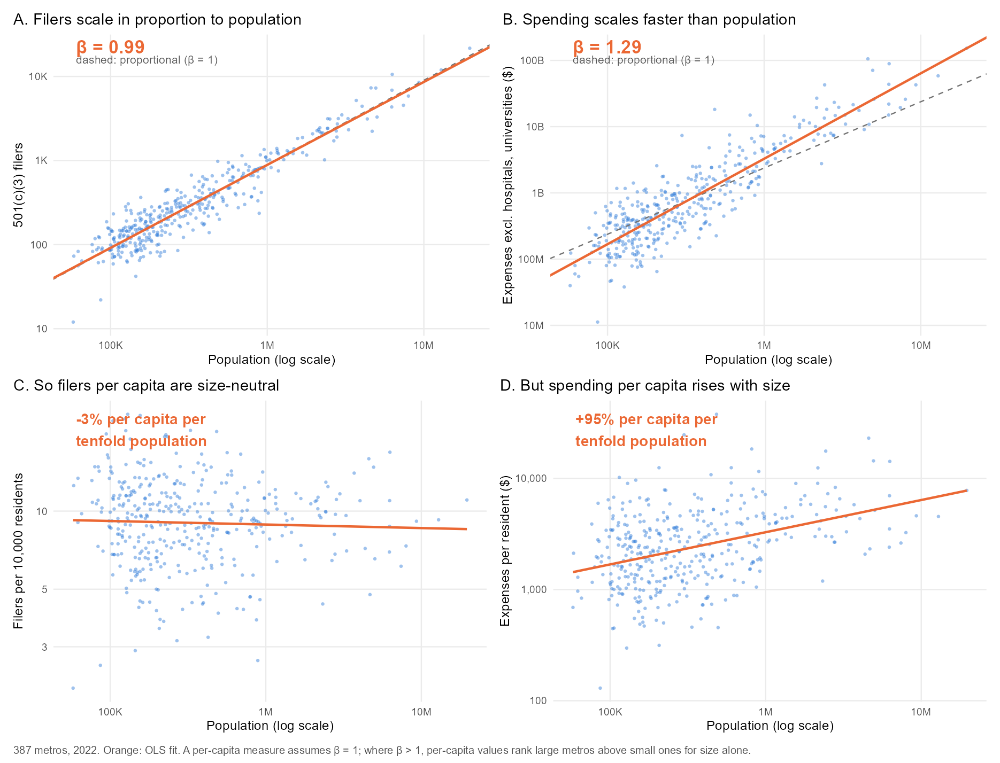{#fig-f1-scaling}

**Evidence 2: the spending exponent depends on the unit; the count exponent does not.**

| Full sector, 2022 | County | Metro | CSA | Range |
| --- | --- | --- | --- | --- |
| Counts, OLS | 0.98 | 0.99 | 0.98 | 0.01 |
| Counts, Poisson | 1.00 | 1.01 | 1.02 | 0.02 |
| Spending, OLS | 1.46 | 1.27 | 1.23 | 0.23 |
| Spending, Poisson | 1.25 | 1.14 | 1.13 | 0.12 |

: Scaling exponent β by geographic unit and estimator. {#tbl-f1-units}

Big-budget organizations sit in core counties. At the county level their spending is credited to the core county's population alone; at the metro level the suburbs share the denominator.

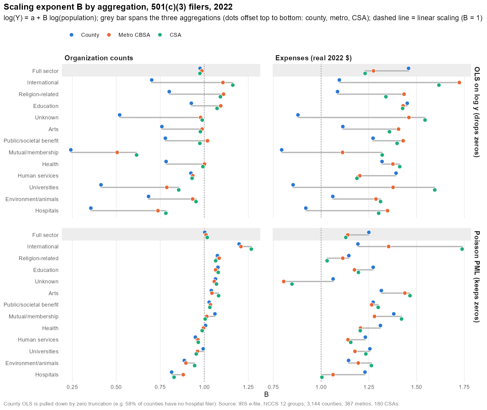{#fig-f1-aggregation}

**Evidence 3: the exponent people report depends on what else is in the model.**

| Metros | Bivariate | Conditional on covariates (cross-section) | Over time, within metro |
| --- | --- | --- | --- |
| Filers | 0.99 | 0.88 | 0.79 |
| Spending excl. hospitals and universities | 1.29 | 1.19 | 0.77 |

: Scaling exponent with and without covariates. {#tbl-f1-conditional}

Counts look sublinear only after conditioning, and the conditional value moves with the covariates: with logged foundation assets and government earnings on the right it falls to about 0.61, because those variables carry size. Over time within a metro, both scale below 1, consistent with the lags in Fact 3.

**Evidence 4: subsectors and zeros.** With Poisson, subsector count exponents run from 0.90 (environment) to 1.21 (international). OLS on logs drops places with no organizations and biases the exponent down: hospitals at the county level give 0.36 by OLS and 0.81 by Poisson.

**Evidence 5: a county model with metro fixed effects estimates something else.** Within metros, the county exponent is 1.12 for counts and 1.80 for spending. That measures how organizations concentrate in core counties, not urban scaling.

**What it means for practice.**

- Report β for the outcome, unit and estimator used, and say whether it is bivariate or conditional.
- Full-sector counts per capita are acceptable at the metro level; spending per capita is not. For spending, use log-log or SAMI forms (D4).
- Compare exponents only across studies that use the same unit: county spending exponents run about 0.2 above metro ones.
- Use Poisson whenever zeros are common (subsectors, small units).

*Sources: `R/notes/58_outline_analyses.R` part F (`D:/MULTIVERSE/data/outline/fact1_numbers.csv`); `notes/scaling-aggregation-results.md`; Thornton's scaling page §3.*

# Fact 2: Density is nearly frozen {#sec-fact2}

**Filer density is nearly frozen.** A metro's density in 2000 predicts its density in 2024 almost perfectly, and the spread between metros has not narrowed. Grassroots and spending move more, but still slowly.

**Evidence 1: persistence by outcome** (387 metros, year-specific SAMIs, 2000–2024).

| SAMI | r, 1 yr | r, 5 yrs | r, 10 yrs | r, 20 yrs | Rank r, 2000 vs. 2024 | Same quintile, 2000 and 2024 |
| --- | --- | --- | --- | --- | --- | --- |
| Filers | .99 | .98 | .97 | .94 | .93 | 63% |
| Grassroots | .99 | .95 | .89 | .78 | .70 | 37% |
| Spending excl. hospitals, universities | .96 | .91 | .84 | .74 | .72 | 46% |
| *Real GDP (benchmark)* | .99 | .94 | .88 | .78 | .80 | 51% |
| *Personal income (benchmark)* | .99 | .95 | .90 | .85 | .80 | 48% |

: Persistence of metro SAMIs, with GDP and income as benchmarks. {#tbl-f2-persistence}

Filer density is more persistent than the size-adjusted economy itself; grassroots density is about as persistent as GDP.

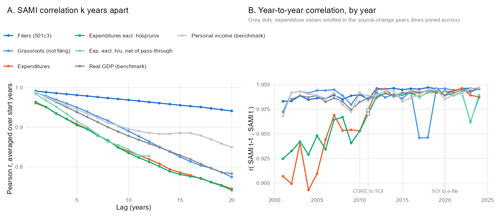{#fig-f2-persistence}

**Evidence 2: almost all the variation is between metros.**

- 97.5% of the variance in the filer SAMI is between metros. Within a metro its SD is about 0.06 log points, against 0.39 overall.
- A growth-curve model gives an SD of 0.38 for metro levels and 0.06 per decade for metro trends, with no relation between them (r = −.04).
- Covariates are just as fixed: within-metro shares of variance over 2010–2022 are 0.2% for % nonwhite, 0.8% for % BA, 3.3% for turnout and 6.7% for foundation assets, and much of that is interpolation.

**Evidence 3: no convergence for filers.**

- The SD of the filer SAMI was .40 in 2000, .38 in 2015 and .40 in 2024.
- Regressing the 2000–2024 change on the 2000 level gives λ = −.064, a half-life of about 240 years. Instrumenting the 2000 level with the independent registered-stock measure gives −.060, so this is not measurement error.
- Grassroots narrowed slightly (SD .31 to .26; half-life about 27 years). Spending widened (.66 to .75).

**Evidence 4: the few large moves.** The top and bottom 10% of metros moved about ±25% relative to expected size in 24 years. Climbers include New Orleans (+33 percentile points), Chico (+31) and Cleveland TN (+28); decliners include Decatur IL and Hagerstown (−33 each) and Tyler (−29). These changes are real but noisy: the 24-year change correlates .62 with the 2011–2024 change and .41 with the change in the registered-stock SAMI.

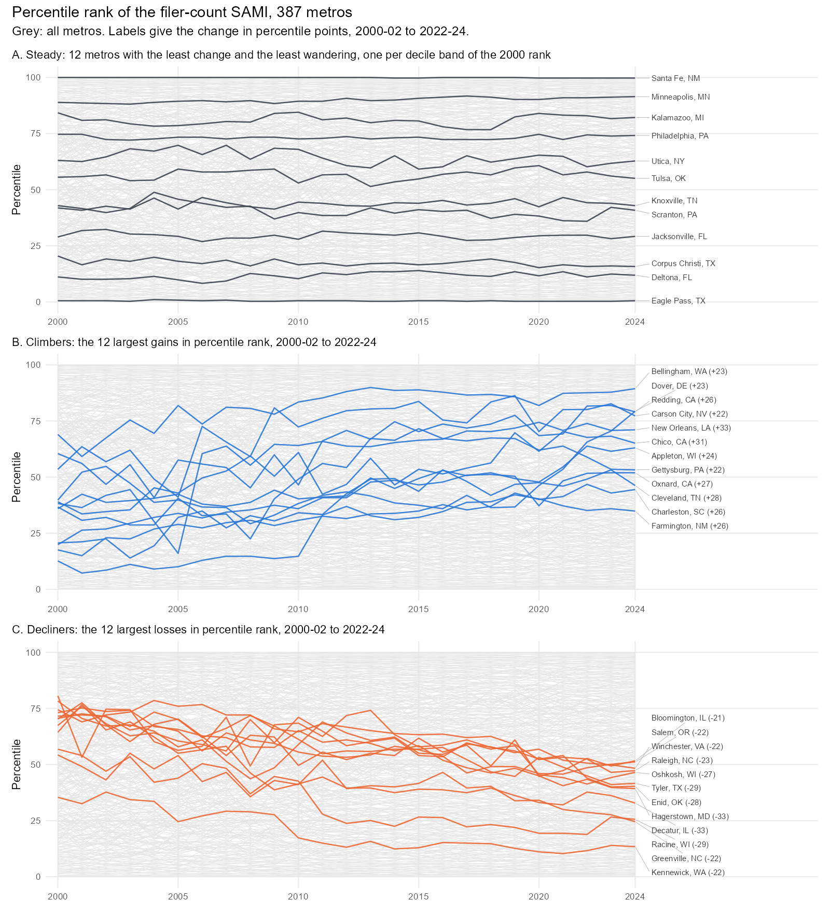{#fig-f2-rank-paths}

Who moved, and where (top and bottom 10% by filer SAMI change, 39 metros each):

|  | Δ SAMI | Start percentile | Population growth | South | West | Pre-1970 endowment SAMI |
| --- | --- | --- | --- | --- | --- | --- |
| Risers | +.22 | 26 | 16% | 33% | 44% | −.19 |
| Fallers | −.22 | 48 | 28% | 49% | 18% | +.09 |
| *Middle 80%* | .00 | 52 | 18% | 40% | 20% | +.06 |

: Profiles of the largest filer-density movers, 2000–02 to 2022–24. {#tbl-f2-movers}

- **Risers start low and have thin historical endowments.** Fallers start near the middle and grew faster.
- **Growth alone does not predict the change** (β = −.05, R² = .002), and no region has a meaningful slope of change on growth (all p > .15).
- **Conditional on the starting level, growth and region matter.** With region and census traits held fixed, the change falls with the starting SAMI (−.62 SD) and with population growth (−.44 SD) and rises with growth in % BA (+.32 SD). The West (+.87 SD) and South (+.32 SD) gained relative to the Northeast (R² .34): low-density Western and Southern metros drifted up, slowly.

**Evidence 5: source changes show up in money, not counts.** Year-to-year correlations for filers stay at .98 or above throughout. Spending correlations drop at the CORE-to-SOI splice in 2011 (.87) and again in 2020; grassroots dip in 2017–18, where BMF snapshots omit newly ruled organizations.

**What it means for practice.**

- Within-metro designs work with about 2.5% of the outcome's variance and mostly interpolated covariate change. Treat them as weakly identified (D3).
- Pooling years adds little beyond a single cross-section. Do not count metro-years as independent: cluster by metro and count degrees of freedom in metros.
- A single recent year represents a metro's long-run filer density well. For spending, average several years and avoid splice years.
- Persistence makes history a confounder in levels models: today's covariates partly stand in for conditions decades ago (Fact 3, D8).

*Sources: `notes/catchup-lag-results.qmd` section 1; `R/notes/50_followups_jeremy.R` part 2; `R/notes/52_endowment_change.R`; `notes/collinearity-composites-results.md` (within-metro shares).*

# Fact 3: Density runs on two clocks {#sec-fact3}

**Density runs on two clocks.** Within a metro, nonprofits catch up with population growth in about five years. Between metros, density gaps left by decades of growth persist for a generation or more.

**Evidence 1: within a metro, the lag is short.** Share of size-expected growth realized, by horizon (Δlog N on Δlog P over h years, start-year FE, metros 2000–2024):

| Years after growth | 1 | 3 | 5 | 10 | 15 | 24 |
| --- | --- | --- | --- | --- | --- | --- |
| Filers | .49 | .69 | .76 | .91 | .98 | .96 |
| Grassroots (registered non-filers) | .41 | .53 | .58 | .69 | .76 | .78 |
| Expenditures | .45 | .54 | .61 | .68 | .72 | .76 |

: Share of size-expected growth realized, by horizon. {#tbl-f3-horizon}

Local projections give a half-life for the growth gap of about 5 years for filers and 9 for grassroots, measured against each metro's own trend.

{#fig-f3-gap}

**Evidence 2: between metros, the gap persists.** Mean filer SAMI by quintile of 2000–2010 population growth:

| Growth quintile | Growth 2000s | Share South or West | 2000 | 2010 | 2024 |
| --- | --- | --- | --- | --- | --- |
| Q1 (slowest) | 0.5% | 27% | .05 | .07 | .07 |
| Q3 | 9.7% | 66% | .02 | .01 | .02 |
| Q5 (fastest) | 23% | 96% | −.25 | −.27 | −.26 |

: Mean filer SAMI by 2000s growth quintile. {#tbl-f3-quintiles}

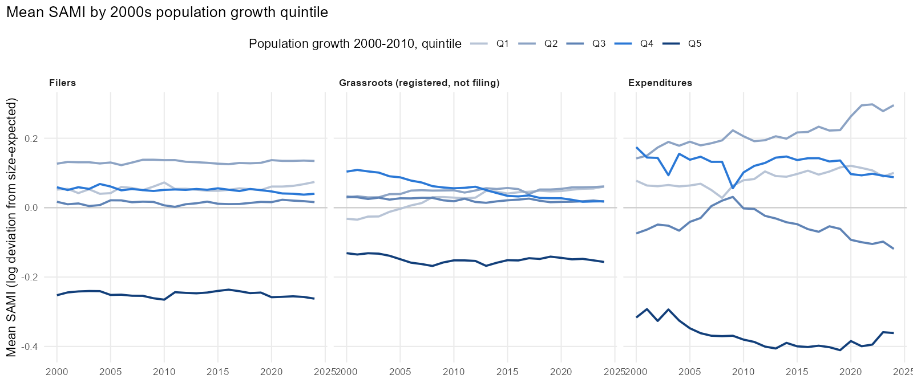{#fig-f3-trajectories}

{#fig-f3-trajectories-change}

- The fastest-growing fifth sits about 25% below size-expected density in every year, although new growth after 2000 was matched almost one-for-one.
- The same holds in dollars. The median fastest-fifth metro spent \$812 per resident in 2000 and \$1,803 in 2024 (real 2022 dollars, excluding hospitals and universities), 30–45% below the other quintiles in both years. Its spending grew as fast as everyone else's (+133% vs. +126% for all metros): no catch-up and no further falling behind.
- The 2000 gap tracks 1970–2000 growth (−.36 per log point, with region and census traits controlled; R² .63). Recent decades weigh more than older ones, as a lag would.
- The within-metro rates explain only about a quarter of the fastest fifth's filer gap. Fast growers whose growth slowed after 2000 closed about a third of their gap in 24 years (half-life about 35 years); those still growing fast closed none.
- The growth-history gap does not survive nonprofit market share: fast growers also have small nonprofit workforces, and the two cannot be separated in a cross-section.

**Evidence 2b: lag or trait? The flows say lag.** A stock gains entrants and loses exits: dN/dt = fP − dN, where f is entrants per resident and d the exit rate. A metro whose flows held steady would settle at density f / (d + g), where g is population growth. That steady state splits exactly into three parts: entry per resident, the exit rate, and growth. Only the growth part is a lag: the stock trails a population that keeps arriving. A trait of in-migration would show as fewer entrants per resident or faster exit. The test uses 2012–13 to 2018–19, within one data source (SOI), so no splice enters.

| Filers, 2012–19 | Metros | Population growth per year | Observed density vs. average metro | Steady state implied by the flows | of which: entry | exit | growth | Observed minus steady state |
| --- | --- | --- | --- | --- | --- | --- | --- | --- |
| Fast growers, still growing | 39 | 2.1% | −.20 | −.22 | +.13 | −.06 | −.28 | +.04 |
| Fast growers, slowed down | 38 | 0.7% | −.10 | +.02 | +.00 | +.02 | −.00 | −.10 |
| All other metros | 305 | 0.5% | +.04 | +.05 | −.02 | +.01 | +.06 | +.01 |

: Steady-state decomposition of filer density. Log points relative to the average metro. Fast growers = top fifth of 1970–2000 growth, split at the median of 2000–24 growth. The average metro adds 0.040 filers per 1,000 residents a year and loses 3.6% of its filers a year. {#tbl-f3-steady-state}

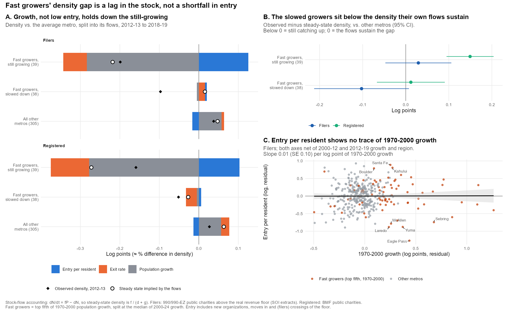{#fig-f3-lag-trait}

- **Still-growing fast growers are short because of growth alone.** They add more entrants per resident than other metros (+.13), not fewer, and lose them a little faster (−.06). Growth (−.28) accounts for the whole gap. They sit at their own steady state (+.04, n.s.): the gap stays as long as growth does.
- **Slowed growers have normal flows but an inherited deficit.** Entry and exit match other metros, so their flows would sustain average density. They sit about 10% below that level (−.10, SE .06; −.11 with region fixed effects). That is the signature of a lag: the gap should close, at a half-life of about 16 years if 2012–19 flows hold. That is faster than the roughly 35 years observed over 2000–2024.
- **1970–2000 growth leaves no trace in the flows.** Entry per resident rises with current growth and dips after growth in 2000–12, as newcomers take time to form or join organizations. Net of both and of region, 1970–2000 growth predicts nothing: +.01 (SE .10) for filers and +.01 (SE .06) for registrations. Exit rates track none of the growth measures.
- **Registrations tell the same story with one twist.** Still-growing fast growers sit 13% above the steady state their flows imply, so their registered density should keep falling while growth continues, as the grassroots trajectories show.
- **Entry carries most cross-metro differences.** The steady state correlates .79 with observed filer density; entry alone correlates .78. The lowest-entry metros are border metros (Laredo, McAllen, Eagle Pass, Yuma), a trait not tied to growth history.
- **Limits.** Entry counts new organizations, moves in and, for filers, organizations crossing the revenue floor. The test rules out lower entry or faster exit as the source of the fast growers' gap. It cannot rule out a trait that works only through growth itself, and it says nothing about why fast growers have small nonprofit market shares.

**Evidence 3: decline and income losses work differently.**

- **Population decline:** organizations stay at first, so density rises. Filers realize only a third of the size-expected decline within five years, against three quarters of expected growth; grassroots then shed the excess, which halves in about 4 years and is gone by year 8, roughly twice as fast as they fill a growth shortfall.
- **Relative income loss:** a 10% loss lowers filer density by about 1.5–2% at once, recovering with a half-life of about 10 years. Relative income gains do nothing, and registrations do not respond either way.

**Evidence 4: catch-up runs through existing organizations.** After growth, new registrations do not rise within a metro. Instead, the share of registered organizations that file climbs for 6–10 years: existing organizations grow past the filing thresholds and appear in the 990 data.

**Evidence 5: one specification for the lag.** Replace current population with a geometrically weighted memory of past changes, log N = β·log P + γ·G with metro and year fixed effects, where G[t] = a·G[t−1] + Δlog P[t] and a = 0.5^(1/half-life). 382 metros, 2000–2024; half-life chosen by fit, 95% intervals from 300 metro bootstrap draws:

|  | Half-life (years) | Long-run within-metro β | Missing at impact | Missing at 10 years |
| --- | --- | --- | --- | --- |
| Filers | 10 [5.5–20] | .93 | .45 | .23 |
| Grassroots | 7.5 [4.5–14.5] | .72 | .81 | .32 |
| Filers, across metros (year FE only) | 30 [9.5–100] |  | .45 | .36 |

: Kernel (distributed-lag) estimates of the adjustment to population change. {#tbl-f3-kernel}

- A fixed lag is the wrong shape. For filers every single lag of population fits worse than current population, and adding one growth window captures less than half of what the kernel gains.
- Grassroots never fully catch up within a metro (β = .72). Imposing the cross-sectional slope (.99), as a SAMI outcome does, turns that shortfall into slow adjustment and inflates their half-life to 40 years. Put log P and G on the right instead.
- The kernel (about 10 years) and the local projections (about 5) agree for five years after growth, then part: the kernel keeps a small deficit (filers −2.5% at year 10). The difference is metro-specific trends, which 25 years of data cannot separate from a slow tail, so the two estimates bound the within-metro half-life.
- Organizations barely leave after population loss: separate gain and loss kernels fit filers best, with about 90% of an implied decline unrealized at first.
- In the multiverse the kernel enters as a covariate (D8, Evidence 5).

**What it means for practice.**

- Annual within-metro models estimate a short-run adjustment that is half closed in about five years. Do not read them as long-run effects.
- For change questions, use differences of 10 years or more, or include a geometric kernel of past population change (half-life 5–10 years) rather than a fixed lag, and model growth and decline separately.
- Cross-sectional comparisons inherit decades of growth history. The stock-flow test shows that the fast growers' gap is a lag in the stock, not lower entry or faster exit. When the question is about current conditions, control for past growth or the pre-1970 endowment, and do not read the gap as a trait of newcomers.
- Filer counts respond to income shocks through the filing floor; grassroots counts do not. Choose the count to match the question (D1).

*Sources: `notes/catchup-lag-results.qmd` (sections 1, 2, 3.5, 6); `R/notes/72_catchup_lag.R`, `R/notes/73_pre2000_growth.R`, `R/notes/75_capacity_grid.R`; Evidence 2b: `R/notes/58_outline_analyses.R` part T (`D:/MULTIVERSE/data/outline/v10/gap_lag_*`; notes section 2.6d); Evidence 5: `R/notes/79_kernel_lag.R` (`data/catchup/c14_*`; notes section 2.8).*

# Fact 4: Registered charities are two populations {#sec-fact4}

**Registered charities are two populations.** About a quarter file a 990 above the \$50k floor and behave like an economic sector. The other three quarters are grassroots organizations whose density follows demography and institutional legacy.

**Evidence 1: composition.** In the 387 metros, the registered stock of 501(c)(3) public charities grew from 563,000 in 2000 to 1.19 million in 2024; filers grew from 158,000 to 288,000. The share filing above the floor drifted from 28% to 24%, with dips at the source changes and a low of 20% in 2020.

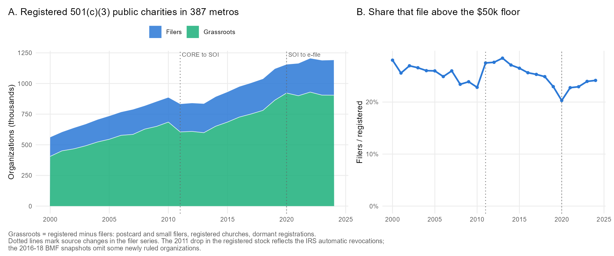{#fig-f4-composition}

**Evidence 2: same scaling, different rankings.** Filers and grassroots both scale with population at about 1.0. Their SAMIs correlate only .65–.73, while the pooled registered stock correlates .97 with grassroots and .82–.87 with filers.

**Evidence 3: different dynamics.**

|  | Filers | Grassroots | Registered (pooled) |
| --- | --- | --- | --- |
| Persistence, r at 20 years | .94 | .78 | .85 |
| Share of expected growth realized at 10 / 24 years | .91 / .96 | .69 / .78 | .75 / .83 |
| Within-metro half-life after growth | about 5 years | about 9 years | about 9 years |
| Fastest-growing fifth, SAMI in 2024 | −.26 | −.16 | −.18 |
| Deficit convergence per decade (2011 SAMI) | −.01 | −.23 | −.18 |
| Effect of a 10% relative income loss, immediate | about −1.5% | about 0 | about 0 |
| Nonprofit market share, within R² | .35 | .14 | .23 |

: Filers, grassroots and the pooled registered stock compared. {#tbl-f4-dynamics}

**Evidence 4: different drivers.** For 2011–2023 change:

- Filer gains follow the local economy: income growth (partial r .35), private wage growth (.28), % BA (.24) and turnout (.21).
- Grassroots fall where wages and government earnings grow (−.17 and −.28) and rise where poverty rises (+.15). Growth in % BA is the one change that lifts both (+.24 filers, +.19 grassroots).
- Starting levels matter more for grassroots. High poverty and inequality in 2000 predict smaller filer gains (−.19, −.15); high unemployment and immigrant share predict smaller grassroots gains (−.19 each). The pre-1970 endowment predicts smaller gains, much more for grassroots (−.32) than filers (−.11).
- The blocks rank differently. Shapley R²: for filers, change during the decade carries .14 of a total .29 and 2000 levels .05; for grassroots, 2000 levels carry .18 of .55, with the 2011 deficit (.10), region (.10) and growth (.08) next.
- In the pooled registered stock the income effect is .03: the two groups respond in opposite directions and cancel.

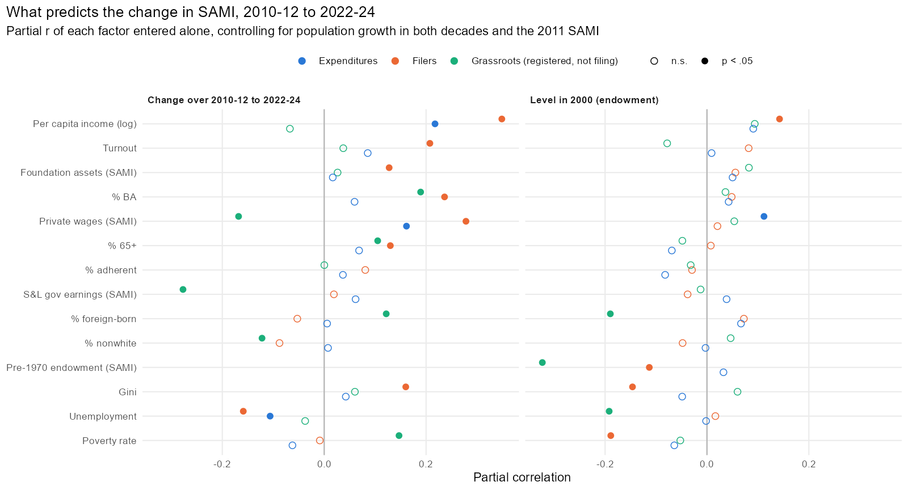{#fig-f4-change}

**Evidence 5: organizations move between the groups.** Within a metro, growth does not raise new registrations. Instead the filing share rises for 6–10 years: grassroots organizations grow past the floor and become filers. Relative income losses do the reverse, pushing filers below the floor.

**What it means for practice.**

- Treat filing status as a stage, not a type of organization. The floor moves organizations between the groups as local economies change.
- Analyze filers and grassroots separately. Pooling cancels opposite responses (D1).
- Use the registered stock as a splice-free robustness check; grassroots inherit the filer splices in reverse.
- Check registration practices that distort grassroots counts: LDS congregations that do not register separately (low counts in Utah), group exemptions (Memphis, Mankato), and the many registrations in military towns.

*Sources: `notes/catchup-lag-results.qmd` sections 3, 4 and 5; `R/notes/58_outline_analyses.R` part H (`D:/MULTIVERSE/data/outline/fact4_composition.csv`).*

# Fact 5: Market share sets the level, not the pace {#sec-fact5}

**Nonprofit market share sets the level of density, not its pace.** The 501(c)(3) share of private employment explains about a third of the cross-metro variation in filer density and two-fifths of the variation in spending. It barely changes within metros and does not predict which metros catch up. It behaves like population: a bound on how large a sector a metro carries, not a lever that moves it.

**Evidence 1: share and density levels** (BLS QCEW nonprofit data, 363 metros, 2013–2022 pooled with year FE).

|  | Filers | Grassroots | Spending |
| --- | --- | --- | --- |
| SAMI per log point of share | .40 | .18 | .78 |
| R², share alone (net of year) | .35 | .14 | .38 |
| Density percentile on share percentile, R² | .34 | .13 | .40 |
| Wage ratio given share, per unit | −.42 | −.30 | −.28 (n.s.) |

: Nonprofit employment share and density levels. {#tbl-f5-share}

- The relation is loose. At a 10% share, metros run from the 5th to the 95th percentile of filer density.
- Sunbelt metros are low on both.
- Health care adds nothing. The nonprofit share within health care and social assistance predicts filer density alone, but not once overall share is in the model (p = .85).
- Holding share fixed, a higher nonprofit/for-profit wage ratio goes with fewer organizations (−.04 filer SAMI per 0.1 of the ratio; −.03 for grassroots): fewer, larger and more professional organizations. Over 2013–2022 it also predicts slower grassroots growth (−.016 per SD) and faster spending growth (+.056 per SD), but not filer change. Where nonprofits pay well, the sector grows by getting bigger, not more numerous.

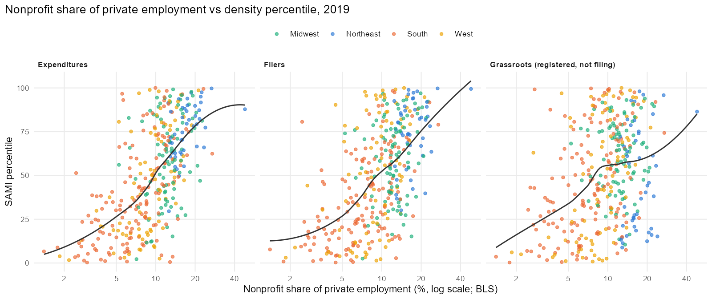{#fig-f5-share}

**Evidence 2: share absorbs growth history** (358 metros; population growth 1970–2000 by average share 2013–2022, in fifths).

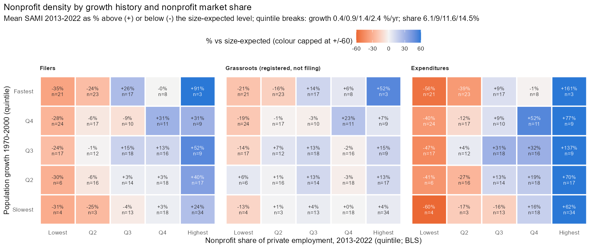{#fig-f5-grid}

- Every lowest-share cell is 24–35% below expected filer density, whatever its growth history. Every highest-share cell is 24–91% above.
- Shapley R² for filers: share .31, growth history .04 (grassroots .12 and .03; spending .35 and .05). With share fixed, growth history has no effect (−.008 per SD, SE .021).
- The two axes correlate −.41. Of the 72 fastest-growing metros, 44 sit in the two lowest-share fifths and only 3 in the highest, so a cross-section cannot fully separate them.
- A small positive interaction (+.035, p = .02): fast growth goes with lower density only where share is low.

**Evidence 3: share is nearly fixed and does not predict catch-up.**

- Across metros the share's SD is 5.3 percentage points; within a metro it is 0.4. Shares in 2013 and 2022 correlate .95.
- 72% of the variance in share change comes from changing establishment size, not from the number of nonprofits. The largest drops (Johnstown −8.3 points, Asheville −5.3) look like hospital systems converting to for-profit ownership.
- Share change correlates −.05 with the change in filer SAMI and .11 with the change in grassroots SAMI.
- Filers show no convergence in any share tercile. Grassroots deficits close half as fast in low-share metros (−.09 per decade vs. −.18 in high-share metros): a soft ceiling, not a cap.

**Regions differ in level, not in change** (balanced panel, 327 metros):

| Region | Metros | Median share | Middle 90% of metros | Median change, 2013–14 to 2021–22 (points) | Gained / lost > 1 point | Variance from establishment size |
| --- | --- | --- | --- | --- | --- | --- |
| Northeast | 40 | 16.2% | 12.3–22.7% | +0.41 | 13 / 8 | 76% |
| Midwest | 82 | 11.9% | 8.2–19.0% | −0.07 | 12 / 16 | 66% |
| South | 133 | 7.4% | 2.7–15.2% | +0.07 | 28 / 19 | 69% |
| West | 72 | 9.0% | 3.4–15.2% | 0.00 | 13 / 8 | 78% |

: Nonprofit share of private employment by region, level and change. {#tbl-f5-share-region}

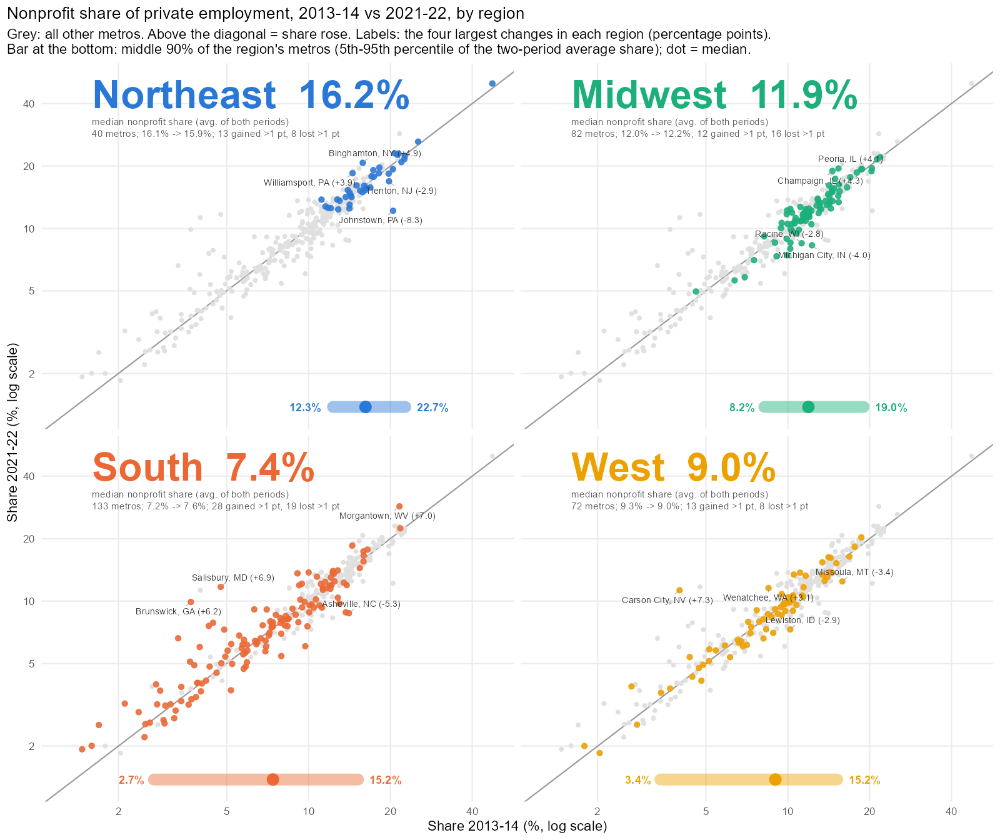{#fig-f5-share-region}

- The Northeast's typical share is twice the South's, but every region's median moved less than half a point. No region is catching up or pulling away.
- The Northeast and Midwest ranges are narrow and high. The South and West ranges are wide and reach far lower: the South's 5th percentile (2.7%) is under a quarter of the Northeast's (12.3%), while their top ends overlap the Northeast median.
- Within each region, large moves are idiosyncratic and mostly about establishment size. The Midwest is the only region where more metros lost a point than gained one.

**Evidence 4: the residuals point to institutions.** Against a fit on share and growth history, filers fall furthest below in military towns (Hinesville, Killeen) and border metros (McAllen, Brownsville, Yuma); grassroots fall furthest below in Utah (Provo, Ogden, Logan). College and amenity towns (Boulder, Santa Fe, Missoula, Charlottesville) sit above.

**Evidence 5: older nonprofit sectors have larger market shares, because older organizations are larger** (2022 BMF: 1.36 million registered public charities, 312,500 of them filers; age = 2022 minus the IRS ruling year).

|  | Northeast | Midwest | South | West | All |
| --- | --- | --- | --- | --- | --- |
| Mean age, filers | 25.7 | 25.3 | 22.2 | 22.1 | 23.6 |
| Mean age, grassroots | 19.9 | 22.1 | 19.5 | 19.6 | 20.2 |
| Median age, all registered | 14 | 15 | 12 | 12 | 13 |
| Dollar-weighted age, filers | 45.1 | 46.4 | 41.0 | 42.7 | 43.7 |
| Dollar-weighted age, excl. hospitals and universities | 37.9 | 36.0 | 33.6 | 35.2 | 35.6 |

: Age of 501(c)(3) public charities by region, 2022 (years since IRS ruling). {#tbl-f5-age-region}

- **Filers are older in the Northeast and Midwest** (mean 25.7 and 25.3 years) than in the South and West (22.2 and 22.1). The oldest filer sectors are in Connecticut (30 years), Rhode Island, Maine, West Virginia, North Dakota, Iowa and Vermont; the youngest are in Nevada (18), Utah, Georgia, Arizona, Florida, Idaho, Texas and Colorado: the fast-growth Sunbelt and Mountain West. The median registered organization is 12–15 years old everywhere, so the gap is among established filers, not grassroots registrations.
- **The average dollar is much older than the average organization:** weighted by expenditures, filer age is 44 years, against a mean of 24. The regional ordering holds without hospitals and universities (34–38 years).

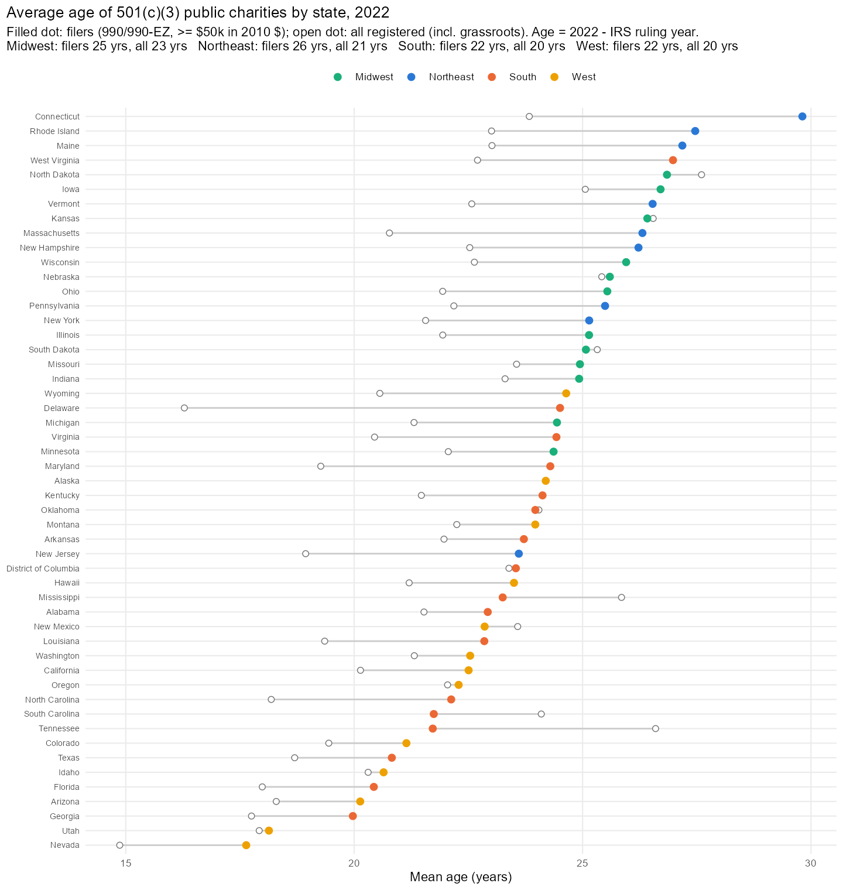{#fig-f5-age-state}

- **Older sectors hold more of the labor market.** Across metros, mean filer age correlates .50 with log market share (.31 within regions); dollar-weighted age correlates .37 (.26). Within regions, each extra year of dollar-weighted age goes with about a 1% larger share. The youngest sectors are Provo and St. George (14 years) and Las Vegas (15 years; share 2%); the oldest are Wheeling, Elmira and Weirton (33–38). The relationship flattens above an average filer age of about 28 years, where share levels off near 15–20%.
- **What counts is the age of the filers, not the share of old registrations.** The share of organizations ruled before 1970 does not correlate with market share (.01; −.02 within regions), and the median age of all registered organizations correlates only .21.
- **Region still matters at equal age.** At the same dollar-weighted age, the Northeast's share is about 33 log points above the Midwest's and the South's about 37 below.

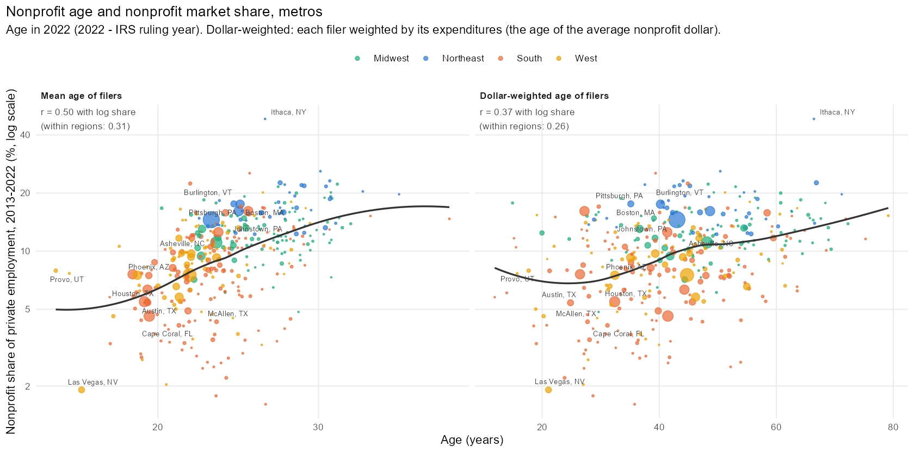{#fig-f5-age-share}

**Age matters most where sectors are young.** Within each region, metros' log market share on mean filer age:

| Region | Metros | Mean filer age | Median share | r | Share per extra year of age | p |
| --- | --- | --- | --- | --- | --- | --- |
| Northeast | 45 | 25.4 | 16.1% | .35 | +3.3% | .017 |
| Midwest | 91 | 24.8 | 12.0% | .13 | +1.4% | .23 |
| South | 151 | 21.9 | 7.6% | .34 | +6.1% | < .001 |
| West | 82 | 22.0 | 9.2% | .39 | +6.3% | < .001 |

: Market share and filer age within regions. {#tbl-f5-age-share-region}

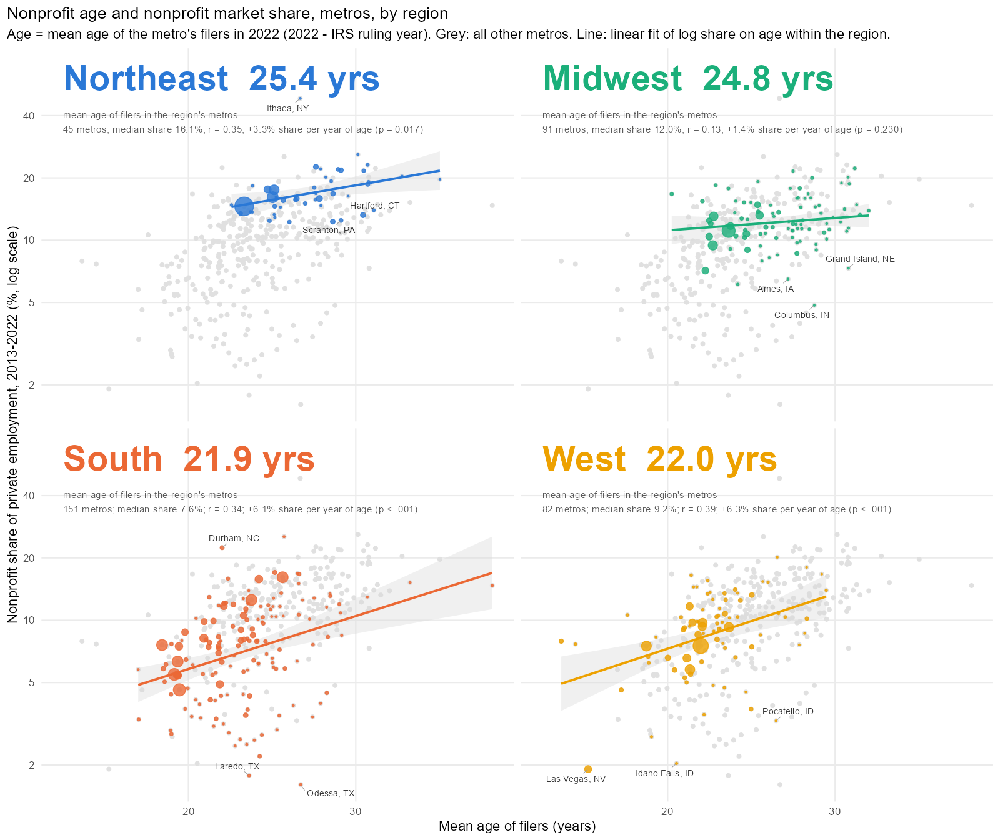{#fig-f5-age-share-region}

- **Within the South and West, each extra year of average filer age goes with about 6% more share.** The South's line runs from about 5% share in metros with 17-year-old sectors to about 15% at 35 years.
- **In the older Northeast and Midwest the slope is modest or flat** (+1–3% per year, not significant in the Midwest), matching the leveling-off above about 28 years: once a sector is old, more age adds little.
- **The age gap separates the Sunbelt from the older regions.** South and West filers are about 3–3.5 years younger, and their metros sit on the steep part of the relationship.
- **Outliers.** Below their region's line: border and energy metros (Laredo, Odessa), Las Vegas, Idaho Falls and Pocatello, and Columbus IN and Ames IA (large corporate or university-dominated economies). Above it: Durham (Duke) and Ithaca (Cornell; share 48%), where one large institution dominates.

- **Size rises steadily with age.** Median spending is \$152k for filers 0–2 years old, \$368k at 21–30 years, \$783k at 41–50 and \$10M at 81 years and over. The elasticity of spending with respect to age is .59 (.53 without hospitals and universities): doubling age goes with about 50% more spending. The spread is wide at every age (the interquartile range spans a factor of 4–5, and 40 for the oldest). Without hospitals and universities the median barely changes through age 60, but for the oldest it falls from \$10.0M to \$4.9M.
- **Hospitals and universities are the oldest institutions:** under 2% of filers younger than 30, but 14% of those aged 71–80 and 23% of those 81 and over.

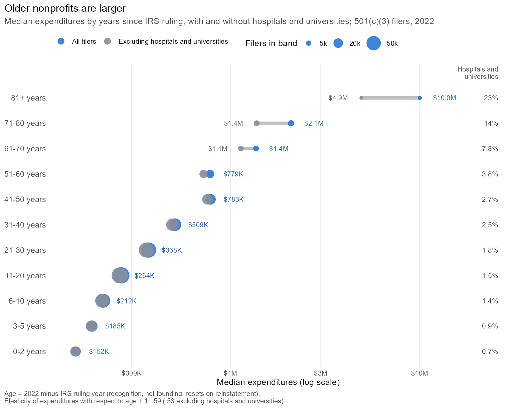{#fig-f5-age-size}

- **Reading.** Market share records accumulated institutional growth. Sectors that are older hold more large, long-established institutions, especially hospitals and colleges, and organizations grow over decades. The young Sunbelt and Mountain West sectors have not had that time, or their large institutions were founded as for-profit or public. Closing a share gap therefore takes institutions aging and growing, not more registrations, which fits the slow catch-up in Fact 3.
- **Caveats.** The ruling year marks IRS recognition, not founding, and resets when a revoked organization is reinstated (common after the 2011 automatic revocations), which understates age. Group-exemption subordinates carry the group's date.

**Evidence 6: Northeast filers also last longest** (1.49 million public charities ruled 1990–2021; Kaplan–Meier with right censoring and delayed entry from 2000). A filer "ends" at its last 990 or 990-EZ; a non-filer at its last BMF year.

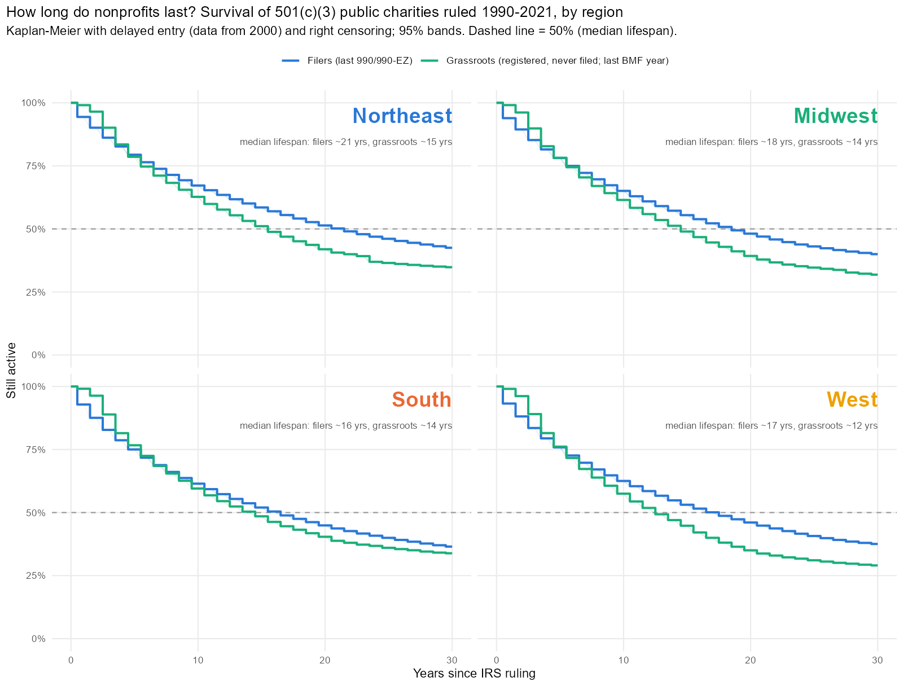{#fig-f5-survival}

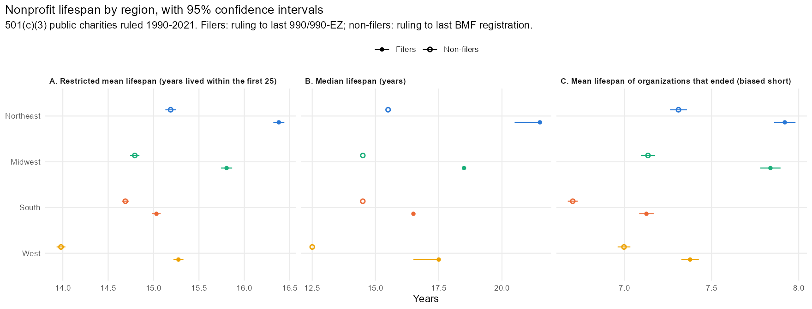{#fig-f5-lifespan}

|  | Northeast | Midwest | South | West | All |
| --- | --- | --- | --- | --- | --- |
| **Filers:** mean years active in first 25 | 16.4 | 15.8 | 15.0 | 15.3 | 15.5 |
| Filers: median lifespan (years) | ~21 | ~18 | ~16 | ~17 | ~17 |
| Filers: still filing at 10 / 20 years | 67% / 51% | 65% / 48% | 62% / 45% | 63% / 46% | 64% / 47% |
| Filers: hazard of ending vs. Northeast | 1 | 1.09 | 1.21 | 1.17 |  |
| **Non-filers:** mean years active in first 25 | 15.2 | 14.8 | 14.7 | 14.0 | 14.6 |
| Non-filers: median lifespan (years) | ~15 | ~14 | ~14 | ~12 | ~14 |
| Non-filers: still registered at 10 / 20 years | 63% / 42% | 62% / 39% | 60% / 40% | 58% / 35% | 60% / 39% |
| Non-filers: hazard of ending vs. Northeast | 1 | 1.06 | 1.07 | 1.18 |  |

: Lifespan of public charities ruled 1990–2021, by region. Mean years active is the restricted mean survival time; 95% intervals are about ±0.1 year. Hazard ratios from a Cox model with delayed entry. {#tbl-f5-lifespan}

- **Nonprofits are long-lived but not permanent.** About two thirds of filers still file 10 years after ruling and about half after 20; the median filer lasts about 17 years, the median non-filer about 14.
- **Northeast filers last longest:** median about 21 years against 16–18 elsewhere, and 1.4 more active years in the first 25 than Southern filers (16.4 vs. 15.0). Southern filers stop filing 21% faster at any age, Western filers 17% faster (Cox hazard ratios vs. the Northeast).
- **Among non-filers, the West stands out** with the shortest registrations (median about 12 years, hazard +18%); the other three regions are within about half a year of each other.
- **This compounds the age result.** Organizations that survive keep growing (Evidence 5), so higher survival builds older, larger sectors and higher market shares.
- **Filers and non-filers cross at about 4–5 years.** Early on, filers end faster because many file for a year or two and then drop to the postcard 990-N; after year 5 filers outlast non-filers, by 8–11 points at 20–30 years outside the South and only 3–5 in the South.
- **Caveats.** The differences are precise but modest: 1–2 years on a base of about 15. Dropping below the filing threshold counts as ending, so filer lifespans are understated. Completed-spell means (about 7 years) are far shorter than the survival estimates because early closures dominate completed spells.

**Evidence 7: the regional gap is in who owns hospitals and colleges.** Regional medians of metro averages, 2013–2022:

|  | Northeast | Midwest | South | West |
| --- | --- | --- | --- | --- |
| Nonprofit share of private employment | 16.1% | 12.0% | 7.5% | 9.2% |
| Nonprofit jobs per 1,000 residents | 61 | 47 | 25 | 31 |
| For-profit jobs per 1,000 residents | 308 | 345 | 294 | 299 |
| Nonprofit share within health care and social assistance | 58% | 54% | 34% | 40% |
| Nonprofit share within private education | 85% | 73% | 66% | 55% |
| Nonprofit share within social assistance | 53% | 50% | 40% | 35% |
| Nonprofit share within arts and recreation | 17% | 18% | 15% | 15% |
| Mean filer age (years) | 25.7 | 25.3 | 22.2 | 22.1 |
| Pre-1970 stock, SAMI | +.13 | +.21 | −.17 | +.06 |
| Foundation assets, SAMI (2000) | +.15 | +.51 | −.23 | −.33 |
| Population growth 1970–2000 | 16% | 17% | 51% | 100% |
| Religious adherents | 45% | 45% | 52% | 40% |
| Catholic share of adherents | 57% | 32% | 14% | 43% |
| S&L government share of employment | 10.0% | 10.0% | 10.4% | 11.3% |
| % BA / % 65+ | 31% / 17.7% | 28% / 16.3% | 25% / 15.9% | 29% / 15.9% |

: Regional medians of metro averages, 2013–2022. Filer age is the 2022 regional mean (Evidence 5). {#tbl-f5-regions}

**The gap is in the numerator.** For-profit employment per resident is about the same everywhere (294–345 per 1,000). The South and West have well under half the Northeast's nonprofit jobs per resident: the question is why nonprofits supply fewer services there, not why for-profits are bigger. Candidate explanations, roughly in order of weight:

1. **Ownership of hospitals and colleges.** Health care is about half of nonprofit employment and higher education the next largest piece. The same services exist in the South and West, but more are run by for-profit chains (HCA and Tenet grew up in the South), public hospital districts and state college systems. This fits the finding that share shifts come from single large employers.
2. **Institutional age and religious sponsorship.** Northeast hospitals, settlement houses, immigrant-aid societies and colleges date from the 19th and early 20th centuries, many with Catholic or mainline sponsors. Filers are older there (Evidence 5) and last longer (Evidence 6). Adherence is higher in the South, but Southern Protestant religious life runs largely through congregations rather than separately incorporated service agencies.
3. **Growth timing.** South and West metros grew 50–100% over 1970–2000. Density lags growth slowly across metros (Fact 3), and much of the Sunbelt's build-out came after 1970, when for-profit chains and public community colleges were the expanding models.
4. **Philanthropic capital.** Foundation assets are well above size-expected in the Midwest and Northeast and below it in the South and West, reflecting old industrial fortunes and community foundations that fund nonprofit providers.
5. **How government funds services.** Northeast states have long paid nonprofits to deliver publicly funded health and social services; many Southern states spend less or provide services directly. The gap in nonprofit shares within social assistance (53% vs. 35–40%) fits this. State and local government's share of employment is similar everywhere (10–11%), so public provision is not an obvious substitute in the aggregate.
6. **Demand** differences are modest: the Northeast is somewhat more educated and older.

Not tested: hospital ownership (AHA survey, CMS Provider of Services) and state Medicaid and contracting policy.

**What it means for practice.**

- Share is partly the outcome. It includes hospitals and universities and rises with the number of established organizations. Do not use it as an ordinary control in a levels model of filer density or spending: it will absorb the effects of other covariates. Use it as a benchmark or bound, as population is used.
- A covariate that predicts density but not share points to an organizational mechanism; one that predicts both may only measure sector size.
- Check growth-history and regional results in levels against share. The Sunbelt's low density and its low share are the same fact seen two ways.
- Read region effects in levels as institutional history (who owns hospitals and colleges, how old and long-lived the filer sector is), not as regional differences in demand. Regions differ in the level of share, not its change.
- In change models, share is fixed enough to treat as a metro trait. It belongs with the starting conditions, not with time-varying covariates.
- The BLS window is short (2013–2022) and starts midway through the catch-up decade; treat these results as cross-sectional.

*Sources: `notes/catchup-lag-results.qmd` sections 4, 4.5, 4.6, 4.7, 4.8 and 6; `R/notes/75_capacity_grid.R`; `R/notes/76_bls_share_change.R` (`c11_by_region.csv`, `c11_region_profile.csv`); `R/notes/77_nonprofit_age.R`, `R/notes/78_nonprofit_lifespan.R`; `R/notes/58_outline_analyses.R` part O (age-size chart); figures from `notes/catchup-figures/`.*

# Fact 6: Size is the main source of collinearity {#sec-fact6}

**Metro size is one latent factor behind most density covariates, and mishandling it changes coefficients by up to a factor of eight.** The collinearity in density models is mostly not between theory blocks; it is every size-scaled covariate moving with population.

**Evidence 1: size-scaled covariates are near-copies of population.** In log form, government earnings, contributions, foundation counts, congregations and private wages correlate .89–.97 with log population and .85–.99 with each other. Intensive rates correlate only moderately (% BA .38–.40, % nonwhite .38). After residualizing on log population, most cross-block pairs fall below |r| = .1; government employment vs. congregations goes from .89 to −.01.

**Evidence 2: a SAMI outcome with an unadjusted covariate shrinks the covariate's effect by exactly 1 − R².** 2022, 387 metros, filer counts, one covariate at a time:

| Covariate | r with log P | SAMI on logged X | SAMI on SAMI-form X | log N on log P + X | Share retained (= 1 − R²) |
| --- | --- | --- | --- | --- | --- |
| S&L govt earnings | .94 | .043 | .357 | .357 | .12 |
| Itemized contributions | .93 | .028 | .225 | .225 | .13 |
| No. of foundations | .90 | .080 | .426 | .426 | .19 |
| Foundation assets | .80 | .064 | .176 | .176 | .36 |
| % nonwhite | .38 | −.927 | −1.081 | −1.081 | .86 |
| % BA | .40 | 2.62 | 3.12 | 3.12 | .84 |
| Poverty rate | −.23 | −4.46 | −4.71 | −4.71 | .95 |
| Turnout | −.01 | 2.31 | 2.31 | 2.31 | 1.00 |

: Coefficients under three ways of handling size, one covariate at a time. {#tbl-f6-attenuation}

The two correct specifications give identical coefficients (Frisch–Waugh–Lovell). The incorrect one keeps 12% of the government-earnings effect.

**Evidence 3: in the full model, how size is handled can flip signs.** Partial r, default covariates, 2022:

| Covariate | log N on log P + covariates (= all-SAMI) | SAMI on logged covariates, no size control | log N on logged covariates, no log P |
| --- | --- | --- | --- |
| S&L govt earnings | .33 | **−.20** | .83 |
| Foundation assets | .41 | .26 | .52 |
| % BA | .24 | .53 | −.06 |
| Poverty rate | −.10 | .02 | −.20 |
| % nonwhite | −.26 | −.23 | −.23 |
| Turnout | .09 | .06 | .10 |

: Partial r of the default covariates under three ways of handling size. {#tbl-f6-full-model}

Without log population, government earnings becomes a proxy for size (.83) and % BA disappears. With a SAMI outcome but unadjusted covariates, government earnings turns negative.

**Evidence 4: variance inflation flags the wrong problem.** In the log-log model with log P on the right, government earnings has a VIF of 13.0 and log P 12.7, yet its coefficient is identical to the all-SAMI model, where the largest VIF is 2.2. Real collinearity appears only when several measures of one construct enter together: all 30 candidate items give a VIF of 78.

**What it means for practice.**

- Handle size once and consistently: residualize every size-scaled covariate on log population, or keep log population on the right. The two are equivalent.
- Never pair a size-adjusted outcome with raw or logged size-scaled covariates.
- Diagnose collinearity in SAMI form; high VIFs in the log-log model reflect size, not instability.
- Within a construct, use one measure or a composite (see `02-variables.qmd`).

*Sources: `R/notes/58_outline_analyses.R` part B (`D:/MULTIVERSE/data/outline/v10/fact6_*`); `notes/collinearity-composites-results.md`.*

# Fact 7: Data hazards are frequent and patterned {#sec-fact7}

**Data hazards are frequent and patterned.** Three source changes, one tax law and two registration practices leave marks large enough to pass for findings. They are predictable: each hits specific years, measures or metros.

**Evidence 1: totals jump at the source changes.** Year-over-year change in the 387-metro totals:

|  | 2011 (CORE → SOI) | 2018 (tax law) | 2020 (SOI → e-file) | 2021 |
| --- | --- | --- | --- | --- |
| Filers, \$50k real floor | +13.3% | +1.5% | −8.8% | +12.9% |
| Filers, no floor | +25.9% | +1.3% | −7.7% | +10.3% |
| Registered stock (BMF) | −6.0% | +3.3% | +3.2% | +0.7% |
| Spending excl. hospitals, universities | +6.4% | +4.7% | +13.1% | +6.0% |
| Itemized contributions | +2.2% | −21.7% | +5.0% | +30.4% |

: Year-over-year change in 387-metro totals at the source changes. {#tbl-f7-splices}

- The 2011 filer jump is the switch from NCCS CORE to the IRS SOI extracts; the registered stock fell the same year because of the IRS automatic revocations.
- Tax year 2020 counts are about 9% low in both SOI and e-file (the 990-EZ e-file mandate lag and COVID), and recover in 2021.
- The \$50k real revenue floor excludes about a quarter of 990/990-EZ filers (27% in 2012, 23% in 2022) and halves the 2011 splice jump, but it barely changes which metros have more filers. The filer SAMI with and without it correlates .987 in 2022.
  - In the 93 default-model 2022 cross-sections with the 13 covariates, a term moves by a median |Δr| of .018 (largest .087).
  - No term's median moves by more than .04. The largest moves are foundation assets (.14 → .10) and % 65+ (−.04 → .00).
- Itemized contributions fall 22% at the 2018 tax law. Nationally the share of returns itemizing fell from 31% (2017) to 11.5% (2018), and in the median county from 20% to 5%; the share claiming a charitable deduction from 25% to 10% (IRS SOI county files).

**Evidence 2: the splices move spending rankings, not count rankings.** The correlation of each metro's SAMI with the year before stays at .985 or above for filers in every year, including 2011 (.985) and 2020 (.991). For spending it drops to .87 in 2011 (.90 excluding hospitals and universities) and .94 in 2020, against .99 in other years and .98–.99 for metro GDP and income. Grassroots dip to .95 in 2017–18, where BMF snapshots omit newly ruled organizations.

**Evidence 3: most covariate-years are filled in.** Share of metro-years observed rather than interpolated or carried forward, 2000–2024:

- % BA, % foreign born and Gini: 64% (ACS five-year estimates in recent years, the census before that).
- Contributions: 56%, and only 2010–2023.
- Turnout and Democratic margin: 28% (presidential election years only).
- The 2020 and 2024 returns come from a news-feed compilation and match official sources. Harris and Trump county votes equal MIT's official 2024 precinct returns; metro votes, margins and SAMI-form turnout correlate 1.000 (296 metros). The compilation omits some minor-candidate votes, so a few state totals run 0.5–2% low in 2024 (New York 2.2%), and Kansas runs 1.8% low in 2020. The check found one real error, in the 2016 official file: Bedford County, VA was double-counted, which made Lynchburg the highest-turnout metro in 2016 (.83 instead of .62). It is now fixed; correlations with filer density move by .002 at most.
- Social capital measures: 16% (waves through 2014). Religion: 12% (decennial).

Within-metro and lag models fit mostly interpolated change in these covariates (D3).

**Evidence 4: registration practices distort the registered stock.** Group-exemption subordinates registered at a headquarters address inflate Memphis and Mankato. Military towns (Augusta, Hinesville, Fayetteville, Warner Robins, Sumter) register far more charities than their filer counts imply. LDS congregations that do not register separately keep Utah low. These distort counts, not covariate results: dropping Memphis and Mankato moves no benchmark (D2, Evidence 5).

**Evidence 5: some covariates partly count the outcome.** The Rupasingha social-capital index includes NCCS nonprofit density and turnout; its revised version and CBP association counts still include membership organizations, which are mostly nonprofits. Market share counts the employees of the organizations being counted (Fact 5).

**Evidence 6: the 2018 tax law moves contribution coefficients, though not contribution rankings.** The 13-covariate default model was refit as a metro cross-section in every year 2010–2022, with each contribution measure in place of foundation assets:

- Metro rankings survive the break. Year-to-year rank correlations across metros are .966 for contributions per return and per capita across 2017–18, against about .98 in other years (.936 vs. .97 for contributions as a share of AGI).
- **Coefficients shift, more than in the six-covariate model.**
  - For filer counts, total contributions go from a partial r of .01 before 2018 to .16 after (OLS), and from −.01 to .14 with division FE. These jumps are 5–7 times their year-to-year SD before 2018; the six-covariate model gave .005 → .058.
  - Contributions per return and as a share of AGI go from slightly negative (−.03 to −.08) to positive (.04 to .11), so their sign depends on the year.
  - For spending the jumps are .08–.10.
  - The other covariates in the same models move by at most .05 (2.8 SD; turnout and % nonwhite in spending models). Foundation assets in the default model move by .03 or less (1 SD).
- Within metros the break carries part of the estimate. A contribution × post-2018 term is significant for share of AGI (t = 3.5, counts) and for total contributions (t = 3.4 for spending, −2.2 for counts).
- Every multiverse cross-section (2019, 2022) is after the law, so its contribution results describe the post-2018 itemizing slice. The pooled (2015–22) and within (2010–22) contribution specifications span the break.

**Evidence 6b: what the law does to the multiverse.** Every contribution specification in run v11 (34,914, excluding 2019 cross-sections; 13-covariate model) was refit on a pre-2018 window: a 2017 cross-section instead of 2022, pooled 2015–17 instead of 2015–22, within 2010–17 instead of 2010–22. Each default twin (foundation assets) was refit the same way, so the window's own effect can be subtracted.

- **Contribution terms, cross-section, counts:** +.06 to +.08 after the law and about 0 before it (−.003 to .014). Net of the window effect, the law adds .05; the six-covariate model gave .03–.04. Signs flip in 11–22% of specifications.
  - The share significant rises most for share of AGI (17% → 34%) and less for the other two measures (30–39% → 37–46%).
- **Pooled counts:** the law adds .03–.035. **Spending:** the law lowers the contribution terms by .02 or less.
- **Within metros:** contribution estimates are unstable whatever the window. Their partial r correlates only −.40 to .40 between the two windows for counts and .47 to .65 for spending, so within-metro contribution results should not be reported as findings.
- **The other 12 covariates:** swapping contributions in for foundation assets moves them by at most .023 more under the full window than under the pre-2018 one (the Gini in count cross-sections); the median shift is .01 or less.
- **For the paper:** one note. Individual giving is weak in every window. Post-2018 cross-sections make it look stronger, because itemizers became a smaller, richer group. Within-metro giving effects are not identified.

**Evidence 7: zeros in a size-scaled covariate create leverage points.** Eagle Pass, TX has no foundation assets in any year; under log(1 + x) it sat about 11 SD below the metro mean and drove spurious interactions (D6, Evidence 6).

{#fig-f7-hazards}

**What it means for practice.**

- Use year fixed effects in every panel and never read a change across 2011 or 2020 as real without a check against counts.
- For spending cross-sections, avoid 2011 and 2020, or average several years.
- Treat tax year 2020 counts as low; drop or flag them in change and lag models.
- Do not let contributions models span 2018, and do not compare contribution coefficients across it. Read the multiverse's pooled and within contribution specifications as flagged.
- Report the observed share of each covariate, and prefer models that use observed years (election years, census years) over interpolated panels.
- Exclude covariates built from nonprofit counts (Rupasingha index, association counts) from models of nonprofit density.
- Check registered and grassroots outcomes for group-exemption and military-town outliers before interpreting them.

*Sources: `R/notes/58_outline_analyses.R` parts Q and R (`D:/MULTIVERSE/data/outline/fact7_*`, `v10/gap_floor_*`); `R/notes/101_lean_open_checks.R` part F (floor, 13 covariates; `v11/open_checks/f_*.csv`); `R/notes/50_followups_jeremy.R` part 2 (year-to-year correlations); `R/notes/84_tcja_contrib.R` with `MV_MODEL=lean` (Evidence 6; `D:/MULTIVERSE/data/tcja_v11/`); `R/notes/86_sensitivity_tcja_size.R` part A with `MV_MODEL=lean` (Evidence 6b; `D:/MULTIVERSE/data/sensitivity_v11/a_*.csv`); `R/README.md` and the data-construction notes.*
