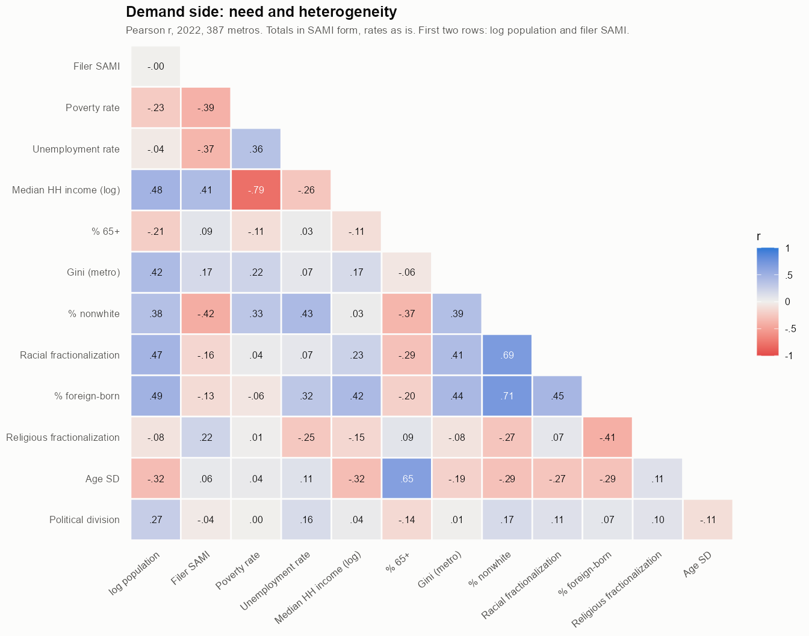
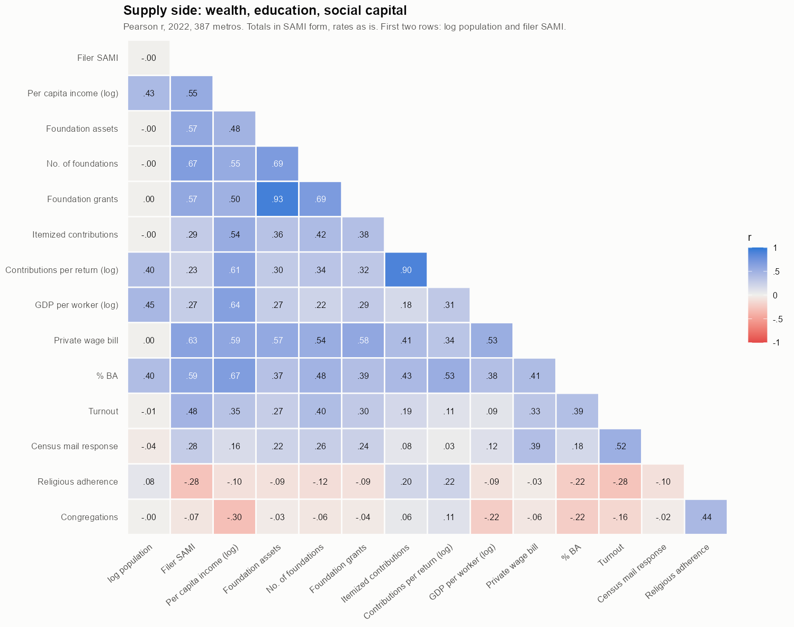
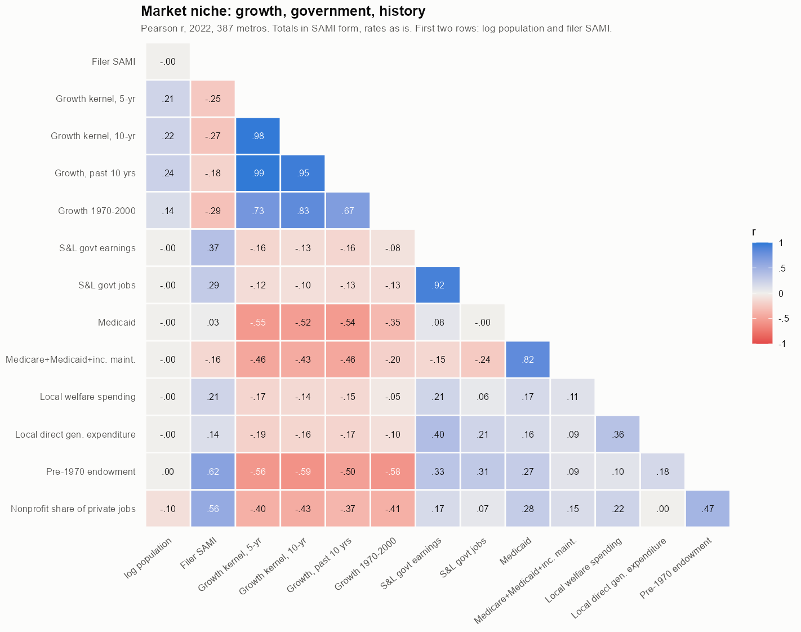
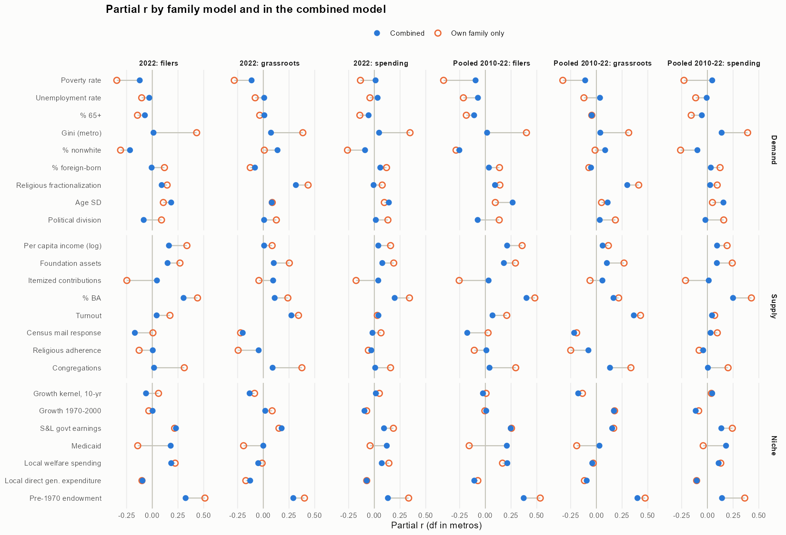
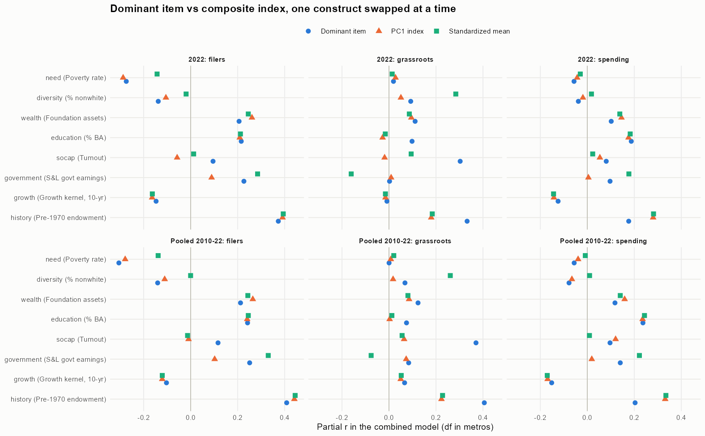
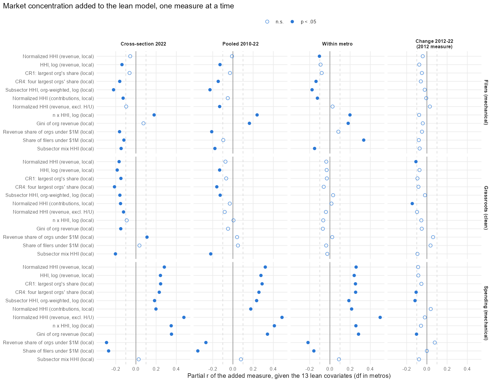

**Recommendation.** A unified panel model of nonprofit density needs 13 covariates, one item per construct, with diversity and government split into the separate constructs they actually contain. Demand side: poverty, % 65+, the metro Gini, % nonwhite, religious fractionalization and age SD. Supply side: foundation assets, % BA and turnout. Market niche: a 10-year growth kernel, state and local government earnings (direct government), Medicaid receipts (indirect government) and the pre-1970 endowment. No VIF in this set exceeds 4.5. It explains 79% of filer SAMI variance in 2022 (62% grassroots, 45% spending). Composite indices beat the dominant item for no construct once interpretability and sign stability are counted. Collinearity is a problem only inside constructs: 12 pairs of candidate measures correlate above .7, and all are twins of one another.

The evidence below covers 387 metros, 2010–2022, with three outcomes: filer SAMI (`n_filer_c3`), grassroots SAMI (registered minus filers) and spending SAMI excluding hospitals and universities. Covariates are in model form: dollar totals and counts in SAMI form (log, residualized on log population by year, with the per-capita floor for zeros), rates as is, incomes logged. Log population stays on the right of every model. Partial r counts degrees of freedom in metros. The spending series was corrected on 2026-11-17 (e-file NTEE codes backfilled, so hospitals and universities are excluded in 2020–24); the tables below predate the fix, and refitting the lean model on the corrected series moves no spending partial r by more than .04.

# Theories, constructs and measures {#sec-var-theory}

Three families of theory predict where nonprofits concentrate. Each names constructs; each construct has candidate measures in the panel.

| Family | Theory | Construct | Candidate measures | Selected |
|---|---|---|---|---|
| Demand | Unmet need creates demand for services | Need | poverty, unemployment, median household income, % 65+ | poverty, % 65+ |
| Demand | Government failure: heterogeneous preferences leave demand the median voter does not fund [@lecy2013nonprofit] | Heterogeneity | % nonwhite, racial fractionalization, % foreign-born, religious fractionalization, age SD, Gini, political division | % nonwhite, religious fractionalization, age SD, Gini |
| Supply | Resources for founding and funding | Wealth and philanthropy | per capita income, foundation assets, number of foundations, foundation grants, itemized contributions, contributions per return, GDP per worker, private wage bill | foundation assets |
| Supply | Entrepreneurs and volunteers | Education | % BA | % BA |
| Supply | Civic capacity | Social capital | turnout, census mail response, religious adherence, congregations | turnout |
| Niche | Carrying capacity lags population | Growth | 5- and 10-year growth kernels, 10-year growth, 1970–2000 growth | 10-year kernel |
| Niche | Public funding creates space for providers | Government | S&L earnings and jobs, Medicaid, Medicare + Medicaid + income maintenance, local welfare spending, local direct general expenditure | S&L earnings, Medicaid |
| Niche | Inherited sector size | History | pre-1970 endowment, nonprofit share of private jobs (BLS) | endowment |

: Theory, construct and measure. "Selected" is the lean set of @sec-var-lean. {#tbl-var-theory}

**Variables that fit two families.**

- **Per capita income** is a need measure (low income) and a wealth measure. It goes to supply: given poverty, its partial r is positive (.16 for filers in the combined model), the sign of a resource. Poverty carries the need side.
- **The Gini** is usually filed under need. It correlates only .22 with poverty, stays positive given poverty, and loads with the diversity items. It enters as economic heterogeneity.
- **Government size** can be read as demand (government failure) or as niche. It goes to niche and is split by mode: direct (public payroll) and indirect (Medicaid paid to providers). The two correlate .08.
- **Medicaid** tracks need (r .32 with poverty) but is money that reaches providers, so it is a government measure.

# Correlation within each family {#sec-var-cor}

@fig-cor-demand, @fig-cor-supply and @fig-cor-niche show each family in model form for 2022. The first two rows are log population and the filer SAMI. In SAMI form, totals are orthogonal to log population by construction; rates are not (% foreign-born .49, per capita income .43, Gini .42, % BA .40).

{#fig-cor-demand}

{#fig-cor-supply}

{#fig-cor-niche}

**Redundant proxies.** Twelve pairs exceed |r| = .7, all within a construct:

| Pair | r |
|---|---|
| 5-year growth kernel vs 10-year growth | .99 |
| 5-year vs 10-year kernel | .98 |
| 10-year kernel vs 10-year growth | .95 |
| Foundation assets vs foundation grants | .93 |
| S&L earnings vs S&L jobs | .92 |
| Contributions vs contributions per return | .90 |
| 10-year kernel vs 1970–2000 growth | .83 |
| Medicaid vs Medicare + Medicaid + income maintenance | .82 |
| Median household income vs per capita income | .80 |
| Poverty vs median household income | −.79 |
| 5-year kernel vs 1970–2000 growth | .73 |
| % nonwhite vs % foreign-born | .71 |

: Candidate pairs with |r| > .7, 2022, model form. {#tbl-var-pairs}

The largest cross-family correlations are lower: endowment vs growth kernel −.59, % nonwhite vs turnout −.61, poverty vs turnout −.55, Medicaid vs growth kernel −.52.

**VIFs.** With every candidate item entered, VIFs reach 212 (growth kernels), 55 (contributions) and 11 (S&L earnings). With one or two items per construct the largest VIF within a family is 4.4, and 6.4 when all three families are combined. The lean set peaks at 4.5 (% BA). These are computed on covariates residualized on log population, which is what the coefficients use.

**Do the candidate indices hold together?** First principal component share and Cronbach's α, items signed and standardized, pooled 2010–2022:

| Construct | Items | PC1 share | α | Holds together? |
|---|---|---|---|---|
| Growth | 4 growth measures | .89 | .96 | Yes: one variable |
| Education/affluence | % BA, per capita income, median income, −poverty | .76 | .89 | Yes, but three items belong to other constructs |
| Wealth and philanthropy | 7 items | .54 | .85 | Yes, once size is removed |
| History | endowment, BLS share | .73 | .63 | Two items, r .47 |
| Government | 6 items | .36 | .57 | No: direct and indirect load on opposite ends |
| Need | poverty, unemployment, −median income, % 65+ | .54 | .53 | Without % 65+, α .79 |
| Diversity | 7 items | .39 | .39 | No: age SD and religious fractionalization load against composition |
| Social capital | 4 items | .41 | .33 | No: participation and religion are opposed poles |

: Coherence of candidate indices. {#tbl-var-alpha}

# Block models and the combined model {#sec-var-blocks}

Each family is fit alone with its candidate set (twins removed: 9 demand, 8 supply and 7 niche covariates), then all 24 together. Fits are the 2022 cross-section (robust SEs) and the pooled 2010–2022 panel (year fixed effects, a log-population slope for each year, metro-clustered SEs).

| Model | Filers, 2022 | Grassroots, 2022 | Spending, 2022 | Filers, pooled | Grassroots, pooled | Spending, pooled |
|---|---|---|---|---|---|---|
| Demand | .48 | .44 | .25 | .50 | .38 | .30 |
| Supply | .66 | .47 | .34 | .65 | .46 | .40 |
| Niche | .47 | .37 | .28 | .47 | .41 | .32 |
| Combined | .82 | .68 | .46 | .81 | .68 | .53 |

: R² by family and combined. {#tbl-var-r2}

Supply explains the most alone. The pooled panel reproduces the cross-section: density is 98.8% between metros (within-metro share of filer SAMI variance 1.2%, 2010–2022), so pooling adds years, not information.

{#fig-var-blocks}

Across 24 terms and six outcome-by-sample cells, 42 term-cells stay significant with the same sign, 44 are absorbed, 19 flip sign, 8 emerge and 31 are null in both (@fig-var-blocks).

- **Survive everywhere: % BA and the endowment.** % BA falls from .44 to .30 for filers (2022) and stays significant in all six cells. The endowment falls from .51 to .32 and does the same. S&L earnings holds at .22–.25 for filers.
- **Absorbed: the Gini, congregations, turnout for filers.** The Gini drops from .43 to .01 for filers; % BA is its main absorber (without % BA it is .20 pooled). Congregations drop from .31 to .02, absorbed by religious fractionalization. Turnout for filers drops from .17 to .04, again through % BA; for grassroots it holds (.34 → .27).
- **Flip: Medicaid, contributions, census response.** Medicaid is negative alone (−.14 for filers) and positive combined (+.18; +.21 pooled). Alone it stands in for low education and fast growth (r −.37 with % BA, −.52 with the growth kernel). Contributions go from −.25 to +.05. Census response goes from .01 to −.17 once % nonwhite and turnout are in. Political division (+.09 to +.18 alone) and % foreign-born (+.12) go to zero or below.
- **Emerge: age SD.** Its −.43 correlation with % BA hides it; combined it is .18 (.27 pooled) for filers.
- **Poverty shrinks.** −.35 alone to −.12 combined for filers. Per capita income is the absorber: without it, poverty is −.26 (pooled).

**Within metros.** Metro and year fixed effects leave a within R² of .09 (filers), .19 (grassroots) and .04 (spending). The endowment and 1970–2000 growth drop out: they are fixed, and their SAMI forms move only with log population. What remains is mostly short-run: the growth kernel (−.16 filers, −.22 grassroots), unemployment (−.12, −.21), % BA (.16, .20) and turnout (.12, .17, mostly interpolation between elections). Three signs differ from the cross-section. S&L earnings turn negative (−.08 filers, −.26 grassroots), poverty positive (.10, .20) and age SD negative for filers. A within model answers how places adjust, not why some are denser; its nulls are not tests of the cross-sectional terms.

# Item or index, construct by construct {#sec-var-index}

Each construct is entered in the combined model as its dominant item, then swapped, one at a time, for its first principal component, its standardized mean, or an alternative item. Weights are fixed on the pooled panel. @fig-var-index shows partial r in 2022 and pooled.

{#fig-var-index}

| Construct | Dominant item: partial r, 2022 (filers / grassroots / spending) | PC1 index | Verdict |
|---|---|---|---|
| Need | poverty −.27 / .02 / −.06 | −.29 / .03 / −.04 | Item. PC1 is poverty (loadings .61 poverty, .61 −income) |
| Heterogeneity | % nonwhite −.14 / .09 / −.04 | −.11 / .05 / −.02 | Separate items. α .39; the standardized mean flips grassroots to +.28 |
| Wealth | foundation assets .21 / .11 / .10 | .26 / .10 / .15 | Item, index as check. Index gains .04–.05 for filers and spending, is significant in 4 of 6 cells against 6 of 6, and mixes in income and post-2018 contributions |
| Education | % BA .22 / .10 / .19 | .21 / −.03 / .18 | Item. The index borrows income and poverty and loses grassroots |
| Social capital | turnout .10 / .30 / .08 | −.06 / −.02 / .05 | Item. The index cancels participation against religion |
| Government | S&L earnings .23 / .00 / .10 | .09 / .01 / .01 | Two items. PC1 averages direct and indirect, which load on opposite ends; Medicaid alone is .27 / −.09 / .19 |
| Growth | 10-year kernel −.15 / −.01 / −.12 | −.16 / −.02 / −.14 | Item. Identical (α .96); the kernel has a half-life reading |
| History | endowment .37 / .33 / .18 | .39 / .18 / .28 | Item. The index's spending gain comes from the BLS share, which counts hospital and university jobs |

: Dominant item vs PC1 index in the combined model, 2022. Pooled values agree within .05 except where noted in the text. {#tbl-var-index}

Three patterns run through the table.

- **Where items are twins, the index equals the item.** Growth, need and education/affluence have high α, and their indices give back the dominant item's estimate. The item is simpler and keeps its unit.
- **Where items are separate constructs, the index cancels.** Diversity, social capital and government have α of .33–.57. Their PC1 estimates are near zero because loadings of opposite sign average out effects of opposite sign. The diversity items show it: age SD (.15 / .10 / .15) and the Gini (.09 / .14 / .09) are positive in every cell, % nonwhite is negative for filers and spending, and religious fractionalization is +.47 for grassroots.
- **Wealth is the one real trade-off.** In SAMI form the seven wealth items form one factor (α .85), and the index is slightly stronger for filers and spending. Foundation assets win on interpretability, stability across outcomes and data quality: contributions break at the 2018 tax change, and the number of foundations counts private foundations, which share registration habits with the outcome.

# Market competition: tested, not included {#sec-var-compete}

Niche theory has a second side: when a few organizations hold most of a metro's resources, smaller ones face a thinner niche. We tested 12 concentration measures from `R/23_cov_compete.R`. All are computed over active filers' revenue (or contributions) in the community-serving `local` universe, which leaves out health, international, research, grantmakers and university support organizations, because headquarters revenue (Kaiser in Oakland, UPMC in Pittsburgh) dominates whole-sector HHI. Each was added alone to the 13-covariate set (385 metros, 2010–2022). @fig-var-compete shows the result.

{#fig-var-compete}

**Two of the three outcomes are mechanically tied to concentration.** HHI is at least 1/n, with n the number of filers, and the filer SAMI is log n net of log P. Log HHI and CR4 correlate −.68 with log filers; normalized HHI, which removes the 1/n floor, −.38. Spending is the revenue being divided: one large organization raises both spending and HHI. Grassroots (registered non-filers) appear in no concentration measure, so they are the clean test.

| Measure | Grassroots: 2022 / pooled / within | 2012 measure → 2012–22 change, grassroots | Spending, 2022 (mechanical) | ΔR², filers / grassroots | VIF in the lean set |
|---|---|---|---|---|---|
| Normalized HHI (revenue) | −.17 / −.07 / −.04 | −.11 | .28 | .001 / .011 | 1.09 |
| HHI, log | −.19 / −.13 / −.03 | −.07 | .24 | .004 / .011 | 1.17 |
| CR1, largest organization | −.15 / −.07 / −.03 | −.09 | .24 | .001 / .008 | 1.10 |
| CR4, four largest | −.21 / −.16 / −.06 | −.08 | .23 | .007 / .015 | 1.23 |
| Normalized HHI (contributions) | −.15 / −.03 / .02 | −.15 | .20 | .005 / .009 | 1.13 |
| Gini of organization revenue | −.15 / −.05 / −.07 | −.05 | .35 | .002 / .013 | 1.07 |

: Concentration added to the lean model: partial r for grassroots, the clean outcome. Six of the 12 measures; the rest are in `D:/MULTIVERSE/data/variables/compete/addone_summary.csv`. {#tbl-var-compete}

- **HHI and the n-firm ratios are one variable.** Log HHI and CR4 correlate .96; normalized HHI and CR1 .95. Entered together, CR4 keeps the effect (−.13 for grassroots) and HHI goes to zero (.04).
- **On the clean outcome the effect is small and cross-sectional.** More concentrated metros have somewhat fewer grassroots organizations in 2022 (−.15 to −.21). Pooled it is weaker (−.03 to −.16), within metros zero (−.07 to .02), and concentration in 2012 predicts at most a small grassroots decline to 2022 (−.11 for normalized HHI, −.15 for its contributions version; the other measures n.s.).
- **It adds almost nothing and moves nothing.** ΔR² is .015 or less for filers and grassroots, no lean coefficient moves by more than .03 for those outcomes, and VIFs stay at 1.05–1.35. Leaving concentration out does not bias the other terms.
- **Spending results are the mechanism, not a finding.** Every dominance measure is positive for spending (.18–.47) and every small-organization share negative (−.27 to −.29), in levels and within metros. Concentration there describes how the spending is distributed, not a cause of it. The whole-sector version (excluding only hospitals and universities) reaches .47 because it records where headquarters book revenue.

**Decision.** Concentration stays out of the default model, with the same status as the BLS nonprofit share: partly the outcome for filers and spending. It is worth one extension, as a niche-crowding test on grassroots with the measure dated before the outcome (normalized HHI of local revenue or contributions in a base year). If one measure is reported, use normalized HHI rather than HHI or CR4, because it is least tied to the filer count.

# Recommended set {#sec-var-lean}

| Variable | Family | One-line justification |
|---|---|---|
| Poverty rate | Demand: need | The need construct; an index of seven need rates correlates .94 with it |
| % 65+ | Demand: need | Dependent population; holds the age level fixed so age SD reads as heterogeneity |
| Gini (metro, from summed brackets) | Demand: heterogeneity | Economic heterogeneity; positive given poverty (.13 filers) |
| % nonwhite | Demand: heterogeneity | Racial composition; monotone, unlike fractionalization |
| Religious fractionalization | Demand: heterogeneity | Preference heterogeneity; strongest grassroots term (.52) |
| Age SD | Demand: heterogeneity | Age heterogeneity; positive in all six cells |
| Foundation assets (SAMI) | Supply: wealth | Philanthropic capital; significant in all six cells |
| % BA | Supply: education | The most robust covariate (.37 filers, .26 spending) |
| Turnout | Supply: social capital | Participation; carries grassroots (.24) and the within-metro civic signal |
| Growth kernel, 10-year half-life | Niche: growth | Carrying capacity lags population; the main within-metro term (−.20) |
| S&L government earnings (SAMI) | Niche: government, direct | Public payroll; .23 for filers |
| Medicaid (SAMI) | Niche: government, indirect | Public money paid through providers; .25 filers, .16 spending |
| Pre-1970 endowment (SAMI) | Niche: history | The sector's inherited size; .32 filers; an estimand choice (report without it) |

: The lean set: 13 covariates. {#tbl-var-lean}

| Term | 2022 | Pooled 2010–22 | Within | 2022, no endowment |
|---|---|---|---|---|
| Poverty | −.28 / −.06 / −.04 | −.29 / −.06 / −.05 | .04 / .13 / −.02 | −.29 / −.07 / −.05 |
| % 65+ | −.03 / −.01 / −.05 | −.06 / .00 / −.04 | .00 / −.13 / −.01 | −.03 / −.01 / −.05 |
| Gini | .13 / .15 / .07 | .14 / .08 / .14 | .07 / −.10 / .02 | .07 / .11 / .04 |
| % nonwhite | −.20 / .12 / −.09 | −.19 / .12 / −.13 | −.09 / −.11 / −.04 | −.21 / .11 / −.10 |
| Religious fractionalization | .12 / .52 / .00 | .14 / .52 / .09 | −.04 / .09 / −.09 | .20 / .53 / .05 |
| Age SD | .15 / .07 / .12 | .18 / .06 / .10 | −.10 / .19 / −.03 | .17 / .10 / .13 |
| Foundation assets | .22 / .12 / .10 | .22 / .13 / .13 | .06 / −.02 / −.02 | .29 / .19 / .15 |
| % BA | .37 / .14 / .26 | .46 / .16 / .31 | .19 / .15 / .07 | .41 / .19 / .29 |
| Turnout | .01 / .24 / .03 | .03 / .32 / .04 | .11 / .15 / .09 | −.05 / .19 / .00 |
| Growth kernel | −.05 / −.07 / −.05 | .00 / .01 / −.07 | −.20 / −.26 / −.03 | −.22 / −.25 / −.15 |
| S&L earnings | .23 / .08 / .09 | .24 / .13 / .11 | −.02 / −.32 / .00 | .29 / .14 / .12 |
| Medicaid | .25 / .01 / .16 | .26 / .04 / .23 | .03 / −.01 / .15 | .27 / .03 / .18 |
| Endowment | .32 / .26 / .15 | .34 / .34 / .15 | — | — |
| R² (within R²) | .79 / .62 / .45 | .78 / .62 / .51 | .07 / .12 / .03 | .77 / .58 / .44 |

: Partial r in the lean model: filers / grassroots / spending. {#tbl-var-lean-fit}

**What the lean model says.**

- **Supply and history carry levels.** % BA, the endowment, foundation assets and S&L earnings are positive for every outcome. Per SD, % BA moves filer density 17 log points and spending 31; the endowment moves them 10 and 13.
- **Indirect government matters for filers and spending, not grassroots.** Medicaid is .25 and .16; for grassroots it is .01.
- **Heterogeneity splits by outcome.** % nonwhite is negative for filers (−.20) and spending (−.09) but positive for grassroots (.12). Religious fractionalization drives grassroots (.52) and barely touches spending. Registered congregations sit inside the grassroots count, so part of that link is mechanical.
- **The endowment and growth history are one fact in levels.** With the endowment in, the growth kernel is about −.05; without it, −.22. Within metros the kernel is −.20 either way. This qualifies D8's advice to include growth history in every current-conditions model: in levels it is redundant with the endowment; within metros it is the main term.
- **Poverty depends on income.** Adding per capita income moves poverty for filers from −.28 to −.12, the Gini from .13 to .05 and foundation assets from .22 to .16. Poverty also reverses with metro size: negative below about 250,000 residents, positive above (`R/86`, `R/90`). Report it as heterogeneity, not as a fork.

**The historic size of the sector washes out under metro fixed effects.** The endowment is fixed in 2000 and the BLS share moves 1.8% within metros over 2013–2022. With metro fixed effects both are absorbed, and the endowment's SAMI form varies only with log population, which carries no information about history. So a within model cannot estimate history and cannot be confounded by it. It also cannot say why some places are dense. The cross-section and pooled panel can, but every resource coefficient there partly reflects history: without the endowment, foundation assets rise from .22 to .29 and S&L earnings from .23 to .29. Report both.

**Drop list.**

| Variable | Reason |
|---|---|
| Median household income | −.79 with poverty, .80 with per capita income |
| Unemployment | Cyclical; ~0 in levels (−.03); keep only in within models (−.14 / −.21) |
| Racial fractionalization | Not monotone in composition; ranks border metros least diverse (D7) |
| % foreign-born | .71 with % nonwhite; absorbed (+.12 → −.01) |
| Political division | Interpolated between elections; flips from +.13 to −.07 |
| Per capita income | Optional; it moves poverty and the Gini. Report as a variant |
| Foundation grants, number of foundations | .93 and .69 with assets; foundation counts share registration habits with the outcome |
| Itemized contributions, contributions per return | .90 pair; TCJA break in 2018; sign flips (−.25 → +.05) |
| GDP per worker, private wage bill | Negative or absorbed; size of the private economy, not philanthropy |
| Census mail response | Negative given turnout and % nonwhite (−.17); frozen after 2014 |
| Religious adherence, congregations | Null and absorbed (.31 → .02) |
| S&L government jobs, all transfers | .92 and .82 twins of the selected items |
| Local welfare, local direct general expenditure | Census of Governments years only; welfare (.18 filers) is an alternative indirect measure; direct expenditure is −.10 given payroll |
| 5-year kernel, 10-year growth, 1970–2000 growth | .73–.99 twins of the 10-year kernel; 1970–2000 growth is fixed and absorbed by the endowment |
| BLS nonprofit share of private jobs | Partly the outcome: counts hospital and university jobs (r .56 filers, .57 spending), 2013+ only |
| Rupasingha index, re-estimated index (sk2), association establishments | Count nonprofits: r .69, .47 and .54 with the filer SAMI. Never a predictor |
| Market concentration (HHI, CR1, CR4, normalized HHI, revenue Gini, small-organization shares) | Built from the filers themselves: HHI ≥ 1/n, and spending is the revenue being divided. On grassroots, the clean outcome, −.15 to −.21 in 2022 but near zero pooled and within; ΔR² ≤ .015 (@sec-var-compete). An extension, not a covariate |

: Variables to drop, and why. {#tbl-var-drop}

# What to report {#sec-var-report}

- The construct each covariate measures and the theory family it tests, with the placement of any variable that fits two families.
- The correlation matrix of candidate measures in model form, and each total's correlation with log population.
- One item per construct. Where a construct has several items, an α or PC1 share to show whether they form one construct; enter separate constructs as separate terms.
- Block models next to the combined model, so readers see which effects survive, which are absorbed and which flip.
- The wealth index as a robustness check for foundation assets, and the model with and without the endowment.
- Within-metro estimates as a separate question, with the within share of variance for each covariate.

*Sources: market competition: `R/95_compete_niche.R` (`D:/MULTIVERSE/data/variables/compete/`), measures from `R/23_cov_compete.R` (`notes/market-competition-measures.md`); `R/94_variables_panel_model.R` (`D:/MULTIVERSE/data/variables/`: `cor_*_2022.csv`, `vif_2022.csv`, `constructs_pc1_alpha.csv`, `block_models.csv`, `block_vs_combined.csv`, `absorbers_top3.csv`, `item_vs_index_summary.csv`, `lean_models.csv`, `within_share.csv`, `contaminated_r_2022.csv`); `notes/variables-panel-model-results.md`; `notes/collinearity-composites-results.md` (`R/70_collinearity_composites.R`); `notes/need-socap-diversity-results.md` (`R/89_need_socap_diversity.R`); `notes/government-funding-measures.md` (`R/91_government_measures.R`); `notes/catchup-lag-results.md`; size heterogeneity of poverty: `R/86_sensitivity_tcja_size.R`, `R/90_size_moderation_screen.R`. Data: `D:/MULTIVERSE/data/analysis/cbsa_year.parquet`, `D:/MULTIVERSE/data/cov/cov_endowment.csv`, `cov_lag_kernel.csv`, `cov_gini_metro.csv`, `D:/MULTIVERSE/data/catchup/c9_metro_1970_2024.csv`.*

# References {.unnumbered}
