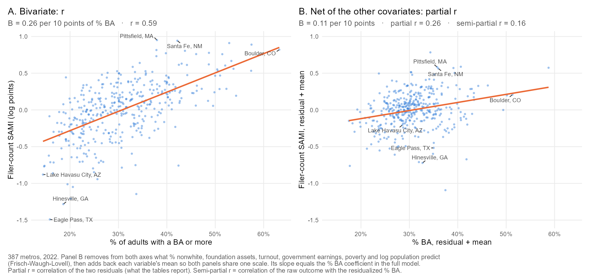
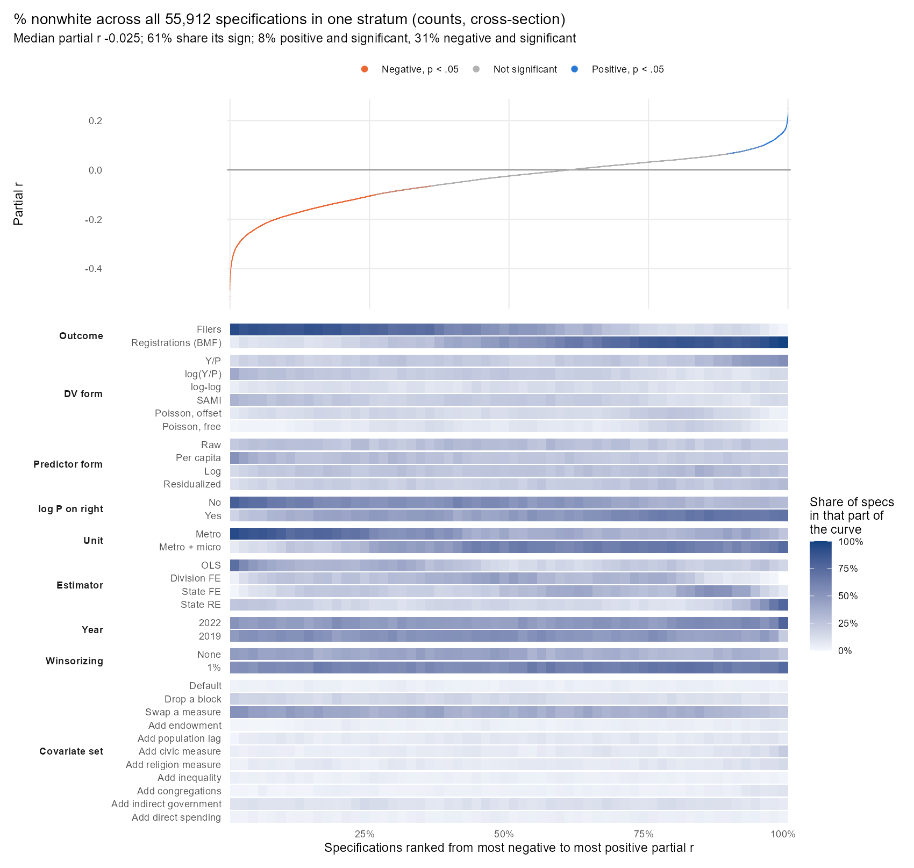

Most disagreement in nonprofit density research comes from a few design decisions, not from the data. Studies that choose differently about the outcome, its functional form, the unit of analysis, the identification strategy and how covariates are measured can reach opposite conclusions from the same metros. A multiverse analysis makes those choices visible: it fits every defensible combination and asks which choices move the answer and by how much. This section explains how our multiverse is built (605,352 specifications over 387 metros, 2000–2024, run v10) and the three statistics used to read it.

# Why a multiverse

Every empirical result rests on a chain of choices: which organizations to count, how to scale by population, which year, which estimator, which measure of each construct. Each choice is defensible on its own, and the chain branches at every step. Gelman and Loken [-@gelman2014garden] call this the garden of forking paths. A single published estimate is one path through it, and readers cannot tell whether a neighboring path would have given the same answer.

Leamer [-@leamer1983lets] proposed reporting how estimates move across reasonable specifications rather than choosing one. Multiverse analysis [@steegen2016increasing] and specification curve analysis [@simonsohn2020specification] apply the idea systematically: define the set of defensible choices in advance, fit every combination, and report the whole distribution. Young and Holsteen [-@young2017model] add a decomposition that attributes the spread of an estimate to the choices that produce it.

Density research is a strong case for the approach. Its covariates are standard (education, poverty, diversity, philanthropy, government, civic culture), but published signs disagree. Racial diversity is positive in some studies and negative in others; poverty and income flip sign between pooled and fixed-effects models of the same metros [@lecy2013nonprofit]. The paper asks whether those disagreements are about the world or about the paths taken.

The paper makes four contributions:

1. Seven empirical facts about density data that any design has to confront (`01-stylized-facts.qmd`).
2. A theory-based set of key variables, with a decision between single items and indexes for each construct (`02-variables.qmd`).
3. A decision card for each design choice: options, mechanism, evidence and recommendation (`04-design-decisions.qmd`).
4. A ranked summary of decisions by consequence, read on a common yardstick of benchmark covariates (`05-findings.qmd`).

# Three kinds of decisions

Not every choice belongs in one distribution. Del Giudice and Gangestad [-@delgiudice2021traveler] distinguish choices that change what is being estimated from choices that are interchangeable ways of estimating the same thing. Pooling both into one specification curve produces a spread that has no interpretation. We tag every decision with one of three types, because the right response differs:

| Type | What it means | How it is handled | Examples |
| --- | --- | --- | --- |
| Estimand choice | The options answer different questions | Separate strata, never pooled; justified by theory | Outcome population, identification, unit of analysis |
| Analyst discretion | Defensible alternatives for the same question | Crossed as forks; report robustness across them | Estimator, year, winsorizing, measure of a construct |
| Avoidable error | One option is wrong for a known reason | Kept in the grid to show its cost, then excluded from recommendations | Per capita outcomes when the scaling exponent is far from 1; raw dollar predictors; OLS on outcomes with many zeros |

: Decision types. {#tbl-decision-types}

# The specification grid

A specification is one path through four layers of choices (@fig-grid).

```{mermaid}
%%| label: fig-grid
%%| fig-cap: "One specification is one path through every layer of choices. Estimand choices split the universe into strata; analyst choices are crossed inside each one."
flowchart TB
  D["Data: 387 metros and 925 CBSAs, 2000–2024"]
  S["Strata (12, never pooled)<br/>construct (counts, spending) ×<br/>hospitals and universities (included, excluded) ×<br/>identification (cross-section, pooled, within)"]
  F["Forks, crossed within each stratum<br/>outcome measure · DV form (6) · predictor form (4) · log P on the right (2)<br/>unit (2) · estimator (4) · year (2, cross-section only) · winsorizing (2)"]
  C["Covariate sets (34)<br/>default model · drop one block (5) · swap one measure (15) · add one measure (13)"]
  X["Remove impossible pairs and algebraic duplicates"]
  R["605,352 specifications<br/>each gives a partial r for every covariate"]
  D --> S --> F --> C --> X --> R
```

**Strata.** Choices that change the question split the universe into 12 strata that are never pooled: the construct (counts of organizations or spending), whether hospitals and universities are included, and the identification strategy (a single-year cross-section; a pooled panel, 2015–2022, with year fixed effects; or a within-metro panel, 2010–2022, with metro and year fixed effects).

**Forks.** Inside each stratum the defensible alternatives are crossed with each other:

| Fork | Options |
| --- | --- |
| Outcome measure | Counts: filers, registrations (BMF). Spending: expenses or revenue, gross or net of grants to other organizations |
| DV form | Per capita; log per capita; log-log; SAMI; Poisson with a population offset; Poisson with log P free |
| Predictor form (size-scaled covariates) | Raw; per capita; logged; residualized on log P (SAMI form) |
| Log P on the right | No; yes |
| Unit | Metro; metro + micro |
| Estimator | OLS; state fixed effects; Census division fixed effects; state random effects |
| Year (cross-section only) | 2022; 2019 |
| Winsorizing | None; top and bottom 1% |

: Forks crossed within each stratum. {#tbl-forks}

**Covariate sets.** Covariates are organized in theory blocks with one default measure each. The covariate fork changes one thing at a time from the default model: drop one block (5 sets), swap one block's measure for an alternative (15), or add one measure to the full default model (13: the pre-1970 endowment, two population-lag kernels, two civic measures, two religion measures, metro inequality, congregations, three indirect-government measures and direct government spending). With the default, that makes 34 sets. One-at-a-time changes keep the grid interpretable: each specification differs from a default twin in a single, named way.

**Removing duplicates.** Some combinations cannot apply (log-log needs log P on the right; Poisson models do not take state random effects; the within stratum uses only metro and year fixed effects; time-invariant covariates drop out under metro fixed effects). Others are algebraically identical: log(Y/P) with log P on the right equals log Y with log P on the right, and residualized predictors alongside log P equal logged predictors (Frisch–Waugh–Lovell). Duplicates are removed from the distribution and fitted only as a check. What remains is 605,352 specifications.

The grid grew in stages, and each addition was appended so earlier specification ids never changed: the 396,264 specifications of runs v5–v6, then 36,168 population-lag, 66,000 civic and religion, 34,584 inequality and congregation, and 72,336 government specifications (run v10).

# One metric across all specifications

Coefficients cannot be compared across the grid: a per capita model, a log model and a Poisson model put the same covariate on different scales. Every specification therefore reports the partial correlation of each covariate,

```latex
r = \frac{t}{\sqrt{t^2 + df}}
```

with t from robust or clustered standard errors and degrees of freedom counted in metros. Partial r is scale-free across DV forms, identical across algebraically equivalent specifications, and a direct transformation of the t-statistic. As a rough guide, |r| ≈ .1 is small and ≈ .3 moderate.

**What partial r measures.** It is how closely a covariate tracks density once the other covariates are held fixed. % BA shows how different that is from the raw association (@fig-partial-r).

{#fig-partial-r}

- **Bivariate (panel A).** Across 387 metros in 2022, the filer-count SAMI rises 0.26 log points (about 30% more organizations than expected for size) per 10 points of % BA; r = .59.
- **Partial (panel B).** Remove from both % BA and the SAMI what the other five covariates and log population predict, then plot the residuals around their means. The slope falls by more than half, to 0.11 per 10 points, exactly the % BA coefficient in the full model (Frisch–Waugh–Lovell). The correlation of the residuals, the partial r, is .26.
- **Semi-partial.** Residualizing only % BA and correlating it with the raw SAMI gives .16. Its square (.025) is the share of total density variance that % BA explains on its own, a different question from the one the tables ask.
- **What control does to the data.** More than half of the variance in % BA is shared with the other covariates: its SD falls from 8.8 to 5.6 points. Metros move along the x-axis: Eagle Pass, TX has a low raw % BA but a high value once its other traits are accounted for.

The tables compute partial r from robust or clustered t-statistics, so their values differ slightly from the residual correlation shown here (.24 vs. .26 for this model).

# Reading one covariate across the grid

A single estimate tells readers little. Across the 55,912 specifications in one stratum (counts, cross-section), the partial r of % nonwhite runs from about −.5 to +.25 (@fig-spec-curve). The median is −.02, 61% of specifications share its sign, 31% are negative and significant, and 8% are positive and significant.

{#fig-spec-curve}

The strips under the curve show where each option's specifications fall. Dark means that option makes up most of the specifications in that part of the curve; read each row left to right, and the rows of one fork sum to 100% at every point.

- **Outcome (D1):** filers sit at the negative end and registrations at the positive end.
- **Unit (D2):** metro specifications fill the negative end; adding micro areas moves estimates toward zero and above.
- **Everything else** has milder pulls: OLS leans negative and state random effects positive (D9), and models without log P on the right lean negative. DV form, predictor form, year, winsorizing and covariate set are spread evenly along the curve.

For every covariate the summary statistics are the median partial r, sign agreement (the share of specifications with the median's sign), and the share significant at p < .05 under robust and under state-clustered standard errors.

# Attributing the spread to decisions

The specification curve shows that a covariate moves; η² says which decision moves it. Each cell of the decision table answers one question: if you knew only which option of one decision a specification used, how much of the covariate's spread could you predict?

```latex
\eta^2 = \frac{\sum_k n_k\,(\bar r_k - \bar r)^2}{\sum_i (r_i - \bar r)^2}
```

The numerator is the spread between option means; the denominator is the total spread across specifications. The example uses the 964 default-model specifications for filer counts in the cross-section (@fig-eta2).

{#fig-eta2}

- **Grouped by estimator,** the specifications separate partly. OLS averages −.15, division FE and state random effects −.08, and state FE −.06. Those four means account for 15% of the total variance: η² = .15.
- **Grouped by winsorizing,** nothing separates. Both means sit on the overall mean: η² = .01.

The decision tables compute η² within each stratum and outcome, then average. Because some options only occur together, cells overlap and do not add up. η² is a marginal measure in the spirit of Young and Holsteen's [-@young2017model] model influence: it says how much a decision matters for a covariate, not why.

# The yardstick and the decision cards

Five benchmark covariates, fixed before any card was written, serve as the yardstick in every card: % BA, foundation assets, % nonwhite, turnout and poverty. Each stands for a theory the field tests and for a different way results go wrong (size scaling, measurement, estimator, collinearity); `02-variables.qmd` defines them. Reading every decision on the same five covariates lets readers compare the cost of decisions directly.

Each design decision is written as a card with the same five parts, so the paper can be scanned as a reference:

| Part | What it holds |
| --- | --- |
| Decision | The choice an analyst faces, in one line |
| Options | The alternatives used in published work, plus ours |
| Mechanism | Why the choice changes results (the algebra or the data behavior) |
| Evidence | How the five benchmark covariates move under each option, plus any outcome-level fact (scaling exponent, persistence) |
| Recommendation | What to do, and what to report if the reader chooses otherwise |

: Parts of a decision card. {#tbl-card}

Each card reports, for each benchmark, the median partial r under each option, sign agreement, the share significant (robust and state-clustered), and the decision's η². Results that matter but do not warrant a fork (the 2018 tax law, city-size heterogeneity, sample exclusions) are reported as sensitivity notes in `05-findings.qmd`.

# References {.unnumbered}

::: {#refs}
:::
