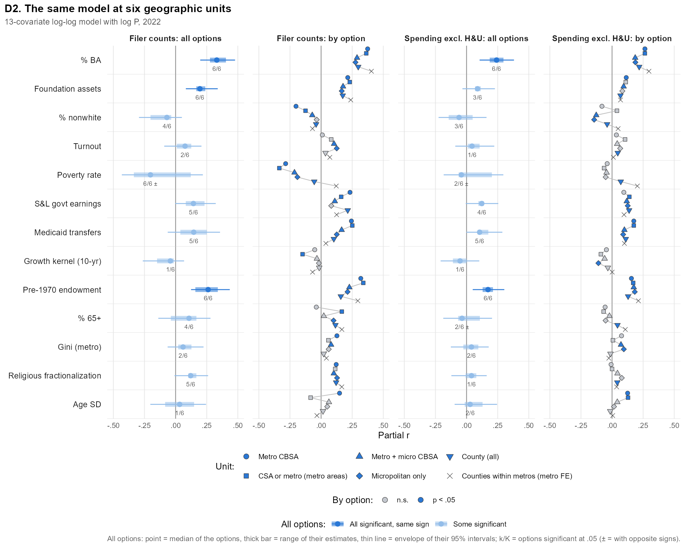
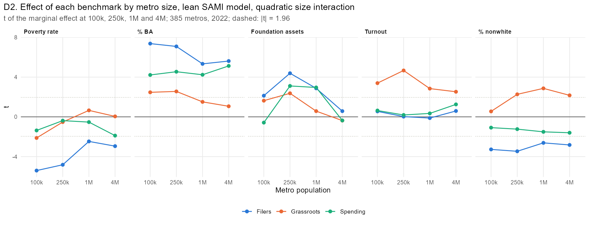
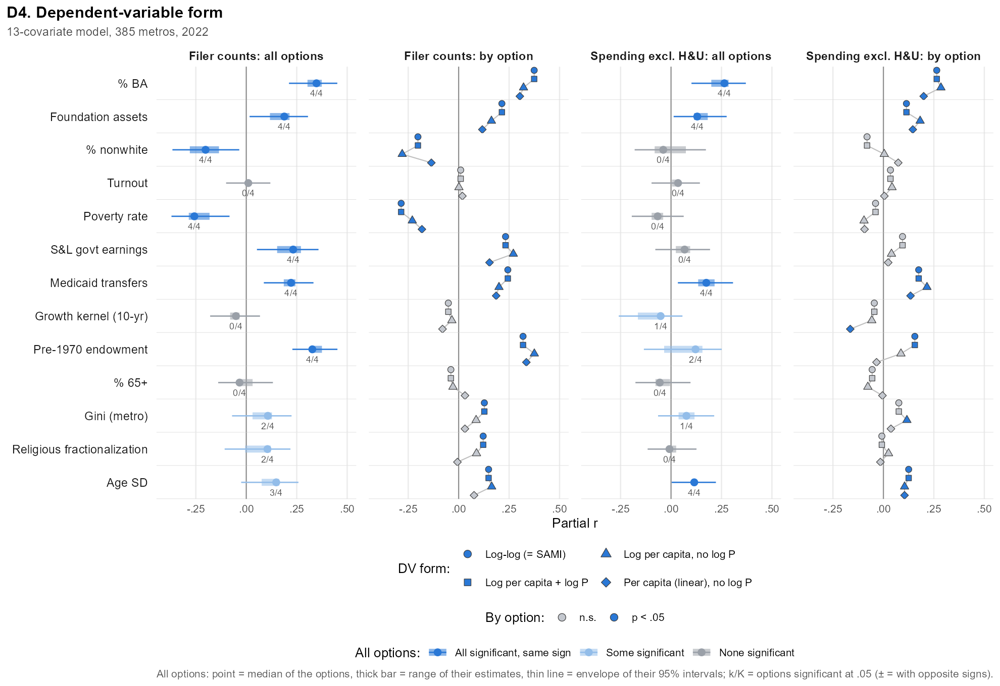
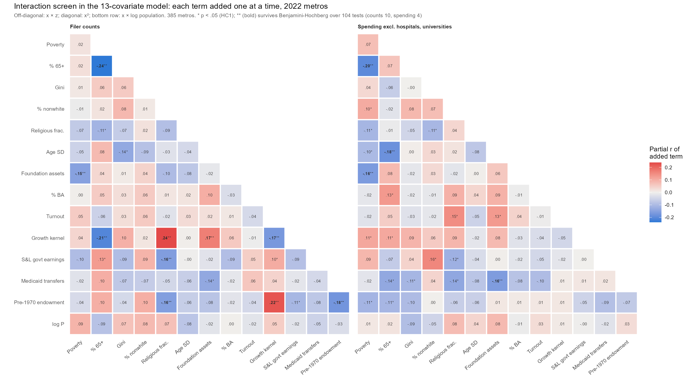
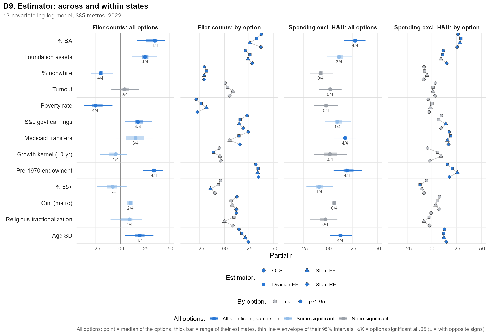
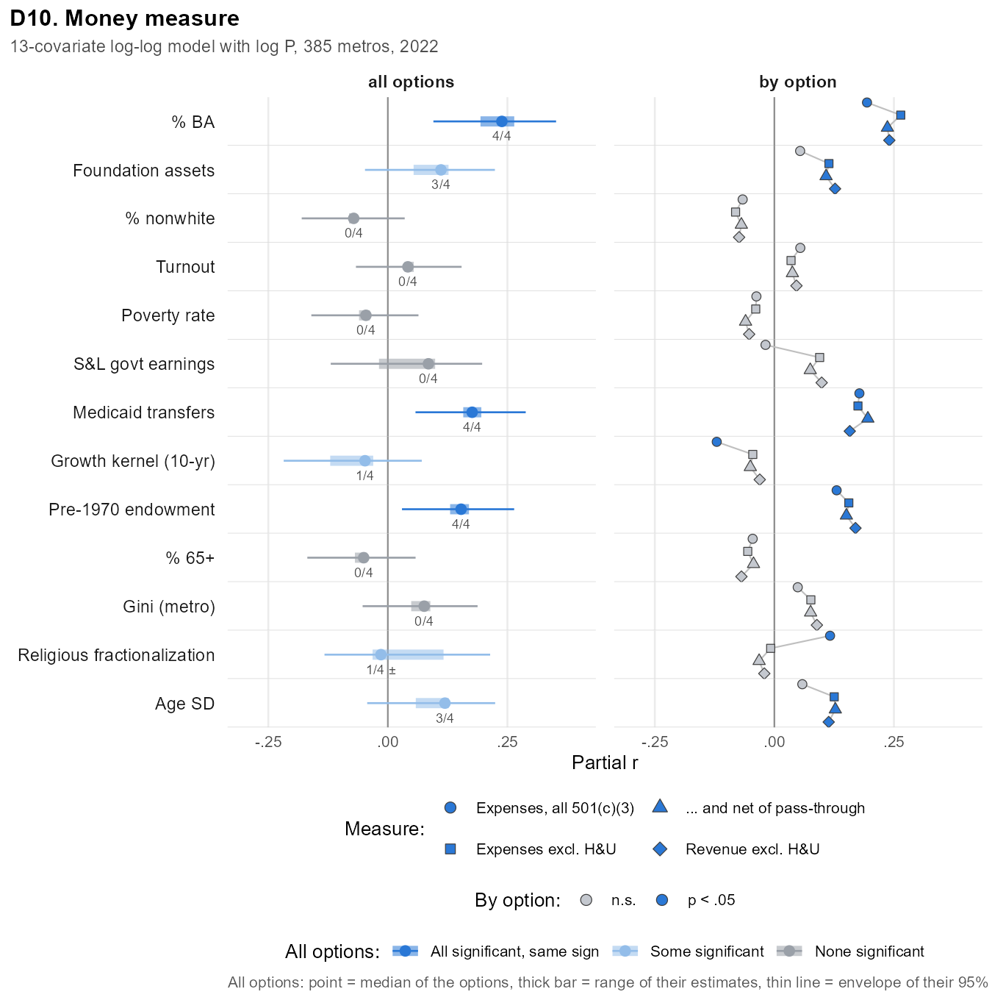
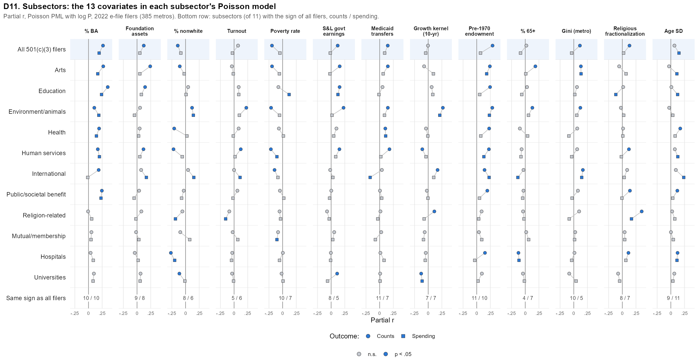
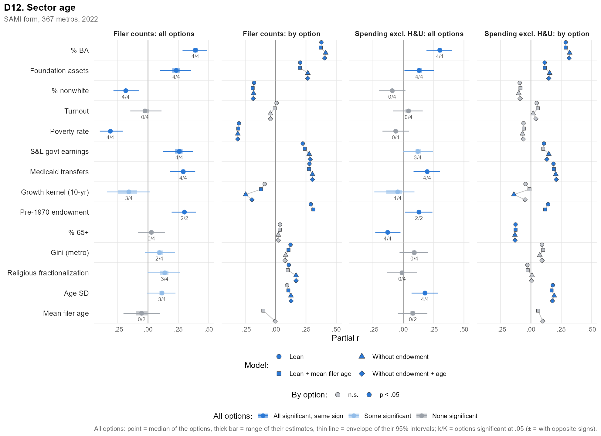

Twelve cards, ordered from the choices that define the question to the choices that only refine it. Every card is read on the 13-covariate model of `02-variables.qmd`: poverty and % 65+ (need); the metro Gini, % nonwhite, religious fractionalization and age SD (heterogeneity); foundation assets, % BA and turnout (supply); the 10-year growth kernel, state and local government earnings, Medicaid and the pre-1970 endowment (market niche). The evidence comes from two sources. Single models refit each option with the 13 covariates on 385 metros (Memphis and Mankato have no endowment value). Run v11 of the multiverse supplies the distributions: the same forks as before, with the 13-covariate model as the default, one-at-a-time measurement swaps and drop-one-block contrasts, 432,432 specifications in all.

**What the 13-covariate model changes across the cards.**

- **Poverty is clearly negative for filers** (partial r −.29, against −.10 in the old six-covariate model). It no longer changes sign between filers and grassroots (D1), and it no longer reverses with metro size (D2).
- **Foundation assets roughly halve** (.41 → .21 for filers, .26 → .11 for spending). No single term absorbs them; the endowment, Medicaid and the heterogeneity terms share it.
- **Turnout is a grassroots covariate.** It is about zero for filers (.01) and spending (.04) and .24 for grassroots.
- **% BA strengthens** (.24 → .37 for filers), and **% nonwhite weakens a little** (−.26 → −.20) and turns positive for grassroots (+.13).
- **The most estimator-sensitive terms are now the new state-patterned ones:** Medicaid (.24 under OLS, .06 within states) and religious fractionalization (.12 → .00).

Old values are from the six-covariate cards; refitting the old model on the current data and the same 385 metros moves them by .02 or less, so the changes are the model's, not the data's.

| Decision | Type | Card |
|---|---|---|
| Outcome population | Estimand choice | D1 |
| Unit of analysis | Estimand choice | D2 |
| Identification | Estimand choice | D3 |
| DV form | Avoidable error | D4 |
| Estimator with zeros | Avoidable error (subsectors, small units); weighting choice (full-sector metros) | D5 |
| Predictor form for size-scaled totals | Avoidable error (raw, logged without log P); discretion otherwise | D6 |
| Measurement: one item or an index | Analyst discretion | D7 |
| Historical controls | Estimand choice, bad-control risk | D8 |
| Geography fixed effects and SEs | Analyst discretion that can flip signs | D9 |
| Money measure and exclusions | Analyst discretion | D10 |
| Subsector scope | Estimand choice | D11 |
| Sector age | Bad-control risk | D12 |

: The twelve decisions. {#tbl-cards}

# D1. Outcome population: filers, grassroots, registered stock, or spending {#sec-d1}

**Decision.** Which population of organizations "density" counts: established filers, grassroots organizations, the whole registered stock, or the money they spend.

**Type.** Estimand choice. Each population answers a different question, and the choice changes signs.

**Options.**

- **Filers:** 501(c)(3) public charities filing a 990 or 990-EZ with revenue or expenses of at least \$50k (2010 dollars). The established, economically active sector.
- **Grassroots:** registered public charities that do not file at that level: postcard (990-N) filers, small filers, registered churches and dormant registrations. 72–80% of the registered stock.
- **Registered stock:** the IRS Business Master File (BMF), both groups together.
- **Spending:** expenses or revenue, gross or net of pass-through grants, with or without hospitals and universities.
- Congregations that never register are outside every count.

**Mechanism.** The populations grow for different reasons. Filers follow the local economy, because organizations cross the filing floor as their revenue grows. Grassroots follow demography and institutional legacy. Spending is dominated by a few large organizations and scales faster than population.

**Evidence 1: the populations rank metros differently** (387 metros, 2022).

- Filer and grassroots SAMIs correlate .67. The registered stock correlates .97 with grassroots but .83 with filers, so it mostly measures grassroots.
- Spending correlates .71 with filers and .41 with grassroots.
- All three counts scale at about 1.0 (filers 0.99, grassroots 1.01, registered 1.00); spending scales at 1.29. The SAMI spreads differ: SD .39 for filers, .26 for grassroots, .73 for spending.

**Evidence 2: the same model gives different answers.** Partial r from the 13-covariate log-log cross-section, 385 metros, 2022, fitted to each population (@fig-d1):

| Covariate | Filers | Grassroots | Registered stock | Spending |
|---|---|---|---|---|
| % BA | .37 | .14 | .24 | .26 |
| Foundation assets | .21 | .12 | .18 | .11 |
| % nonwhite | −.20 | .13 | .05 | −.08 |
| Turnout | .01 | .24 | .21 | .04 |
| Poverty rate | −.29 | −.06 | −.14 | −.04 |
| S&L govt earnings | .23 | .08 | .13 | .10 |
| Medicaid | .24 | .00 | .06 | .18 |
| Growth kernel | −.05 | −.08 | −.10 | −.05 |
| Pre-1970 endowment | .32 | .26 | .30 | .16 |
| Gini (metro) | .13 | .15 | .16 | .08 |
| Religious fractionalization | .12 | .51 | .48 | −.01 |
| Age SD | .15 | .07 | .10 | .13 |
| % 65+ | −.04 | −.01 | −.02 | −.06 |

: Partial r of the 13 covariates by outcome population. {#tbl-d1}

{#fig-d1}

- **% nonwhite splits by population:** negative for filers (−.20) and spending (−.08), positive for grassroots (+.13).
- **Poverty no longer changes sign.** It is negative for all four populations and strongest for filers (−.29). In the six-covariate model it was −.10 for filers and +.14 for grassroots.
- **Grassroots have their own predictors.** Religious fractionalization (.51) and turnout (.24) carry grassroots density and do nothing for filers or spending (.01–.12). Medicaid is the reverse: .24 for filers, .18 for spending, .00 for grassroots.
- % BA, foundation assets, the endowment and S&L earnings agree in sign everywhere.

**Evidence 3: in the multiverse, outcome population is the largest decision for filers.** Grassroots were added to the multiverse by refitting every registered-stock specification of run v11 with registered non-filers as the outcome.

- **η²:** filers vs. grassroots explains .69 of the spread for % nonwhite, .58 for turnout, .57 for religious fractionalization, .46 for % BA, .42 for poverty and .29 for age SD. Counts vs. spending explains .57 for poverty and .36 for % 65+.
- **Default-model medians, filers vs. grassroots:** % nonwhite −.07 vs. +.11, turnout .08 vs. .21, religious fractionalization .09 vs. .28, % BA .31 vs. .16, poverty −.17 vs. −.07.
- **Impact:** changing only the population changes 41% of covariate verdicts (|Δr| = .098), more than any other decision for filers. Between counts and spending it changes 37% (@sec-matrix).

**Evidence 4: the populations move differently over time** (Facts 2 to 4).

- Filers are more persistent (r = .94 at 20 years, vs. .78 for grassroots).
- Filer gains follow income growth (partial r .35); grassroots gains do not (−.07).
- Only filers respond to income losses: organizations drop below the filing floor into the grassroots count.
- Grassroots deficits converge across metros (half-life about 27 years); filer deficits do not.
- Nonprofit market share explains 35% of filer density but 14% of grassroots density.

**Recommendation.**

- Match the population to the theory. Service capacity and economic-sector questions call for filers; civic participation and associational life call for grassroots, noting that unregistered congregations are missing; questions about the scale of resources call for spending.
- Report filers and grassroots separately. The pooled registered stock is mostly grassroots and hides the cases where the two disagree (% nonwhite, Medicaid, religious fractionalization).
- When counts and spending disagree, the finding concerns the number versus the size of organizations; it is not a robustness failure.
- Check registered and grassroots counts for group-exemption artifacts (Memphis, Mankato).

**What to report.** The population definition (forms, floor, exclusions) and the key results for both filers and grassroots.

*Sources: `R/96_lean_card_evidence.R` (`D:/MULTIVERSE/data/outline/v11/single/d1_outcome_models.csv`); `R/97_v11_decision_summary.R` (`D:/MULTIVERSE/data/outline/v11/mv/`); `R/58_outline_analyses.R` part G (SAMI correlations); `notes/catchup-lag-results.md` sections 3 and 5.*

# D2. Unit of analysis: county, metro, metro + micro, CSA {#sec-d2}

**Decision.** Which geographic unit carries the analysis: counties, metropolitan CBSAs, metro plus micropolitan CBSAs, micropolitan areas alone, CSAs, or counties compared within their metro.

**Type.** Estimand choice. Each unit asks a different question: how dense a market is, or where organizations locate inside one.

**Options** (2022):

- Counties: 3,144, of which 3,090 have a filer.
- Metro CBSAs: 387. Metro plus micro CBSAs: 925. Micropolitan only: 538.
- CSA or metro (CSA where the metro belongs to one, else the metro): 271.
- Counties within metros: 1,183 counties with metro fixed effects.

**Mechanism.** Counties split labor and service markets: an organization serving a whole metro is counted in its core county, and the 990 credits all its spending to its headquarters. Small units create zeros. Counties compared within a metro measure how organizations are arranged inside a market, not how many a market supports.

**Evidence 1: the count exponent is stable; the spending exponent is not.** Bivariate β for filers is 0.97–0.99 at every unit (1.10 for counties within metros). For spending it is 1.25–1.42 across units and 1.60 for counties within metros (Fact 1).

**Evidence 2: the same model at six units.** Partial r, filer counts, 13-covariate log-log model. Every term was rebuilt from county data for each unit (the rebuilt metro values correlate 1.000 with the panel):

| Covariate | County | Metro | Metro + micro | Micro only | CSA or metro | Counties within metros |
|---|---|---|---|---|---|---|
| % BA | .30 | .37 | .29 | .28 | .36 | .41 |
| Foundation assets | .17 | .21 | .18 | .17 | .23 | .24 |
| % nonwhite | −.04 | −.20 | −.07 | −.04 | −.13 | −.07 |
| Turnout | .04 | .01 | .10 | .13 | .08 | .07 |
| Poverty rate | −.06 | −.29 | −.21 | −.19 | −.34 | **.12** |
| S&L govt earnings | .21 | .23 | .11 | .08 | .16 | .13 |
| Medicaid | .10 | .24 | .17 | .13 | .25 | .04 |
| Growth kernel | −.02 | −.05 | −.03 | −.02 | −.15 | −.07 |
| Pre-1970 endowment | .16 | .32 | .23 | .21 | .34 | .30 |

: Partial r of the 13-covariate model at six units, filer counts, 2022 (nine of the 13 terms shown). {#tbl-d2-units}

{#fig-d2-units}

- **Poverty reverses only inside metros.** Across markets (metros, CSAs, micropolitan areas) poorer places have fewer filers (−.19 to −.34); across all counties the association is small (−.06). Within a metro, poorer counties have more organizations (+.12 for counts, +.20 for spending), because organizations locate in the core county where need and headquarters concentrate. The within-metro reversal is half its six-covariate size (+.27).
- **The endowment and Medicaid are strongest at the market level:** the endowment .32–.34 for metros and CSAs against .16–.23 for counties and micropolitan units, Medicaid .24–.25 against .04–.17. Foundation assets now differ little by unit (.17–.24).
- **% BA, foundation assets and S&L earnings** keep their sign and rough size at every unit; age SD does not (−.08 to .15).

**Evidence 3: in the multiverse,** the unit choice (metro vs. metro plus micro) moves different terms in each population (run v11):

- **Filers:** η² = .48 for % nonwhite, .39 for % 65+, .38 for age SD and .19 for % BA.
- **Grassroots:** .45 for % 65+, .33 for poverty, .30 for religious fractionalization and .28 for turnout.
- **Spending:** .31 for age SD.

It moves the average covariate by |Δr| = .059 and changes 26% of verdicts for filers (grassroots .050, 20%).

**Evidence 4: zeros.** 53 counties have no filer, and subsector zeros are far more common (58% of counties have no hospital filer). OLS on logs drops them (D5).

**Evidence 5: which places inside the unit.** The 1,470 default-model specifications (filers, registrations and spending excluding hospitals and universities; cross-section 2022, pooled and within; every DV form, predictor form, unit and estimator) re-fit on restricted samples. Shift in the 13 covariates' partial r against the same specification on all places (cross-section and pooled):

| Sample | Median \|Δr\| | 90th percentile \|Δr\| | Sign flips | Significance changes |
|---|---|---|---|---|
| Drop Washington DC | .002 | .02 | 0.1% | 3% |
| Drop Alaska and Hawaii | .004 | .02 | 0% | 3% |
| Drop Memphis and Mankato (group exemptions) | already out | | | |
| Drop covariate outliers (any \|z\| > 4) | .009 | .05 | 2.9% | 10% |
| Drop the 5 largest and 20 smallest | .011 | .04 | 0.5% | 7% |
| All case exclusions together | .013 | .04 | 0.5% | 8% |
| *Winsorize 1% (already a fork, for comparison)* | *.016* | *.06* | *1.7%* | *13%* |
| Population ≥ 100k | .015 | .08 | 2.0% | 13% |
| Population ≥ 250k (about half the metros) | .053 | .14 | 8.5% | 24% |

: Sample restrictions, 13-covariate default model. Sign flips count only pairs in which either |r| exceeds .05. {#tbl-d2-excl}

- Case exclusions still change results less than winsorizing does. Memphis and Mankato have no endowment value, so the 13-covariate model already leaves them out.
- The covariate-outlier trim now matters for the age terms. With % 65+, age SD and religious fractionalization in the model, the trim drops the Utah metros (Provo, St. George, Logan) and retirement metros (The Villages, Punta Gorda, Homosassa Springs). Among filers it moves % 65+ by .07 at the median, with sign flips in 24% of pairs, and age SD by .05. Report the age terms with and without these metros.
- A population threshold changes which places the question is about. Among metros of 250k or more, poverty for filers moves toward zero by .10 at the median (sign flips in 29% of pairs) and % BA strengthens by .09. Evidence 6 shows this is a weakening, not a reversal.

**Evidence 6: city size no longer reverses poverty.** The 13-covariate SAMI model, 2022, fitted separately on the 193 metros under 250,000 residents and the 192 above, and with a quadratic size interaction (x × c + x × c², c = centred log P):

| Benchmark, filers | Under 250k | 250k and over | Quadratic: joint p | t at 100k / 250k / 1M / 4M |
|---|---|---|---|---|
| Poverty rate | −.33 | −.22 | .018 | −5.4 / −4.8 / −2.5 / −3.0 |
| % BA | .43 | .29 | .47 | 7.4 / 7.1 / 5.3 / 5.6 |
| Foundation assets | .22 | .25 | .38 | 2.1 / 4.4 / 2.9 / 0.6 |
| % nonwhite | −.20 | −.20 | — | — |
| Turnout | −.08 | .16 | .72 | 0.5 / 0.0 / −0.1 / 0.6 |

: Benchmarks by metro size, 13-covariate model, filers, 2022. {#tbl-d2-size}

{#fig-d2-size}

The multiverse agrees. The 1,212 default-model specifications per outcome (2022 and 2019 cross-sections and pooled; every DV form, predictor form, unit, estimator except state random effects, and winsorizing) were refit with the quadratic size interaction. For filers, poverty's effect is concave in 94% of specifications and the size terms are jointly significant in 86%, but the effect is negative at every size: median t −4.7 at 100k (significantly negative in 93% of specifications), −2.7 at 250k, −0.8 at 1M and −0.7 at 4M. It is significantly positive at 1M in 2% of specifications, against 16% with six covariates. For grassroots poverty is negative in small metros (t −2.1 at 100k) and near zero above 250k; for spending it is near zero at every size.

- **The reversal was an omitted-variable pattern.** In the six-covariate model poverty for filers was −.11 to −.14 in smaller metros and +.08 to +.13 in larger ones. With the 13 covariates it is negative and significant at every size; the curvature remains (concave, joint p .018) but bends a negative effect toward zero instead of across it. No single term does this: poverty correlates .34 with Medicaid and .36 with the Gini in SAMI form, and dropping either leaves large-metro poverty at −.16 to −.22.
- **Two size differences remain.** Foundation assets for spending still peak at mid-size (concave, joint p .015). Turnout for filers is negative in smaller metros and positive in larger ones (−.08 vs .16, z = 2.4).

**Recommendation.**

- For questions about density, use metro CBSAs or CSAs. They match labor and service markets, have no zeros and give similar answers.
- Use counties only for questions about location within a market, with metro fixed effects, and say so: a positive poverty coefficient there means organizations sit where need concentrates inside a metro.
- Do not pool micropolitan areas with metros without testing whether they behave alike.
- Treat a population threshold like the unit: a choice of which places the claim covers. If a claim is meant for large cities, report it for metros of 250k or more as well.
- Do not report the poverty-by-size reversal as a finding: it disappears once need, heterogeneity and indirect government are measured. Report the size split as a check.
- Do not add case exclusions as a fork. One robustness line (dropping DC, Alaska and Hawaii, group-exemption metros and the size extremes) covers them.
- Compare spending exponents only across studies that use the same unit.

**What to report.** The unit and its delineation vintage, the number of units and zeros, and key results at one alternative unit and, for claims about large cities, above a population threshold.

*Sources: `R/96_lean_card_evidence.R` (`v11/single/d2_units.csv`, `d2_size_split.csv`, `d2_size_quadratic.csv`); `R/97_v11_decision_summary.R`; size screen on the 13-covariate default: `R/90_size_moderation_screen.R` with `MV_MODEL=lean` (`D:/MULTIVERSE/data/interactions/size_moderation_v11/`); six-covariate size analyses: `R/86_sensitivity_tcja_size.R` part B, `R/90_size_moderation_screen.R`; sample exclusions: `R/83_sample_exclusions.R` with `MV_MODEL=lean` (`D:/MULTIVERSE/data/sample_excl_v11/`); `notes/scaling-aggregation-results.md`.*

# D3. Identification: cross-section, between, within, long difference {#sec-d3}

**Decision.** Which variation identifies a covariate's association: differences between metros (a cross-section, or pooled years with year FE), changes within metros (metro and year FE), or long-run change (long differences, growth curves), and whether to estimate between and within effects together (correlated random effects, hybrid models).

**Type.** Estimand choice. Between and within estimators answer different questions. They are not more and less robust versions of one answer.

**Options.**

- **Cross-section:** one year, or an average of several.
- **Pooled panel with year FE:** all years; mixes between and within variation, but between variation dominates.
- **Within:** metro and year FE; only deviations from each metro's own mean. The endowment drops out.
- **Long differences:** change over 10–20 years regressed on covariate change, with the starting level.
- **Growth curves and hybrid models:** metro means and deviations entered together, giving between and within effects in one model.
- State or division FE (D9) sit in between: they remove regional levels but keep differences among metros within a state.

**Mechanism.** Density and its covariates are nearly fixed (Fact 2). A within estimator discards the 95–99% of variance that lies between metros and fits what is left: interpolated ACS change, source splices, and short-run adjustment that lags population change by years (Fact 3). A pooled estimator keeps the between variance and so reproduces the cross-section; counting metro-years as independent overstates the sample 8 to 13 times.

**Evidence 1: pooling changes little; within estimates shrink or flip, differently for filers and grassroots.** Median partial r across default-model specifications, degrees of freedom counted in metros (run v11):

| Covariate | Filers: cross-section / pooled / within | Grassroots: cross-section / pooled / within | Spending: cross-section / pooled / within | Within − cross-section: filers / grassroots / spending |
|---|---|---|---|---|
| % BA | .31 / .33 / .08 | .15 / .17 / .14 | .23 / .25 / .06 | **−.23** / .00 / **−.17** |
| Turnout | .07 / .08 / .07 | .20 / .21 / .10 | .02 / .04 / .05 | −.01 / **−.10** / .03 |
| Foundation assets | .11 / .12 / .07 | .04 / .05 / .01 | .06 / .08 / .03 | −.04 / −.03 / −.03 |
| S&L govt earnings | .09 / .09 / −.01 | .07 / .07 / −.13 | .05 / .06 / .01 | −.10 / **−.20** / −.05 |
| Medicaid | .04 / .05 / −.01 | −.02 / .00 / .00 | .05 / .07 / .08 | −.05 / .02 / .03 |
| Poverty rate | −.17 / −.17 / −.02 | −.07 / −.06 / .09 | −.03 / −.04 / −.05 | **.15** / **.16** / −.02 |
| % nonwhite | −.06 / −.07 / −.10 | .12 / .09 / −.09 | −.04 / −.03 / .00 | −.04 / **−.21** / .03 |
| Growth kernel | −.09 / −.06 / −.15 | −.15 / −.12 / −.20 | −.09 / −.09 / −.02 | −.06 / −.04 / .07 |
| Pre-1970 endowment | .20 / .22 / — | .18 / .19 / — | .09 / .10 / — | — / — / — |
| Religious fractionalization | .09 / .09 / −.02 | .28 / .26 / .10 | .04 / .06 / −.03 | **−.11** / **−.18** / −.08 |
| Gini (metro) | .09 / .10 / .02 | .07 / .06 / .01 | .08 / .11 / .04 | −.07 / −.07 / −.04 |
| Age SD | .08 / .09 / −.08 | .02 / .02 / .13 | .10 / .10 / −.01 | **−.16** / **.11** / **−.11** |
| % 65+ | .02 / .01 / .04 | .03 / .03 / −.14 | −.07 / −.07 / .04 | .02 / **−.17** / **.11** |

: Median partial r by identification and outcome population, default-model specifications of run v11 (1,540 per population; grassroots refit on the registered-stock specifications). Blue: more than half the specifications significant (p < .05) with the median's sign; gray: half or fewer. Bold: within-metro median differs from the cross-section by .10 or more. Spending excludes hospitals and universities. {#tbl-d3}

![The same medians as @tbl-d3, by covariate (rows) and outcome population: filers, grassroots, expenditures excluding hospitals and universities. For each population, the left column shows the three identifications (triangle cross-section, square pooled, circle within metros), filled blue when more than half the specifications are significant with the median sign. The right column shows an arrow from the cross-section estimate (gray value) to the within-metro estimate (circle). The arrow and the within value are blue when the within estimate is mostly significant.](figures/d3_card.png){#fig-d3-ident}

- **Pooling years changes little.** Pooled and cross-section medians differ by .04 at most for every population.
- **Filers and grassroots must be read separately.** Several terms have opposite signs in the two populations, so a "counts" summary that pools them averages the two away. % nonwhite is −.06 for filers and +.12 for grassroots; the earlier pooled table showed .03. Turnout and religious fractionalization are grassroots covariates (.20, .28) more than filer covariates (.07, .09). Poverty is a filer covariate (−.17 vs. −.07). The registered stock behaves like grassroots, which are three quarters of it.
- **Within metros, filers lose the between-metro story.** % BA keeps a quarter of its cross-section strength (.31 → .08), poverty vanishes (−.17 → −.02), and religious fractionalization and age SD turn slightly negative. Only the growth kernel (−.09 → −.15, significant in 84% of specifications) and % nonwhite (−.06 → −.10) get stronger.
- **Grassroots keep more within-metro signal.** Their SAMI varies four times as much within metros as filers' does (4.9% vs. 1.2% of variance). % BA holds (.15 → .14), turnout halves (.20 → .10), and the growth kernel strengthens (−.15 → −.20, significant in 95%).
- **Several grassroots terms change sign within metros:** poverty (−.07 → +.09), % nonwhite (+.12 → −.09), S&L earnings (+.07 → −.13), % 65+ (+.03 → −.14) and age SD (+.02 → +.13). Read these as short-run change, not as the cross-section's mechanism in reverse. Metros that age or lose government employment over the decade add registrations in the same years.
- **Spending:** % BA falls from .23 to .07 within metros, and age SD and religious fractionalization turn negative. Medicaid is the one spending term that stays and is significant in half the within specifications (.05 → .08).
- The endowment is fixed and drops out.

**Evidence 2: little variation is left within metros.** Share of variance within metros, 2010–2022, after removing year means:

- Outcomes: filer SAMI 1.2%, grassroots 4.9%, spending 7.2%.
- Covariates: % nonwhite 0.2%, % BA 0.8%, S&L govt earnings 1.4%, turnout 3.3%, foundation assets 6.7%, per capita income 7.4%, poverty 9.0%. The endowment is fixed. Population growth is the exception at 21%, which is why the growth kernel is the main within-metro term (−.20 for filers, −.26 for grassroots in the 13-covariate model).
- The within estimates for % BA and % nonwhite rest on less than 1% of their variance, much of it the smoothing of ACS five-year averages. The covariates that do move are cyclical: growth, poverty and income.

**Evidence 3: more years do not buy precision.** Every within specification of run v11 was refit on 2000–2022 and on 2010–2022 (20,160 specifications). Contribution measures and net outcomes start in 2010–12, so they are left out. Both windows use the county-weighted Gini, because the metro Gini starts in 2010. On 2010–2022 that swap moves no other term (correlation with v11 ≥ .989).

- The longer window adds 77% more metro-years, but standard errors do not shrink: the median ratio is 1.08 for counts (filers and the registered stock together) and 1.03 for spending. The median |t| falls for counts (1.75 → 1.57) and is unchanged for spending (1.06).
- Estimates agree in sign in 84% of pairs for counts and 73% for spending (partial r correlates .85 and .64).
- **Counts:** only the growth kernel gains (−.16 → −.20, |t| 4.0 → 5.0). % nonwhite (−.11 → −.07), age SD and foundation assets weaken.
- **Spending:** the Gini doubles (.05 → .09), and the growth kernel changes sign (−.03 → +.02).
- The extra years cross the 2011 source splice and rest mostly on covariates interpolated from the 2000 census, so they add noise as fast as they add observations.

**Evidence 4: hybrid models separate the two cleanly.** In correlated random effects models with the 13 covariates (385 metros, 2010–2022), between-metro effects are .13–.42 SD per SD of the covariate for filers and spending; % BA is the largest (.39 and .42) and turnout is about zero. Within effects are .03 SD or less for filers and spending and at most .06 for grassroots.

| Covariate | Filers: between / within | Spending: between / within | Grassroots: between / within |
|---|---|---|---|
| % BA | .39 / .025 | .42 / .023 | .11 / .025 |
| Foundation assets | .16 / .004 | .13 / −.002 | .13 / −.001 |
| % nonwhite | −.23 / −.023 | −.20 / −.027 | .07 / −.041 |
| Turnout | −.01 / .012 | .02 / .018 | .28 / .026 |
| Poverty rate | −.21 / .007 | .00 / −.003 | −.05 / .022 |
| S&L govt earnings | .20 / −.001 | .15 / .002 | .14 / −.029 |
| Medicaid | .15 / .003 | .19 / .025 | .02 / .002 |
| Growth kernel | .00 / −.027 | −.07 / −.022 | .01 / −.048 |
| Pre-1970 endowment | .23 / — | .13 / — | .32 / — |
| Age SD | .22 / −.016 | .15 / −.019 | .09 / .064 |

: Between and within effects (SD of the SAMI per SD of the covariate), hybrid models, 2010–2022. {#tbl-d3-cre}

**Evidence 5: identification is a major decision in the multiverse, and the largest for grassroots.** Its η² (run v11):

- **Filers:** .37 for age SD, .36 for % BA, .31 for poverty and .24 for religious fractionalization.
- **Grassroots:** .58 for % nonwhite, .47 for S&L earnings, .44 for poverty, .34 for % 65+ and .33 for age SD. These are the terms that change sign within metros.
- **Spending:** .37 for age SD, .30 for % 65+ and .30 for % BA.

Changing only the identification moves the average covariate by |Δr| = .106 and changes 42% of verdicts for grassroots, the largest decision for them. For filers it is .088 and 38%, for spending .059 and 29%.

**Evidence 6: within-metro change is short-run adjustment.** After population growth, filer density takes about five years to close half the gap and grassroots about nine (Fact 3). A within model with same-year covariates measures this lag and reports it as an association.

**Recommendation.**

- Decide the question first. For levels (why some metros have more nonprofits), use a cross-section or the between part of a hybrid model, with the endowment and the growth kernel.
- For change (what makes density grow), use long differences or growth curves over ten years or more, controlling for the starting level and for growth not yet absorbed.
- Treat metro-FE estimates as weakly identified. Report them as a check, not as the causal answer.
- In pooled panels, cluster by metro and count degrees of freedom in metros. A pooled panel is a cross-section measured repeatedly, not a larger sample.
- Use the longer 2000–2022 window only as robustness; it crosses the 2011 source splice.

**What to report.** Which variation identifies each estimate; the within-metro share of variance for the outcome and key covariates; the clustering level and effective sample size; and, for panels, between and within effects side by side.

*Sources: `R/97_v11_decision_summary.R` (`v11/mv_split/option_medians.csv`, `stability.csv`); `R/96_lean_card_evidence.R` (`v11/single/d3_hybrid_cre.csv`); `R/94_variables_panel_model.R` (within shares); `R/101_lean_open_checks.R` part W (`v11/open_checks/w_*.csv`); `notes/catchup-lag-results.md` section 2.*

# D4. DV form: per capita, log-log, SAMI, Poisson {#sec-d4}

**Decision.** How size enters the outcome: counts or dollars per capita (linear), log per capita, log Y with log P on the right (log-log), or the SAMI (the residual of log Y on log P).

**Type.** Avoidable error. A per capita form is a constraint on the size coefficient. When the constraint is wrong, the error flows into every covariate correlated with size.

**Options.**

- **Per capita, linear:** organizations per 10,000 residents, dollars per resident. The most common form in the literature.
- **Log per capita:** log(Y/P).
- **Log-log:** log Y on log P plus covariates.
- **SAMI:** the residual of log Y on log P, with covariates also in SAMI form. Identical to log-log by FWL (Fact 6).
- **Poisson** with log P or a population offset: see D5.

**Mechanism.** log(Y/P) = log Y − log P, so a per capita model is a log-log model with the coefficient on log P fixed at 1. The constraint fails in two ways.

- The outcome may not scale at 1. Spending scales at 1.29, so per capita spending still carries 0.29 × log P.
- Even when Y scales at 1, the coefficient on log P is no longer 1 once size-bearing covariates enter the model (per capita foundation assets, government earnings, Medicaid). The constraint then pushes weight onto them.

In both cases the omitted size term biases each covariate in proportion to its correlation with size: % BA r = .40 with log P, foundation assets .42, % nonwhite .38, poverty −.23; among the new terms, the Gini .42, age SD −.33, the growth kernel .22 and the per capita endowment −.25.

**Evidence 1: per capita ranks metros like the SAMI for counts, but by size for spending.**

- Filer counts scale at β = 0.99. Log per capita filers is flat in population (R² = .00), and per capita and SAMI ranks correlate .999.
- Spending scales at 1.29. Per capita spending rises with population (R² = .16), and the ranks correlate .90.
- The ten largest metros average the 77th percentile of per capita spending but the 39th percentile by SAMI. New York is 94th per capita vs. 51st by SAMI, Dallas 66th vs. 20th, Houston 54th vs. 12th.

**Evidence 2: per capita forms change covariate results, for counts as well as spending.** Partial r, 385 metros, 2022. Log per capita uses per capita totals and no log P; linear per capita likewise.

| Covariate | Counts: log-log / log per capita / per capita | Spending: log-log / log per capita / per capita |
|---|---|---|
| % BA | .37 / .32 / .30 | .26 / .29 / .20 |
| Foundation assets | .21 / .16 / .12 | .11 / .18 / .15 |
| S&L govt earnings | .23 / .27 / .15 | .10 / .04 / .02 |
| % nonwhite | −.20 / −.28 / −.14 | −.08 / .00 / .07 |
| Turnout | .01 / .00 / .02 | .04 / .04 / .01 |
| Poverty rate | −.29 / −.23 / −.18 | −.04 / −.10 / −.09 |
| Medicaid | .24 / .20 / .19 | .18 / .22 / .13 |
| Growth kernel | −.05 / −.03 / −.08 | −.05 / −.06 / −.16 |
| Pre-1970 endowment | .32 / .38 / .34 | .16 / .09 / −.03 |

: Partial r under three DV forms (nine of the 13 terms). {#tbl-d4}

{#fig-d4}

- % nonwhite strengthens for counts in log per capita (−.20 → −.28) and disappears for spending (−.08 → .00 → .07).
- For spending, S&L earnings falls from .10 to .02 and the endowment from .16 to −.03 in the linear form.
- The per capita forms move results less for counts than they did with six covariates (% nonwhite −.26 → −.43 then), because the 13 terms leave less size for the constraint to misplace.
- Adding log P to the right of the log per capita model reproduces log-log exactly, and the SAMI model gives the same partial r.

**Evidence 3: DV form matters in the multiverse, more for spending.** Its η² (run v11; these include the Poisson forms, D5):

- **Filers:** .38 for age SD, .34 for the Gini, .33 for religious fractionalization and .31 for poverty.
- **Grassroots:** .48 for % BA, .39 for age SD and .34 for the Gini.
- **Spending:** .47 for the Gini, .25 for % nonwhite, .20 for religious fractionalization and .16 for the endowment.

Changing only the DV form changes 23% of verdicts for filers, 16% for grassroots and 27% for spending.

**Recommendation.**

- Use log-log or the SAMI. If per capita is wanted for presentation, estimate log per capita with log P on the right, which is the same model.
- Do not compare per capita spending across metros of different size without adjustment; it ranks metros by size.
- Treat size-scaled covariates like the outcome (D6). Per capita covariates without log P re-create the constraint.
- Keep linear per capita for description. It adds skew and heteroskedasticity to the constraint.

**What to report.** The outcome's form; β with its interval; whether log P is on the right-hand side; and the form of size-scaled covariates.

*Sources: `R/96_lean_card_evidence.R` (`v11/single/d4_forms.csv`, `d4_size_cor.csv`); `R/97_v11_decision_summary.R`; `R/58_outline_analyses.R` part J (rankings).*

# D5. Estimator with zeros: OLS on logs vs. Poisson {#sec-d5}

**Decision.** How to estimate when some units have no organizations or no dollars: OLS on log Y with zeros dropped, OLS on log(Y + 1), or Poisson pseudo-maximum likelihood (PML) with log P or a population offset.

**Type.** Avoidable error for subsectors, small units and changes in counts. For full-sector metro models, a weighting choice.

**Options.**

- **OLS on log Y, zeros dropped.**
- **OLS on log(Y + 1)** or another added constant.
- **Poisson PML** with log P on the right (β estimated) or as an offset (β = 1), with robust SEs. It estimates the elasticity of the mean consistently without assuming the data are Poisson.
- **Negative binomial, hurdle or zero-inflated models**, when the zero process is itself of interest.

**Mechanism.**

- Dropping zeros keeps only the small places that happen to have an organization, which are the small places with unusually many. That flattens the slope.
- log(Y + 1) pulls small counts toward zero and flattens it further.
- Poisson keeps the zeros and models the mean on the original scale. It also weights units by their expected count, so large places dominate. That weighting matters even when there are no zeros.

**Evidence 1: the OLS bias tracks the share of zeros.** Across 12 NCCS groups and five geographic units, the gap between the OLS (zeros dropped) and Poisson β correlates −.98 with the share of units with no filer in the group. The gap is under .05 where zeros are rare and reaches −.8 for mutual/membership organizations in counties, 90% of which have none.

**Evidence 2: only Poisson keeps β stable.** County models with the 13 covariates in SAMI form (3,124 counties, 2022):

| Group (share of counties with none) | OLS, zeros dropped | OLS, log(n + 1) | Poisson |
|---|---|---|---|
| Full sector (2%) | 0.98 | 0.93 | 1.00 |
| Human services (6%) | 0.93 | 0.86 | 0.95 |
| Health (25%) | 0.77 | 0.68 | 0.99 |
| Arts (30%) | 0.76 | 0.67 | 1.01 |
| Hospitals (57%) | 0.35 | 0.27 | 0.81 |
| Universities (72%) | 0.39 | 0.25 | 1.00 |
| Mutual/membership (90%) | 0.19 | 0.10 | 1.06 |

: County scaling exponents by estimator, 13-covariate model. {#tbl-d5}

- OLS β falls from about 1 to 0.2 as zeros rise; log(n + 1) is lower still at every level.
- Poisson β stays between 0.81 and 1.27 for every group.

**Evidence 3: covariate effects change too.** For the sparse groups, OLS finds essentially no foundation-asset effect (−.01 to −.03 SD) where Poisson finds .06–.17. The mean absolute OLS–Poisson gap in standardized coefficients rises from .05 for the full sector to .09–.14 for the sparse groups, about as large as the Poisson coefficients themselves.

**Evidence 4: with no zeros, Poisson is a weighting choice.**

- For full-sector metro filer counts, OLS and Poisson agree: β 0.99 vs. 1.00, every covariate within .04.
- For spending, Poisson SEs are 1.7 to 2.9 times larger and the results depend on the largest metros. Dropping the top 5% by population moves % BA from .45 to .07 and the endowment from .25 to .04, while turnout (.05 → .15) and S&L earnings (.07 → .17) rise.
- In the multiverse, Poisson vs. OLS matters most for grassroots (run v11):
  - **Grassroots:** η² = .48 for % BA (OLS .17 against Poisson .04), .34 for age SD and .26 for the Gini.
  - **Filers:** .23 for poverty (−.19 vs. −.13), .18 for the Gini, .17 for age SD and .10 for % BA (.33 vs. .25).
  - **Spending:** .39 for the Gini.

**Recommendation.**

- Use Poisson PML with robust SEs whenever more than a few percent of units are zero: subsectors, counties, micro areas and changes in counts.
- Do not use log(Y + 1).
- With log P on the right, Poisson β compares directly with OLS β. An offset imposes β = 1, as per capita does (D4).
- For full-sector metro models, report OLS and Poisson side by side, and check Poisson spending results without the largest metros.
- For change, model the later count by Poisson with the earlier count's log on the right (or with metro FE), not as a log difference that is undefined at zero.

**What to report.** The share of zeros; the estimator and how zeros were handled; and, for Poisson, sensitivity to the largest units.

*Sources: `R/96_lean_card_evidence.R` (`v11/single/d5_county_models.csv`, `d5_metro_ols_pois.csv`, `d5_disagreement.csv`); `R/97_v11_decision_summary.R`; `notes/scaling-aggregation-results.md` (`R/74_scaling_aggregation.R`).*

# D6. Predictor form for size-scaled covariates {#sec-d6}

**Decision.** How to enter covariates that are totals and so grow with population (foundation assets, government earnings, Medicaid, the endowment, contributions, numbers of foundations): raw dollars, per capita, logged totals, or SAMI form (logged and residualized on log P).

**Type.** Avoidable error for raw dollars, and for logged totals without log P on the right. Discretion among per capita, logged totals with log P, and SAMI form.

**Options.**

- **Raw dollars or counts.**
- **Per capita:** the total divided by population.
- **Logged total**, with zeros raised to a per-capita floor before logging (see Evidence 6).
- **SAMI form:** the logged total residualized on log P, as for the outcome. With log P on the right, logged totals and SAMI form give the same partial r (FWL).

Rates and shares (% BA, poverty, turnout, % nonwhite, the Gini, age SD, the growth kernel) need no transformation, but they shift when their neighbors change form. The 13-covariate model has four totals: foundation assets, S&L earnings, Medicaid and the endowment.

**Mechanism.**

- A total is mostly population. Logged foundation assets correlate .80 with log P and logged government earnings .94. Without log P on the right, a logged total acts as a second size measure. It takes on the outcome's size gradient, and the rates that also track size (% BA) absorb what is left.
- Raw dollars are extremely skewed (skew 9.4 for foundation assets; the five largest metros hold 43% of the total). A linear term then fits a handful of metros.
- Per capita removes size from government earnings (r = −.01) but only partly from foundation assets (.15), and it is even more skewed (11.6).

**Evidence 1: form changes the covariate's own result.** Median partial r across cross-section specifications of filer counts, with / without log P on the right (run v11):

| Form | Foundation assets | S&L govt earnings | Medicaid | Pre-1970 endowment | % BA (unchanged form) |
|---|---|---|---|---|---|
| Raw dollars | −.02 / .01 | .04 / .04 | −.06 / −.04 | .07 / −.03 | .40 / .39 |
| Per capita | .10 / .09 | .11 / .15 | .10 / .06 | .27 / .33 | .28 / .25 |
| Logged total | .18 / .13 | .11 / −.04 | .07 / −.16 | .24 / .08 | .27 / .30 |
| SAMI form | .19 / .19 | .12 / .12 | .11 / .11 | .26 / .26 | .30 / .28 |

: Median partial r by predictor form, with / without log P on the right; filer counts, cross-section, run v11. {#tbl-d6}

- Raw dollars erase foundation assets (−.02 against .19 in SAMI form), Medicaid and, without log P, the endowment.
- Logged totals without log P turn Medicaid negative (−.16) and S&L earnings to −.04, against +.11 and +.12 in SAMI form.
- SAMI form is the only form that gives the same answer with and without log P on the right, for all four totals.
- Grassroots show the same pattern, more weakly. Foundation assets are −.08 in raw dollars against .09 in SAMI form, and Medicaid without log P is −.20 against .02.

**Evidence 2: form changes the neighbors.** % BA does not change form, but its partial r moves with how the totals enter. When the totals fail to absorb size or are swamped by outliers, % BA takes over, because it is the rate most correlated with size (r = .40). For filers, % BA is .39–.40 when the totals enter as raw dollars and .25–.30 under every other form. For grassroots it is .24–.25 against .10–.15 (@tbl-d6).

**Evidence 3: predictor form is one of the largest decisions in the multiverse.** Its η² (run v11):

- **Filers:** .70 for foundation assets, .61 for the endowment, .59 for the growth kernel, .41 for Medicaid, .37 for S&L earnings and .30 for % BA.
- **Grassroots:** .64 for foundation assets, .63 for the growth kernel, .48 for the endowment and .40 for Medicaid.
- **Spending:** .45, .40, .36 and .35 for the growth kernel, Medicaid, foundation assets and S&L earnings.

Turnout, poverty and the heterogeneity terms respond less (η² ≤ .17 for filers, ≤ .11 for grassroots). Changing only the predictor form changes 32% of verdicts for filers, 22% for grassroots and 26% for spending.

**Evidence 4: size dependence predicts which covariates the predictor form moves, not which ones the DV form moves.** This is the design's pre-registered meta-hypothesis, tested on 27 covariates in each of the 12 strata (25 within metros; run v11). The Spearman correlation between a covariate's R² on log P and its predictor-form sensitivity (the spread of its median partial r across the four forms) is .38–.79 in every stratum (.47 for counts and .61 for spending excluding hospitals and universities, cross-section). Against DV-form sensitivity it is −.58 to +.17 (.04 and .17). The DV form barely reorders covariates: in count strata covariate t-statistics correlate .83–1.00 across DV forms, lowest between log-log and Poisson.

**Evidence 5: interactions and squares are second-order.** In the 13-covariate default (385 metros, 2022), 10 of 104 pairwise interactions, squares and x × log P terms survive Benjamini–Hochberg for counts and 4 for spending, with partial r .15–.24 against .20–.38 for the leading count main effects. The four interactions that looked stable with six covariates (turnout², turnout × poverty, turnout × % nonwhite, % BA × % nonwhite) were standing in for omitted main effects: across 108 count specifications they now keep their sign in only 62–76% and are significant in 7–10%. The stable terms now involve the new covariates (foundation assets × growth kernel: same sign in 100% of specifications, significant in 93%; % 65+ × Medicaid for spending: 100% and 82%). Adding the survivors raises adjusted R² by at most .006; with the selection repeated inside each cross-validation fold, they raise prediction error 2.7% for counts and 0.9% for spending, and no significant main effect changes sign. No x × log P term is stable for counts; poverty × size is concave but no longer reverses (D2, Evidence 6).

{#fig-d6-int}

**Evidence 6: zeros need a floor, not log(1 + x).** Eagle Pass, TX reports no foundation assets in any year, and 89 CBSAs have zero or near-zero assets (\$0.002 per person against a \$452 median). log(1 + x) put Eagle Pass about 11 SD below the metro mean, a leverage point that faked strong foundation-asset interactions and halved the spending t (2.65 against 5.2 with the floor). Logged totals use a per-capita floor at the 1st percentile of positive values in the estimation sample.

**Recommendation.**

- Enter totals in SAMI form, or as logged totals with log P on the right, which is the same model.
- Never enter raw dollars or raw counts.
- Never log(1 + x) a total that has zeros. Floor it per capita at a low percentile of positive values first, and check the minimum z of every logged covariate.
- Per capita is acceptable for totals that scale at about 1 (government earnings); check the size correlation first, since foundation assets and the endowment still carry size per capita.
- Treat the outcome and the totals alike (D4). A SAMI outcome with logged totals and no log P re-creates the problem.
- Keep the model additive. Report interactions as robustness checks, not forks.

**What to report.** The form of every size-scaled covariate, whether log P is on the right, and each total's correlation with log P in the form used.

*Sources: `R/97_v11_decision_summary.R` (`v11/mv_split/option_medians.csv`, `decision_importance.csv`); `R/45_summarize_run.R` on run v11 (meta-hypothesis); interactions: `R/99_interaction_screen_v11.R` (`D:/MULTIVERSE/data/interactions/v11/`; `notes/interaction-screen-v11-results.md`); floor: `R/81_compare_floor.R`; Fact 6.*

# D7. Measurement: one item or an index {#sec-d7}

**Decision.** For each construct, which measure enters the model: one dominant item, an alternative item, or a composite index.

**Type.** Analyst discretion, settled in `02-variables.qmd`: one item per construct, with diversity and government split into the separate constructs they contain.

**Evidence 1: the item choice.** `02-variables.qmd` compares each construct's dominant item with its first principal component and a standardized mean. Where the items are twins (growth, need, education and affluence), the index returns the item's estimate. Where the items are separate constructs (diversity α .39, social capital .33, government .57), the index cancels effects of opposite sign. Wealth is the one trade-off (α .85): the index gains .04–.05 for filers and spending but is significant in fewer cells. % nonwhite replaced racial fractionalization as the diversity item because fractionalization is not monotone in composition and ranks the border metros least diverse.

**Evidence 2: one-at-a-time swaps in the multiverse.** Run v11 swaps one block's measure at a time (unemployment for poverty, racial fractionalization or % foreign-born for % nonwhite, four philanthropy measures for foundation assets, census mail response for turnout, the 5-year for the 10-year kernel, S&L jobs or direct general expenditure for S&L earnings, all transfers or local welfare for Medicaid). The swap's η² on the construct's own term:

- **Turnout** (census mail response in its place): .80 for filers and .92 for grassroots.
- **Poverty** (unemployment): .38 for filers and .18 for grassroots.
- **S&L earnings:** .11 for filers and .32 for grassroots.
- **% nonwhite:** .18 and .26.
- **Foundation assets:** .14 for both.
- **The kernel's half-life** (5 vs. 10 years): .00.

Swapping one construct's measure moves the other terms much less: η² ≤ .21 for filers (largest for the Gini) and ≤ .23 for grassroots (% nonwhite). By impact, measurement is among the largest decisions. Across the seven swappable constructs |Δr| is .088 for filers and .103 for grassroots, and 44% of verdicts change in both. For spending it is .050 and 27% (run v11).

**Recommendation.** Use the 13 items of `02-variables.qmd`. Report the wealth index as a robustness check for foundation assets, and the racial fractionalization swap for any argument about diversity. Do not build indices across constructs that load in opposite directions.

**What to report.** The item chosen for each construct, its alternatives, and the measurement η² for any covariate the argument rests on.

*Sources: `paper/02-variables.qmd` (`R/94_variables_panel_model.R`); `R/97_v11_decision_summary.R`.*

# D8. Historical controls: endowment, growth history and market share {#sec-d8}

**Decision.** Whether to control for the sector's own history (the pre-1970 endowment of charities), for the metro's past population growth (the growth kernel), or for its current size in the labor market (the nonprofit share of private employment).

**Type.** Estimand choice, with a risk of bad controls. The endowment is the same organizations decades earlier, and market share counts the employees of today's organizations. The growth kernel is built from population and carries no such risk.

**Options.**

- **Pre-1970 endowment:** 501(c)(3) public charities in the 2000 BMF stock with a ruling date before 1970, in SAMI form; group-exemption artifacts (Memphis, Mankato) set to missing. In the 13-covariate default; the multiverse drops it as a contrast.
- **Growth kernel:** a geometric memory of past log population change, G[t] = a·G[t−1] + Δlog P[t] with a = 0.5^(1/half-life), at a 10-year half-life (5-year as the swap), built from 1970–2024 population. In the default; it varies over time, so it also runs within metros.
- **Market share:** the BLS 501(c)(3) share of private employment, averaged over 2013–2022. Not in the default.

**Mechanism.** Density is persistent (Fact 2), so any covariate that was high decades ago, and is still high, gets credit for density that arose then. The endowment soaks that up, and so it changes the question from "where is density high?" to "where is density higher than its history predicts?" Growth history does the same for the Sunbelt lag (Fact 3). Market share goes further: it overlaps the outcome in the present, so it absorbs any covariate that works through the size of the sector.

**Evidence 1: the endowment adds less once the other 12 terms are in.** 360 metros, SAMI form, 2022:

| | 13 covariates without endowment | 13 covariates | Without endowment, + market share | 13 + market share | 13 without growth kernel |
|---|---|---|---|---|---|
| R², filer counts | .773 | .792 | .784 | .801 | .790 |
| R², spending | .496 | .508 | .557 | .565 | .507 |
| Endowment, partial r (counts / spending) | | .29 / .15 | | .28 / .13 | .37 / .21 |
| Market share, partial r | | | .23 / .33 | .22 / .32 | |
| Growth kernel, partial r | −.25 / −.15 | −.09 / −.05 | −.18 / −.05 | −.05 / .02 | |

: Historical controls in the 13-covariate model. {#tbl-d8}

In the six-covariate model the endowment had partial r .45 for counts and added .09 to R²; with the other 12 terms it is .29 and adds .02.

**Evidence 2: what each absorbs.** Partial r for filer counts:

- **The endowment and the growth kernel are one fact in levels.** They correlate −.62 in SAMI form: fast-growing metros have little pre-1970 stock. Adding the endowment moves the kernel from −.25 to −.09; dropping the kernel moves the endowment from .29 to .37.
- **The endowment absorbs a little philanthropy and government:** foundation assets .27 → .20, S&L earnings .28 → .22, % BA .41 → .38. With six covariates it took nearly half of each (.40 → .23; .33 → .20).
- **Market share absorbs Medicaid** (.28 → .22 for filers, .18 → .07 for spending) and part of % BA for spending (.29 → .19). Share and the endowment correlate .50, but adding share leaves the endowment almost intact (.29 → .28).

{#fig-d8}

**Evidence 3: the same pattern holds across the multiverse.** The comparison uses 964 matched cross-section pairs and 432 pooled pairs of specifications for each count population (run v11):

- **How often the endowment is positive:**
  - Filers: 91–93% of default specifications, significant in 77–83% (median partial r .21–.23).
  - Grassroots: 96%, significant in 87–89% (.19–.20).
  - Spending: 90%, significant in 59–60% (.10–.11).
- **Dropping the endowment** moves the growth kernel from −.09 to −.24 for filers and from −.15 to −.29 for grassroots (cross-section). Kernel signs flip in 9% of filer pairs (19% pooled) and 1% of grassroots pairs.
  - It also raises religious fractionalization (+.05 filers, +.03 grassroots), foundation assets (+.02, +.03) and S&L earnings (+.02).
  - It lowers turnout (−.02 filers, −.04 grassroots).
- **Dropping the growth kernel** raises the endowment from .20 to .26 for filers and from .18 to .27 for grassroots. It moves poverty toward zero (filers −.17 → −.14; grassroots −.07 → −.03, with 15% of pairs changing sign).
- **Both are small decisions overall.** Dropping the endowment changes 13% of verdicts for filers and 11% for grassroots (|Δr| .031 and .032). Dropping the kernel changes 10% and 11% (.023 and .027).

**Evidence 4: market share is nearly fixed and partly the outcome (Fact 5).** It includes hospitals and universities, rises with the number of established organizations, and correlates .95 between 2013 and 2022. Its 2013–2022 window starts after the outcome's history.

**Recommendation.**

- Decide whether the question is about current conditions or about origins. For current conditions (what predicts density given a metro's history), include the endowment. For how endowments arose, leave it out, since it is the outcome's own past. Report the model both ways.
- Include the growth kernel. It is built from population, not from the outcome, and it is the main within-metro term. In levels, read it together with the endowment: the two split one Sunbelt fact, and neither alone measures it.
- Report foundation assets and government earnings with and without the endowment.
- Do not use market share as a control in models of density levels. Use it as a benchmark or bound (Fact 5), or as an outcome in its own right.
- In change models, the endowment belongs with the starting conditions (D3).

**What to report.** Which historical controls are included and why; the covariates that change most when they are added; and for the endowment, how it was built (ruling-date cutoff, artifacts removed).

*Sources: `R/96_lean_card_evidence.R` (`v11/single/d8_models.csv`, `d8_correlations.csv`); `R/97_v11_decision_summary.R` (`v11/mv_split/drop_shift.csv`); `R/55_endowment_fork.R`; `R/82_lag_fork.R`; `notes/catchup-lag-results.md` sections 2.8, 4 and 6.*

# D9. Geography fixed effects and standard errors {#sec-d9}

**Decision.** In a cross-section, whether to compare every metro with every other (OLS), only with metros in the same Census division or state (fixed effects), or partially pool by state (random intercepts); and how to cluster standard errors.

**Type.** Analyst discretion that can flip signs. In practice it decides whether a covariate's regional differences count as evidence.

**Options.**

- OLS with robust SEs: all variation, between and within states.
- Census division FE: nine regions; the comparison is within region.
- State FE: within-state comparisons only; four single-metro states drop out.
- State random intercepts: a weighted compromise between OLS and state FE.
- SEs: robust, or clustered by state (about 50 clusters).

**Mechanism.** Fixed effects remove the between-state (or between-division) part of every variable. A covariate whose variation is mostly between states, through state tax law, Medicaid policy, election rules or regional demography, loses most of its identifying variation and can change sign. Clustering by state recognizes that metros in one state share shocks, which widens SEs.

**Evidence 1: the share of variance between states predicts how much the estimator matters, with exceptions.** 385 metros, 2022, model form; η² from run v11:

| Covariate | Variance between states | Between divisions | η² of estimator: filers / grassroots | η² of estimator, spending |
|---|---|---|---|---|
| Turnout | .65 | .29 | .22 / .32 | .04 |
| % nonwhite | .64 | .32 | .01 / .54 | .17 |
| Religious fractionalization | .58 | .25 | .19 / .51 | .04 |
| Growth kernel | .52 | .33 | .04 / .02 | .09 |
| Medicaid (SAMI form) | .50 | .24 | .18 / .00 | .10 |
| Pre-1970 endowment (SAMI form) | .46 | .24 | .01 / .11 | .04 |
| Poverty rate | .39 | .18 | .25 / .06 | .23 |
| % 65+ | .37 | .11 | .06 / .10 | .25 |
| Gini (metro) | .34 | .12 | .16 / .10 | .07 |
| S&L govt earnings (SAMI form) | .31 | .14 | .02 / .08 | .04 |
| Age SD | .21 | .04 | .08 / .05 | .09 |
| % BA | .21 | .11 | .23 / .04 | .09 |
| Foundation assets (SAMI form) | .19 | .08 | .03 / .01 | .04 |
| *Filer SAMI (the outcome)* | .39 | .22 | | |

: Between-state variance and the estimator's η², by outcome population. {#tbl-d9-share}

The state-patterned terms are estimator-sensitive, but in different populations:

- **Grassroots:** % nonwhite (.54), religious fractionalization (.51) and turnout (.32).
- **Filers:** poverty (.25), % BA (.23), turnout (.22) and Medicaid (.18).

The growth kernel is the exception. Half its variance lies between states, yet the estimator barely moves it (η² ≤ .04 for counts), because its within-state differences point the same way as the regional ones.

**Evidence 2: the direction of change.** Single-model partial r, 13-covariate log-log, 2022: OLS / division FE / state FE / state random intercepts.

| Covariate | Filers | Spending |
|---|---|---|
| % BA | .37 / .33 / .26 / .37 | .26 / .29 / .28 / .26 |
| Foundation assets | .21 / .26 / .24 / .28 | .11 / .11 / .09 / .15 |
| % nonwhite | −.20 / −.18 / −.20 / −.20 | −.08 / −.08 / −.05 / −.09 |
| Turnout | .01 / .03 / .09 / .05 | .04 / .01 / .01 / .03 |
| Poverty rate | −.29 / −.24 / −.18 / −.27 | −.04 / .00 / −.01 / −.03 |
| S&L govt earnings | .23 / .16 / .15 / .19 | .10 / .07 / .14 / .09 |
| Medicaid | .24 / .15 / .06 / .16 | .18 / .19 / .16 / .17 |
| Growth kernel | −.05 / −.11 / −.04 / −.04 | −.05 / .06 / .09 / −.02 |
| Pre-1970 endowment | .32 / .34 / .34 / .35 | .16 / .21 / .26 / .18 |
| Religious fractionalization | .12 / .10 / .00 / .09 | −.01 / −.03 / −.08 / −.03 |

: Partial r by estimator, 13-covariate model (ten of the 13 terms). {#tbl-d9-est}

{#fig-d9}

- **The benchmarks are more stable across estimators than with six covariates.** % nonwhite is −.18 to −.20 under all four (−.13 to −.26 before); poverty stays negative within states (−.18; it was .00).
- **The new state-patterned terms are the sensitive ones.** Medicaid for filers falls from .24 under OLS to .06 within states: Medicaid generosity is set by states, so within a state there is little left to compare. Religious fractionalization falls from .12 to .00.
- Turnout still gains within states (.01 → .09), but from zero.

**Evidence 3: covariate rankings mostly agree.** Spearman correlation of the 13 covariates' t-statistics, matched on every other fork (cross-section, default model, run v11):

| | OLS vs. state FE | OLS vs. division FE | Division vs. state FE | OLS vs. state RE |
|---|---|---|---|---|
| Filers | .83 | .93 | .92 | .91 |
| Grassroots | .92 | .95 | .94 | .97 |
| Spending excl. H&U | .85 | .91 | .91 | .96 |

: Agreement of covariate rankings across estimators. {#tbl-d9-rank}

With six covariates the spending rankings agreed far less (.59–.64 for OLS vs. state FE); the 13-covariate model gives the estimators less to disagree about.

**Evidence 4: clustering changes inference, not estimates.** Share of OLS specifications significant with robust vs. state-clustered SEs (run v11):

- **Filers:** religious fractionalization 70% vs. 40%, turnout 31% vs. 20%, % 65+ 17% vs. 6%, the Gini 46% vs. 35%.
- **Grassroots:** the Gini 54% vs. 37%, Medicaid 43% vs. 30%, % nonwhite 97% vs. 88%. Religious fractionalization and turnout stay significant either way (100% and 97–100%).
- **Spending:** turnout 11% vs. 3%, the Gini 43% vs. 26%.
- **Unaffected:** % BA (filers 100% vs. 100%), the endowment (filers 75% vs. 73%, grassroots 92% vs. 91%) and foundation assets (57% vs. 56%).

**Evidence 5: multi-state metros are a small problem, except for the endowment.** 43 metros cross a state line (27% of metro population; 6.8% of residents live outside their assigned state); only 18 cross a division line (1.1% of residents). The 93 default-model 2022 cross-sections per outcome were refit on single-state metros:

- The typical term barely moves: median |Δr| is .009–.015 under every estimator for filers, registrations and spending. Division FE refit on metros inside one division moves it .004–.007.
- **State FE, filers:** the endowment rises from .18 to .25, which is close to its OLS value (.26). Turnout rises from .09 to .14 and foundation assets from .17 to .21. Under OLS the same sample change moves no filer median by more than .03. State assignment therefore does matter for these three terms: with the multi-state metros in, state FE understates the endowment.
- **Spending:** the endowment roughly halves without the multi-state metros under every estimator (OLS .11 → .05, division FE .15 → .07, state FE .12 → .08). This is a sample effect, not a state-assignment effect. The 43 include most of the largest old metros (New York, Philadelphia, Boston, Washington), and they carry much of the endowment's association with spending.
- No other term's median moves by more than .04.

**Recommendation.**

- Report OLS, division FE and state FE side by side for the covariates the argument rests on. Do not choose one silently.
- Report each key covariate's between-state variance share. Above about .3, the estimator choice is part of the finding: say whether the claim is about regional or within-state differences. Medicaid, religious fractionalization, the growth kernel, turnout and % nonwhite are all above .5.
- Cluster SEs by state in cross-sections. With about 50 clusters, a wild cluster bootstrap is the safer test.
- Check state-FE results without multi-state metros, or use division FE where state assignment is ambiguous. Report the endowment's spending effect with and without them.

**What to report.** The between-state share table, the three-estimator estimates for key covariates, and significance under robust and state-clustered SEs.

*Sources: `R/96_lean_card_evidence.R` (`v11/single/d9_between_state_share.csv`, `d9_estimators.csv`); `R/97_v11_decision_summary.R` with `MV_SPLIT=1` (`v11/mv_split/`: `decision_importance.csv`, `est_spearman.csv`, `stability.csv`, `option_medians.csv`); `R/101_lean_open_checks.R` part M (multi-state metros; `v11/open_checks/m_*.csv`).*

# D10. Money measure and exclusions {#sec-d10}

**Decision.** Which money to count: expenses or revenue; gross, or net of grants passed through to other organizations; and with or without hospitals and universities.

**Type.** Analyst discretion, of very different weight. The hospital and university exclusion changes results. The money measure mostly changes levels.

**Options.**

- **Expenses or revenue.** Revenue is lumpier: 43% of organization-years change by more than 20%, against 36% for expenses.
- **Gross or net of pass-through:** net subtracts grants paid to domestic organizations and governments (Form 990 Part IX line 1). Available from 2012.
- **All 501(c)(3) filers, or excluding hospitals and universities** (NTEE E20–E24, B40–B43, B50, and the e-file industry codes; e-file NTEE codes backfilled from the BMF since 2026-11-17).

**Mechanism.**

- Hospitals and universities are 47% of 501(c)(3) spending nationally, but the share ranges from almost nothing to 75% across metros (10th to 90th percentile). Whether a metro's hospital and university count at all depends on ownership: public universities and government hospitals file no 990, and system hospitals may file at a headquarters elsewhere. An all-sector spending SAMI is largely a measure of that.
- Pass-through money is concentrated in a few intermediaries (the top 1% of grantmaking charities pay 85–89% of grants to organizations), which sit disproportionately in large and educated metros.
- Revenue and expenses differ year to year but describe the same organizations over a cross-section.

**Evidence 1: excluding hospitals and universities changes which metros are high.** Spending SAMIs with and without hospitals and universities correlate .80, and the hospital and university share correlates .65 with the all-sector SAMI but .09 with the SAMI that excludes them. Metros with one dominant nonprofit hospital or private university fall (Rochester, MN from the 100th to the 34th percentile); metros whose hospital and university are public or file elsewhere rise (Missoula 55th to 91st). Counts are unaffected (r = .999).

**Evidence 2: covariate results follow the exclusion, not the money measure.** Partial r, SAMI form, 385 metros, 2022 (corrected spending series): expenses, all / expenses excl. H&U / excl. H&U, net / revenue excl. H&U.

| Covariate | Partial r |
|---|---|
| % BA | .19 / .26 / .24 / .24 |
| S&L govt earnings | −.02 / .10 / .08 / .10 |
| % nonwhite | −.07 / −.08 / −.07 / −.07 |
| Foundation assets | .05 / .11 / .11 / .13 |
| Turnout | .05 / .04 / .04 / .05 |
| Poverty rate | −.04 / −.04 / −.06 / −.05 |
| Medicaid | .18 / .18 / .20 / .16 |
| Pre-1970 endowment | .13 / .16 / .15 / .17 |
| Religious fractionalization | .12 / −.01 / −.03 / −.02 |

: Partial r by money measure, 13-covariate model (nine of the 13 terms). {#tbl-d10}

{#fig-d10}

- Excluding hospitals and universities moves S&L earnings from −.02 to .10, % BA from .19 to .26 and foundation assets from .05 to .11. Religious fractionalization is the reverse: .12 with them, −.01 without.
- Netting pass-through lowers % BA only from .26 to .24 and leaves the rest within .02. Revenue and expenses agree within .03.
- Poverty is slightly negative for every money measure (it was +.05 to +.10 with six covariates).

**Evidence 3: the same split holds in the multiverse.** The hospital and university exclusion explains η² = .39 of the spread for S&L earnings in spending models (median partial r −.02 with them, .05 without), .26 for religious fractionalization (.10 vs. .05), .25 for % BA (.17 vs. .24) and .14 for % nonwhite (run v11). It changes 23% of spending verdicts. Expenses vs. revenue and gross vs. net together explain .02 or less for every covariate and change 5% of verdicts. For counts, the exclusion explains nothing (η² ≤ .001).

**Recommendation.**

- Exclude hospitals and universities from spending by default, and report the all-sector version as a robustness check. Their presence measures ownership and filing location as much as local sector size.
- Use expenses rather than revenue: same cross-sectional results, less year-to-year noise.
- Report spending net of pass-through when the question is the size of the local sector or when grantmaking intermediaries matter.
- For counts, the exclusion is immaterial.

**What to report.** The money measure (expenses or revenue, gross or net); how hospitals and universities are identified and whether they are excluded; and their share of spending in the sample.

*Sources: `R/96_lean_card_evidence.R` (`v11/single/d10_models.csv`, `d10_beta.csv`); `R/97_v11_decision_summary.R`; `R/58_outline_analyses.R` part N (rankings); `notes/rev-exp-passthrough-results.md`; `notes/market-competition-measures.md` (the 2026-11-17 NTEE correction).*

# D11. Subsector scope {#sec-d11}

**Decision.** Model the whole 501(c)(3) sector, drop subsectors thought to add noise, or model subsectors separately.

**Type.** Estimand choice. A full-sector result is a weighted average of subsectors that scale differently and respond to different conditions; human services alone is 35% of filers.

**Options.**

- Full sector (all 501(c)(3) filers): the usual choice.
- Full sector minus religion-related (NTEE X) and mutual-benefit (Y) filers.
- Each NCCS subsector separately; or a single subsector chosen by theory, such as human services.

**Mechanism.** Subsectors differ in scaling, in which places host their headquarters, and in what drives them: local service demand for the civic subsectors, congregational networks for religion-related organizations, institutional anchors for hospitals and universities. Many subsectors have zero organizations in small metros, so OLS on logs drops places and biases the estimates.

**Evidence 1: scaling differs by subsector** (Poisson, 387 metros, 2022). Count exponents run from 0.88 (hospitals) and 0.90 (environment) to 1.21 (international); spending exponents from 1.06 (hospitals) to 1.44 (arts). The six civic subsectors (arts, education, environment, health, human services, public benefit) have SAMIs that correlate .56–.79 with each other; religion-related, hospitals, universities and mutual benefit correlate .05–.46 with the rest.

**Evidence 2: covariate conclusions depend on the subsector.** Partial r from Poisson models of 2022 counts with log P and the 13 covariates (per SD):

| Subsector | % BA | Foundation assets | % nonwhite | Turnout | Poverty | S&L earnings | Medicaid | Endowment | Growth |
|---|---|---|---|---|---|---|---|---|---|
| Full sector | .27 | .12 | −.14 | .07 | −.20 | .12 | .15 | .29 | .00 |
| Human services | .17 | .12 | −.22 | .12 | −.21 | .15 | .18 | .22 | −.11 |
| Education | .35 | .15 | .05 | .08 | −.08 | .15 | .05 | .24 | .06 |
| Public/societal benefit | .24 | .04 | −.03 | .06 | −.05 | .00 | .01 | .19 | −.02 |
| Health | .19 | .05 | −.21 | .08 | −.07 | .10 | .10 | .23 | −.04 |
| Arts | .27 | .24 | −.11 | −.04 | −.19 | .16 | .15 | .24 | −.07 |
| Religion-related | −.01 | .08 | −.06 | −.09 | −.06 | −.08 | .01 | .09 | .11 |
| Environment/animals | .11 | .06 | .12 | .22 | −.21 | .23 | .15 | .29 | .27 |
| International | .19 | .08 | .05 | .00 | −.15 | −.02 | .04 | .14 | .17 |
| Hospitals | .04 | −.04 | −.27 | −.03 | .00 | −.01 | .01 | .15 | −.05 |
| Universities | .10 | .06 | −.11 | −.04 | −.02 | .11 | .01 | .09 | −.13 |
| Mutual/membership | .05 | −.02 | −.10 | −.03 | −.08 | .06 | .03 | .04 | −.06 |

: Subsector Poisson models, 13-covariate model (nine terms shown). {#tbl-d11}

{#fig-d11}

- **Subsectors sharing the full-sector sign** (of 11): % BA 10, poverty 10, foundation assets 9, % nonwhite 8, S&L earnings 8, turnout 5; Medicaid and the endowment 11 of 11.
- **Poverty is now one of the most consistent terms** (10 of 11; 6 with six covariates). Foundation assets lose their universality (9; 11 before), and turnout is the least consistent benchmark.
- **Religion-related organizations follow their own rules:** they reverse % BA, S&L earnings and turnout, grow with population growth (.11), track religious fractionalization (.36 against .13 for the full sector), and scale fastest given the covariates (log P coefficient 0.90 vs. 0.42 for the full sector).
- **The growth kernel splits subsectors:** environment, international and religion-related organizations are denser where growth was recent (.11–.27); human services and universities are sparser.

**Evidence 3: dropping religion-related and mutual-benefit filers changes little on average.** Across 2,000 matched 2022 cross-section specifications of the 13-covariate multiverse (1,200 for filers, 800 for spending), covariate partial r correlates .997 with and without them for filers and .991 for spending (mean change .010 and .012; sign flips in 2% and 5% of pairs). The term that moves most is religious fractionalization for filers (.12 → .09 in the baseline model; significance changes in 16% of matched pairs), as expected when the dropped organizations are the religious ones. The effect is concentrated in metros that host national ministries (Cleveland TN, Tulsa, Colorado Springs).

**Recommendation.**

- Use the full sector for questions about overall density, and report which subsectors carry the result.
- When the theory is about one kind of organization (government failure in human services, cultural demand for the arts), model that subsector directly, with Poisson.
- Do not drop subsectors as noise. Dropping religion-related and mutual-benefit filers does not clean the estimates; it only moves a few ministry-heavy metros.
- Treat diversity and turnout findings as subsector-specific until shown otherwise.

**What to report.** The subsector scaling table, the sign-agreement counts per covariate, and the subsector estimates for any covariate the paper's argument rests on.

Subsector counts and spending were rebuilt on 2026-11-17 so that invalid BMF codes no longer fill missing NTEE codes; national subsector counts moved by .03% or less and no partial r in the table moved by more than .004.

*Sources: `R/96_lean_card_evidence.R` (`v11/single/d11_subsector_models.csv`, `d11_sign_agreement.csv`); subsector file: `R/50_followups_jeremy.R` part 3 (`D:/MULTIVERSE/data/followup/p3_*`); `R/58_outline_analyses.R` part C (scaling); `R/56_drop_religion_mutual.R` with `MV_MODEL=lean` (`D:/MULTIVERSE/data/followup/p10_v11_*`); `notes/scaling-aggregation-results.md`.*

# D12. Sector age as a control {#sec-d12}

**Decision.** Whether to control for the age of a metro's nonprofit sector (mean years since IRS ruling of its filers, the median age of all registered charities, or expenditure-weighted age), and in which models.

**Type.** Bad-control risk. Sector age is a consequence of the outcome's own history: new filers are young, so metros that add many filers have young sectors.

**Options.**

- **No age control.**
- **Mean age of filers:** the most predictive measure (Fact 5).
- **Median age of all registered charities:** mostly grassroots, and close to the same everywhere.
- **Expenditure-weighted age:** the age of the average dollar, excluding hospitals and universities.
- **The pre-1970 endowment (D8)** as the alternative history measure.

**Mechanism.** Mean filer age goes up when old organizations survive and down when new ones enter. It therefore mixes the sector's history (correlation .60 with the pre-1970 endowment) with how fast filers were added since. It correlates −.69 with population growth in both 1970–2000 and 2000–2024, and −.33 with the change in filer SAMI since 2000.

**Evidence 1: in levels models, age adds nothing to the 13 covariates.** Filer SAMI, 367 metros, 2022:

| | 13 without endowment | + mean filer age | 13 covariates | + mean filer age |
|---|---|---|---|---|
| R² | .773 | .773 | .792 | .794 |
| Mean filer age, partial r | | −.00 | | −.10 |
| Endowment, partial r | | | .29 | .31 |
| Foundation assets | .27 | .26 | .20 | .20 |
| S&L govt earnings | .28 | .29 | .22 | .24 |
| % BA | .41 | .40 | .38 | .37 |
| Growth kernel | −.25 | −.20 | −.09 | −.12 |

: Sector age in the 13-covariate model. {#tbl-d12}

{#fig-d12}

- With six covariates, age had partial r .26 and moved the other terms the way the endowment does. With the 13 covariates it has nothing left to explain even without the endowment (−.00): the growth kernel, Medicaid and the heterogeneity terms carry what age picked up.
- With the endowment in, age turns weakly negative for filers (−.10) and clearly negative for grassroots (−.21); for spending it is .06. "Older sectors are denser" does not hold net of history.
- The measure matters little now: mean filer age −.10, median age of all registered charities .07, dollar-weighted age .03.

**Evidence 2: in change models, age absorbs the outcome.** Filer SAMI change from 2010–12 to 2022–24, holding the starting level and in-window population growth fixed, with the 13 covariates measured in 2010 (367 metros):

| | Without age | With mean filer age (2022) |
|---|---|---|
| R² | .16 | .33 |
| Mean filer age, partial r | | −.41 |
| Population growth in the window | −.32 | −.41 |
| Growth kernel at the start | .20 | .10 |
| Turnout | −.01 | −.07 |

: Sector age in the filer change model, 13 covariates. {#tbl-d12-change}

- Adding age doubles R² for the same reason it did with six covariates (.22 → .40 over 2000–02 to 2022–24). It is mechanical: 2022 filer age correlates −.65 with growth in the window. The metros that gained the most filers relative to size (Logan, Farmington, Santa Rosa, Las Vegas) now have young filer sectors; those that lost (Wheeling, Weirton, Elmira) have old ones.
- Age measured before the window does not do this. The age of the registered stock in 2010 has partial r −.06 and adds at most .01 to R² (−.11 from 2000, −.01 from 2012).
- The same result holds over 2000–02 to 2022–24 with the 12 terms available in 2000 (age −.44; R² .23 → .38). For grassroots, age is weak (−.14; R² .41 → .42).

**Evidence 3: age is also a measurement problem.** The ruling year marks IRS recognition, not founding. It resets when a revoked organization is reinstated, common after the 2011 automatic revocations, and group-exemption subordinates carry the group's date (Fact 5).

**Recommendation.**

- Do not control for current sector age in levels or change models. In levels it adds nothing to the 13 covariates; in change models it is partly the outcome.
- Use the pre-1970 endowment for history: a cleaner measure, fixed before the outcome period.
- Use sector age descriptively, to explain regional differences in market share and organization size (Fact 5).

**What to report.** If age enters a model: which age measure, when it is measured relative to the outcome, and results with and without it.

*Sources: `R/96_lean_card_evidence.R` (`v11/single/d12_levels.csv`, `d12_alt_measures.csv`); change models: `R/100_d12_change_lean.R` (`v11/single/d12_change_lean*.csv`); `R/77_nonprofit_age.R`; `notes/catchup-lag-results.md` section 4.7.*

# Summary: the decision matrix {#sec-matrix}

Each decision's impact, aggregated over the 13 covariates. **Mean |Δr|** is how far a covariate's partial r moves when only that decision changes: the average over matched pairs of specifications that differ in nothing else, then over covariates. **Verdicts changed** is the share of those pairs in which the covariate's verdict differs (significantly positive, not significant, significantly negative). **Covariates** counts those for which the decision explains η² ≥ .06 of the spread. With 10⁴–10⁵ specifications every F test is significant, so η² rather than a p-value is the screen. Run v11.

| Decision | Filers: mean \|Δr\| / verdicts changed / covariates | Grassroots | Spending |
|---|---|---|---|
| Identification (D3) | .088 / 38% / 8 of 13 | .106 / 42% / 8 of 13 | .059 / 29% / 11 of 13 |
| Measure, own swap (D7) | .088 / 44% / 6 of 7 | .103 / 44% / 5 of 7 | .050 / 27% / 4 of 7 |
| Population (D1: filers vs. grassroots; for spending, counts vs. spending) | .098 / 41% / 9 of 13 | .098 / 41% / 9 of 13 | .074 / 37% / 8 of 13 |
| Predictor form (D6) | .073 / 32% / 9 of 13 | .055 / 22% / 9 of 13 | .049 / 26% / 9 of 13 |
| Unit (D2) | .059 / 26% / 6 of 13 | .050 / 20% / 5 of 13 | .040 / 22% / 5 of 13 |
| DV form (D4, D5) | .045 / 23% / 8 of 13 | .038 / 16% / 7 of 13 | .048 / 27% / 10 of 13 |
| Estimator (D9) | .042 / 19% / 7 of 13 | .042 / 14% / 8 of 13 | .037 / 20% / 8 of 13 |
| log P on the right (D6) | .039 / 17% / 1 of 13 | .028 / 13% / 0 of 13 | .027 / 14% / 1 of 13 |
| Endowment in or out (D8) | .031 / 13% / 3 of 12 | .032 / 11% / 2 of 12 | .018 / 10% / 2 of 12 |
| Winsorizing | .026 / 13% / 0 of 13 | .023 / 12% / 2 of 13 | .026 / 14% / 3 of 13 |
| Growth kernel in or out (D8) | .023 / 10% / 1 of 12 | .027 / 11% / 4 of 12 | .018 / 10% / 2 of 12 |
| Year (2022 vs. 2019) | .023 / 9% / 0 of 13 | .024 / 13% / 1 of 13 | .031 / 14% / 5 of 13 |
| Hospitals and universities (D10) | .003 / 2% / 0 of 13 | | .041 / 23% / 5 of 13 |
| Money measure (D10) | | | .010 / 5% / 0 of 13 |

: Impact of each decision, run v11, by outcome population. Grassroots are the registered-stock specifications refit with registered non-filers as the outcome. {#tbl-impact-summary}

The estimand choices (population, identification, unit) and the measurement and predictor-form choices dominate. The analyst-discretion forks people argue about most (year, winsorizing, log P on the right, the money measure) change 5–17% of verdicts. Population is the largest decision for filers; identification is the largest for grassroots.

The decision matrix in `05-findings.qmd` shows the same decisions covariate by covariate.

*Sources: `R/98_decision_matrix.R` (`D:/MULTIVERSE/data/outline/v11/matrix/`); `R/97_v11_decision_summary.R` (`D:/MULTIVERSE/data/outline/v11/mv/`); run v11 (`D:/MULTIVERSE/data/spec/run_principled_v11/`, `MV_MODEL=lean` in `R/40_multiverse.R`).*
