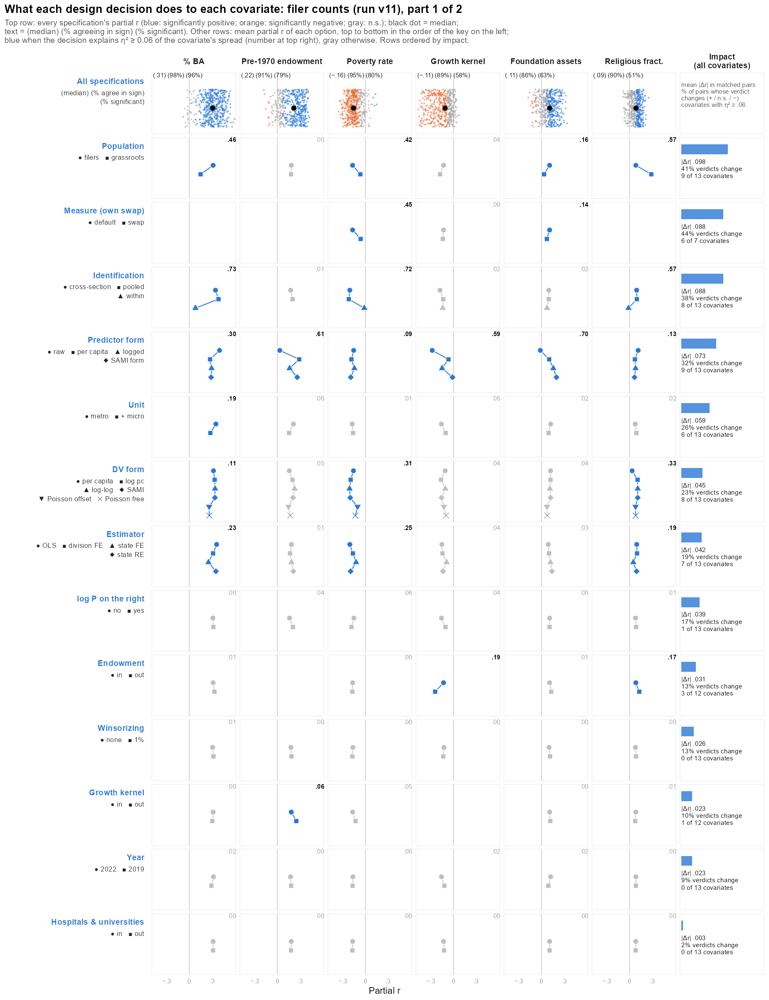
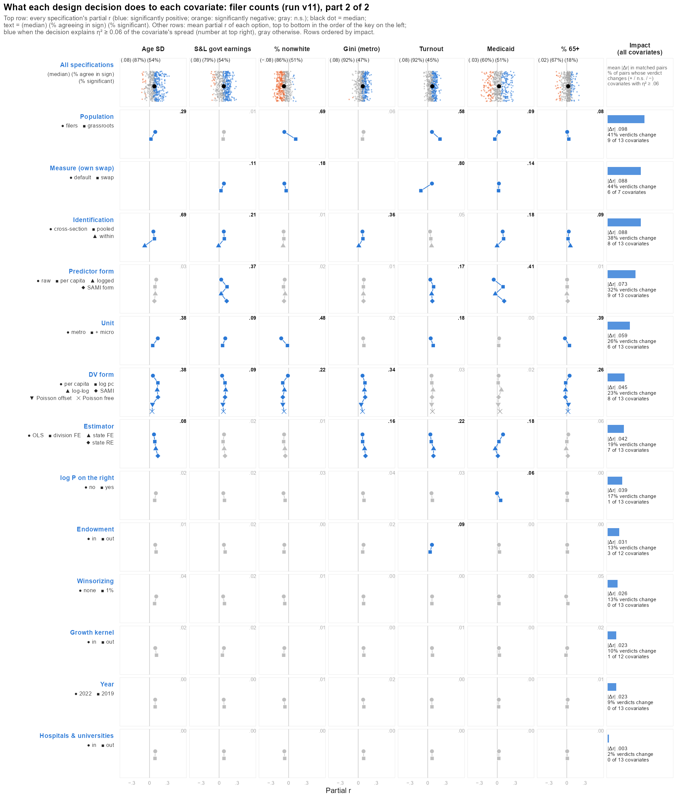
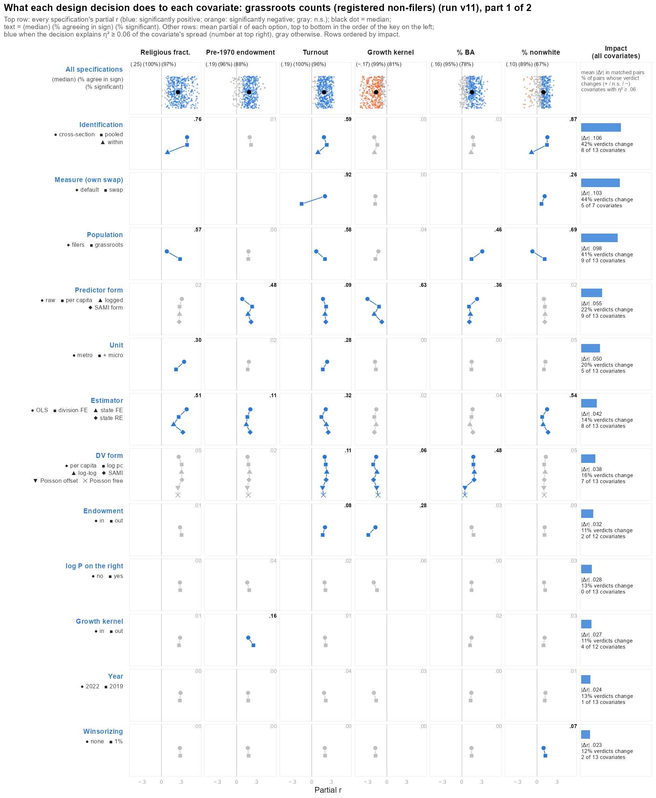
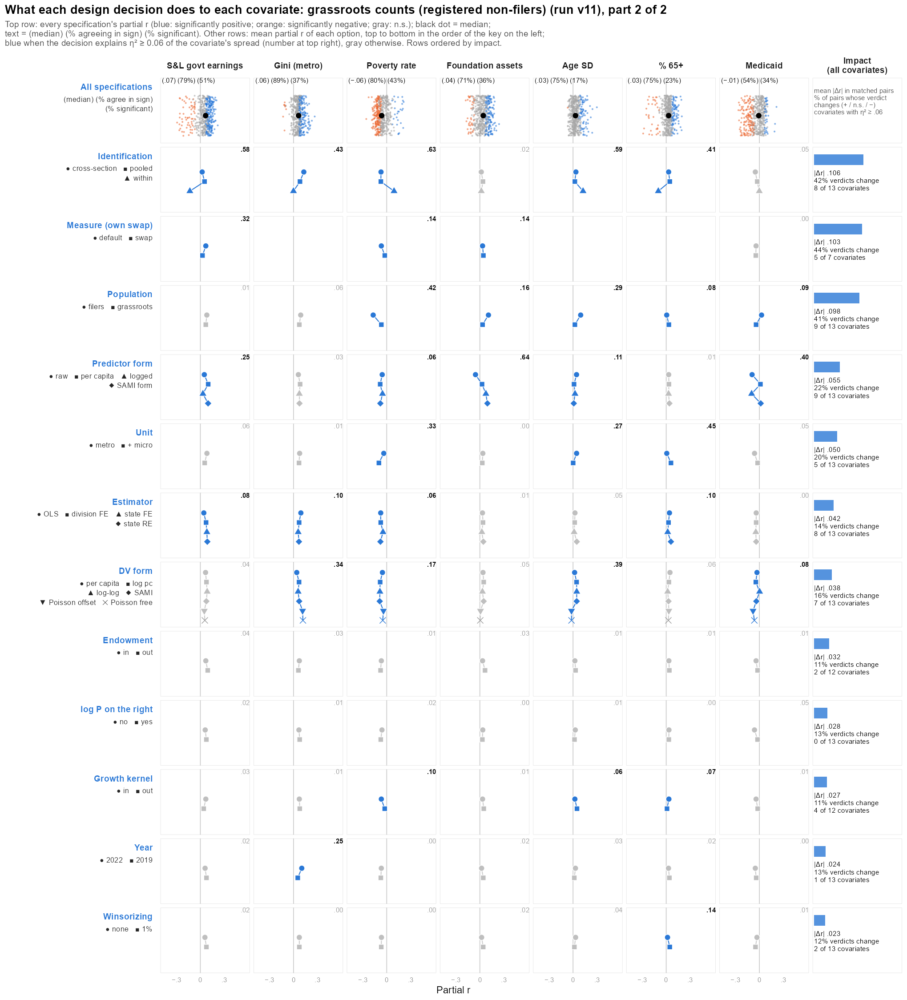
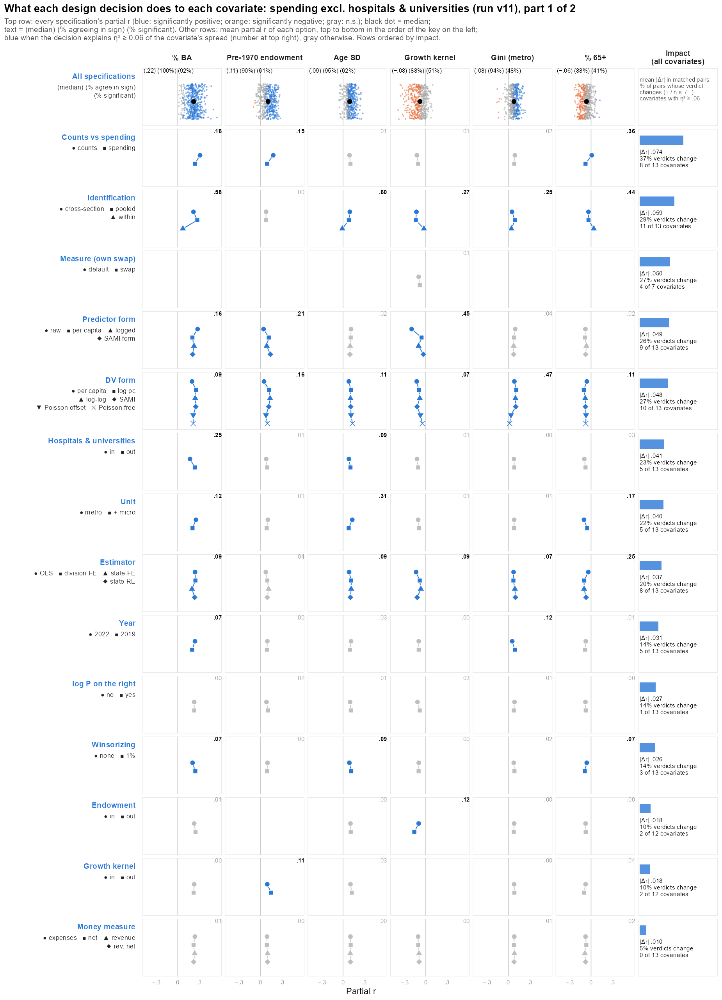
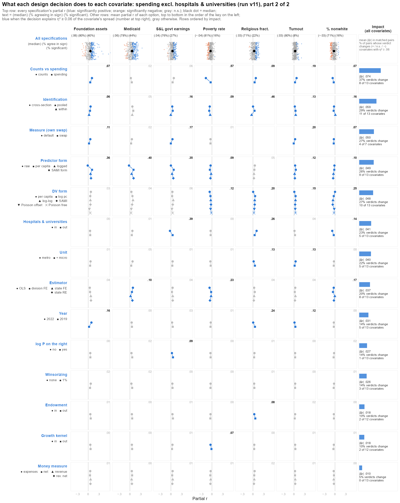

**Five findings.** All results are from run v11: 432,432 specifications of the 13-covariate model of `02-variables.qmd`, over 387 metros and 925 CBSAs, 2010–2022. The registered-stock specifications were also refit with grassroots (registered public charities that do not file above the floor) as the outcome. Every summary here reports filers, grassroots and spending separately. The two count populations disagree on several covariates (D1), so a "counts" summary that pools them averages opposite answers.

1. **Four decisions change conclusions; the forks most papers check do not.**
   - Changing only the outcome population (filers vs. grassroots), the identification, the measure of a construct or the predictor form changes 22–44% of covariate verdicts.
   - The population is the largest decision for filers (41%); identification is the largest for grassroots (42%).
   - Year, winsorizing, log P on the right and the money measure each change 5–17% (@tbl-impact).
2. **A few covariates are robust within each population, and they are not the same ones.** % BA is positive in every filer and spending cross-section and significant in 99–100% of them. For grassroots, religious fractionalization and turnout are positive in every cross-section and significant in 98–100%. The pre-1970 endowment is positive for all three populations (90–96%) (@tbl-stability).
3. **Which covariates enter the model is itself a decision, and one of the largest.** Moving from the six-covariate to the 13-covariate default has three effects for filers (@tbl-v10-v11):
   - Poverty becomes clearly negative (−.02 → −.17; significant in 89% of specifications).
   - Foundation assets lose almost half their strength and turnout more than half.
   - The interactions that looked stable before dissolve.
4. **Following every card at once sharpens the answer.**
   - **Filers:** % nonwhite (−.17) and poverty (−.23) become clear findings; Medicaid (.13) and age SD (.15) emerge.
   - **Grassroots:** religious fractionalization (.36) and turnout (.25) are significant in every recommended specification.
   - **Spending:** Medicaid (.17) and age SD (.15) join % BA and the endowment (@tbl-naive).
5. **Filers, grassroots and spending answer different questions.**
   - Filer density follows education, need and institutional history: % BA .32, poverty −.17, endowment .21.
   - Grassroots density follows civic and religious structure and recent growth: religious fractionalization .28, turnout .20, growth kernel −.16.
   - % nonwhite is negative for filers (−.07) and positive for grassroots (+.11).
   - Spending shares the filers' education and endowment terms, more weakly.

# Decision importance {#sec-importance}

Each decision's impact, aggregated over the 13 covariates:

- **Mean |Δr|** is how far a covariate's partial r moves when only that decision changes. It is averaged over matched pairs of specifications that differ in nothing else, then over covariates.
- **Verdicts changed** is the share of those pairs in which the covariate's verdict differs (significantly positive, not significant, significantly negative).
- **Covariates** counts the covariates for which the decision explains η² ≥ .06 of the spread. With 10⁴–10⁵ specifications every F test is significant, so η² rather than a p-value is the screen.

| Decision | Type | Filers: mean \|Δr\| / verdicts changed / covariates | Grassroots | Spending |
|---|---|---|---|---|
| Identification (D3) | Estimand | .088 / 38% / 8 of 13 | .106 / 42% / 8 of 13 | .059 / 29% / 11 of 13 |
| Measure, own swap (D7) | Discretion | .088 / 44% / 6 of 7 | .103 / 44% / 5 of 7 | .050 / 27% / 4 of 7 |
| Population (D1: filers vs. grassroots; for spending, counts vs. spending) | Estimand | .098 / 41% / 9 of 13 | .098 / 41% / 9 of 13 | .074 / 37% / 8 of 13 |
| Predictor form (D6) | Avoidable error | .073 / 32% / 9 of 13 | .055 / 22% / 9 of 13 | .049 / 26% / 9 of 13 |
| Unit (D2) | Estimand | .059 / 26% / 6 of 13 | .050 / 20% / 5 of 13 | .040 / 22% / 5 of 13 |
| DV form (D4, D5) | Avoidable error | .045 / 23% / 8 of 13 | .038 / 16% / 7 of 13 | .048 / 27% / 10 of 13 |
| Estimator (D9) | Discretion | .042 / 19% / 7 of 13 | .042 / 14% / 8 of 13 | .037 / 20% / 8 of 13 |
| log P on the right (D6) | Avoidable error | .039 / 17% / 1 of 13 | .028 / 13% / 0 of 13 | .027 / 14% / 1 of 13 |
| Endowment in or out (D8) | Estimand | .031 / 13% / 3 of 12 | .032 / 11% / 2 of 12 | .018 / 10% / 2 of 12 |
| Winsorizing | Discretion | .026 / 13% / 0 of 13 | .023 / 12% / 2 of 13 | .026 / 14% / 3 of 13 |
| Growth kernel in or out (D8) | Estimand | .023 / 10% / 1 of 12 | .027 / 11% / 4 of 12 | .018 / 10% / 2 of 12 |
| Year (2022 vs. 2019) | Discretion | .023 / 9% / 0 of 13 | .024 / 13% / 1 of 13 | .031 / 14% / 5 of 13 |
| Hospitals and universities (D10) | Discretion | .003 / 2% / 0 of 13 | | .041 / 23% / 5 of 13 |
| Money measure (D10) | Discretion | | | .010 / 5% / 0 of 13 |

: Impact of each decision on the 13 covariates, run v11, by outcome population. Grassroots: every registered-stock specification refit with registered non-filers as the outcome (39,312 specifications); the population row compares filers and grassroots in matched pairs, so it is the same for both. Spending excludes hospitals and universities. {#tbl-impact}

- **The estimand choices dominate.** Population, identification and unit change what the question is, and they change 20–42% of verdicts in the count populations. They should be argued from theory, never averaged.
- **Grassroots are more sensitive to identification and measurement, less to predictor form.** Their strongest covariates, religious fractionalization and turnout, are rates, so the form in which totals enter matters less (22% of verdicts against 32% for filers). Their cross-section signs reverse within metros (D3), and swapping census mail response for turnout changes the turnout result outright (η² .92).
- **The robustness checks papers usually report are the small ones.** Year, winsorizing, log P on the right and the money measure each move the average covariate by .04 or less. The hospital and university exclusion matters only for spending (23% of verdicts against 2% for filers).

## The decision matrix

@fig-matrix-filers-1 to @fig-matrix-spending-2 show every decision for every covariate, one pair of figures per population.

- **Top row:** every specification's partial r (blue: significantly positive; orange: significantly negative; gray: not significant), with (median) (% agreeing in sign) (% significant).
- **Each decision row:** the mean partial r of each option, top to bottom in the order of the key on the left. It is blue where the decision explains η² ≥ .06 of that covariate's spread (the number at top right).
- **The Impact column** repeats @tbl-impact and is the same on both pages of a population.

Option means pool strata while η² is computed within them, so a decision can matter (high η²) even when its pooled means sit close together.

{#fig-matrix-filers-1}

{#fig-matrix-filers-2}

{#fig-matrix-grassroots-1}

{#fig-matrix-grassroots-2}

{#fig-matrix-spending-1}

{#fig-matrix-spending-2}

**Reading across the matrix.**

- No covariate is moved by every decision, and no decision moves every covariate.
- **Predictor form governs the totals in both count populations:** foundation assets (η² .70 for filers, .64 for grassroots), the endowment (.61, .48), the growth kernel (.59, .63) and Medicaid (.41, .40).
- **Population governs** % nonwhite (.69), turnout (.58), religious fractionalization (.57) and % BA (.46): the terms whose size or sign differs between filers and grassroots.
- **Identification governs** % BA (.73), poverty (.72) and age SD (.69) for filers. For grassroots it governs % nonwhite (.87), religious fractionalization (.76) and poverty (.63), the terms that reverse sign within metros.
- **The estimator matters mainly for grassroots,** where its terms are state-patterned: % nonwhite (.54), religious fractionalization (.51) and turnout (.32).

# How stable is each covariate? {#sec-stability}

| Covariate | Filers: median r / % agree / % sig (robust, state) | Within | Grassroots: median r / % agree / % sig | Within | Spending: median r / % agree / % sig | Within |
|---|---|---|---|---|---|---|
| % BA | .32 / 100% / 100%, 100% | .08 | .15 / 94% / 78%, 74% | .14 | .24 / 100% / 99%, 98% | .06 |
| Pre-1970 endowment | .21 / 91% / 77%, 76% | — | .19 / 96% / 87%, 87% | — | .10 / 90% / 59%, 59% | — |
| Poverty rate | −.17 / 98% / 86%, 84% | −.02 | −.07 / 88% / 45%, 41% | .08 | −.03 / 77% / 16%, 14% | −.05 |
| Foundation assets | .11 / 86% / 65%, 63% | .07 | .05 / 69% / 38%, 36% | .01 | .06 / 82% / 39%, 36% | .03 |
| Growth kernel | −.11 / 90% / 57%, 54% | −.15 | −.16 / 99% / 82%, 77% | −.19 | −.10 / 91% / 59%, 56% | −.02 |
| Religious fractionalization | .09 / 94% / 55%, 44% | −.02 | .28 / 100% / 100%, 100% | .10 | .04 / 80% / 25%, 25% | −.03 |
| S&L govt earnings | .09 / 82% / 56%, 53% | −.01 | .07 / 85% / 48%, 41% | −.13 | .05 / 78% / 32%, 29% | .01 |
| Age SD | .09 / 92% / 55%, 49% | −.08 | .03 / 71% / 12%, 8% | .13 | .10 / 98% / 67%, 67% | −.01 |
| Gini (metro) | .08 / 94% / 51%, 42% | .02 | .07 / 94% / 41%, 39% | .00 | .08 / 91% / 49%, 40% | .04 |
| Turnout | .08 / 93% / 48%, 41% | .07 | .20 / 100% / 98%, 96% | .10 | .02 / 73% / 8%, 7% | .05 |
| % nonwhite | −.07 / 83% / 49%, 46% | −.10 | .11 / 98% / 72%, 64% | −.08 | −.04 / 76% / 19%, 20% | .00 |
| Medicaid | .03 / 59% / 53%, 51% | −.01 | −.02 / 57% / 34%, 31% | −.01 | .05 / 74% / 43%, 39% | .08 |
| % 65+ | .02 / 67% / 20%, 11% | .05 | .03 / 81% / 20%, 8% | −.12 | −.07 / 93% / 43%, 44% | .04 |

: Each covariate across all cross-section specifications of run v11 in which it appears, every covariate set included, by outcome population; within-metro medians in their own columns. % agree: share with the median's sign; % sig: share significant at p < .05 with robust and with state-clustered SEs. Rows ordered by the filer median. {#tbl-stability}

- **Robust in sign and size:** % BA for filers and spending, the endowment for all three, and religious fractionalization and turnout for grassroots. They survive every decision except within-metro identification, where the endowment drops out and the others shrink.
- **The populations need different models.**
  - Poverty is a filer covariate (−.17; significant in 86%), not a grassroots one (−.07, 45%).
  - Religious fractionalization and turnout are grassroots covariates (.28 and .20) much more than filer covariates (.09 and .08).
  - % nonwhite has opposite signs (−.07 and +.11), each with 83–98% sign agreement.
  - Pooling the two had put % nonwhite and Medicaid near zero.
- **Within metros, grassroots keep more signal and reverse more signs.** Within metros their % BA holds (.14), and their growth kernel is the strongest term (−.19). Poverty, % nonwhite, S&L earnings, % 65+ and age SD change sign (D3, Evidence 1).
- **Spending is weaker than filer counts** for every term except age SD, Medicaid and % 65+. A few large organizations dominate spending, and the covariates explain less of it (R² .45 against .79 for filers in the single model).

# What changed from the six-covariate model {#sec-change}

| Covariate | Filers, cross-section: v10 → v11 median r (% sig) | Spending, cross-section: v10 → v11 median r (% sig) |
|---|---|---|
| % BA | .33 → .31 (100% → 100%) | .25 → .23 (100% → 99%) |
| Foundation assets | .19 → .11 (82% → 65%) | .13 → .06 (70% → 38%) |
| Turnout | .16 → .07 (74% → 41%) | .07 → .02 (37% → 4%) |
| Poverty rate | −.02 → −.17 (20% → 89%) | .07 → −.03 (40% → 13%) |
| % nonwhite | −.08 → −.06 (55% → 47%) | −.03 → −.04 (27% → 18%) |
| S&L govt earnings | .10 → .09 (77% → 55%) | .08 → .05 (55% → 29%) |

: The six original covariates in run v10 (six-covariate default) and run v11 (13-covariate default), default-model cross-section specifications. Grassroots were not an outcome in v10. {#tbl-v10-v11}

- **Poverty moves most.** For filers it goes from no effect to a clear negative one (significant in 89% of specifications). The reversal with metro size that the six-covariate model showed disappears (D2, Evidence 6). The reversal was an omitted-variable pattern: poverty correlates .34 with Medicaid and .36 with the Gini.
- **Foundation assets and turnout lose about half their strength.** The endowment, Medicaid and the heterogeneity terms share what foundation assets carried. Turnout's association with filers moves to religious fractionalization and the other civic terms; it remains a grassroots covariate (.20).
- **% BA barely moves.** It is the one benchmark whose result does not depend on what else is in the model.
- **Interactions.** The four interactions that looked stable with six covariates keep their sign in only 62–76% of specifications with 13 (D6, Evidence 5).

The lesson for practice: covariate selection belongs in the multiverse's account of what drives results, next to identification and measurement. A paper that reports its covariates as fixed hides a choice as consequential as any fork in @tbl-impact.

# Following every card at once {#sec-naive}

The **naive** answer is the median over every default-model specification of a population: what the multiverse says if no decision is taken seriously.

The **recommended** answer follows every card at once (42 specifications for each population):

- cross-section and metro;
- expenses excluding hospitals and universities for spending;
- a log-log or SAMI outcome;
- SAMI-form predictors, or logged predictors with log P on the right;
- OLS, division FE or state FE.

| Covariate | Filers: naive → recommended (% sig) | Grassroots | Spending |
|---|---|---|---|
| Pre-1970 endowment | .21 → .34 (100%) | .19 → .21 (98%) | .10 → .19 (100%) |
| % BA | .30 → .33 (100%) | .16 → .14 (88%) | .22 → .27 (100%) |
| Foundation assets | .11 → .25 (100%) | .04 → .13 (86%) | .06 → .10 (43%) |
| Poverty rate | −.16 → −.23 (98%) | −.06 → −.06 (5%) | −.04 → −.02 (0%) |
| S&L govt earnings | .08 → .17 (100%) | .06 → .13 (76%) | .04 → .11 (50%) |
| % nonwhite | −.07 → −.17 (90%) | .11 → .12 (64%) | −.03 → −.08 (7%) |
| Age SD | .08 → .15 (90%) | .03 → .06 (0%) | .09 → .15 (100%) |
| Medicaid | .03 → .13 (64%) | −.01 → .01 (2%) | .06 → .17 (98%) |
| Religious fractionalization | .09 → .10 (52%) | .25 → .36 (100%) | .03 → .00 (0%) |
| Gini (metro) | .08 → .09 (38%) | .07 → .06 (21%) | .08 → .08 (21%) |
| Growth kernel | −.10 → −.05 (14%) | −.16 → −.10 (45%) | −.08 → .03 (2%) |
| % 65+ | .02 → −.04 (10%) | .03 → .00 (0%) | −.06 → −.13 (62%) |
| Turnout | .08 → .03 (0%) | .20 → .25 (100%) | .03 → .02 (0%) |

: Naive and recommended medians by population, run v11. Naive: every default-model specification of the population, all identifications (1,540 for each count population, 6,160 for spending across four money measures); recommended: 42 specifications each. Rows ordered by the filers' recommended median. {#tbl-naive}

- **The totals gain most.** Foundation assets (.11 → .25 for filers, .04 → .13 for grassroots), the endowment, S&L earnings and Medicaid all strengthen once raw and unadjusted forms are set aside. Each weak option pulled them down, and removing them together removes the pull.
- **Filers:** % nonwhite (−.17, significant in 90%) and poverty (−.23, 98%) become findings. Turnout is .03 and never significant.
- **Grassroots:** religious fractionalization (.36) and turnout (.25) are significant in every recommended specification, and the endowment in 98%. Poverty, age SD and Medicaid are not grassroots covariates.
- **The growth kernel fades in the cross-section** (−.05 for filers, −.10 for grassroots). With the endowment in the model, the two split one Sunbelt fact in levels (D8); within metros the growth kernel remains the main term.
- **For spending, fewer things survive.** % BA, the endowment, Medicaid and age SD are significant in at least 98% of recommended specifications; poverty, % nonwhite and turnout are not.

# Sensitivity analyses: reported, not forked {#sec-sensitivity}

| Check | What was re-fit | Largest effect | Treatment |
|---|---|---|---|
| Dropping outlying cases (DC, Alaska and Hawaii, size extremes) | 1,470 default-model specs, 13 covariates | Median \|Δr\| ≤ .013; less than winsorizing (.016) | One robustness sentence (D2, Evidence 5) |
| Covariate-outlier trim (\|z\| > 4) | Same | Drops Utah and retirement metros; moves % 65+ (.07, sign flips in 24% of filer pairs) and age SD (.05) | Report the age terms with and without them (D2) |
| City size (under vs. over 250k; quadratic size term) | Single model and 1,212 default specs per outcome | Poverty for filers weakens in large metros but stays negative (no reversal) | Note (D2, Evidence 6) |
| Interactions and squares | 104 terms; 108 / 72-spec mini-multiverse | 10 (counts) and 4 (spending) survive BH; out-of-sample error rises | Robustness paragraph (D6, Evidence 5) |
| Religion-related and mutual-benefit filers dropped | 2,000 matched 2022 specs | Partial r correlates .997 (counts), .991 (spending) | One sentence (D11) |
| Market concentration (HHI, CR4, normalized HHI) | 13-covariate model + one measure | Partly the outcome; on grassroots −.15 to −.21 cross-section, ~0 within; ΔR² ≤ .015 | Excluded; one extension (`02-variables.qmd`) |
| Spending correction (e-file NTEE codes, 2020–24) | 13-covariate model | Spending partial r move ≤ .04 | One sentence (D10) |
| 2018 tax law | 34,914 contribution specs, 13 covariates | Other covariates ≤ .023; contribution terms +.05 in count cross-sections (+.03–.04 with six covariates) | Note (Fact 7, Evidence 6b) |
| Revenue floor (\$50k real vs. none) | 93 default-model 2022 specs, 13 covariates | Median \|Δr\| .018 (largest .087); no term's median moves more than .04 | One sentence (Fact 7, Evidence 1) |
| Multi-state metros dropped | 93 default-model 2022 specs per outcome, 13 covariates | Median \|Δr\| .009–.015; state-FE endowment for filers .18 → .25; endowment for spending about halves under every estimator | Report the endowment both ways (D9, Evidence 5) |

: Sensitivity analyses. {#tbl-sensitivity}

None of these is a fork. Each is smaller than winsorizing, which is itself a fork that changes 13% of verdicts, or confined to one term whose behavior the paper can state directly.

# Scope and open gaps {#sec-gaps}

- **Grassroots in the multiverse.** The grid's count outcomes are filers and the registered stock. Grassroots enter as a refit: every registered-stock specification run again with registered non-filers as the outcome. Not every grassroots-specific fork is covered, for example a grassroots series without hospitals and universities.
- **Disasters.** Whether the risers' pattern (New Orleans, Gulfport, Santa Rosa, Chico, Redding) reflects disaster recovery is still a hypothesis.
- **Not testable with these data:** hospital ownership and state contracting (AHA survey, CMS Provider of Services, Medicaid) behind the regional gap (Fact 5, Evidence 7). Nothing in the paper is causal.
- **Not run, by design:** commuting zones, government grants received by nonprofits (Form 990 line 1e, absent from the IRS extracts for 2011–2019), crime, the Elazar typology, alternative population bases, price adjustment, population weights, all block subsets (leave-one-block-out was run) and the kitchen-sink universe (built, not run).

*Sources: run v11 (`D:/MULTIVERSE/data/spec/run_principled_v11/`); `R/notes/104_fit_grassroots_v11.R` (grassroots refit, `run_principled_v11_grass/`); `R/multiverse/97_v11_decision_summary.R` with `MV_SPLIT=1` (`D:/MULTIVERSE/data/outline/v11/mv_split/`: `decision_importance.csv`, `stability.csv`, `v10_v11_benchmarks.csv`, `naive_vs_recommended.csv`); `R/multiverse/98_decision_matrix.R` with `MV_SPLIT=1` (`v11/matrix_split/`); sensitivity: `R/notes/83_sample_exclusions.R`, `R/notes/90_size_moderation_screen.R` and `R/notes/56_drop_religion_mutual.R` with `MV_MODEL=lean`, `R/paper/99_interaction_screen_v11.R`, `R/paper/95_compete_niche.R`, `R/notes/84_tcja_contrib.R` and `R/notes/86_sensitivity_tcja_size.R` part A with `MV_MODEL=lean`, `R/notes/101_lean_open_checks.R` (revenue floor, multi-state metros, 2000–2022 within window).*

# References {.unnumbered}

::: {#refs}
:::
