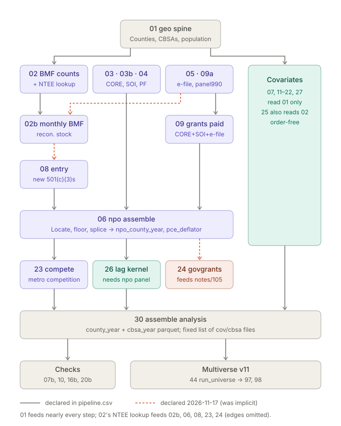

# What the database measures

The database measures **nonprofit density**: the number and size of charitable
nonprofits in a place, relative to what its population would predict. Density
differs widely across US communities, and the reasons are much debated: unmet demand
for public goods, the supply of resources and civic capacity, and the role of
government [@lecy2013nonprofit]. To test those explanations side by side, the
database puts every 501(c)(3) public charity in the United States into a county and
year, and joins it to about 300 covariates describing each place's economy, demography,
government, politics and civic life.

Two features drive the design:

- **Many sources, one geography.** Nonprofit counts come from IRS registration files
  and three generations of financial-return data. Covariates come from about 20 federal
  and academic sources. Everything is placed on one fixed county geography and then
  aggregated to metropolitan areas.
- **Population sets the expected level.** Larger places have more nonprofits almost
  exactly in proportion to population, but not more spending [@bettencourt2007growth].
  The analysis therefore compares places with their size-expected level
  (scale-adjusted metropolitan indicators, SAMIs) [@bettencourt2010urban]. The
  database stores the counts and totals the SAMIs are computed from.

# Units and coverage

| | Counties | Core-based statistical areas (CBSAs) |
|---|---|---|
| Units | 3,144 county-equivalents | 925: 387 metropolitan, 538 micropolitan |
| Geography | 2023 Census delineation, Connecticut planning regions [@data_census_tiger] | OMB 2023 delineation, fixed for all years [@data_omb_cbsa] |
| Years | 2000–2024, annual | 2000–2024, annual |
| Table | `county_year.parquet` (78,600 rows, 354 columns) | `cbsa_year.parquet` (23,125 rows, 422 columns) |

Every source is first placed on county-equivalents. The CBSA table sums counts and
dollar totals over a CBSA's counties, then recomputes rates and shares with the same
formulas. Some measures exist only for metros (BLS nonprofit employment, market
competition, the metro Gini, the pre-1970 endowment, population-lag kernels), which
is why the CBSA table has 68 more columns. Choosing metros only or all CBSAs is a
filter on `cbsa_year`, not a separate table.

# The nonprofit outcomes

Four outcome populations come from the same organizations:

- **Filers:** 501(c)(3) public charities that file a Form 990 or 990-EZ above an
  inflation-adjusted activity floor. Annual counts come from three generations of
  return data, spliced together:
  - NCCS CORE files for 2000–2010 [@data_nccs_core];
  - IRS Statistics of Income exempt-organization extracts for 2011–2019
    [@data_irs_soi_eo];
  - NCCS e-file data for 2020–2024 [@data_nccs_efile].
- **Registered stock:** every public charity on the IRS Business Master File in a given
  year, from the NCCS legacy snapshots for 2000–2022 and the monthly BMF for 2023–2024
  [@data_nccs_bmf_legacy; @data_nccs_bmf_monthly].
- **Grassroots:** registered charities that do not file above the floor (registered
  stock minus filers). They are 72–80% of the registered stock.
- **Spending:** total expenses of filers, in 2022 dollars, deflated with the PCE price
  index [@data_bea_pcepi].

Each organization is located with the geocoded unified BMF [@data_nccs_bmf_unified].
Its subsector comes from its NTEE code. Invalid codes (`UND`, `INV`, `Z99`) are
replaced once, from each organization's latest valid code, and that one rule is
applied in every step that uses subsectors.

# The covariates

| Family | Examples | Sources |
|---|---|---|
| Population and demography | population 2000–2025, growth since 1970, age, race and ethnicity | @data_census_popest; @data_census_hist; @data_census_pep_char |
| Economy | income, earnings, GDP, transfers, unemployment, poverty, wages | @data_bea_regional; @data_ers_laus; @data_census_saipe; @data_bls_qcew |
| Nonprofit employment | nonprofit share of private employment (metros, 2013–2022) | @data_bls_nonprofits |
| Government | local government revenue and spending, public employment | @data_census_cog; @data_census_acs |
| Households | education, homeownership, inequality, commuting | @data_census_acs; @data_census_sf3 |
| Giving | itemized charitable contributions, AGI | @data_irs_soi_county |
| Civic life and politics | social capital index, congregations and adherents, presidential vote | @rupasingha2006production; @data_nercrd_socap; @data_rcms_2000_2010; @data_rcms_2020; @data_medsl_county; @data_mcgovern_elections |
| Innovation | patents per capita | @data_patentsview |

Part 2 lists every source with its years, licence and full citation, and every
variable in the final tables.

# How the build runs

{width=100%}

The build has 30 steps in five layers:

1. **Geography (step 01).** The county spine, CBSA crosswalk and annual population.
   Almost every later step reads it.
2. **Nonprofit sources (02–09, 24).**
   - BMF registrations (02, 02b, 08).
   - Financial returns: CORE (03), SOI (03b, 04), e-file (05).
   - Grants paid (09a, 09) and government grants (24).
   - Step 02 also writes the NTEE lookup that the later steps use.
3. **Nonprofit panel (06).** Filers, grassroots, registered stock and spending by
   county and year, plus market competition (23) and population-lag kernels (26).
4. **Covariates (07, 11–22, 25, 27).** Each reads only the geography, so their order
   does not matter.
5. **Assembly (30).** Merges everything into `county_year` and `cbsa_year`.

**Order dependencies.** Every file passed between steps is declared in
`pipeline.csv`. The runner refuses to start if a step would read a file that a later
step writes. Several dependencies used to be hidden and are now explicit:

- step 02b reads the BMF cache that step 05 fills;
- step 08 reads 02b's ruling cohorts;
- the NTEE lookup flows from 02 to 02b, 06, 08, 23 and 24.

Part 3 walks through running the build.

# Known breaks in the series

Three breaks matter for analysis:

- **Source splices.** CORE → SOI in 2011 and SOI → e-file in 2020 move spending SAMIs,
  but not counts. Filer counts for tax year 2020 are about 9% low.
- **Group exemptions.** A few metros (Memphis, Mankato) are inflated by
  group-exemption subordinates registered at one address.
- **Interpolated covariates.** Periodic sources are observed only in some years:
  - elections every 4 years;
  - the religion census every 10;
  - the social capital index 4 times;
  - the Census of Governments every 5.

  Each comes in `_obs`, `_lin` and `_locf` versions (Part 2).

Use year fixed effects in every panel model, and check any change across 2011 or 2020
against counts before reading it as real (Part 6, Fact 7).

# References {.unnumbered}

::: {#refs}
:::
